# LambdaQL 로드맵

## 0. 문서 정보

| 항목 | 내용 |
|---|---|
| 작성일 | 2026-11-09 |
| 기준 커밋 | `70c5c01` (메서드 체이닝 구조 추가, 2025-04-25) |
| 인계 노트 | 작업을 이어받을 때는 저장소 루트의 [`DEVNOTE.md`](../../DEVNOTE.md)부터 읽습니다(현재 상태, 환경, 확정 설계 요약, 다음 작업, 검증 재현 방법) |
| 대상 모듈 | `query` (Java 21, ASM 9.11.1 — 2026-11-09 9.7에서 상향(2.6절), Spring Boot 3.4 / Hibernate 테스트 환경) |
| 검증 DB | H2 2.3.230(인메모리), MariaDB 10.11.18(docker `mariadb`, 전용 스키마 `lql_verify`), Oracle AI Database 26ai Free 23.26.3(docker `lql-oracle`, 스키마 `LQL`), Hibernate ORM 6.6.5(`H2Dialect`/`MariaDBDialect`/`OracleDialect`) |
| 근거 자료 | lambdaql 소스 직접 확인, 전체 및 개별 테스트 실행 로그, ExTree/FluentJPA/Jinq 소스 정적 분석, ExTree 2.8.4 실측 probe(`/tmp/lql-probe`), 이전 로드맵 초안과 critic 보고서 |
| 상태 | 2.5절 결정 사항 확정(2026-11-09, D8 법무 확인 제외). 정렬 문법(D15)은 설계 중 |

**경로 약어** (모든 `file:line`은 각 저장소 루트 기준입니다)

| 약어 | 실제 경로 |
|---|---|
| `A/` | lambdaql `query/src/main/java/org/lambdaql/analyzer/` |
| `Q/` | lambdaql `query/src/main/java/org/lambdaql/query/` |
| `F/` | lambdaql `query/src/main/java/org/lambdaql/function/` |
| `LPV` | `A/LambdaPredicateVisitor.java` |
| `CSM` | `A/ComparisonStateManager.java` |
| `LVA` | `A/LambdaVariableAnalyzer.java` |
| `QBT` | lambdaql `query/src/test/java/org/lambdaql/query/QueryBuilderTest.java` |
| `ET/` | ExTree `src/main/java/co/streamx/fluent/extree/expression/` |
| `EMV` | `ET/ExpressionMethodVisitor.java` |
| `ECC` | `ET/ExpressionClassCracker.java` |
| `FJ/` | FluentJPA `src/main/java/co/streamx/fluent/JPA/` |
| `[A]` | Jinq `analysis/src/ch/epfl/labos/iu/orm/queryll2/` |
| `[T]` | Jinq `jinq-jpa-impl/src/main/java/org/jinq/jpa/transform/` |
| `[Q]` | Jinq `jinq-jpa-impl/src/main/java/org/jinq/jpa/jpqlquery/` |
| `[J]` | Jinq `jinq-jpa/main/org/jinq/jpa/` |

ExTree 라인 번호(`EMV`, `ECC`, `ET/`)는 모두 ASM판 2.8.4(master clone) 기준입니다. jre24 릴리스 jar는 소스가 다르므로 라인 번호가 맞지 않습니다(2.2절 유지보수 행).

**근거 표기**

- **[실측]**: 이번에 실제로 실행해 확인한 결과입니다. lambdaql Gradle 테스트이거나 ExTree probe입니다.
- **[추적]**: 코드를 손으로 따라가 얻은 결과이며, 실행하지 않았습니다.
- **[정적]**: 참고 라이브러리 소스를 정적으로 분석한 결과입니다.

---

## 1. 프로젝트 개요와 현재 상태

### 1.1 목표

사용자가 Serializable 람다를 쓰면 이를 JPQL(또는 SQL)로 바꾸는 LINQ류 라이브러리입니다.

```java
from(Order.class).where(o -> o.getId() == p1 || o.getDescription().equals(x))
```

동작 순서는 다음과 같습니다.

1. `writeReplace`로 `SerializedLambda`를 얻습니다.
2. impl 메서드(`lambda$xxx$N`)의 바이트코드를 ASM으로 해석해 조건 트리를 만듭니다.
3. 조건 트리를 JPQL로 렌더링하고, 캡처한 값은 바인드 파라미터로 넘깁니다.

현재는 1단계와 2단계 일부만 구현되어 있습니다.

### 1.2 코드 구조

| 패키지 / 파일 | 줄 수 | 역할 | 상태 |
|---|---|---|---|
| `A/LambdaWhereAnalyzer.java` | 69 | 진입점: writeReplace → `ClassReader` → visitor | 시스템 클래스로더 의존(`:29`). catch 블록이 원래 예외를 가림(`:34-65`, 1.4절) |
| `A/LambdaMethodVisitor.java` | 81 | ClassVisitor. impl 메서드를 이름으로만 선택(`:38`) | 매 분석마다 메타모델 전체를 출력(`:41-62`) |
| `LPV` | 828 | 핵심 MethodVisitor. 직접 만든 값 스택 `Deque<Object>`(`:29`)와 `exprStack`(`:30`) | 분기 재구성이 없음(2.3절) |
| `CSM` | 81 | 진행 중인 LCMP 비교 슬롯 1개와 마지막 jump opcode | 비교를 1개만 보관(`:13,19-22`) |
| `LVA` | 134 | 캡처 인자와 엔티티 파라미터를 로컬 슬롯에 매핑 | **정상 동작**(`:41-78`) |
| `A/MethodStack.java`, `A/MethodSignature.java` | 32 / 47 | 메서드 호출 노드, 리플렉션 해석 | `stacks`가 null(`MethodStack.java:15,28`). `getDeclaredMethod`라 상속 메서드에서 실패(`MethodSignature.java:22`) |
| `A/BinaryCondition`, `LogicalCondition`, `BinaryOperator` 등 | 3~40 | 조건 IR | 좌항이 문자열(`LPV:777`). `not()` 미사용. `BinaryOperator`는 package-private(`A/BinaryOperator.java:3`) |
| `A/ConstantValue`, `ConstantVariable`, `ColumnMethod`, `UnaryCondition`, `Condition`, `EntityExpression`, `ExecuteExpression`, `CapturedFieldAnalyzer` | | | 미사용(죽은 코드) |
| `F/JpqlFunction.java`, `F/FunctionDescriptor.java` | 169 / 16 | Method → JPQL 템플릿 레지스트리 | visitor와 연결되지 않음. 매핑 오류 있음(8.1절) |
| `Q/SelectQuery.java` 외 | 170 등 | 쿼리 API | `toSql`은 스텁(`:86-90`). select/join/orderBy는 `return this` |
| `jpa/*` | 4개 파일 | repository default 메서드 지원 시도 | 실제로 동작하지 않음(8.1절) |
| 테스트 `QBT`, `table.sql`, `application-test.yaml` | 320 / 14 / 46 | `@SpringBootTest` + H2 | 회귀 단언이 사실상 없음 |

### 1.3 진행 이력 (git log)

| 날짜 | 커밋 | 내용 |
|---|---|---|
| 2025-04-11 | `ef0ad23` | Initial commit |
| 2025-04-14~15 | `ce6c929`~`9a48fb4` | 코드 초기화, 테스트 추가 |
| 2025-04-15 | `894e392` | 람다 local var load 지원 |
| 2025-04-16 | `a5dd4b6` | LCMP 조건 처리(`ComparisonStateManager`의 시작) |
| 2025-04-17 | `f6353a6` | 컬럼 찾기 테스트 |
| 2025-04-18 | `5a7ad2a`, `1d5f14a` | 캡처 값과 람다 인수 구분, captured value table |
| 2025-04-19~21 | `35b0a0d`~`b9d2261` | 메서드 정보 타입화, 패키지 정리, 메서드 실행 로직(`MethodInvoke`) |
| 2025-04-22 | `df0dc0b` | 캡처 값과 람다 인수 구분 재작업 |
| 2025-04-24~25 | `80da556`~`70c5c01` | 메서드 분석, stack 누적, 메서드 체이닝 구조(`MethodStack.beforeStack`) |

작성자는 javac 출력(`javap`, ASM Textifier)을 opcode 하나하나 대조하며 visitor 분기를 추가해 왔습니다. 그 결과 다음 셋은 실측 패턴을 정확히 반영합니다.

- 캡처 슬롯 매핑(`LVA`)
- LCMP→IFxx→ICONST 극성 표(`CSM:56-68`)
- unboxing 판정 표(`LPV:805-818`)

반면 **분기(라벨) 정보를 버리는 구조**여서 다항 논리식에서 항이 사라집니다(2.3절).

### 1.4 측정된 테스트 상태 [실측]

실행 환경은 2026-11-09, OpenJDK 21.0.7(Homebrew), Gradle 8.10, `./gradlew :query:test`(전체 1회 + 테스트별 `--tests` 개별 실행)입니다.

> ASM을 9.7에서 9.11.1로 올린 뒤(M0 작업 0) 같은 방식으로 다시 실행했습니다. 테스트 13개의 개별 결과, 전체 실행 15/15 실패, `selectVarIndexTest`/`selectFrom2`/`selectFromBasicAnd`의 분기 트레이스(`captureComparison`, `registerBranch`)가 모두 상향 전과 같았습니다(`/tmp/lql/after/`). 아래 표는 상향 전 기준이지만 상향 후에도 그대로 유효합니다.

> **M0 적용 후(2026-11-09)**: `./gradlew clean build`가 **BUILD SUCCESSFUL**입니다. 테스트 15개 중 통과 5, `@Disabled`(사유 명시) 10, 실패 0입니다. 적용 직후 `@Disabled` 없이 실행한 결과(전체 1회)는 15건 중 11건 실패였고, "Table already exists"와 `Class not found`는 0건이었습니다. 드러난 실제 예외는 1.4.2절의 [추적] 원인과 모두 일치했습니다.
>
> | 테스트 | 실제 원인(M0 후 `LambdaAnalysisException`의 cause) |
> |---|---|
> | `selectVarIndexTest` | `ClassCastException: MethodStack → IOperand` (`LPV:233`) |
> | `selectFrom2`, `selectWhereMethodStack` | `NoSuchElementException` (`LPV:229`, 체이닝 receiver pop) |
> | `selectWhereStack` | `ClassCastException: Integer → IOperand` (`LPV:223`) |
> | `selectWhereStaticMethodStack` | `ClassCastException: String → IOperand` (`LPV:223`) |
> | `selectVarIndexTest1` | `UnsupportedOperationException: Unsupported jump opcode: 166`(IF_ACMPNE, `LPV:644`) |
> | `selectNewObjectStack` | `NoSuchMethodException: Order.<init>()` (`MethodSignature.java:26`) |
> | `selectNewWhereStack` | `NoSuchMethodException: QueryBuilderTest$1.writeReplace()` → `assertThrows` 테스트로 전환(익명 클래스 거부가 설계상 기대 동작) |
> | `selectFromBasic`, `selectFromBasicAnd` | `toString`/SQL 렌더링 미구현(M5) |
> | `update` | Jinq 2.0.2 제약(캡처 엔티티 접근 거부) |

#### 1.4.1 전체 실행: 15/15 실패

| 구분 | 개수 | 원인 |
|---|---|---|
| 첫 테스트(`selectWhereMethodStack`) | 1 | 분석기 예외. `RuntimeException: java.io.IOException: Class not found`이며, 실제 원인은 가려져 있습니다(아래 참고) |
| 나머지 14개 | 14 | `JdbcSQLSyntaxErrorException: Table "CUSTOMERS" already exists` |

14개가 실패하는 이유는 다음과 같습니다.

- `@BeforeEach setUp()`(`QBT:45-55`)이 테스트마다 `table.sql`의 `CREATE TABLE`을 실행합니다.
- 그런데 Spring 컨텍스트와 H2 DB는 테스트 사이에 공유됩니다.
- 그래서 두 번째 테스트부터 모두 실패합니다. 테스트 결과는 실행 순서에 좌우되며, **분석기 결함과는 무관합니다**.

#### 1.4.2 개별 실행 결과 (`--tests ...QueryBuilderTest.<name>`)

| 테스트 | 결과 | 표면 예외 | 실패 직전 visitor 이벤트(로그) | 실제 원인 |
|---|---|---|---|---|
| `selectFromBasic` | FAIL | `AssertionFailedError: expected <SELECT * FROM orders> but was <SelectQuery@…>` | LCMP → IFNE → ICONST_1/0 → IRETURN (정상) | `SelectQuery`에 `toString`이 없고 `toSql`은 스텁(`Q/SelectQuery.java:86-90`) [실측] |
| `selectFromBasicAnd` | FAIL | 위와 같음 | `captureComparison`이 2회 실행되어 두 번째가 첫 번째를 덮어씀 | 위와 같음. 분석 결과도 `id <= 1`만 남음(`CSM:19-22`) [실측+추적] |
| `selectVarIndexTest1` | FAIL (`QBT:114`) | `Class not found` | 첫 람다: ARRAYLENGTH가 무시되고 `✅ 비교 조건 추가됨: MethodStack@… <> ObjectCapturedVariable[int[]]`. 두 번째 람다: `IF_ACMPNE` | 첫 람다는 **배열 길이를 잃고 극성이 뒤집힌 `<>`** 를 만듦 [실측]. 두 번째는 `IF_ACMPNE`가 `default` 분기로 가서 `UnsupportedOperationException`(`LPV:643-645`) [추적] |
| `selectVarIndexTest` | FAIL (`QBT:144`) | `Class not found` | `getDescription` → ALOAD param5 → `String.equals` | receiver가 `MethodStack`이라 `(IOperand)` 캐스트에서 CCE(`LPV:233`) [추적] |
| `selectFrom2` | FAIL (`QBT:194`, where4) | `Class not found` | `getCustomer` → `getId` | `beforeStack`이 receiver를 먼저 꺼내므로(`LPV:212-215`) instance pop이 빈 deque에서 NoSuchElement(`LPV:229`) [추적]. where1~3은 **예외 없이 손실된 결과** [실측, 2.4절] |
| `selectWhereStack` | FAIL (`QBT:216`) | `Class not found` | ICONST_2 → raw `Integer 2` push → `items(II)Z` | `Integer`를 `(IOperand)`로 캐스트하다 CCE(`LPV:223`) [추적] |
| `selectNewObjectStack` | FAIL (`QBT:231`) | `Class not found` | DUP(no-op) → `Order.<init>` | NEW가 처리되지 않고(`visitTypeInsn` 미override), `MethodSignature.parse`가 `getDeclaredMethod("<init>")`에서 실패(`MethodSignature.java:22-26`) [추적] |
| `selectWhereMethodStack` | FAIL (`QBT:244`) | `Class not found` | `getDescription` → `trim` | `selectFrom2`와 같은 `beforeStack` 문제(`LPV:212-229`) [추적] |
| `selectWhereStaticMethodStack` | FAIL (`QBT:270`) | `Class not found` | LDC "aaa", LDC "aa%" → `JpqlFunction.like` | raw `String`을 `(IOperand)`로 캐스트하다 CCE(`LPV:223`) [추적] |
| `selectNewWhereStack` | FAIL (`QBT:282`) | `UnsupportedOperationException: Lambda parsing failed` | `NoSuchMethodException: QueryBuilderTest$1.writeReplace()` | 익명 클래스라 `writeReplace`가 없음(`A/LambdaWhereAnalyzer.java:24,65`). 설계상 예상된 거부 [실측] |
| `update` | FAIL | `IllegalArgumentException: Cannot access fields and members of complex query parameters…` | (Jinq 경로) | **Jinq의 제약**입니다. 캡처한 엔티티 `customer.getId()`를 거부합니다(`[T]SymbExToColumns.java:371-379`) [실측] |
| `selectFromDate` | PASS | – | `o.getId()==10` | 단언 없음 |
| `selectWhereThisMethodStack` | PASS | – | `this.bool()` 다음 바로 IRETURN | 조건이 생성되지 않음(null). `JpqlFunction::isNull`은 **참조 대상 메서드 본문**을 람다처럼 해석함(IFNONNULL no-op). 단언 없음 [실측] |
| `delete`, `insert` | PASS | – | – | 본문이 비어 있음 |

개별 실행 결과는 **PASS 4 / FAIL 11**입니다. PASS 4개는 모두 단언이 없습니다.

#### 1.4.3 원인 표

| 원인 | 영향 테스트 | 관련 위치 | 해결 마일스톤 |
|---|---|---|---|
| 테스트 DDL 중복 실행(`Table already exists`) | 전체 실행 시 14개 | `QBT:45-55`, `table.sql`, `application-test.yaml:7`(`ddl-auto: none`) | M0 |
| **catch 블록이 원래 예외를 가림.** fallback `new ClassReader(hidden class 이름)`이 `:39`에서 `IOException`을 던지고, `:61`에서 `RuntimeException`으로 감싸 즉시 던집니다. 그래서 `:63`의 `e.printStackTrace()`에 **도달하지 못합니다** | 7개(`Class not found`) | `A/LambdaWhereAnalyzer.java:34-65` | M0(첫 커밋) |
| `MethodStack.beforeStack` receiver pop 버그 | `selectFrom2`, `selectWhereMethodStack` | `LPV:210-242` | M2 |
| raw 상수와 `MethodStack`을 `(IOperand)`로 캐스트 | `selectVarIndexTest`, `selectWhereStack`, `selectWhereStaticMethodStack` | `LPV:223,233` | M2 |
| NEW, `<init>` 미처리 | `selectNewObjectStack` | `visitTypeInsn` 미override, `MethodSignature.java:22` | M2 |
| IF_ACMPNE, IFNULL 미지원(예외) / IF_ACMPEQ, IFNONNULL, GOTO no-op | `selectVarIndexTest1` | `LPV:632-645` | M3 |
| 다항 논리식 손실(비교 1개만 보관), IF_ICMP 극성 미반전 | 예외는 없지만 결과가 틀림(`selectFrom2` where1~3, `selectFromBasicAnd`, `selectVarIndexTest1`) | `CSM:19-22`, `LPV:594-619,707-721` | M3 |
| 렌더러 없음 | `selectFromBasic`, `selectFromBasicAnd` | `Q/SelectQuery.java:86-90`, `A/Renderer.java:4-6` | M5 |
| 익명 클래스 | `selectNewWhereStack` | `A/LambdaWhereAnalyzer.java:24` | M7(명확한 거부) |
| Jinq 제약(비교용 테스트) | `update` | `[T]SymbExToColumns.java:371-379` | 해당 없음(오라클 용도로만 유지) |

---

## 2. 바이트코드 분석 방식 비교

비교 대상은 셋입니다.

- **lambdaql**: opcode를 수작업으로 매칭하는 streaming visitor
- **ExTree(+FluentJPA)**: streaming visitor에 분기 스택 fork와 라벨 merge를 더한 방식
- **Jinq**: ASM tree API, CFG, 경로 열거, 기호 실행

### 2.1 각 방식 요약

#### 2.1.1 lambdaql (현재)

ASM Core의 `MethodVisitor`를 한 번 선형으로 순회합니다(`LPV:21`). 피연산자 스택은 타입이 없는 `Deque<Object>`(`LPV:29`)입니다.

비교 결과를 만드는 경로는 둘입니다.

- **(a) LCMP 경로**: 진행 중인 비교 슬롯 하나에 덮어씁니다(`CSM:19-22`). IRETURN 시점에 그 하나만 `BinaryCondition`으로 만듭니다(`LPV:538-543`).
- **(b) IF_ICMPxx 경로**: jump를 만나는 즉시 `exprStack`에 push합니다. 극성은 뒤집지 않습니다(`LPV:594-619`).

마지막에 `getConditionExpr()`가 이를 평면 AND/OR로 묶습니다(`LPV:707-721`). 라벨은 `setCurrentLabel`만 하고 읽는 곳이 없습니다(`LPV:690`, `CSM:34` 미사용).

```mermaid
flowchart LR
  L[Serializable lambda] -->|writeReplace + setAccessible| SL[SerializedLambda]
  SL -->|ClassReader(String) 시스템 로더| CR["ClassReader.accept SKIP_FRAMES | SKIP_DEBUG"]
  CR -->|이름만으로 메서드 선택| V[LambdaPredicateVisitor]
  V -->|opcode별 수작업 분기| VS["valueStack: Deque&lt;Object&gt;"]
  V -->|LCMP| CSM["ComparisonStateManager: 비교 1개"]
  V -->|IF_ICMPxx| ES["exprStack: 극성 미반전"]
  CSM -->|IRETURN| ES
  ES -->|"getConditionExpr: 평면 AND/OR"| C[ConditionExpression]
  C -.->|미구현| R[Renderer identity]
```

#### 2.1.2 ExTree (+FluentJPA)

ExTree는 ASM Core `MethodVisitor`를 상속한 직접 구현이며(`EMV:32,74-79`), lambdaql과 **같은 계열**입니다. 차이는 두 가지입니다.

- **opcode 처리 방식**: 모든 opcode가 "심볼릭 `Expression`을 push/pop한다"는 한 규칙을 따릅니다.
- **분기 처리**: 조건 jump마다 스택을 true/false로 fork합니다(`EMV:103-113`). 그리고 라벨에서 대기 중인 스택을 `reduce`로 합칩니다(`EMV:605-746`).

정규화(드모르간, 비교 반전, 상수 팔 ternary 접기)는 `Expression` 팩토리에 모여 있습니다(`ET/Expression.java:761-794,1185-1210,1259-1320`).

FluentJPA의 처리 순서는 다음과 같습니다.

1. `Normalizer`로 사전 변환합니다(`FJ/Normalizer.java`).
2. `DSLInterpreter`로 **네이티브 SQL**을 생성합니다(`FJ/FluentQueryImpl.java:51-59,76-78`).

```mermaid
flowchart LR
  L[Serializable lambda] -->|"ObjectOutputStream.replaceObject (ECC:143-162)"| SL[SerializedLambda]
  SL -->|"람다 로더 getResourceAsStream (ECC:519-544)"| CR[ClassReader SKIP_DEBUG/FRAMES]
  CR -->|"이름+desc로 선택 (ExpressionClassVisitor:120-121)"| V[ExpressionMethodVisitor]
  V -->|"조건 jump: branch() 스택 fork"| BT[BranchExpression 트리]
  V -->|"GOTO/xRETURN: go()"| WL["Map&lt;Label, List&lt;Stack&gt;&gt;"]
  WL -->|"visitLabel: reduce()"| BT
  BT -->|visitEnd: 단일 결과| EX["LambdaExpression (Expression tree)"]
  EX -->|"캡처: Invoke(inner, Constant...)"| EX
  EX --> N[FluentJPA Normalizer] --> D[DSLInterpreter] --> SQL[native SQL]
```



#### 2.1.3 Jinq

ASM tree API를 그대로 활용합니다.

1. `Analyzer.newControlFlowEdge`를 override해 CFG를 만듭니다(`[A]path/CFG.java:24-34`).
2. try/catch나 루프가 있으면 포기합니다(`[A]path/TransformationClassAnalyzer.java:478,489`).
3. 경로를 DFS로 열거합니다. 상한은 64개입니다(`[A]path/CodePath.java:53-115`, `TransformationClassAnalyzer.java:34`).
4. 경로마다 ASM `Frame.execute`로 기호 실행을 합니다. 자체 `Interpreter`와 함께 작은 `Frame` 서브클래스(`FrameWithHelpers`)를 씁니다(`CodePath.java:117-156`, `:136`). 분기 방향에 따라 조건 또는 그 역을 기록합니다(`CodePath.java:121-133`).

결과는 `(조건 목록, 반환값)` 쌍의 집합이며, IR에는 AND/OR 노드가 없습니다(`[A]path/PathAnalysis.java:17-40`). jinq-jpa는 이 집합을 DNF JPQL로 조립합니다(`[T]WhereTransform.java:74-145`).

```mermaid
flowchart LR
  L[Serializable lambda] -->|"실제 직렬화 후 클래스명 바이트 치환 (SerializedLambda.java:23-67)"| SL[LambdaInfo]
  SL -->|"시스템/Jinq/hint 로더 (TransformationClassAnalyzer:390-410)"| CN[ClassNode/MethodNode]
  CN -->|"Analyzer edge 수집"| CFG[CFG]
  CFG -->|"DFS 경로 열거 ≤64"| P[CodePath 목록]
  P -->|"FrameWithHelpers.execute + BasicSymbolicInterpreter"| PA["PathAnalysis(조건들, 반환값)"]
  PA -->|"simplify, false 경로 제거"| PA2[정리된 경로]
  PA2 -->|"WhereTransform: 경로 OR, 조건 AND"| JPQL["JPQL (DNF) + :param"]
```



### 2.2 차원별 비교

| 차원 | lambdaql (현재) | ExTree (+FluentJPA) | Jinq |
|---|---|---|---|
| **진입(entry)** | `writeReplace`를 `setAccessible`로 호출(`A/LambdaWhereAnalyzer.java:24-28`). impl 메서드는 이름만 비교(`A/LambdaMethodVisitor.java:38`). 메서드 레퍼런스 구분 없음. 익명 클래스는 디버그 덤프 후 실패(`:34-65`) | `ObjectOutputStream.replaceObject`로 가로채므로 setAccessible이 필요 없음(`ECC:143-162`). 대상 메서드의 ACC_SYNTHETIC 검사로 메서드 레퍼런스를 판별해 호출 노드를 직접 합성(`ET/ExpressionClassVisitor.java:133-180`). `implMethodKind`는 판별이 아니라 receiver(hasThis) 계산에 씀(`ECC:316-318`). 중첩 람다는 지연 파싱(`EMV:876-920`) | 실제 직렬화 후 클래스명 바이트를 치환하므로 캡처 값도 Serializable이어야 함(`analysis/src/com/user00/thunk/SerializedLambda.java:23-67`). kind는 static과 virtual만 지원(`[T]LambdaAnalysis.java:164-241`) |
| **로딩(loading)** | `new ClassReader(String)`라 시스템 클래스로더만 씀(`A/LambdaWhereAnalyzer.java:29`). `Class.forName(owner)`(`A/MethodSignature.java:17`). `SKIP_FRAMES \| SKIP_DEBUG`(`:31`) | 람다 클래스의 로더로 `getResourceAsStream`(`ECC:181,519-544`). `Class.forName(cn,false,loader)`(`ET/ExpressionClassVisitor.java:82-111`). SKIP_DEBUG와 SKIP_FRAMES(`ECC:529-530`) | 시스템 → Jinq → hint 로더 순서이고 람다 자신의 로더는 쓰지 않음(TODO, `[A]path/TransformationClassAnalyzer.java:390-410`). ClassNode 전체를 만듦(`:409`) |
| **해석(interpretation)** | streaming visitor에서 opcode마다 수작업 처리. 미처리 opcode는 println 후 무시(`LPV:558-560`). `visitIntInsn`, `visitTypeInsn`, `visitInvokeDynamicInsn` 미override | streaming visitor에서 opcode를 모두 `Expression`으로 처리. 상수, 산술, 변환, 배열, NEW, indy 문자열 결합을 처리(`EMV:259-520,797-941`). 미지원은 `notLambda` 예외(`EMV:1222-1241`) | tree API에서 ASM `Frame`이 스택(DUP, SWAP, 2-word 포함)을 처리. Jinq는 `Interpreter` 콜백(`[A]symbolic/BasicSymbolicInterpreter.java:112-435`)과 함께, NEW/`<init>` 별칭 값과 fluent 체이닝 결과를 스택과 로컬에서 치환하는 작은 `Frame` 서브클래스(`FrameWithHelpers.java:75-100`, 호출부 `BasicSymbolicInterpreter.java:374-377`, 생성 `CodePath.java:136`)를 구현. 미지원 opcode는 `AnalyzerException`(`:231-248,295-338`) |
| **IR** | `Deque<Object>` 위에 이종 객체가 섞임(`LPV:29`). `BinaryCondition(String field, String op, Object value)`(`A/BinaryCondition.java:8-17`). resultType 없음 | 단일 `Expression` 계층(10개 클래스, `ET/ExpressionVisitor.java:17-89`). resultType과 `ExpressionType`(`ET/ExpressionType.java`). `java.lang.reflect.Member`를 직접 보관 | 1단계 `TypedValue`(`[A]symbolic/TypedValue.java`)이며 AND/OR 없음. 2단계 JPQL AST(`[Q]`) |
| **제어 흐름(controlFlow)** | **재구성 없음.** 비교 슬롯 1개(`CSM:13`). 라벨 미사용. 평면 결합(`LPV:707-721`) | 단일 패스 fork/merge. reduce 세 경우: 형제면 ternary, 같은 조부모면 ternary-in-condition, 깊이가 다르면 AND+NOT(`EMV:605-708`). OR는 드모르간으로만 생성(`ET/Expression.java:1288-1294`). **`a \|\| (b && c)` 형태에서 실패** [실측, 2.3절] | 경로 열거와 DNF. 구조 복원은 하지 않음. `checkForOrChain`으로 간단히 정리(`[T]WhereTransform.java:151-172`). 경로 64개 상한 |
| **캡처(captured)** | 슬롯 매핑 정확(`LVA:41-78`). 값은 `ObjectCapturedVariable`로 남지만 바인딩과 렌더링이 없음 | 본문은 P0..Pn 내부 람다이고, 바깥에서 `Invoke(inner, Constant(capturedArg)…)`로 분리(`ECC:382-427`). FluentJPA는 최상위 상수 인자만 `?n`으로 바인딩(`FJ/DSLInterpreter.java:270-279,306-311`) | `ArgValue(i<numCaptured)`를 `ParameterExpression`으로 바꾸고 `:paramN`으로 늦게 바인딩(`[T]LambdaParameterArgumentHandler.java:126-127,176-194`, `[J]JPAQueryComposer.java:121-133`). 캡처한 객체의 getter는 거부(`[T]SymbExToColumns.java:371-379`) |
| **메서드 호출(methodCalls)** | `MethodStack.beforeStack` 특수 처리로 체이닝이 깨짐(`LPV:210-242`). unboxing만 skip(`LPV:193-203`) | descriptor 인자를 역순 pop하고 receiver를 pop하면 체이닝이 자연스럽게 중첩됨(`EMV:1023-1025,1066-1073`). 박싱/언박싱은 표로 `Convert`가 됨(`ET/Expression.java:36-59,971-981`). NEW는 placeholder로 처리(`EMV:959-970,1118-1120`) | 화이트리스트와 부작용 검사(`BasicSymbolicInterpreter.java:61-78,347-391`). getter는 Metamodel 기반 `ReadFieldExpression`(`[T]MetamodelUtil.java:233-248`). 문자열과 수학 함수 매핑 표(`[T]SymbExToColumns.java:552-777`) |
| **오류(errors)** | 조용한 무시(`LPV:526-530,558-560,597-602`). 최상위에서 원인이 사라짐(`A/LambdaWhereAnalyzer.java:34-65`) | `notLambda`에 opcode 이름. 구조 불일치는 `assert`로만 검사(`EMV:745`). `-ea` 없이 실행하면 NPE(`EMV:737`) [실측] | `AnalyzerException` 등 예외는 `new IllegalArgumentException("Could not analyze lambda code", e)`로 cause가 보존됨(`[T]LambdaAnalysis.java:197`). 그러나 구조적 거부(try/catch, 루프, 64경로 초과, 메서드 없음)는 `analyzeMethod`가 null을 반환해 cause 없는 분기(`LambdaAnalysis.java:190`)로 가므로 이유가 사라짐(`[A]path/TransformationClassAnalyzer.java:478,489,495-496`). `dieOnError=false`면 메모리 필터로 조용히 fallback(`api/src/org/jinq/orm/stream/QueryJinqStream.java:43-48`) |
| **번역(translation)** | 미구현(`Q/SelectQuery.java:86-90`). `JpqlFunction` 레지스트리는 연결되지 않음 | FluentJPA: 어노테이션 DSL로 **네이티브 SQL**(`FJ/DSLInterpreter.java:539-1058`). Conditional, InstanceOf 미지원(`:221-224`). `String.equals` 미지원(`FJ/TranslationError.java:29-41`) | JPQL. 연산별 `*Transform`. CASE WHEN 지원(`[T]JPQLQueryTransform.java:39-96`). 우선순위 기반 괄호(`[Q]BinaryExpression.java:17-27`) |
| **캐시(caching)** | 없음. 호출할 때마다 EntityManager를 만들고 닫지 않음(`Q/SelectQuery.java:42`) | 캡처가 없는 람다만 `ConcurrentHashMap` 캐시(`ECC:308,340-348`). **캡처가 있으면 매번 재파싱**(`ECC:420-422`). 실측 45~70µs/회, 캐시 히트는 3~5µs [실측]. 키가 클래스로더를 구분하지 못함 | 변환된 **쿼리** 단위 캐시이며 실패도 캐시(`[J]JPAQueryComposer.java:290-301`). `synchronized` HashMap, 크기 제한 없음(`[T]JPAQueryComposerCache.java:77-160`) |
| **라이선스(license)** | Apache-2.0(`LICENSE`) | ExTree는 `LICENSE`가 LGPL-2.1인데 `pom.xml:30-35`는 LGPL-3.0이라 **불일치**. `README.md:87`은 버전 없이 "LGPL"이라고만 씀. FluentJPA는 `LICENSE` 첫 줄이 소스 AGPL-3.0, 공식 바이너리 LGPL-3.0(`README.md:324-331`)인데, `pom.xml:31-34`는 LGPL-3.0만 선언해 **LICENSE와 불일치**. FluentJPA `README.md:1`에 **'Patent Pending' 배지**가 있음. 개념만 참고하는 clean-room 구현에서도 특허는 저작권 라이선스와 별개의 위험이므로 법무 확인 필요(D8) | BSD-2(`LICENSE`) |
| **유지보수 상태** | 개인 프로젝트. 마지막 커밋 2025-04-25 | ExTree master clone HEAD `76ea6fc`(2024-10-03, 2.8.5-SNAPSHOT, `pom.xml:7`). Maven 최신 릴리스는 `2.8.4-jre24`(lastUpdated 20250404). **jre24 빌드는 class file 68, `java.lang.classfile` 기반이라 JDK 24 이상 필요** [실측]. 원격에 `classfile-api`, `dmlloyd`, `invoke-dynamic-no-parse` 브랜치와 `refs/pull/1/head`가 있어(`git ls-remote`), jre24 릴리스는 master가 아니라 `classfile-api` 브랜치 기반으로 추정됩니다. 그래서 본문의 EMV 라인 번호는 ASM판 2.8.4(master) 기준이며, jre24 jar에서는 같은 NPE가 `visitLabel:701` ← `visitEnd:145`에서 납니다(`/tmp/lql-probe/run-jre24.log`) [실측]. FluentJPA HEAD 2025-09-20이며 `ex-tree 2.8.4-jre24`에 고정(`pom.xml:279`). 세 clone 모두 shallow(depth 1)라 커밋 이력과 저자 수는 확인할 수 없음 | Jinq HEAD 2025-06-08(샘플 갱신). 소스 버전 2.0.4-SNAPSHOT(`pom.xml:12`). lambdaql 테스트 의존은 2.0.2(`query/build.gradle`) |

### 2.3 분기(`&&` / `||` / `!` / ternary) 재구성 알고리즘 상세 비교

#### 2.3.1 공통 예제: `a || (b && c)`

예제 람다는 `o -> o.getId() == p1 || (o.getId() < 100 && o.getId() >= p1)`입니다.

- **A** = `id == p1`
- **B** = `id < 100`
- **C** = `id >= p1`

javac 21 출력은 probe `javap.txt`의 `lambda$c4$905da31a$1(long, probe.Order)`입니다 [실측]. lambdaql `selectFrom2`의 where2(`QBT:190`)도 같은 jump 시퀀스(IFEQ 153, IFGE 156, IFLT 155)를 냅니다(`/tmp/lql/selectFrom2.log:404-443`) [실측].

```
 0: aload_2; invokevirtual Order.getId; invokevirtual Long.longValue
 7: lload_0
 8: lcmp
 9: ifeq   38        // A가 참이면 → TRUE 블록
12: aload_2; getId; longValue
19: ldc2_w 100
22: lcmp
23: ifge   42        // ¬B(id>=100)이면 → FALSE 블록
26: aload_2; getId; longValue
33: lload_0
34: lcmp
35: iflt   42        // ¬C(id<p1)이면 → FALSE 블록
38: iconst_1         // TRUE 블록 (35에서 fall-through)
39: goto   43
42: iconst_0         // FALSE 블록
43: ireturn
```

javac는 `||`의 앞 항을 "참이면 TRUE 블록으로 점프"로, `&&`의 항을 "거짓이면 FALSE 블록으로 점프"로 냅니다. 그래서 **같은 비교라도 위치에 따라 jump opcode의 극성이 달라집니다**.

#### 2.3.2 lambdaql 현재: 비교 슬롯 1개 [실측 이벤트 + 추적 결과]

| 명령 | `ComparisonStateManager` 상태 | 비고 |
|---|---|---|
| `8: lcmp` | `comparison = (getId, p1)` | `CSM:19-22` |
| `9: ifeq 38` | `lastJumpOpcode = IFEQ`, `jumpTargets += L38` | `CSM:24-28`. 라벨은 이후 읽히지 않음 |
| `22: lcmp` | `comparison = (getId, 100)` | **A 소실** |
| `23: ifge 42` | `lastJumpOpcode = IFGE` | |
| `34: lcmp` | `comparison = (getId, p1)` | **B 소실** |
| `35: iflt 42` | `lastJumpOpcode = IFLT` | |
| `38:` | `setCurrentLabel(L38)` | `LPV:690`. 아무 효과 없음 |
| `38: iconst_1` | `expectedResult = true` | pending이 있으면 push 대신 이 값을 덮어씀(`LPV:477-492`) |
| `39: goto` | println만 함 | `LPV:635-637` |
| `42: iconst_0` | `expectedResult = false` | 마지막 값이 이김 |
| `43: ireturn` | `resolveFinalOperator(IFLT, false) = GE` | `CSM:56-68` |

결과는 `BinaryCondition("MethodStack@…", ">=", p1)`, 즉 **`id >= :p1` 하나만** 남습니다. 의미가 완전히 달라졌는데도 예외가 나지 않습니다.

IF_ICMP 계열(int getter, 예: `o -> o.getSt() == p1 || (o.getSt() < 100 && o.getSt() >= p1)`)이었다면 결과는 다음과 같습니다. javac 21.0.7 출력은 `5: if_icmpeq 25 … 12: bipush 100; 14: if_icmpge 29 … 22: if_icmplt 29; 25: iconst_1; 26: goto 30; 29: iconst_0; 30: ireturn`입니다(`/tmp/lql-verify`) [실측].

- `100`은 `bipush 100`으로 컴파일되는데, LPV는 `visitIntInsn`을 override하지 않아 이 상수가 push되지 않습니다.
- 그래서 `if_icmpge` 시점에 값 스택에 항이 하나뿐이고, "Stack too small"을 출력한 뒤 pop 없이 return합니다(`LPV:597-602`). 이 항은 통째로 건너뜁니다.
- 남은 `getSt()`가 스택에 남아 정렬이 어긋납니다. 다음 `if_icmplt`는 C의 `getSt()`와 `p1`을 꺼내므로, 앞에서 남은 `getSt()`는 새어 나간 채로 남습니다.
- 결과는 대략 `[EQ(getSt,p1), LT(getSt,p1)]`(역순) 두 항뿐이고, 극성도 뒤집지 않아 C는 `>=`가 아니라 `<`로 들어갑니다. 이를 평면 결합합니다(`LPV:594-619,707-721`) [추적].

극성 미반전만 보이려면 ICONST 범위(0..5)의 상수를 쓰면 됩니다. 이때는 `A`(EQ, 맞음), `¬B`(`>=`, 틀림), `¬C`(`<`, 틀림) 세 항이 쌓입니다.

#### 2.3.3 ExTree: 스택 fork와 라벨 merge [정적 추적 + 실측 실패]

표기는 다음과 같습니다.

- `S0`: 루트 스택(depth 0)
- `Bk`: k번째 `BranchExpression`
- `Tk` / `Fk`: Bk의 true 쪽(fall-through) / false 쪽(jump) 스택

| 명령 | 동작 | 대기 목록 |
|---|---|---|
| `9: ifeq 38` | test는 fall-through 조건인 `¬A`(`EMV:543-546`). `S0.push(B1)`. `F1`을 L38에 등록. 현재 = `T1`(depth 1) | L38: [F1] |
| `23: ifge 42` | test = `B`(`EMV:555-557`). `T1.push(B2)`. `F2`를 L42에 등록. 현재 = `T2`(depth 2) | L42: [F2] |
| `35: iflt 42` | test = `C`. `T2.push(B3)`. `F3`을 L42에 등록. 현재 = `T3`(depth 3) | L42: [F2, F3] |
| `38:` visitLabel | bl = [F1, T3(fall-through)]. `reduce(F1, T3)`: 깊이가 1≠3이고 둘 다 빔 → 경우 (c)(`EMV:668-706`). older=F1, younger=T3, `trueB=false`. 결과 test = `¬(¬A ∧ ¬C)` = `A ∨ C`. B1을 `Branch(S0, A∨C, F1, F3)`로 교체 | **B가 빠진 잘못된 중간 결과입니다.** T1/B2 서브트리는 고아가 됨 |
| `38: iconst_1`, `goto 43` | F1에 `1` push. F1을 L43에 등록. 현재 = null | L43: [F1] |
| `42:` visitLabel | bl = [F2, F3]. `reduce(F2, F3)`: 깊이 2≠1 → 경우 (c). test = `¬((A∨C) ∧ B)`. **방금 만든 branch를 pop하고** 새 branch로 교체. F1이 다시 고아가 됨 | |
| `42: iconst_0` | F3에 `0` push | |
| `43:` visitLabel | bl = [F1, F3]. 깊이는 같지만 부모가 다르고 둘 다 비어 있지 않음 → `reduce`가 null 반환(`EMV:708`). `_exprStack = null`. `assert`(`EMV:745`)는 `-ea`가 있을 때만 검사 | |
| `43: ireturn`, `visitEnd` | `go(null)`이 null 스택을 등록. `visitLabel(null)`에서 `es.isReduced()` 호출 시 NPE(`EMV:737`) | |

probe 실측 결과는 위 추적과 정확히 일치합니다.

- `-ea` 없이: `NullPointerException … "es" is null at ExpressionMethodVisitor.visitLabel(:737) ← visitEnd(:171)`
- `-ea`로: `AssertionError at :745`
- jre24 jar(JDK 26): 같은 NPE가 `visitLabel(:701) ← visitEnd(:145)`에서 납니다. 소스가 다른 `classfile-api` 계열이라 라인 번호만 다릅니다(`/tmp/lql-probe/run-jre24.log`).

실패 원인은 reduce 경우 (c)에 있습니다. 이 경우는 "younger가 older 형제 branch의 **바로 아래** 자식"이라고 암묵적으로 가정합니다. 그런데 `||` 다음에 `&&` 그룹이 오면, TRUE 라벨에는 깊이 차이가 2 이상인 스택만 모이고 중간 branch(B2)의 false 쪽은 다른 라벨(L42)에 가 있습니다.

같은 계열(probe #41, #43~#46, #48)은 모두 실패했고 [실측], 순서를 바꾼 `(b && c) || a`(#42)와 `a && (b || c)`(#47)는 성공했습니다 [실측]. ExTree와 FluentJPA의 테스트에는 이 형태가 없습니다(probe의 grep 결과).

`a || b || c`(probe #2)는 대기 목록이 [F1, F2, T3]이라 인접한 것끼리 먼저 접히므로 성공합니다 [실측].

#### 2.3.4 Jinq: 경로 열거와 DNF [정적 추적]

DFS는 taken 쪽을 먼저 방문합니다(`[A]path/CodePath.java:65-83`). 조건은 `ifOperation`이 "taken일 때 참"인 비교로 만들고(`[A]symbolic/BasicSymbolicInterpreter.java:437-483`), not-taken이면 `inverseValue()`를 기록합니다(`CodePath.java:121-133`). `cmp(a,b) op 0` 형태는 `SymbExSimplifier`가 `a op b`로 접습니다(`[A]path/SymbExSimplifier.java:67-74,116-121`).

| 경로 | 분기 결정 | 조건 목록 | 반환 |
|---|---|---|---|
| P1 | 9 taken | [`id = p1`] | 1 |
| P2 | 9 not, 23 taken | [`id <> p1`, `id >= 100`] | 0 → 제거(`[T]WhereTransform.java:98-99`) |
| P3 | 9 not, 23 not, 35 taken | [`id <> p1`, `id < 100`, `id < p1`] | 0 → 제거 |
| P4 | 9 not, 23 not, 35 not | [`id <> p1`, `id < 100`, `id >= p1`] | 1 |

1. DNF는 `(id = :p1) OR (id <> :p1 AND id < 100 AND id >= :p1)`입니다(`WhereTransform.java:105-142`).
2. `checkForOrChain`이 첫 단일 절의 부정인 `id <> p1`을 뒤 절에서 제거합니다(`:151-172`).
3. 최종 결과는 `(id = :p1) OR (id < 100 AND id >= :p1)`입니다. 의미는 맞습니다.

다만 다음 특성이 있습니다.

- 경로 수는 조건 jump마다 갈라집니다(`CodePath.java:65-83`). 단순한 `&&` 또는 `||` 체인에서는 각 jump의 한쪽이 곧바로 종단 블록으로 가므로 조건 하나당 경로가 하나씩 늘어 **n+1개(선형)** 입니다. 예를 들어 `selectVarIndexTest`의 14항 OR는 15개 경로입니다. OR 그룹의 곱(`(a||b)&&(c||d)&&…`)에서는 경로 수가 곱으로 늘어 최악의 경우 지수적입니다. 2항 OR 그룹 6개를 `&&`로 이으면 TRUE에 도달하는 경로만 2^6=64개이고 실패 경로가 더해지므로 상한을 넘습니다. 64개를 넘으면 분석을 포기합니다(`CodePath.java:102`, `TransformationClassAnalyzer.java:34`).
- `(a||b)&&c`는 `(a∧c)∨(¬a∧b∧c)`처럼 원자가 **중복**되므로 바인드 파라미터도 중복됩니다.
- DNF 경로 열거는 앞 분기의 **부정 guard 원자(¬X)** 를 뒤 절에 덧붙입니다. 이 형태는 소스 `X || Y`와 SQL NULL 의미가 다릅니다. X가 UNKNOWN이고 Y가 TRUE이면 `X ∨ (¬X ∧ Y)`는 UNKNOWN이라 행이 빠지지만, `X ∨ Y`는 TRUE라 행이 남습니다. `checkForOrChain`은 앞 절이 단일 원자 X일 때만 뒤 절의 `NOT X`를 지우므로(`WhereTransform.java:160-171`), 단순 OR 체인에서만 이 guard를 부분적으로 제거해 소스 형태로 되돌립니다. 저자도 NOT 생성이 NULL 문제를 일으킨다고 TODO로 남겼습니다(`WhereTransform.java:154`).

#### 2.3.5 권장안: 분기 원자 그래프와 구조 축약 [설계 추적]

이전 초안의 `ShortCircuitReducer`이며, Cifuentes의 compound-condition 축약 규칙을 따릅니다. 핵심은 세 가지입니다.

- 각 조건 jump를 "조건 X가 참이면 `T`로, 거짓이면 `F`로"라는 **원자**로 기록합니다. 극성은 Jinq처럼 jump-taken 의미를 그대로 씁니다.
- 원자 그래프 전체를 본 뒤 고정점까지 축약합니다.
- 각 라벨의 종단(`iconst_1`→TRUE, `iconst_0`→FALSE)은 `MethodNode.instructions`에서 다음 명령어를 미리 보고 판정합니다.

원자 그래프는 다음과 같습니다.

```
n1: (id == p1)  T→TRUE  F→n2
n2: (id >= 100) T→FALSE F→n3
n3: (id <  p1)  T→FALSE F→TRUE
```

축약 규칙(x의 후속 y가 x만을 선행자로 가질 때 적용):

| 규칙 | 조건 | 결과 노드 |
|---|---|---|
| R1 OR | x.T == y.T 이고 x.F == y | (x ∨ y), T=y.T, F=y.F |
| R2 AND | x.F == y.F 이고 x.T == y | (x ∧ y), T=y.T, F=y.F |
| R3 NOT-AND | x.T == y.F 이고 x.F == y | (¬x ∧ y), T=y.T, F=y.F |
| R4 NOT-OR | x.F == y.T 이고 x.T == y | (¬x ∨ y), T=y.T, F=y.F |

| 단계 | 적용 | 결과 |
|---|---|---|
| 1 | n2→n3: n2.T = n3.T = FALSE, n2.F = n3 → R1 | m = `(id>=100 ∨ id<p1)`, T→FALSE, F→TRUE |
| 2 | n1→m: n1.T = TRUE = m.F, n1.F = m → R3 | r = `(¬(id==p1) ∧ (id>=100 ∨ id<p1))`, T→FALSE, F→TRUE |
| 3 | 단일 노드가 남음. 술어는 "TRUE에 도달하는 조건" = `¬r` | `id==p1 ∨ ¬(id>=100 ∨ id<p1)` |
| 4 | 정규화: 정수 비교에만 NOT을 안쪽으로 밀어 넣음 | `id = :p1 OR (id < 100 AND id >= :p1)` |

결과는 **소스 구조와 같고**, 원자 중복이 없으며, DNF 경로 열거처럼 부정 guard 원자(¬X)를 덧붙이지도 않습니다. 노드 하나로 줄어들지 않는 그래프가 나오면(값 ternary, 블록 람다 등) assert에 기대지 않고, 바이트코드 dump와 소스 라인을 담은 `UnsupportedLambdaShapeException`을 던집니다.

#### 2.3.6 `!`와 ternary 처리 비교

| 형태 | lambdaql 현재 | ExTree | Jinq | 권장안 |
|---|---|---|---|---|
| `!(a && b)` | 표현할 수 없음(NOT 노드 미연결) | `logicalNot` 드모르간으로 `!a \|\| !b` [실측 #6]. 단 float/double 비교도 타입과 무관하게 반전하므로(`!(x > y)` → `x <= y`) NaN에서 Java와 다름(`ET/Expression.java:1299-1310`) [정적] | 경로 조건에 녹아듦 | R3/R4. NOT 푸시다운은 정수·참조·IS NULL 비교에만. float/double은 `cmpl`/`cmpg`로 복원한 소스 연산자를 그대로 렌더링(H2·MariaDB에서는 결과 차이 없음, 2.3.7) |
| boolean 결과 ternary `c ? x>1 : y<5` | 표현할 수 없음 | Conditional 노드로 남음 [실측 #14]. FluentJPA는 렌더링하지 못함(`FJ/DSLInterpreter.java:221-224`) | `(c∧x)∨(¬c∧y)` | ~~R5(부분 지원)~~ → R1~R4로 축약되는 `c?x:false`, `c?true:x`, `c?false:true`만 지원(Kleene 의미). 일반 `c?x:y`는 v0.1에서 거부. `(c∧x)∨(¬c∧y)`는 c가 NULL일 때 결과가 달라지므로 **금지**(2.3.7, H2·MariaDB C10) |
| 값 ternary `id == (f ? p1 : p2)` | 스택이 어긋남(GOTO no-op) | Conditional 값으로 남음 [실측 #13] | select에서는 CASE WHEN(`[T]JPQLQueryTransform.java:39-96`) | v0.1에서는 명확히 거부. v0.2에서 경로 열거 엔진 또는 CASE WHEN |
| boolean 값끼리 `==`/`!=` (`o.isActive() == (o.getId() > p)`, G40) | – | – | – | R1~R4로 축약되지 않음(XNOR). v0.1 거부, v0.2 후보는 XNOR DNF `(a∧b)∨(¬a∧¬b)`(정확한 확장과 일치) |

#### 2.3.7 NOT 극성 재작성과 SQL 3값 논리 [실측 + 전수 검증]

작성자 질문: "javac가 NOT을 없애거나 붙여 결과는 같지만 구문이 달라지는 경우, SQL에서 문제가 생기지 않는가?"

- **결론: 컴파일러의 NOT 재작성 자체는 SQL 결과를 바꾸지 않는다.** 조건은 의미 계약 "축약 결과의 Kleene(3값) 값 = 원본 2값 함수의 정확한 확장"이다. v0.1은 이를 "각 원자(조건 jump)를 결과 트리에 정확히 한 번 사용"(read-once, 충분조건)으로 만족시킨다.
- **javac가 하는 일**
  - `!e`는 `genCond(e).negate()`이고(`Gen.java:2233-2235`), `CondItem.negate()`(`Items.java:825-829`)는 마지막 jump opcode를 반전하고 true/false jump 목록을 맞바꿀 뿐 코드를 만들지 않는다. 그래서 드모르간, 이중 부정, 비교 반전(`!(x>y)`→`x<=y`, `!(n==null)`→`ifnull`)이 저절로 생긴다.
  - 흡수, 분배, 재배열, 원자 복제, 배중률은 쓰지 않는다. `a || (a && b)`는 `a`를 두 번 평가한 채로, `a || !a`도 그대로 남는다.
  - 실측: 등가식 41그룹·람다 109개에서 `!(a&&b)`, `!a||!b`, `a<=p||!b`가 **바이트 단위로 같은** 코드가 된다. javac 21과 26 결과도 109개 모두 같다. 원자 중복·재배열 0건(`/tmp/lql-notlogic/javac/report.txt`). 작성자 확인용으로 별도 재현도 했다(`/tmp/lql-notlogic/spot/S.java`).
  - OpenJDK 소스 기준 커밋 `1e381b3d18a5ea6dc28acfae8e882724bf926060`(`/tmp/lql-notlogic/src/jdk/`).
- **3값 논리 근거**
  - 드모르간, 이중 부정, 비교 반전(`NOT(x>y)=x<=y`, `NOT(x=y)=x<>y`), `NOT(x IS NULL)=x IS NOT NULL`, `NOT IN`/`NOT LIKE`/`NOT BETWEEN` 전개는 NULL이 있어도 성립한다.
  - read-once 정리: 각 원자를 한 번만 쓰는 두 식이 2값에서 같으면 3값에서도 같다. 1~4원자 트리 124,450개·동치 쌍 21,589,296개, 6원자까지 함수 단위 전수 검사에서 **반례 0건**(`/tmp/lql-notlogic/logic/out.txt`). 원자를 중복시키면 같은 생성기에서 14/14 그룹이 깨져 검사기 자체의 검출력도 확인했다.
  - **H2 2.3.230과 MariaDB 10.11.18 모두**에서 SQL 변형끼리 행마다 T/F/U 값이 같다(선택 집합뿐 아니라 값까지 같으므로 바깥에 NOT이 더 붙어도 안전). MariaDB는 공통 108행(NaN 행 제외)에서 H2와 모든 케이스가 행 단위로 일치했다(`/tmp/lql-notlogic/db/out.txt`, `/tmp/lql-notlogic/mariadb/out.txt`).
- **결과가 달라지는 경우 = 정확한 확장을 깨는 원자 중복**(두 DB에서 동일하게 재현)
  - 흡수 `X ∨ (¬X ∧ Y)` → `X ∨ Y`: (status=NULL, name='x')에서 U vs T(C7).
  - ternary를 `(c∧x)∨(¬c∧y)`로 전개: c가 NULL이면 행이 빠짐(C10, CASE와 5조합 차이).
  - `X ∨ ¬X` → TRUE.
  - 원자가 중복돼도 계약을 지키는 형태(XNOR DNF, 합의항 ternary `(c∧x)∨(¬c∧y)∨(x∧y)`)는 있다(`/tmp/lql-notlogic/synth/ternary_exact.py`, x·y가 원자일 때 27/27).
- **축약 불가 형태**: boolean 값끼리 `==`(G40, `lcmp ifle goto if_icmpne goto`)는 XNOR라 R1~R4로 축약되지 않는다. v0.1은 거부한다.
- **float/double**: 비교 명령은 소스 연산자로 정해진다(`<`,`<=`는 `cmpg`, 나머지는 `cmpl`, `Operators.java:766-798`). `(cmp, jump)` 조합으로 `op`와 `!op`를 완전히 복원할 수 있으므로 소스 형태 그대로 렌더링한다.
- **상수 접기**: `B&&false`는 퇴화 jump(T==F 후속), `false&&B`는 원자 소멸, `B||false`는 단독 goto가 된다. 3값에서 안전한 항등식이지만 축약기가 이 형태를 처리해야 한다(불변식 I5).
- **ECJ**: jump 방향과 `ireturn` 개수가 다르고(같은 논리가 다른 모양), 상수 처리도 다르다. 원자 1회 사용은 전수 검증하지 않았으므로 "ECJ 미보장"을 유지한다(`/tmp/lql-notlogic/src/corpus/ecj21.javap.txt`).
- **진짜 위험은 컴파일러가 아니라 Java와 SQL의 의미 차이**다. 2.7절에서 DB별로 정리한다.

### 2.4 실측 결과

ExTree 2.8.4, JDK 21.0.7, 각 트리를 무작위 `Order` 3,000개로 검증했습니다.

`run.log` 기준으로 기본 15개 중 14개를 파싱했고, 변형 8개 중 2개가 성공했습니다. 실행한 사례는 `#131`(#13의 flag=false 변형)을 포함해 총 24개입니다(`run.log`의 `==== #` 헤더 24개).

| # | 람다 | ExTree 파싱 | ExTree 트리 충실성 | lambdaql 현재 결과 |
|---|---|---|---|---|
| 1 | `getId()==p1` | OK | 3000/3000 | 조건 1개가 나오지만 좌항이 `"MethodStack@…"` 문자열(`LPV:777`). 유사 사례 `selectFromBasic` [실측] |
| 2 | `==p1 \|\| ==p2 \|\| ==p3` | OK, 세 항 모두 유지(오른쪽 결합) | 3000/3000 | **`id = p3` 하나만 남음**. `selectFrom2` where1, captureComparison 3회(로그 `:320-360`) [실측] |
| 3 | `>=0 && <=1` | OK | 3000/3000 | **`id <= 1` 하나만 남음**. `selectFromBasicAnd` [실측] |
| 4 | `==p1 \|\| (<100 && >=p1)` | **FAIL**: NPE `:737`, `-ea`면 AssertionError `:745` | – | **`id >= p1` 하나만 남음**. `selectFrom2` where2 [실측] |
| 5 | `(status==1 \|\| active) && price>d` | OK | 3000/3000 (Interpreter는 2526, 버그 A) | `status = 1`만 남음. `active`(IFEQ인데 pending 없음, `LPV:623`)와 `price>d`(DCMPL no-op, `LPV:558`) 소실 [추적] |
| 6 | `!(active && tex>f)` | OK, 드모르간 `!active \|\| tex<=f` | 3000/3000. 단 트리는 tex가 NaN이면 Java와 다름. 입력에 NaN이 없어 검출되지 않음(`ET/Expression.java:1299-1310`) | 조건 0개(null) [추적] |
| 7 | `getDescription().trim().equals(s)` | OK, 체인 유지 | 2608 + 동일 입력에서 NPE 392 | `beforeStack` 버그로 예외. 유사 사례 `selectWhereMethodStack` [실측 실패] |
| 8 | `getDescription() == order.getDescription().trim()` | OK, 캡처 객체는 상수 인자 | 3000/3000 (Interpreter는 2588, 버그 B) | IF_ACMPNE에서 `UnsupportedOperationException`(`LPV:643-645`). 유사 사례 `selectVarIndexTest1:114` [추적] |
| 9 | `getCustomer().getId()==1` | OK | 3000/3000 | 예외. `selectFrom2` where4 [실측 실패] |
| 10 | `getImage().length == arr.length` | OK (ArrayLength) | 3000/3000 | **`getImage <> int[]`**: 길이가 사라지고 극성이 뒤집힘. `selectVarIndexTest1` [실측] |
| 11 | `getId() == this.instanceField` | OK, `this`를 상수로 접음 | 3000/3000 | 예외는 없지만 결과가 틀림. GETFIELD가 receiver를 pop하지 않으므로(`LPV:428-430`) `aload_0`의 `this`가 값 스택에 남습니다. LCMP가 위의 두 항을 꺼내(`LPV:531-534`) `this`(captured)와 문자열 `"instanceField"`를 짝짓고, 엔티티 쪽 `getId()`는 그 아래에 새어 남아 사라집니다. 필드명은 메타모델에서 찾지 못해 `IllegalArgumentException`을 catch하고 raw 이름을 반환합니다(`LPV:754-755`) [추적] |
| 12 | `!= null && startsWith("a")` | OK, `IsNonNull` | 3000/3000 | IFNULL에서 `UnsupportedOperationException`(`LPV:643-645`) [추적] |
| 13 | `getId() == (flag ? p1 : p2)` | OK, Conditional로 유지. test가 int `!= 0`으로 타입 지정됨 | 3000/3000(트리). Interpreter는 flag=true에서 3000, flag=false(#131)에서 2437(버그 B, `run.log:160`) | GOTO no-op로 두 팔이 모두 push되어 스택이 어긋남 [추적] |
| 14 | `active ? price>10 : tex<5` | OK, Conditional로 유지(`&&`/`\|\|`로 바뀌지 않음) | 3000/3000 (Interpreter는 2633, 버그 A) | 조건 없음 또는 쓰레기 값 [추적] |
| 15 | `status==10 && isAfter(LocalDateTime.of(...))` | OK, static 호출이 노드로 유지됨 | 3000/3000 (Interpreter는 2664, 버그 B) | BIPUSH 10 유실(`visitIntInsn` 미override). IF_ICMP에서 "Stack too small"(`LPV:597-602`), 이어 `of(...)`의 raw Integer 인자에서 CCE(`LPV:223`) [추적] |

**ExTree 변형 실측**

| 결과 | 사례 |
|---|---|
| 실패(같은 NPE) | #41(캡처 없는 #4), #43, #44, #45(IF_ICMP), #46, #48 |
| 성공 | #42(`(b&&c) \|\| a`), #47(`a && (b \|\| c)`, 파싱 성공, Interpreter 1999/3000(버그 B, `run.log:82`)) |

실패 패턴은 "`||` 다음에 `&&` 그룹이 오는 경우"입니다. 캡처, 타입, long/int 비교와는 무관합니다. jre24 빌드를 JDK 26에서 돌려도 결과가 같았습니다 [실측].

**ExTree Interpreter 버그** (트리는 정확하고 평가기에만 있는 문제입니다)

- **A**: 수치 비교 전반을 `BinaryOperator.Subtract.eval((Number) key1, (Number) key2).intValue()`로 합니다(`src/main/java/co/streamx/fluent/extree/function/Functions.java:565-572,361-368,422,520`). 소수는 절단되어 `11.0 > 10.5`가 false가 됩니다 [실측]. 차이가 int 범위를 넘는 long(예: 차이가 2^32)은 같다고 판정되거나 부호가 뒤집힐 수 있습니다 [정적].
- **B**: `==`와 `!=`에 `Objects.equals`를 씁니다(`Functions.java:465-467`). 그래서 `Short(10)` vs `Integer(10)`이 false가 되고, 참조 `==`가 `equals`처럼 동작합니다. #8, #15 외에 #131(`(P0 != 0)`에서 Boolean과 Integer 비교, 563건 불일치)과 #47(short status와 int 상수 비교, 1001건 불일치)도 같은 메커니즘으로 보입니다(메커니즘은 추정).

시사점은 두 가지입니다. ExTree `compile()`은 오라클로 쓰면 안 됩니다. 또 ExTree 트리에는 JVM 수준 타입(short/int 상수, int로 표현된 boolean)이 남으므로 번역기가 정규화해야 합니다.

**ExTree 성능** [실측]

| 람다 | 같은 인스턴스 ×1000 | 새 인스턴스 ×1000 | 캐시 |
|---|---|---|---|
| #9 (캡처 없음) | 4.6 ms | 3.3 ms | 히트 |
| #3 (캡처 없음) | 3.3 ms | 3.3 ms | 히트 |
| #1 (캡처 1개) | 68.9 ms | 50.2 ms | 매번 재파싱 |
| #2 (캡처 3개) | 57.0 ms | 55.9 ms | 매번 재파싱 |
| #11 (`this` 캡처) | 47.3 ms | 45.0 ms | 매번 재파싱 |

lambdaql은 현재 캐시가 없으므로, 호출할 때마다 클래스 파일을 다시 읽습니다(`A/LambdaWhereAnalyzer.java:29`). 측정은 하지 않았습니다.

**Jinq 실측**: lambdaql 테스트 `update`에서 Jinq 2.0.2가 캡처 엔티티 접근(`customer.getId()`)을 거부했습니다 [실측]. 그 밖의 Jinq 결과는 이번에 실행하지 않았으며, 2.3.4절은 정적 추적입니다.

### 2.5 선택지와 권고

#### (A) ExTree를 의존성으로 채택

| 장점 | 단점 |
|---|---|
| opcode 커버리지가 넓음(상수, 산술, 배열, NEW, indy 문자열 결합, 메서드 레퍼런스, 중첩 람다). probe 15개 중 14개를 파싱했고 트리는 3000/3000 충실 [실측] | **`a \|\| (b && c)` 계열에서 파싱 실패** [실측]. 실무 where 절에 흔한 형태이며, 고치려면 upstream PR이나 fork가 필요함 |
| `replaceObject` 진입, 클래스로더 처리, 박싱 표 등 검증된 주변 코드 | **LGPL**: 라이브러리로 링크하는 것은 가능하지만, lambdaql 사용자에게 LGPL 의존성이 전이됩니다(사내 정책상 금지인 곳이 있음). fork해서 고치면 수정분은 LGPL로 공개해야 합니다. `LICENSE`(2.1)와 `pom.xml:30-35`(3.0)가 다르고 `README.md:87`은 버전 없이 "LGPL"이라 어떤 조건이 적용되는지 모호합니다. **법무 확인 필요** |
| ASM 9.7이라 lambdaql과 같음 | 최신 `2.8.4-jre24`는 JDK 24 이상 전용 [실측]. Java 21을 지원하려면 2.8.4(ASM)에 고정하거나 두 라인을 관리해야 함 |
| | 캡처가 있는 람다는 캐시하지 않음(`ECC:420-422`). 쿼리마다 45~70µs [실측]. 이를 피하려면 lambdaql 쪽에 자체 캐시가 필요함 |
| | IR 특성: 캡처를 Invocation으로 감싸 파라미터 인덱스가 밀림, boolean이 int `!= 0`, Conditional이 남음 [실측]. 정규화기와 **JPQL 번역기는 어차피 새로 써야 함**. FluentJPA 번역기는 AGPL 소스이고 네이티브 SQL 전용이라 재사용할 수 없음 |
| | 작성자의 visitor와 스택 작업은 대부분 폐기됨. master 소스 HEAD는 2024-10이고, jre24 릴리스 소스는 `classfile-api` 브랜치로 추정됨. shallow clone이라 커밋 이력과 저자 수는 확인하지 못함 |

#### (B) ExTree/Jinq 알고리즘을 참고해 자체 구현 (clean-room)

| 장점 | 단점 |
|---|---|
| Apache-2.0을 유지합니다. Jinq(BSD-2)는 고지만 하면 구조를 차용할 수 있고, ExTree는 개념만 참고합니다 | 구현량이 가장 많음. 예상 M0~M7은 약 3주(4절). FluentJPA의 'Patent Pending' 표기(`README.md:1`)는 clean-room이라도 저작권과 별개의 위험이므로 법무 확인 필요(D8) |
| 분기 복원을 **원자 그래프와 구조 축약**으로 하면 ExTree가 실패하는 형태까지 처리하고(2.3.5), Jinq의 DNF 중복과 64경로 제한도 없습니다 | 새 축약기 자체의 버그 위험이 있음. 오라클 테스트와 mutation 검증으로 대응(M6) |
| 작성자의 자산을 재사용합니다. 슬롯 매핑(`LVA`), visitor 골격, Metamodel 해석, `JpqlFunction` 초안, `BinaryOperator.not()`, unboxing 표 | 컴파일러 의존(javac 패턴)은 남음. 다만 구조 축약은 패턴 매칭보다 덜 취약함 |
| 캡처가 있는 람다도 캐시합니다. 템플릿 트리와 늦은 바인딩으로 ExTree보다 빠름 | |
| ExTree probe 코퍼스와 Jinq를 **차등 오라클**로 쓸 수 있음 | |

#### (C) 현재 방식 유지·보강

| 장점 | 단점 |
|---|---|
| 당장의 변경이 가장 적음 | 구조적 원인(비교 1개 슬롯, 라벨 미사용, 평면 결합)이 그대로 남습니다. opcode를 하나씩 땜질하는 방식이 지금의 조용한 오류를 만들었습니다 |
| | IF_ICMP 극성, 다항 OR, 괄호를 각각 특수 처리로 막아야 하며, 회귀 위험이 큼 |

#### 권고 (확정 아님)

**(B)를 권고합니다.** 구체적인 구성은 다음과 같습니다.

1. **분기 복원**: 원자 그래프와 구조 축약을 씁니다(2.3.5). ExTree의 reduce 휴리스틱은 따라 하지 않습니다.
2. **opcode 의미**: ExTree를 참고합니다. 상수 감싸기, xCMP를 임시 노드로 두는 방식, 박싱 표, NEW placeholder, `replaceObject` 진입, ACC_SYNTHETIC 기반 메서드 레퍼런스 판별(`ET/ExpressionClassVisitor.java:133`)과 implMethodKind 기반 receiver 판별(`ECC:316-318`)입니다.
3. **극성 정의**: Jinq처럼 "jump-taken 조건"을 기록합니다(`BasicSymbolicInterpreter.java:437-483`).
4. **바인딩과 캐시**: Jinq의 늦은 바인딩과 실패 캐시를 가져오되, 동시성과 크기 제한은 개선합니다.
5. **검증**: Java `stream().filter()` 결과를 오라클로 쓰고, 필요하면 Jinq를 보조 오라클로 씁니다.

(A)는 `a || (b && c)` 실패와 라이선스 전이 때문에 권하지 않습니다. 다만 법무에서 LGPL 사용이 허용되고 upstream이 버그를 수정해 준다면, **front-end만 ExTree로 쓰는 변형(A')** 을 다시 검토할 수 있습니다.

#### 결정 사항 (2026-11-09 작성자 확정)

작성자가 D1을 (B)로 확정하고, D5는 D12로 통합하며, 나머지는 권고안대로 진행하기로 했습니다. 아래 '권고' 열이 확정 내용입니다. D8(법무)만 외부 확인이 남아 있습니다.

| # | 결정 항목 | 선택지 | 권고 | 결정 시점 |
|---|---|---|---|---|
| D1 | 분석 엔진 | A / A' / B / C | **B 확정(2026-11-09)**. NOT 극성 재작성의 SQL 안전성은 2.3.7에서 확인 | 확정 |
| D2 | (B일 때) 값 스택 구현 | ① 자체 스택 유지(`MethodNode.accept`로 기존 visitor에 흘려보냄) ② ASM `Frame` + 자체 `Interpreter<Expr>`(Jinq식) | ①. 기존 골격과 연속성이 있고, ②로 옮길 수 있게 IR을 설계(`Expr`가 ASM `Value` 구현, 3.2절) | M2 착수 전 |
| D3 | 테스트 오라클(정답 기준) | Java stream 결과만 / + Jinq / + ExTree(LGPL, test scope, 배포물 미포함) | Java stream 결과 + Jinq(이미 test 의존). NULL 행은 `KleeneEvaluator`와 행 단위 T/F/U 비교. **검증 DB는 H2, MariaDB, Oracle Free 23**(2.7) | M6 |
| D4 | 번역 대상 | JPQL / 네이티브 SQL | JPQL(Metamodel 속성명, 매핑을 Hibernate에 위임) | M4 착수 전 |
| D5 | 참조 비교 `==`(IF_ACMP) 정책 | String과 boxed를 값 비교로 해석 / 거부 / 엔티티는 id 비교 | **D12로 통합.** 2026-11-09 작성자 결정에 따라 값 비교로 확정(3.6 R2) | 확정(D12) |
| D6 | v0.1 ternary 범위 | boolean ternary 부분 지원 / 거부 | **(수정)** R1~R4로 축약되는 `c?x:false`, `c?true:x`, `c?false:true`만 지원(Kleene 의미). 일반 `c?x:y`와 값 ternary는 거부. `(c∧x)∨(¬c∧y)` 금지. v0.2 후보는 합의항 형태 또는 CASE WHEN(NULL은 else로 감, 의미가 다름) | M3 |
| D7 | 캐시 정책 | 실패도 캐시 여부, 크기 제한, 클래스로더 키 | 실패 캐시 + 크기 제한 + 로더 identity 키 | M6 |
| D9 | 바이트코드 리더 정책 (2.6) | ① ASM 유지 + JDK 릴리스마다 갱신 ② ASM + `java.lang.classfile` multi-release JAR ③ 최소 JDK 25로 올리고 `java.lang.classfile`만 | v0.1은 ①, 최소 JDK를 25로 올릴 때 ②/③ 재검토 | M1 착수 전(인터페이스만 먼저) |
| D10 | NULL 의미 계약 (2.7) | ① 엔티티 NULL은 SQL NULL 의미(Java NPE 형태 포함) ② null-safe API(`Objects.equals`, 상수 receiver `equals`, `Boolean.TRUE/FALSE.equals`, null·Boolean 상수와의 참조 `==`/`!=`)는 Java 의미로 2값 렌더링 ③ null captured 값은 null-safe 형태에서만 허용, 그 밖(receiver, `col.equals(null)`, unboxing, 순서 비교)은 예외 | 권고안 그대로 | M4 착수 전 |
| D11 | NaN·float 정책 | NaN/Infinity 파라미터 거부, 저장된 NaN은 DB 의미로 문서화, float 소스 형태 렌더링, ~~float/int/long 컬럼과 double 비교는 컬럼 쪽 `CAST`~~ | **수정(2026-11-09, Oracle 실측)**: `cast(x as Double)`이 MariaDB(`decimal(53,20)`)·Oracle(`float(24)` decimal 저장)에서 이식되지 않으므로 CAST 규칙은 폐기. float/double 컬럼 비교의 Java 비트 단위 일치는 v0.1 계약에서 제외하고 문서화(2.7 G7). NaN/Infinity 파라미터 거부는 유지 | M5 |
| D12 | 참조 `==`/`!=`의 의미 (D5 통합) | ① Java 동일성 의미를 지켜 거부 ② 값 비교로 정의 | **② 확정(2026-11-09 작성자 결정)**: lambdaQL 람다는 실행되지 않는 쿼리 DSL이므로 Java 메모리 규칙(박싱 캐시, intern)을 따르지 않는다. 참조끼리 `==`/`!=`는 **null-safe 값 동등**(`is [not] distinct from`)으로 번역한다(3.6 R2). 엔티티끼리 `==`는 식별자 동등(v0.2) | 확정 |
| D13 | 오류 guard | guard 아래 `/`, `%`, CAST 등은 v0.1 거부 / CASE로 렌더링 | v0.1 거부, v0.2에 CASE 검토 | M4 |
| D14 | 렌더링 대상 문법 | ① Hibernate 6 HQL 확장 사용 ② JPQL 표준만 | **① 기본, ② 대안(확정)**. 단 Oracle 실측으로 다음을 수정: (a) null-safe 비교는 `is [not] distinct from`(H2 네이티브, MariaDB `<=>`, Oracle `decode`; 세 DB 일치) (b) boolean null-safe 부정은 `is distinct from true`. `is [not] true/false`·`coalesce(b,false)`는 OracleDialect에서 ORA-00932라 사용 금지 (c) 복합 식에 boolean 래퍼(`= false`, `IS FALSE`, `IS NULL`) 금지, 부정은 `NOT(...)`만(G14). ②는 null-mask를 캐시 키에 넣음 | 확정 |
| D15 | 정렬 문법 (3.7) | ① 키마다 람다(`orderBy/thenBy`, 또는 `orderBy(k1,k2).direction(d1,d2)`) ② 정적 헬퍼 ③ 키 목록 반환 + `direction()` ④ **람다 하나 + `by` 빌더 인자** ⑤ `Comparator` ⑥ 문자열 | **④ 확정(2026-11-09 작성자 결정)**: `orderBy((o, by) -> by.desc(o.getPrice()).asc(o.getId()))`, 키 1개는 `by` 생략형 `orderBy(o -> key[, Direction])`. 람다 하나로 키와 방향이 붙어 순서 불일치가 생길 수 없고, 엔티티 키는 Java·Kotlin 모두 컴파일 오류(실측). 이전 확정안(키 목록 + `direction()`)은 키마다 람다를 반복해야 해서 폐기 | 확정 |
| D16 | `ASC`/`DESC`(NULL 위치 미지정)의 NULL 위치 (3.7, 2.8) | `NATIVE` / `SMALLEST` / `GREATEST` | **`SMALLEST` 확정(2026-11-10, 작성자 위임)**: `ASC` = `ASC_NULLS_FIRST`, `DESC` = `DESC_NULLS_LAST`. H2·MariaDB 기본값과 같아 절이 생략되고(MariaDB CASE 에뮬레이션 없음), Oracle만 네이티브 절이 붙어 세 DB 순서가 같아짐. Java `Comparator.nullsFirst(naturalOrder())`와 같은 의미. NULL 위치를 바꾸려면 `*_NULLS_FIRST/LAST` 값을 씀 | 확정 |
| D17 | 지원 언어 | Java만 / Java 우선 + Kotlin v0.2 / **Java·Kotlin 동시** | **Java·Kotlin 동시 지원 확정(2026-11-09 작성자 결정)**. 분석이 지나치게 어려운 Kotlin 조건식은 v0.1 제약사항(명확한 예외)으로 둠. 지원·제약 경계는 Kotlin 패턴 실측으로 확정(진행 중) | 확정 |
| D18 | 조인 정렬 키 형태 (3.7 S12) | ① `(o, c, by) -> by…` ② 루트 전용 오버로드 병행 ③ 헬퍼 | **① 확정(2026-11-10)**. 조인형에는 메서드 레퍼런스를 쓰지 않음 | 확정 |
| D19 | 서브쿼리 범위 (3.7 S14, M8) | v0.2 일부 / **v0.1에서 통상 서브쿼리 전부** | **v0.1 전부 지원 확정(2026-11-10 작성자 결정: "통상 쿼리는 다 지원")**: IN, EXISTS, 스칼라, 상관, 파생 테이블, CTE. 서브쿼리 정렬은 DB 차이를 라이브러리가 흡수(S14). 서브쿼리 람다 문법은 별도 설계 필요(M8) | 확정 |
| D20 | 연관 경로의 의미 (3.6 R24, Java·Kotlin 공통) | 암묵 inner join / 오류 의미(LEFT JOIN + 도달 가드) / **조인된 테이블의 컬럼(LEFT JOIN, null 평가 없음)** | **확정(2026-11-10 작성자 결정, 같은 날 앞선 '오류 의미' 결정을 대체)**: `o.getCustomer().getName()`은 실행 코드가 아니라 **컬럼 지정**이므로 Customer null 여부를 평가하지 않는다. 각 단계의 종류는 JPA Metamodel `PersistentAttributeType`으로 판별: 연관(`MANY_TO_ONE`/`ONE_TO_ONE`) → `left join` 별칭(where·order·select 공유), 고객이 없으면 컬럼 값이 NULL(SQL 의미); embedded(`EMBEDDED`) → 같은 테이블 컬럼, join 없음; 대상 `@Id`로 끝나는 경로 → FK 컬럼, join 없음; 컬렉션(`ONE_TO_MANY`/`MANY_TO_MANY`) → 거부(명시적 join 또는 `exists` 서브쿼리 안내). 연관이 있는 행만 원하면 `o.getCustomer() != null`을 명시(D22) | 확정 |
| D21 | Kotlin 범위·`when` 문법의 v0.1 지원 여부 | ① v0.1 지원 ② 오류 + 대체 문법 안내 | **① 확정(2026-11-10 작성자 결정)**: 다섯 형태 모두 v0.1 지원. M3 초반: `in a..b`(→ `BETWEEN`), `in a until b`·`!in`(→ `>= AND <`, `NOT(...)`), Int `when`(switch → `IN`). M3 후반: String `when`(상수 3개 이상 `hashCode` switch → `IN`), enum `when`(`WhenMappings` → `IN (:e…)`). nullable 주제에도 가드를 자동으로 붙이지 않음(D22: 명시한 null 처리만 반영). `when`은 모든 분기가 `true`/`false`인 조건 형태만(값을 고르는 `when`은 KC6 거부). M3 후반 두 항목이 일정상 늦어지면 임시로 오류 + `==`/`\|\|` 연쇄 안내로 대체 가능 | 확정 |
| D22 | null 처리 반영 범위 (3.6) | 원자 1회 규칙 유지 / null 확인 원자 중복 허용 / **개발자가 명시한 null 처리만 반영** | **확정(2026-11-10 작성자 결정)**: 소스에 쓴 `!= null`, `== null`, `?.`, `?:`만 반영하고, **컴파일러가 자동 삽입한 null 확인은 무시**(바이트코드로 구분: 명시는 `getX; ifnull/ifnonnull`, 자동은 `dup; ifnonnull; pop; goto` 후 unbox — 실측 `/tmp/lql-kt/explicit/E.kt`). 명시하지 않은 null은 SQL 의미(UNKNOWN). 결과적으로 Java와 Kotlin이 같은 SQL: nullable 대 상수는 `x = c`(Java unboxing R1과 같음), nullable 대 nullable 변수는 null-safe(R2·R11). 명시적 null 확인 원자는 2값이라 중복돼도 안전(허용) | 확정 |
| D23 | Kotlin `!!` 의미 | NULL 값 / 오류 / **무시(컴파일 통과용 문법)** | **확정(2026-11-10, D20·D22에 따름)**: `!!`는 람다를 컴파일시키기 위한 문법일 뿐이므로 무시. `it.customer!!.name`과 `it.customer?.name`은 같은 `c1.name` 컬럼 | 확정 |
| D24 | `ignoreCase` 렌더링 (3.9) | 양쪽 `lower()` / **컬럼별 대소문자 무시 접근 경로에 맞춘 SARGable 렌더링** | **확정(2026-11-10, 3.9 SARGable 기본 규칙에 따름)**: 시작 시 DB 메타데이터(MariaDB `information_schema.COLUMNS.COLLATION_NAME`, Oracle `ALL_TAB_COLS.COLLATION`·`ALL_IND_EXPRESSIONS`)로 컬럼별 경로를 캐시. CI collation → `col = :p`/`col LIKE :p`, Oracle 함수 인덱스 → `lower(col) = :p_lowered`(파라미터는 Java에서 소문자화), Oracle 언어 인덱스 → `col COLLATE BINARY_CI = :p`, 경로 없음 → WARN(strict 모드 거부). LIKE는 `escape '\'`로 사용자 값의 `%`·`_`·`\` 이스케이프. 기본 `equals`는 DB collation을 따름(G11); 정확 일치가 필요하면 설정으로 `col = :p AND col = :p COLLATE <bin>`(인덱스 후 필터). 유니코드 대소문자 차이는 DB collation 정의를 따름(문서화) | 확정 |
| D25 | boolean 값끼리 `==`/`!=` | 거부 / **지원** | **확정(2026-11-10)**: 단순 컬럼끼리는 `a = b`(참조형·nullable은 `is not distinct from`), 식이 섞이면 **DNF 전개** `(a AND b) OR (NOT a AND NOT b)`(`!=`는 `(a AND NOT b) OR (NOT a AND b)`, NOT은 비교 반전으로 밀어 넣음). 3값 정확성 H2 실측 일치, MariaDB·Oracle에서 인덱스 범위 스캔. CASE 형태는 null 분기를 넣으면 정확하지만 비SARGable이라 금지(3.9). 양쪽 식이 **같은 원자를 공유**하면 거부. 바이트코드는 G40 패턴(0/1 값 + `if_icmpeq/ne`)을 `Xnor` 노드로 인식(Kotlin KC7 해제) | 확정 |
| D26 | 서브쿼리 문법 (M8) | A. **람다 인자 서브쿼리 팩토리 `(o, sub) -> sub.from(X.class).where(x -> …)…`** B. 바깥에서 만든 서브쿼리 객체 캡처 C. 정적 헬퍼 `exists()`/`in()` D. 전용 메서드 `whereExists()` | **A 확정(2026-11-10 작성자 결정)**. 람다 인자 이름은 사용자가 자유롭게 정함(`sub`, `by`는 문서 관례일 뿐): `AND`/`OR`/`NOT`과 자유롭게 조합, 상관 관계는 안쪽 람다가 바깥 엔티티를 캡처하는 것으로 자연스럽게 표현, static import 없음, 정렬의 `by`와 같은 모양. Java·Kotlin 컴파일·바이트코드 실측 완료(Kotlin `x in values`는 `contains` 호출로 컴파일). B는 상관 표현이 어렵고, C는 작성자가 제외한 방식, D는 OR/NOT 조합 불가 | 확정 |
| D27 | Projection·집계 문법 (M9) | ① 집계를 람다 인자 `agg`로(`having((o, agg) -> agg.sum(…) > …)`) ② **라이브러리 정적 함수 `Agg.sum(…)`** ③ select의 비집계 식에서 group by 키 자동 추론 / 다중 키: `by.key(…)` 체인, record 키, `List.of`/`listOf` 나열형 | **2026-11-10 작성자 결정**: 집계는 **② `org.lambdaql.Agg` 정적 함수**(`having(o -> Agg.sum(o.getPrice()) > 1000)`, `select(o -> new Stat(…, Agg.count(), Agg.sum(o.getPrice())))`, static import 선택), GROUP BY 키는 **`groupBy` 명시**(비집계 식이 키가 아니면 분석 시점 오류), 다중 키는 **나열형 `groupBy(o -> List.of(a, b))` / Kotlin `groupBy { listOf(a, b) }`**(`by.key` 체인은 작성자 결정으로 폐기, Kotlin `Pair`·`Triple`도 허용). 집계 람다도 인자가 하나라 조인 람다 `(o, c)`와 겹치지 않음. Java·Kotlin 컴파일 실측(`/tmp/lql-agg`: `invokestatic Agg.*`, Kotlin stdlib `sum()`/`count()` 확장과 충돌 없음). DTO는 Java record·일반 DTO·Kotlin data class·`Pair`, 파생 테이블·CTE 행 타입은 record·data class만(J5) | 확정 |
| D28 | 진입점 이름·DML 문법 (M10) | **진입점 이름 확정(2026-11-10 작성자 결정)**: `qb.from(X)`(조회, 기존 `selectFrom` 대체) / `qb.update(X)` / `qb.insert(X)` / `qb.delete(X)`. DML 문법: ① **setter 대입 람다** `update(X).set(o -> { o.setA(…); o.setB(…); }).where(…)`, `insert(X).values(o -> …)` / `values(list, (o, l) -> …)` / `insert(X).from(Y).where(…).select((a, o) -> …)`, `delete(X).where(…)` ② 열마다 람다 `set(Order::getStatus, 5)` ③ 정적 헬퍼 `set(path, value)` | **2026-11-10 작성자 결정**: 대입 표기는 ① setter 방식과 ④ `by.set(열, 값)` 방식(`set((o, by) -> by.set(o.getStatus(), st).set(…))`, setter 없는 엔티티·Kotlin `val`용)을 **둘 다 지원**, 전체 행 갱신·삭제는 **`all()` 필수**(U5). `set()`은 한 람다 안 여러 대입과 여러 번 호출을 모두 허용(U14, 확정). ①은 람다 하나·정적 헬퍼 없음 원칙과 일치. Java setter와 Kotlin 프로퍼티 대입이 같은 바이트코드(setter 호출)라 분석기가 하나면 됨. 서브쿼리는 M8 `sub` 그대로. ②는 작성자가 거부한 열마다 람다, ③은 정적 헬퍼. 규칙 U1~U19(M10 10.3). 핵심: 갱신 전 값 의미와 MariaDB SET 순서 차이 차단(U3), `where`/`all()` 없는 실행을 타입으로 금지(U5), **DML의 연관 경로는 상관 스칼라 서브쿼리로 렌더링해 조회와 같은 행을 대상으로 함(U9, 2026-11-10 개정: EXISTS 방식은 NULL·NOT에서 조회와 결과가 달라 폐기)**, 캡처 값 파라미터 공유 금지(U7). 컴파일: 제안 23건과 경계 사례가 Java·Kotlin 모두 통과. 세 DB 실행: 10.4 | 확정 |
| D29 | Java 컬렉션 IN (`ids.contains(o.getId())`) | v0.1 / v0.2 | **v0.1 확정(2026-11-10 작성자 결정)**. 수신자는 캡처한 `Collection`·`List`·`Set`(`invokeinterface …contains`), 인자는 엔티티 경로. 의미는 Kotlin R19와 같음: `x in (:p)`와 부정 `(x is null or x not in (:p))`, null 원소가 있으면 바인딩 시 예외, 빈 컬렉션은 FALSE/부정은 TRUE. 세 DB 실측: 빈 목록을 Hibernate가 `1=0`/`1=1`로 렌더링, 1,500개 목록은 나누지 않은 한 문장으로 세 DB 모두 성공(Oracle 23ai. 22 이하의 1,000개 제한 ORA-01795는 미실측), `delete … where id in (1,500개)` 성공. 수신자가 엔티티 컬렉션 경로(`o.getItems().contains(x)`)면 오류(D20) | 확정 |
| D30 | 스토어드 프로시저 호출 표기 (M11) | S1 스텁 인터페이스 + 람다 `qb.call(Procs.class, p -> p.calc(id, rate)).execute()`(void는 `qb.exec`) / S2 메서드 참조 `qb.call(Procs::calc, id, rate)` / S6 문자열 빌더 `qb.procedure("X").arg(…)` / S7 프록시 직접 호출 `qb.procs(Procs.class).calc(…)` | **S1 확정(2026-11-10 작성자 결정)**: 람다 하나·정적 헬퍼 없음, 컴파일러 타입 검사, Java·Kotlin 같은 바이트코드(`invokeinterface` 하나), 다른 진입점과 같은 `qb.…(…).execute()` 모양. 선언은 `@SqlProcedure`/`@SqlFunction`(필수). OUT 여러 개·INOUT은 반환 record, 결과 집합은 `List<T>`(Oracle REF CURSOR 같은 표기). 인자는 위치 바인딩 + 메타데이터 대조(PR2, 같은 타입 순서 바뀜은 이름이 있을 때만 검출). 세 DB 실측·적대적 검토 반영 | 확정 |
| D31 | 쿼리 안 DB 함수 표기 (M11) | 문맥 객체 `sub.fn(Fns.class).discount(…)` / **사용자 선언 함수 + `@SqlFunction`**(인터페이스 static, 클래스 static, Kotlin object·최상위 함수, default + 싱글톤, 함수형 인터페이스 상수) | **인터페이스 static 메서드로 확정(2026-11-10 작성자 결정)**: Java `interface OrderFns { @SqlFunction("FN_DISCOUNT") static Double discount(Double p) { throw …; } }` → `where(o -> OrderFns.discount(o.getPrice()) > 10)`, Kotlin은 인터페이스 companion `@JvmStatic`. 어느 람다에서나 같은 표기, 문맥 인자 불필요, `invokestatic` 한 줄이라 판별이 단순. 함수형 인터페이스 상수는 애너테이션 위치가 제각각이고 지역 변수 캡처 시 판별 불가라 거부. 렌더링은 항상 `function('키' as T, …)`, 부팅 시 선택 등록(ServiceLoader, 설정한 클래스 목록). 규칙 FN1~FN11 | 확정 |
| D33 | 메시지 다국어(i18n)·로깅 (3.10) | 기본 언어: 영어 고정 / JVM 로케일 따름 / 영어만. 로깅: SLF4J API / System.Logger. 구조: 오류 코드 + 메시지 번들 / 문구만 | **2026-11-10 작성자 결정**: 모든 메시지에 코드 `[LQL-xxxx]`, **영어(root)·일본어·중국어(간체)·한국어 4개 언어 기본 제공**(2026-11-10 추가 결정), 언어는 **설정 → `-Dlambdaql.locale` → JVM 기본 로케일**(ja·zh·ko면 해당 언어, 그 외 영어), 로깅은 **SLF4J API**(Spring starter는 compileOnly로 옮겨 logback 전이 제거), `MessageFormat` 대신 자체 `{n}` 치환, 예외 생성 시 메시지 확정. 실측: ResourceBundle fallback 함정, named module의 Control 금지, MessageFormat 작은따옴표·숫자 서식 함정 | 확정 |
| D34 | Spring Data JPA 연동·모듈 구성 (M12) | 모듈: core + spring-data-jpa 분리 / + starter / 하나로 통합. 실행기 API: `query()` + 편의 메서드 / `QueryBuilder`만 노출. 범위: Boot 3.4+ / Boot 3.0+ | **2026-11-10 작성자 결정**: **`lambdaql-core`(Spring 의존 0) + `lambdaql-spring-data-jpa`(fragment + spring.factories + Boot 자동 구성 compileOnly)**, 실행기 `LambdaQlExecutor<T>`는 **`query()`·`from()`·`findAll/findOne/count/exists(Where)`·`updateQuery()/deleteQuery()/insertQuery()`**, 지원은 **Spring Boot 3.4+ / Spring Data 3.4+ 와 Boot 4**, 기존 `org.lambdaql.jpa` 패키지는 **삭제하지 않고 재검토**(2026-11-11 작성자 지적, M12 SD9). 근거: Spring Data가 default 메서드를 직접 호출하므로 가로챌 필요가 없음, spring.factories fragment가 공식 확장 방법이고 사용자 커스텀 구현과 공존(실측), Kotlin 2.2+ 동작(실측) | 확정 |
| D35 | 정렬의 NULL 위치·실행 시점 방향 (3.7) | `by.by(key, Direction)` / `asc`·`desc`에 boolean 인자 / `Nulls` enum 인자 | **2026-11-12 작성자 결정: `by.asc(key, boolean nullsFirst)`, `by.desc(key, boolean nullsFirst)`**. 인자 없는 `asc(key)`·`desc(key)`는 D16 기본 NULL 정책. 실행 시점에 방향을 정할 때(캡처한 `Direction`)는 **`by.sort(key, Direction)`**. `by.by`는 폐기. 참고: Kotlin도 Java 메서드에는 이름 있는 인자를 못 써서 두 언어 모두 `by.desc(x, false)` 형태 | 확정 |
| D36 | where의 연관 경로 조인 (R24 개정) | 항상 LEFT JOIN / 쓰임에 따라 자동 / 항상 INNER JOIN | **2026-11-12 작성자 결정: where 조건의 연관 경로는 항상 INNER JOIN**(`o.getCustomer().getName()` → `join o.customer j1 … j1.name`). 연관이 없는 행은 연관 자체를 비교해 찾는다: `o.getCustomer() == null` → `o.customer is null`(FK 검사, 조인 없음). FK id 경로(`o.getCustomer().getId()`)는 조인 없음. **정렬·select에만 쓰인 경로는 행을 잃지 않도록 LEFT JOIN 유지**(S8, J1). 같은 경로를 where와 정렬·select가 함께 쓰면 INNER(where가 이미 행을 거름). DML where(U9)는 INNER와 같은 의미가 되는 상관 `EXISTS`로 렌더링. 주의: Kotlin `it.customer?.name == null`은 고객 없는 주문을 포함하지 않음(포함하려면 `it.customer == null \|\| it.customer?.name == null`). **보완(2026-11-12, 구현 중 발견)**: 조건이 연관 없는 행을 참으로 남길 수 있으면(null guard, 예: `o.getCustomer() == null \|\| o.getCustomer().getName().equals(x)`) 그 경로만 LEFT JOIN. 항상 INNER면 Java가 남기는 행이 빠지는 오답이 됨. 판정은 3값 논리: 연관이 없을 때 연관 null 검사는 참, 연관 뒤 컬럼 조건은 unknown, 나머지 조건은 자유 변수로 두고 참이 될 수 있으면 LEFT(`JoinPlanner`). 구현·세 DB 확인(`SelectQueryTest` region `null-guard`) | 확정 |
| D37 | 값 렌더링: 리터럴과 바인딩 | 정수만 리터럴 / 출처 기준 / 모두 바인딩 | **2026-11-12 작성자 결정: 출처 기준.** 람다 코드에 적힌 상수(숫자·문자열·boolean·`null`·enum 상수·컴파일 시점 상수 `static final`)는 **리터럴**(`o.price > 100.0`, `o.description = 'O''Brien'`, `o.kind = pkg.Order$Kind.RUSH`), 캡처 값과 계산 값은 **항상 바인딩**(`:p1`). 상수는 호출마다 같아 SQL 문장 수가 늘지 않고 옵티마이저가 값을 볼 수 있음. 문자열 리터럴은 작은따옴표를 `''`로 escape(컴파일된 상수라 SQL 주입 위험 없음). NaN·무한대는 바인딩. `new BigDecimal("1.5")`처럼 객체를 만드는 식은 계산 값이라 바인딩. 구현·세 DB 확인 | 확정 |
| D38 | 조회 결과 함수 | `first/one/count/exists` / `fetchFirst/fetchOne…`(null 반환) / `toFirst/toOne…` · `count()` 위치: where 단계만 / 정렬·페이징 뒤에도 | **2026-11-12 작성자 결정: `first()`·`one()`은 `Optional<T>`, `count()`는 `long`, `exists()`는 `boolean`**(서브쿼리 API의 `exists()`·`count()`·`first()`와 같은 이름). `first()`는 where 단계(정렬 없으면 id가 가장 작은 행, S9)와 `orderBy` 뒤(정렬 순서, `offset` 유지) 모두에 있음. `one()`은 where 단계만, 2행 이상이면 `jakarta.persistence.NonUniqueResultException`(최대 2행만 읽음). **`count()`·`exists()`는 where 단계에만** 둠(정렬·페이징 뒤 `limit(10).count()`가 10을 넘는 혼란 방지). 페이징 화면은 where 단계 쿼리로 `count()` 후 `orderBy().limit()`. HQL: `select count(e0) …`, `exists()`는 `select 1 … ` + 최대 1행. 구현·세 DB 확인(`ResultQueryTest`) | 확정 |
| D39 | Spring 연동 범위 (M12, D34 보완) | `org.lambdaql.jpa` 유지 / 삭제 · starter 나중 / v0.1 · 실행기 메서드 범위 | **2026-11-16 작성자 결정**: ① `org.lambdaql.jpa` 4개 클래스(`DefaultMethodSupportJpaRepositoryFactoryBean` 등) **삭제**. repository default 메서드는 Spring Data가 직접 실행한다(SD1, SD9 정리). ② **`lambdaql-spring-boot-starter`를 v0.1에 포함**(코드 없는 의존성 묶음). ③ 실행기에 `findAll(Where)`·`findAll(Where, SortSpec)`·`findAll(Where, Sort)`·`findAll(Where, Pageable)`, `findFirst(Where[, SortSpec \| Sort])`, `findOne`, `count`, `exists`. Spring `Sort`는 `PropertyPath`로 검증한 뒤 `SortSpec.ofPath`로 변환하고, `NullHandling.NATIVE`는 D16 기본 정책, `ignoreCase`는 미지원. `Page`는 `PageableExecutionUtils`로 필요할 때만 count. ④ DML 실행기 `updateQuery()`·`deleteQuery()`·`insertQuery()`·`upsertQuery()`(D34 이름, `JpaRepository.delete(T)`와 충돌 방지). M10 엔진과 함께 구현(2026-11-16). 구현·세 DB 확인(`ExecutorTest`, `AutoConfigurationTest`) | 확정 |
| D40 | UPSERT 문법 (M10) | `upsert(X)` 단축형 / `insert…onConflict` 명시형 / 둘 다 · do nothing 지원 여부 · 영향 행 수 | **2026-11-16 작성자 결정**: **둘 다 지원**. `qb.upsert(X).values(o -> …)`는 키가 @Id이고 충돌 시 대입한 열(키 제외)을 갱신한다. `qb.insert(X).values(…).onConflict(o -> 키).update(o -> …)`는 갱신 식을 따로 적는다(예: `o.setCnt(o.getCnt() + 1)`). **`onConflict(키).ignore()`(do nothing)는 lambdaQL이 에뮬레이션**한다: `insert … select … where not exists (…)`. 동시 삽입에는 원자적이지 않아 키 중복 오류가 날 수 있음을 문서화한다. 근거(2026-11-16 실측, Hibernate 6.6.5): HQL `on conflict(id) do update`는 H2·Oracle에서 `merge`, MariaDB에서 `on duplicate key update`로 세 DB 모두 동작. `on conflict … do nothing`은 H2·Oracle에서 일반 insert로 렌더링되어 PK 위반, MariaDB만 동작. **영향 행 수는 JDBC 값을 그대로 반환**(MariaDB는 갱신 시 2, H2·Oracle은 1)하고 문서화 | 확정 |
| D41 | 실행기 DML 단축 메서드·보호·limit (M10, M12) | 이름: `delete(Where)` / `deleteAll`·`deleteOne` · 트랜잭션: `@Transactional` / 호출자 트랜잭션 필수 · limit: v0.2 / 지금 | **2026-11-16 작성자 결정**: ① 이름은 `deleteAll`/`deleteOne`, `updateAll`/`updateOne`, `insertAll`/`insertOne`, `upsertAll`/`upsertOne`. `All`은 조건에 맞는 행 전부(delete·update) 또는 목록의 행 전부(insert·upsert), `One`은 delete·update에서 **1행 보호**, insert·upsert에서 한 행. `deleteAll(Where)`는 bulk 삭제라 Spring `deleteAll()`(엔티티를 불러와 하나씩 삭제, cascade 적용)과 동작이 다르며 문서에 명시. 오버로드 충돌 없음(kotlinc 2.3.21·javac 바이트코드 확인). ② **`@Transactional`을 붙이지 않는다. 트랜잭션 없이는 동작하지 않는다**: 공유 `EntityManager`에서 트랜잭션이 없으면 SQL을 보내기 전에 `TransactionRequiredException`(Spring에서는 `InvalidDataAccessApiUsageException`). ③ **1행 보호**(`executeOne()`, `deleteOne`, `updateOne`): 조건에 맞는 id를 최대 2개 읽고, 2개면 아무것도 바꾸지 않고 `NonUniqueResultException`(Spring `IncorrectResultSizeDataAccessException`), 1개면 `id = :p and (조건)`으로 그 행만 변경. 롤백에 기대지 않고 2행 이상을 바꾸지 않는다. ④ **DML limit**: `where(…).orderBy(…).limit(n)`(정렬 없으면 id 순, S9). `e0.id in (select t.id from (select x0.id as id from X x0 … order by … limit n) t)`로 렌더링. 안쪽 select는 조회 규칙(조인, D36)을 그대로 써서 같은 행을 대상으로 한다. 파생 테이블 `t`로 MariaDB 1093·1235를 피한다. 구현·세 DB 확인(`DmlQueryTest`, `ExecutorTest`) | 확정 |
| D42 | 순서 보장 Set 결과 (M5.5, M12) | `findAllAsSet` / `findSet` · 자동 distinct · 크기 검사 · DML offset | **2026-11-16 작성자 결정**: 쿼리 `toSet()`, 실행기 `findSet(Where[, SortSpec \| Sort])`, 반환 `SequencedSet<T>`(`LinkedHashSet`, 정렬 순서 유지). **자동 `distinct`는 넣지 않는다**: 엔티티 행은 기본 키가 있고 lambdaQL은 to-one만 조인하므로(컬렉션은 `exists`) 같은 행이 두 번 나오지 않아 결과가 같고 비용만 는다(Oracle 23.26은 LOB에도 distinct 허용, 실측). 값 조회의 distinct는 M9에서 다룬다. **크기 검사**: Set 크기가 행 수보다 작으면 `IllegalStateException`(엔티티 `equals`/`hashCode`가 다른 행을 같게 보거나 `@Id`가 유일하지 않은 경우의 조용한 유실 방지). **DML offset은 두지 않는다**(limit만). 구현·세 DB 확인(`ResultQueryTest`, `ExecutorTest`) | 확정 |
| D43 | 외부 정렬 입력 허용 목록 (M5.5, M12, S6·S11 개정) | `SortWhitelist`를 실행기 인자로 받음 / 전역 등록. 전역 범위: JVM / 커넥션·풀 / EntityManagerFactory | **2026-11-17 작성자 결정**: 실행기 인자 방식은 쓰지 않는다(`findAll(where, Sort/Pageable)`은 그대로 둠). 정렬 정책은 **EntityManagerFactory(persistence unit) 단위로 전역 등록**하고, 규칙은 **엔티티 타입별**로 둔다. JVM static 전역은 persistence unit이 여럿이면 규칙이 섞이고, 커넥션·풀 단위는 복제본·routing datasource에서 같은 엔티티의 규칙이 달라져 맞지 않는다. EMF 단위는 메타모델·`QueryContext`·분석 캐시와 수명이 같다(Spring Boot는 `QueryBuilder` 빈과 같음). **적용 대상은 외부 문자열에서 만든 정렬만**(Spring `Sort`/`Pageable`, `SortSpec.ofPath`). 람다 정렬은 개발자 코드라 검사하지 않는다. 등록은 **설정 빈·프로퍼티 우선**(허용 경로, 외부 이름 별칭), 엔티티 애너테이션(`@Sortable`)은 보조. 모드는 `off`·`warn`·`strict`, **기본 `warn`**. **세부 결정(2026-11-17)**: 규칙 없는 엔티티는 STRICT에서 거부, 연관 경로는 명시 허용만, 위반은 전용 예외 `SortNotAllowedException`(LQL-4040, HTTP 400 변환은 `@ExceptionHandler` 예시로 문서화), 경로는 **람다로 받고 메서드를 나눔**: `allow(o -> o.getPrice())`(이름 = 경로), `alias("newest", o -> o.getCreateAt())`(외부 이름 → 경로, 원래 경로는 외부 이름이 아님). 문자열 인자만으로는 `allow(경로…)`와 별칭이 구분되지 않아 이 형태로 정함. **추가 결정(2026-11-17)**: 프로퍼티와 `@Sortable`도 지원. 문자열 경로는 `allowPath(경로…)`·`aliasPath(이름, 경로)`로 받고(람다형 `allow`·`alias`와 이름으로 구분) 처음 쓸 때 엔티티 모델로 검증. 엔티티 규칙의 출처는 하나만: `SortPolicy` 빈 → 프로퍼티(`lambdaql.sort.allow.<엔티티>`, `lambdaql.sort.alias.<엔티티>.<이름>`, `<엔티티>`는 **JPA 엔티티 이름만**: persistence unit에서 유일하고 기본값은 단순 클래스 이름이라 패키지가 다른 같은 이름 클래스도 모호하지 않음, 없으면 LQL-4042로 기동 중단) → `@Sortable`(필드·getter, `@Sortable("별칭")`, 연관 필드는 `path`). 모드는 프로퍼티 `lambdaql.sort.mode`가 빈보다 우선. 미등록 기본 정책은 INFO(2026-11-17 작성자 결정: 기존 사용자 로그에 경고가 쌓이지 않도록 WARN 대신 INFO 레벨, `SortMode.INFO` 추가) + `@Sortable` 규칙. **구현(2026-11-17)**: `SortRules<T>`, `SortPolicy.of(SortMode, rules…)`, `SortPolicy.register/unregister/find(emf)`(EMF별 약한 참조 등록), `SortMode`(OFF·WARN·STRICT, 미등록 시 WARN 규칙 없음), 검사는 `SortSpec.bind`(외부 경로만), WARN은 LQL-5003을 엔티티·이름별 한 번. Spring: `SortPolicy` 빈 자동 등록, `SpringSorts`는 별칭이면 `PropertyPath` 검사를 건너뜀. 세 DB 실측 `SortPolicyTest` 5개(애너테이션·문자열 경로 포함), `ExecutorTest.sortPolicyWithSpringSort`, `SortPropertiesTest`(프로퍼티와 자동 등록) | 확정 |
| D44 | 명시적 조인 (D18 후속) | 조인 종류 · 결과 · 왼쪽 조인 엔티티의 NULL 의미 · 범위 | **2026-11-17 작성자 결정**: ① `join`(inner)과 `leftJoin` 둘 다, HQL 엔티티 조인 `join Customer e1 on …`. ② `select` 없는 `toList()`는 **루트 엔티티만**(`List<Order>`). 조인 엔티티는 조건·정렬에만 쓰고, 여러 행이 맞으면 루트 행이 반복됨을 문서화(`distinct()` 선택), 조인 값은 `select((o, c) -> …)`. ③ `leftJoin` 뒤 where에서 조인 엔티티 열 조건은 **SQL 의미**(매칭이 없으면 unknown → 행 제외), `c == null`은 `e1.id is null`. Java NPE와의 차이는 D36처럼 문서화. ④ 첫 범위는 **엔티티 3개까지·조회만**: `(o, c)`, `(o, c, i)`의 on·where·orderBy(D18 `(o, c, by)`)·select·limit·first·count. DML·서브쿼리 안 조인은 이후. **구현(2026-11-17)**: `SelectQuery.join`/`leftJoin` → `SelectJoinQuery<T, U>`, 세 번째 엔티티 `SelectJoin3Query<T, U, V>`, 정렬 뒤 `OrderedJoinQuery`/`OrderedJoin3Query`(select 포함). 렌더러는 `from 루트 e0 [e0 경로 조인] [left] join 엔티티 e1 on … [e1 경로 조인] …` 순서로 쓰고, ON 안의 경로는 left join. `c == null`은 조인 엔티티의 `@Id is null`. 세 DB 실측 `JoinQueryTest` 4개(inner·left·정렬·select·엔티티 3개, 반복 행 수와 count) | 확정 |
| D45 | FROM 절의 여러 엔티티 (D44 후속) | `from(A.class, B.class)` 콤마 조인 / `crossJoin(B.class)`만 / 둘 다 | **2026-11-17 작성자 결정: `crossJoin`만 추가**. 조건 있는 조인은 D44 `join`/`leftJoin` 한 가지 표기로 유지(엔티티 조인이 연관 없는 ON 조건도 받으므로 콤마 조인만의 용도는 조건 없는 곱집합뿐). `from(A, B)`는 연결 조건 누락 시 곱집합 사고, 주 엔티티 모호, 표기 이원화로 도입하지 않음. `crossJoin(B.class)` → `cross join B e1`, 조건은 where, 조건 없는 곱집합도 허용(이름이 의도를 표시). 엔티티 3개 한도·select·정렬은 D44와 같음. 페이징 보조 정렬(S9)은 조인한 모든 엔티티의 id를 덧붙임(D44 조인에도 적용). **구현(2026-11-17)**: `SelectQuery.crossJoin`, `SelectJoinQuery.crossJoin`, `JoinQueryTest` region `cross-join`·`cross-join-paging`, 세 DB 실측 | 확정 |
| D46 | 파생 테이블·CTE 진입 형태 (M8-2, J5·J6 개정) | `qb.from(sub -> sub.from(…)…select(…))` 람다 / 기존 `ValueQuery`를 받음 | **2026-11-17 작성자 결정: `ValueQuery`를 받는다**. `qb.from(qb.from(Order.class).groupBy(…).select(o -> new Stat(…)))`, CTE는 `Cte<R> t = qb.with(valueQuery)` 뒤 `qb.from(t)`. M9 API를 그대로 재사용하므로 `sub.from(…)`에 `groupBy`를 더하지 않는다. 바깥 쿼리 범위는 where·orderBy·select·limit·offset·toList·first·count. 파생 테이블끼리·엔티티와의 조인, 같은 CTE 두 번 참조, DML 안 사용은 이후. **구현(2026-11-17)**: `DerivedQuery<R>`, `Cte<R>`, 행 타입 모델 `RowModel`(record 구성 요소·Kotlin data class 필드를 열로), 안쪽 쿼리는 별칭 `d0`·`dj1`과 `as <구성 요소 이름>`, 바깥은 `e0`. 안쪽 limit·offset은 HQL `limit`·`offset`. 행 타입 위반은 LQL-3064. 세 DB 실측 `DerivedQueryTest` 5개(파생 테이블, CTE, 값 select·캡처 값 순서, 안쪽 limit, J5 오류) | 확정 |
| D8 | 라이선스와 특허 | (A/A'일 때) LGPL 의존 허용 여부. ExTree `LICENSE`(2.1)와 `pom.xml:30-35`(3.0) 불일치. FluentJPA `pom.xml:31-34`는 LGPL-3.0만 선언해 `LICENSE`(AGPL-3.0 소스 / LGPL-3.0 바이너리)와 불일치. FluentJPA `README.md:1`의 'Patent Pending' 표기는 (B) clean-room이라도 특허 여부 확인 필요 | 법무 확인 | D1과 함께 |

### 2.6 바이트코드 읽기 계층: ASM, `java.lang.classfile`, Babylon Code Reflection

2.1~2.5절은 "바이트코드를 어떻게 해석하느냐"의 비교였습니다. 이 절은 그 아래 계층, 즉 "클래스 파일을 무엇으로 읽느냐"와 "JDK가 앞으로 트리를 직접 줄 가능성"을 다룹니다.

#### 2.6.1 성능: 두 라이브러리 모두 문제 없음 [실측]

- **환경**: OpenJDK 26.0.2(arm64), JMH 1.37, `-prof gc`, fork 2 × (warmup 5 + 측정 5) × 1s
- **입력**: lambdaql의 실제 `QueryBuilderTest.class`(21KB, 람다 impl 20개)
- **작업**: lambdaql과 같습니다. `lambda$selectVarIndexTest$7095ce02$1`(OR 14항)을 name+desc로 찾아 명령어 전체를 순회합니다.
- **콜드 스타트**: 새 JVM에서 첫 호출 시간, 10회 실행의 중앙값

| 방식 | 반복 실행 시 1회 시간 | 1회 할당량 | 새 JVM 첫 호출 |
|---|---|---|---|
| `java.lang.classfile` (`DROP_DEBUG`) | **4.1 µs** | 18.0 KB | 9.5 ms |
| ASM Core visitor (현재 lambdaql 방식) | 5.9 µs | 16.5 KB | **7.3 ms** |
| ASM 대상 메서드만 `MethodNode` | 6.4 µs | 20.4 KB | 13.9 ms |
| ASM `ClassNode` 전체 | 37.5 µs | 159.5 KB | – |

- ASM 9.7과 9.11.1의 차이는 측정 오차 안입니다(asmCore 5.94 vs 5.92 µs).
- 람다 하나를 해석하는 데 µs 단위라서, DB 왕복(ms 단위)에 비하면 파서 선택은 성능 요인이 아닙니다. 첫 호출 7~14ms는 클래스 로딩과 인터프리터 비용이며 JVM당 한 번입니다.
- 공개 자료도 같은 방향입니다. JDK 내부를 ASM에서 ClassFile API로 옮기면서 startup·warmup이 약간 나빠졌다가 JDK 24에서 대부분 만회했고(Inside.java "Performance Improvements in JDK 24"), 처리량은 비슷하다는 제3자 측정이 대부분입니다.
- **설계 반영**: 클래스 전체 `ClassNode`는 6배 느리고 클래스당 약 160KB를 할당합니다. 대상 메서드의 `MethodNode`만 만들고, 바이트코드 모델은 캐시하지 않습니다(3.1, 3.5절).
- 현재 lambdaql의 실제 병목은 파서가 아니라 명령어마다 찍는 `System.out`, 분석마다 메타모델 전체를 출력하는 코드(`A/LambdaMethodVisitor.java:41-62`), 호출마다 클래스 파일을 다시 읽는 것입니다(M0, M6에서 해결).

#### 2.6.2 진짜 이슈: 클래스 파일 버전 호환성 [실측]

ASM `ClassReader`는 **최대 버전만 검사**합니다(바이트코드로 확인: 9.7은 `major <= 67`, 9.11.1은 `major > 72`면 예외). 최소 버전 검사는 없어 Java 1.1(major 45)부터 읽고, `--release 8`(major 52) 클래스도 9.11.1로 정상적으로 읽었습니다. API는 생성자의 `api` 값(`ASM4`~`ASM9`)으로 동작을 고정하는 구조라, 9.x 안에서는 코드 수정 없이 올릴 수 있습니다(9.7용으로 컴파일한 벤치마크를 9.11.1 jar로 그대로 실행). ASM jar 자체는 class major 49(Java 5)로 빌드되어 어느 JDK에서든 돕니다.

| ASM | 릴리스일 | 읽을 수 있는 최대 버전 |
|---|---|---|
| 9.7 (2026-11-09까지 lambdaql) | 2024-03-23 | Java 23 (major 67) |
| 9.7.1 | 2024-10-06 | Java 24 |
| 9.8 | 2025-03-29 | Java 25 (LTS) |
| 9.9 | 2025-10-04 | Java 26 |
| 9.10 | 2026-05-14 | Java 27 |
| 9.11 | 2026-10-04 | Java 28 (preview 기능 미지원) |
| **9.11.1 (현재 lambdaql)** | 2026-10-17 | **Java 28 (major 72)** |

JDK 26으로 컴파일한 클래스(major 70)를 읽은 결과입니다.

- ASM 9.7: `IllegalArgumentException: Unsupported class file major version 70`
- ASM 9.11.1: 정상

**의미**: 사용자가 자기 코드를 새 JDK로 컴파일하면, 그 JDK를 아는 ASM이 나오기 전까지 lambdaql이 람다를 읽지 못합니다. ASM은 JDK 주기(6개월)에 맞춰 대개 다음 JDK를 미리 지원하지만, **라이브러리가 ASM을 고정하거나 shading하면** Lombok, Groovy, Jackson이 겪은 것과 같은 오류가 납니다. 그래서 M0에서 9.11.1로 올리면서 ASM을 `api` 의존으로 노출했습니다(사용자가 직접 올릴 수 있게).

`java.lang.classfile`(JEP 484, JDK 24 정식)은 JDK에 포함되어 있어 실행 중인 JDK의 클래스 파일을 항상 읽으므로 이 지연이 없습니다. 다만 JDK 24 이상에서만 쓸 수 있어, Java 21을 지원하는 동안에는 ASM이 필요합니다(D9). ExTree도 같은 이유로 `2.8.4-jre24` 빌드를 ClassFile API로 따로 냈습니다(2.2절 유지보수 행).

#### 2.6.3 JDK가 트리를 직접 줄 가능성: Project Babylon Code Reflection

C# Expression Tree에 해당하는 기능이 OpenJDK **Project Babylon**의 **Code Reflection**으로 진행 중입니다(2026-11 확인).

| 항목 | 상태 |
|---|---|
| JEP | draft 8361105 "Code Reflection (Incubator)", 상태 *Submitted*, 최종 수정 2026-10-15. **타깃 JDK 미정** |
| 형태 | incubator 모듈 `jdk.incubator.code`. 컴파일과 실행 모두 `--add-modules jdk.incubator.code` 필요 |
| 사용 방법 | 사용자가 `@Reflect`를 람다의 cast, 변수 선언, 메서드에 붙이면 javac가 코드 모델을 만들어 클래스 파일에 넣음. 런타임에 `Op.ofLambda(p)`로 꺼냄. 초기 설계였던 `Quotable` 인터페이스 방식은 이미 이 방식으로 바뀜 |
| 모델 | `var.load`, `field.load`, `invoke`, `constant` 등 연산 트리. 테스트 코드상 `&&`/`\|\|`는 jump가 아니라 `java.cand`/`java.cor`처럼 **각 항을 블록으로 품은 구조**로 남음 |
| 주된 동기 | GPU(HAT), 머신러닝. JEP는 SQL을 "외부 프로그래밍 모델"의 예로만 듦. 공식 LINQ 예제는 스스로 "proof of concept, far from complete"라고 부름 |

**lambdaql에 주는 의미**

- 정식화되면 M3(jump에서 `&&`/`||` 재조립)가 필요 없어집니다.
- 하지만 incubator → preview → 정식까지 수년이 걸리고, 사용자 코드에 `@Reflect`가 필요하며(라이브러리 `where()` 시그니처로 강제 불가), API가 계속 바뀌고 있습니다. **기다리지 않고 현재 로드맵대로 진행합니다.**
- 대신 IR을 바이트코드 해석기와 분리해 둡니다. Babylon 연산은 3.2절 IR에 거의 1:1로 대응합니다(`field.load`→`FieldAccess`, `invoke`→`MethodCall`, `constant`→`Literal`, `java.cand`/`java.cor`/`not`→`LogicalCondition`/`Not`).

```
[v0.1]  bytecode ──► AsmBytecodeSource ──► LambdaPredicateVisitor + ShortCircuitReducer ──┐
[v0.2+] bytecode ──► ClassFileBytecodeSource (JDK 24+) ──► (같은 visitor 의미) ─────────────┼──► Expr IR ──► ExprNormalizer ──► JpqlRenderer
[미래]  @Reflect 코드 모델 ──► BabylonFrontend (ShortCircuitReducer 불필요) ──────────────────┘
```

### 2.7 Java와 SQL의 의미 차이, DB별 동작 [실측: H2 2.3.230, MariaDB 10.11.18, Oracle 23.26.3, Hibernate 6.6.5]

컴파일러와 무관하게 생기는 차이입니다. 보증 범위는 "H2, MariaDB, Oracle Free 23(Hibernate 6.6.5 경유 일부) 실측"이며, PostgreSQL·SQL Server는 실측하지 않았습니다. NOT 재배치(드모르간, 이중 부정, 비교 부정, IN/LIKE 부정)는 세 DB 모두 행 단위 T/F/U가 같고, 원자 중복 재작성(흡수, ternary 전개, `X OR NOT X`)은 세 DB 모두 NULL 원자 행에서 달라졌습니다(`/tmp/lql-notlogic/oracle/check.md`).

#### 2.7.1 차이 목록과 정책

| # | 차이 | 근거 | 정책(결정 항목) |
|---|---|---|---|
| G1 | **null-safe Java API의 부정/`<>`**: `!Objects.equals(status,1)`은 status=NULL에서 Java T, SQL `status<>1`은 U | C5: Java 90행 vs SQL 45행(H2). MariaDB 동일. `IS DISTINCT FROM`/`NOT(<=>)`이면 Java와 일치 | `Compare(nullSafe=true)`로 표시하고 2값 렌더링(D10, D14) |
| G2 | **nullable Boolean·참조 비교의 NOT**: `!Boolean.TRUE.equals(active)`는 Java T, `NOT active`는 U | C6. Hibernate: MariaDB `active is not true` 일치, **Oracle은 `is [not] true`·`coalesce(active,false)`가 ORA-00932** | null-safe 부정은 **`active is distinct from true`**로 렌더링(H2 네이티브, MariaDB `not(active<=>1)`, Oracle `decode(active,1,0,1)=1`; 세 DB 모두 동작). unboxing `!o.getActive()`(Java NPE)는 SQL NULL 의미 `NOT(active)`(D10) |
| G3 | **null captured 파라미터**: `name = ?`/`<> ?`에 NULL 바인딩 → 0행 | C8(세 DB 동일). Hibernate는 null 파라미터를 그대로 바인딩 | null-safe 형태는 `is [not] distinct from`(H2 네이티브, MariaDB `<=>`, Oracle `decode(name,?,0,1)=0`; 세 DB 일치). Oracle에서는 `''`도 NULL로 취급되어 p=null 조건에 `''` 행이 포함됨(G11). `p.equals(col)` 등의 null은 예외(D10) |
| G4 | **NULL이 섞인 `NOT IN`**: `status NOT IN (1, NULL)`은 항상 0행 | C9(두 DB 동일), Hibernate 7a/7b 0행 | v0.2 `In`: list에 null이 있으면 `x IS NOT NULL AND x NOT IN (:nonNulls)`, 없으면 `(x NOT IN (:list) OR x IS NULL)`(MariaDB에서 9/9, 18/18 Java 일치) |
| G5 | **Java NPE인데 SQL은 행 반환**: unboxing 비교, `o.getName().startsWith` 등 | C1, C10 | "엔티티 NULL은 SQL NULL 의미"를 README·Javadoc에 명시(D10). 오라클은 NPE 행을 버리지 않고 Kleene 평가기와 비교 |
| G6 | **NaN** | H2: NaN 최대값, `NaN=NaN` T. MariaDB: 저장 불가(1054/1264). Oracle: `BINARY_DOUBLE`만 저장 가능하고 JDBC `setDouble(NaN)`은 드라이버가 `IllegalArgumentException`, `FLOAT(53)`은 거부 | captured NaN/Infinity는 바인딩 시 예외(D11). 저장된 NaN은 DB 의미를 따른다고 문서화 |
| G7 | **float 컬럼과 double 값** | H2: literal을 REAL로 맞춰 Java와 반대. MariaDB: FLOAT를 double로 넓혀 literal은 Java와 일치, 기본 연결 `setFloat`는 텍스트 전송. **Oracle: Hibernate가 `Float`를 `float(24)`(decimal NUMBER)로 매핑해 0.1f가 정확히 0.1로 저장됨.** `cast(x as Double)`은 H2만 Java와 일치하고 MariaDB(`decimal(53,20)`로 렌더링)·Oracle에서는 이식되지 않음 | **v0.1 계약에서 float/double 컬럼 비교의 Java 비트 단위 일치는 보장하지 않음**(D11 수정). 렌더러는 CAST를 넣지 않고, 컬럼 매핑(`binary_float` 등)을 사용자 책임으로 문서화 |
| G8 | **ternary와 CASE** | 2.3.7 | D6 |
| G9 | **사용자가 쓴 배중률** `x>5 \|\| !(x>5)` | NULL 행은 빠짐 | 단순화하지 않고 그대로 렌더링, 문서화 |
| G10 | **오류 guard**(`qty != 0 && total/qty > 2`): SQL은 평가 순서를 보장하지 않음(PostgreSQL 문서). H2는 순서를 뒤집어도 오류를 내지 않아 오라클로 못 씀 | `/tmp/lql-notlogic/factcheck2/h2/out.txt` | guard 아래 `/`, `%`, CAST 등은 v0.1 거부(D13) |
| G11 | **문자열**: MariaDB 기본 `_ci`·PAD SPACE는 대소문자·끝 공백 무시. **Oracle은 `''`를 NULL로 저장**(`name=''` 0행, `IS NULL`에 포함; Hibernate로 persist한 `''`는 NULL로 읽힘). Oracle `NLS_SORT`는 JVM locale을 따라감(de_DE면 GERMAN) | `/tmp/lql-notlogic/mariadb/verify/chk_out.txt`, `/tmp/lql-notlogic/oracle/check.md` | 문서화: 문자열 비교·정렬은 DB collation을 따름. Oracle은 `NLS_SORT=BINARY` 고정 권장(세션 초기화 또는 `-Duser.language=en`). `"".equals(x)`/`isEmpty()`는 Oracle에서 Java와 다름 |
| G12 | **참조 `==`의 의미**: Java에서는 객체 동일성이라 `Long` 128 이상, `new String` 등에서 false | 원리, JDK 21 실측(`/tmp/lql-ref/Ref.java`) | **lambdaQL 규칙으로 값 비교 정의(D12 ②)**. Java 실행 의미와 다르다는 점을 README에 명시하고, M6 오라클은 이 형태를 Java 실행이 아니라 규칙 평가기로 검증 |
| G14 | **Oracle 23.26.3 WHERE 복합 boolean 평가 오류**: 실제 테이블에서 `WHERE (st=1 AND nm='x') = false`/`IS FALSE`가 FALSE 행(st=NULL, nm='y')을 빠뜨리고, `WHERE (st=1 OR nm='x') IS NULL`이 UNKNOWN 행을 빠뜨림. 같은 식을 SELECT 목록에서 평가하면 정상, `NOT(...)`은 정상. hint·inline view로도 우회 불가 | 작성자 측 재현(2026-11-09, `lql.zz_bug`), `/tmp/lql-notlogic/oracle/check.md` 3.1 | **렌더러 불변식: 복합 식에 `= true/false`, `IS [NOT] TRUE/FALSE`, `IS [NOT] NULL` 같은 boolean 래퍼를 씌우지 않는다. 부정은 항상 `NOT(...)`.** 오라클(M6) 기대값 계산용 `CASE WHEN p ...`는 SELECT 목록에서만 사용 |
| G15 | **Oracle CHAR 컬럼과 String 바인딩**: `CHAR` 컬럼은 `setString("x")` 바인딩과 매칭되지 않음(VARCHAR2 비교, 패딩 없음) | `/tmp/lql-notlogic/oracle/check.md` | 문서화(엔티티 매핑 주의) |
| G13 | **boolean 저장형**: MariaDB `TINYINT(1)`·Oracle `NUMBER(1)`에 0/1 외 값이 있으면 DB마다 해석이 다름(MariaDB `n=TRUE` F, Oracle `n=TRUE` T). Hibernate DDL은 MariaDB `bit(1)`, Oracle 23 `boolean`이라 기본 매핑에서는 생기지 않음 | 실측 | `BoolTest`는 `= true`/`is distinct from true`로 렌더링(D14 수정). legacy 숫자형 boolean 매핑 주의를 문서화 |

#### 2.7.2 Hibernate 6.6.5 렌더링 (MariaDBDialect) [실측]

| HQL | 생성 SQL | 결과 vs Java |
|---|---|---|
| `name is not distinct from :p` (null / 'x') | `name<=>?` | 일치 |
| `name is distinct from :p` | `not(name<=>?)` | 일치 |
| `name = :p` (p = null) | `name=?` | 0행, 불일치 (null을 그대로 바인딩) |
| `not (status=1 and active=true)` | `not((status=1 and active=1))` | Hibernate는 **NOT을 재작성하지 않고** `not((…))`로 감싸기만 함 |
| `active is not true` | `active is not true` | 일치 |
| `case when c then x else y end = true` | `case … end=1` | 일치(CASE 의미) |
| `(c and x) or (not c and y)` | 그대로 | c가 NULL인 행 누락 |
| `not in :list` (list에 null) | `not in (?,?)` | 0행 |
| `(name = :p or (name is null and :p is null))` | 그대로 | 일치(표준 JPQL 대안 "같음") |
| `not ( 위 식 )` | 그대로 | **불일치** — 원자 중복 식을 NOT으로 감싸면 깨짐. "다름"은 `name <> :p or (name is null and :p is not null) or (name is not null and :p is null)`로 따로 렌더링 |
| `(predicate) is not true` | – | HQL 문법 오류(식에만 `IS [NOT] TRUE` 허용) |


**OracleDialect(23.26) 차이** [실측]

| HQL | Oracle SQL | 결과 |
|---|---|---|
| `name is [not] distinct from :p` | `decode(name,?,0,1)=0` / `=1` | 정상(Oracle은 `IS DISTINCT FROM` 미지원, ORA-00908) |
| `active is [not] true/false`, `coalesce(active,false)` | `(case active when 1 then … end = 1)`, `coalesce(active,0)` | **ORA-00932** (boolean 컬럼과 숫자 혼용) |
| `active is distinct from true` | `decode(active,1,0,1)=1` | 정상 — 세 DB 공통으로 쓸 수 있는 null-safe boolean 부정 |
| bare `active` / `not active` | `active=1` / `active=0` | 정상(`not`은 NULL 행 제외) |
| `not (A and B)` | `not((…))` | 정상(재작성 없음) |
| `cast(tex as Double) > :d` | `cast(tex as float(53))>?` | Java와 다름(`float(24)`가 decimal 저장) |

- 인덱스: `name <=> ?`는 인덱스를 탄다(`type=ref`/`const`). `NOT(name <=> ?)`는 인덱스 전체 스캔.
- 근거: `/tmp/lql-notlogic/mariadb/hib/out.txt`, 교차 검증 `/tmp/lql-notlogic/mariadb/verify/hib_chk_out.txt`.

### 2.8 정렬·페이징 DB 실측 [H2 2.3.230, MariaDB 10.11.18, Oracle 23.26.3, Hibernate 6.6.5]

정렬 문법(D15) 설계의 근거입니다(`/tmp/lql-notlogic/oracle/check.md` 5절, `/tmp/lql-sort/final.md`).

| 항목 | H2 | MariaDB | Oracle |
|---|---|---|---|
| ASC 기본 NULL 위치 | 앞(first) | 앞 | **뒤(last)** |
| DESC 기본 NULL 위치 | 뒤 | 뒤 | **앞** |
| `NULLS FIRST/LAST` 네이티브 | 지원 | **문법 오류(42000)** | 지원 |
| Hibernate 렌더링(명시 시) | 기본값과 같으면 생략, 다르면 네이티브 | 같으면 생략, 다르면 `case when x is null …` 에뮬레이션(인덱스 정렬 불가) | 같으면 생략, 다르면 네이티브 |
| 동순위 행 순서 | – | – | id·삽입 순서와 무관한 임의 순서(실측) |
| 페이징(`setFirstResult`+`setMaxResults`) | `offset ? rows fetch first ? rows only` | `limit ?,?` | `offset ? rows fetch first ? rows only`(raw `LIMIT`은 ORA-03049) |
| 암묵 경로 `order by e.cust.name` | inner join(FK NULL 행 탈락) | 동일 | 동일 |
| NaN 위치 | 최대값 | 저장 불가 | +Inf보다 크고 NULL보다 작음 |
| 문자열 순서 | 대소문자 구분 | `_ci`(대소문자·끝 공백 무시) | `NLS_SORT`(JVM locale 따라감) |

- NULLS를 명시하면 세 DB의 결과 순서가 같았습니다(NULL이 아닌 값의 순서는 collation·`''` 처리에 따라 다름).
- `SMALLEST` 정책(ASC는 NULLS FIRST, DESC는 NULLS LAST)은 H2·MariaDB 기본값과 같아 **두 DB에서는 절이 생략되고**(MariaDB CASE 에뮬레이션 없음), Oracle에서만 네이티브 절이 붙습니다.

---

## 3. 권장 핵심 설계

**원칙: "visitor는 해석만 하고, 논리 조립은 마지막에 구조 축약으로 한다"**

비교 결과 이전 초안에서 바뀐 부분에는 **(변경)** 을 붙였습니다.

### 3.1 진입과 로딩

- **SerializedLambda 획득 (변경)**
  - `writeReplace` 리플렉션 대신 `ObjectOutputStream` 서브클래스의 `replaceObject`로 가로챕니다. 개념은 `ECC:143-162`를 참고하되, clean-room으로 구현합니다.
  - 이렇게 하면 `setAccessible`이 필요 없어 JPMS 환경에서도 안전합니다.
  - `replaceObject`에서는 `SerializedLambda`인지 먼저 확인합니다. ExTree는 무조건 캐스팅해 Serializable 익명 클래스에서 ClassCastException이 납니다(`ECC:158-159`) [실측].
  - Jinq처럼 캡처 값까지 실제로 직렬화하는 방식(`SerializedLambda.java:23-67`)은 쓰지 않습니다.
- **클래스 바이트**
  - `lambda.getClass().getClassLoader().getResourceAsStream(implClass + ".class")`로 읽습니다.
  - **(변경, 2.6.1 실측)** 클래스 전체를 `ClassNode`로 만들지 않습니다. `ClassReader.accept`에서 대상 메서드(name+desc)에만 `MethodNode`를 돌려주고 나머지는 `null`로 건너뜁니다. 실제 테스트 클래스 기준으로 `ClassNode` 전체는 37.5µs/159.5KB, 대상 `MethodNode`만은 6.4µs/20.4KB입니다.
  - `ClassNode`나 `MethodNode`는 캐시하지 않습니다. 캐시에는 분석 결과(템플릿)만 둡니다(3.5절).
  - 바이트 읽기는 `BytecodeSource` 인터페이스 뒤에 둡니다. 지금은 ASM 구현 하나이고, 이후 `java.lang.classfile`(JDK 24+)나 Babylon 코드 모델(2.6.3)로 바꿀 수 있게 하기 위해서입니다.
  - SKIP_DEBUG를 쓰지 않습니다. `LineNumberNode`의 소스 라인을 오류 메시지에 넣기 위해서입니다.
- **메서드 선택**: `MethodNode`를 **name과 desc 둘 다**로 고릅니다.
- **메서드 레퍼런스 판별 (변경)**
  - M1에서 대상 메서드의 ACC_SYNTHETIC 여부로 감지합니다(개념은 `ET/ExpressionClassVisitor.java:133-180`). `implMethodKind`는 판별이 아니라 receiver(hasThis) 계산에 씁니다(개념은 `ECC:316-318`).
  - 감지되면 바이트코드를 파싱하지 않고 `MethodCall(EntityRef0, ref)`를 합성합니다(M7).
- **슬롯 매핑**
  - impl 메서드가 인스턴스 메서드이면(`implMethodKind`가 invokeSpecial/invokeVirtual 등, `this` 캡처) `captured[0] = this`이고 slot 0입니다. `this`는 `implMethodSignature`에 들어 있지 않으므로, descriptor 인자 `0..(capturedCount-2)`가 `captured[1..]`이며 slot 1부터 시작합니다.
  - impl 메서드가 static이면 descriptor 인자 `0..(capturedCount-1)`이 captured이며 slot 0부터 시작합니다.
  - 엔티티 파라미터는 captured 뒤에 이어집니다. 슬롯 번호는 `Type.getArgumentTypes(implMethodSignature)`의 `getSize()`를 누적해 계산합니다.
  - `LVA`의 sequenceIndex/opcodeIndex 이중 인덱스 모델은 유지합니다.
- **리플렉션**: `Class.forName(n, false, loader)`를 씁니다. 상속 메서드는 `getMethod`와 슈퍼클래스 탐색으로 찾습니다.

### 3.2 IR (`org.lambdaql.analyzer.expr`, sealed interface + record)

**값 노드 (`Expr`, 모두 `type()` 보유)**

`Expr`는 `org.objectweb.asm.tree.analysis.Value`를 구현합니다(`getSize()`는 long/double이면 2, 그 밖에는 1). ASM `Interpreter`는 `Interpreter<V extends Value>`로 선언되어 있으므로, 이렇게 해 두어야 D2 ②와 v0.2 `PathEnumerator`(ASM `Frame` + `Interpreter<Expr>`)로 옮길 수 있습니다.

| 노드 | 출처 | 참고 |
|---|---|---|
| `EntityRef(int index, Class<?> type)` | 람다 파라미터 | |
| `CapturedArg(int index, Class<?> type)` | 캡처 슬롯. 값은 호출 시점에 바인딩 | Jinq `ParameterExpression`(`[T]LambdaParameterArgumentHandler.java:126-127`) |
| `Literal(Object value, Class<?> type)` | ICONST_M1~5, LCONST, FCONST, DCONST, BIPUSH, SIPUSH, LDC, ACONST_NULL | ExTree `EMV:262-327,518-520,749-759`. null도 담을 수 있게 record로 감쌈(`ArrayDeque`는 null을 거부) |
| `FieldAccess(Expr receiver, owner, name, type)` | GETFIELD. receiver를 반드시 pop | |
| `StaticField(owner, name, type)` | GETSTATIC(enum, `Boolean.TRUE` 등) | Jinq `SymbExToColumns.java:133-150` |
| `MethodCall(Expr receiver/null, MethodRef ref, List<Expr> args)` | INVOKE*. 체이닝은 receiver가 이전 `MethodCall`인 형태로 표현 | ExTree `EMV:1023-1025,1066-1073` |
| `NewObject(Type, MethodRef ctor, List<Expr> args)` | NEW placeholder를 `<init>`에서 교체 **(변경: 방식 명시)** | ExTree `EMV:959-970,1118-1120`, Jinq `FrameWithHelpers.java:75-100` |
| `ArrayLength(Expr)` | ARRAYLENGTH | |
| `Arith(op, l, r)`, `Cast(e, to)` | 산술, 형변환(I2L 등) | |
| `CmpResult(l, r, nanBias)` | LCMP, FCMPL/G, DCMPL/G 직후에만 존재하며 다음 IFxx가 소비 **(변경: FCMPL과 FCMPG의 NaN 방향을 보존)** | ExTree는 `Subtract`로 뭉갬(`EMV:283-291`) |

박싱/언박싱(`valueOf`, `xxxValue`)은 `Cast`로 바꾸거나 그대로 통과시킵니다 **(변경)**. 표의 개념은 `ET/Expression.java:36-59,971-981`, `[T]SymbExToColumns.java:419-428,715-725`를 참고합니다.

**후처리 단계에서만 생기는 노드**

- `ColumnPath(EntityRef root, List<String> attrs)`
- `HostExpr(Expr tree)`: 엔티티와 무관한 하위 트리. 호출할 때마다 Java로 평가해 바인드 파라미터 하나가 됩니다.
- `Func(JpqlFunction fn, List<Expr> args)`

**조건 노드** (`ConditionExpression` 루트 유지)

- `Compare(BinaryOperator op, Expr l, Expr r)`: `BinaryOperator.not()`(`A/BinaryOperator.java:24-40`)을 재사용합니다. 단 `BinaryOperator`는 현재 package-private(`A/BinaryOperator.java:3` `enum BinaryOperator {`)이라 하위 패키지 `expr`에서 참조할 수 없습니다. `public`으로 바꾸거나 `expr` 패키지로 옮깁니다(M2).
- `IsNull(Expr)`, `BoolTest(Expr)`, `Not(c)`, `LogicalCondition(AND|OR, List)`(평탄화), `BoolConst`

모든 노드에 결정적인 `toString()`과 `equals`를 둡니다. 테스트 golden 비교의 단위가 됩니다.

### 3.3 분석 알고리즘

1. **값 스택**
   - 모든 opcode는 `Expr`만 push합니다. raw `Object`나 `String`은 금지합니다.
   - `visitIntInsn`(BIPUSH, SIPUSH, NEWARRAY), `visitTypeInsn`(NEW, CHECKCAST, INSTANCEOF, ANEWARRAY), `visitInvokeDynamicInsn`, `visitIincInsn`, `visitTableSwitchInsn`, `visitLookupSwitchInsn`, `visitMultiANewArrayInsn`을 **모두 override**합니다. `LPV`는 delegate 없이 `super(ASM9)`로 `MethodVisitor`를 상속하므로(`LPV:21`) override하지 않은 visit 메서드는 조용히 no-op이 됩니다.
   - 미지원 opcode는 즉시 예외를 던집니다. 개념은 ExTree `notLambda`(`EMV:1222-1241`)입니다. NEWARRAY, ANEWARRAY, MULTIANEWARRAY는 v0.1에서 명시적 예외입니다.
   - DUP 계열과 SWAP은 JVM 의미대로 구현합니다. ExTree의 SWAP fall-through(`EMV:452-457`)와 DUP_X 근사(`EMV:457-467,503-512`)를 피하기 위해서입니다.
2. **분기 원자 기록**: 조건 jump를 "C가 참이면 L로 점프"하는 원자로 기록합니다 **(변경: 극성 정의를 Jinq와 일치)**.
   - `CmpResult` 다음의 IFxx, IF_ICMPxx, IF_ACMPxx는 `Compare`가 됩니다.
   - IFNULL/IFNONNULL은 `IsNull` 또는 `Not(IsNull)`이 됩니다.
   - boolean 값에 붙은 IFEQ/IFNE는 `Not(BoolTest)` 또는 `BoolTest`입니다.
   - int 값에 붙은 IFxx는 `Compare(op, x, 0)`입니다.
   - 극성 반전은 축약 단계 한 곳에서만 일어나므로, IF_ICMP 극성 버그는 구조적으로 사라집니다.
   - FCMPL/FCMPG/DCMPL/DCMPG는 bias(l/g)를 `CmpResult`에 보존하고, 뒤따르는 IFxx와 조합해 소스 연산자와 부정 여부를 복원합니다(2.3.7). 앞선 F2D/I2D/L2D 여부도 기록합니다(2.7 G7).
   - 상수 왼쪽 피연산자(`aconst_null; if_acmpne`, `iconst_0; if_icmpne`)도 원자로 기록합니다. 현재 `LPV:632`(TODO)와 `default` 경로는 제거합니다.
   - boolean 상수 비교(`iconst_1 if_icmpeq/ne`)는 `BoolTest`/`Not(BoolTest)`로 정규화합니다. boolean 값끼리 `if_icmpeq/ne`(G40)는 v0.1에서 `UnsupportedLambdaShapeException`입니다.
3. **`ShortCircuitReducer`** (2.3.5)
   - 원자, 라벨, 종단으로 그래프를 만듭니다. 종단(TRUE/FALSE/값 반환)은 `MethodNode.instructions`에서 다음 명령어를 미리 보고 판정합니다.
   - R1~R4, 평탄화, 이중 부정 제거를 고정점까지 반복합니다.
   - 실패하면 `UnsupportedLambdaShapeException`을 던집니다. 메시지에는 Textifier dump, insn index, 소스 라인을 넣습니다 **(변경: assert/NPE로 끝나지 않게)**.
   - 조건 jump 시점에 피연산자를 pop한 뒤에도 값 스택이 비어 있지 않으면 값 ternary로 보고 명시적으로 거부합니다(v0.1). **예외: Kotlin null 확인 패턴**(`dup; ifnonnull L; pop; goto F` → `L: unbox; 비교`)은 `IsNull` 원자 + 비교 원자로 인식합니다(3.6 R12). 같은 컬럼을 공유하는 원자는 3값 논리에서 안전함이 확인되어 있습니다(2.3.7).
   - **불변식 I1(의미 계약)**: 결과 트리의 Kleene 값 = 원본 2값 함수의 정확한 확장. v0.1은 "각 원자를 정확히 한 번 사용"으로 만족시키고 테스트에서 원자 수 = 잎 수를 assert합니다.
   - **I2 허용 재작성**: 드모르간, 이중 부정, `BinaryOperator.not()` 쌍, 평탄화·결합·교환, 상수 항등식(`a∧F=F`, `a∨T=T`, `a∧T=a`, `a∨F=a`). 모두 3값과 두 DB에서 검증됨.
   - **I3 금지 재작성**: 원자 사용 횟수를 바꾸면서 정확한 확장과의 일치가 증명되지 않은 변환(흡수, 분배, 보수 법칙, 배중률, 값 함의 기반 단순화). 축약기·렌더러 모두 적용.
   - **I5 퇴화 그래프**: T·F 후속이 같은 원자는 후속으로 대체하고, 단독·중복 goto는 무시하며, 원자 없는 상수 본문은 `Literal TRUE/FALSE`로 둡니다. ECJ식 다중 `ireturn` 출구도 그래프에 수용합니다.
   - **I6/I7**: read-once로 축약되지 않는 그래프(일반 ternary, G40)는 v0.1 거부. `c?x:false`·`c?true:x`·`c?false:true`는 각각 AND·OR·NOT(Kleene 의미)이며, `!c`와 `c?false:true`는 그래프가 같아 구분할 수 없으므로 이 계약을 문서화합니다.
4. **v0.2 탈출구**: 같은 `Expr` IR 위에 경로 열거 엔진(`PathEnumerator`)을 대체 엔진으로 붙입니다. ASM `Frame.execute`를 재사용하고(그래서 `Expr`가 `Value`를 구현), Jinq `CodePath.java:53-156`의 개념을 따릅니다. 값 ternary와 블록 람다가 대상입니다. 테스트 오라클로도 씁니다.
5. **`ExprNormalizer`** (후처리)
   - 엔티티 getter 체인을 `ColumnPath`로 바꿉니다. JPA Metamodel의 `Attribute.getJavaMember()`로 역매핑하며, 방식은 Jinq `MetamodelUtil.java:233-248,300-345`과 같습니다.
   - 엔티티와 무관한 하위 트리는 `HostExpr`로 표시합니다.
   - `String.equals`와 `Objects.equals`는 `Compare(EQ)`로 바꿉니다. FluentJPA와 달리 equals를 지원합니다(`FJ/TranslationError.java:29-41`).
   - `x.compareTo(y) op 0`은 `x op y`로 바꿉니다(개념: `FJ/Normalizer.java:225-263`, `[A]path/SymbExSimplifier.java:172-194`).
   - JVM 수준 타입을 정규화합니다 **(변경, probe #13/#15 근거)**. int로 표현된 boolean, short/byte/char 상수가 대상입니다.
   - 그 밖의 엔티티 의존 호출은 `TranslationException`을 던집니다.
   - `nullSafe` 판정(D10): `Objects.equals(col,v)`, 상수 receiver `equals`(`"x".equals(col)`), `Boolean.TRUE/FALSE.equals(col)`, null·Boolean 상수와의 참조 `==`/`!=`, (v0.2) `Collection.contains`는 `nullSafe=true`. 엔티티 receiver `col.equals(v)`와 unboxing 비교는 `nullSafe=false`(SQL NULL 의미).
   - 참조끼리 `==`/`!=`(IF_ACMPEQ/NE)는 D12에 따라 `Compare(EQ|NE, nullSafe=true)`로 정규화합니다(3.6 R2). 엔티티끼리 비교는 v0.2 전까지 `TranslationException`입니다.
   - guard(`&&`/`||`) 아래의 `/`, `%`, CAST 등 오류 유발 식은 D13에 따라 거부합니다.

### 3.4 바인드 파라미터

- 분석 결과는 **템플릿 트리**입니다. 템플릿에는 `CapturedArg(i)`와 `HostExpr`만 있고 실제 값은 없습니다.
- `JpqlRenderer`가 등장 순서대로 `:p1..:pn`과 `List<ParameterSource>`를 만듭니다. `ParameterSource`는 `CapturedArgSource(i)` 또는 `HostExprSource(tree)`입니다.
- 실행할 때마다 `capturedArgs`만 다시 꺼냅니다. `HostExpr`도 매번 평가합니다.
- `Literal`은 **정수형** 숫자, boolean, null만 인라인합니다 **(변경)**. float/double, 문자열, 날짜는 항상 파라미터로 보냅니다.
- captured 값끼리만 비교하는 분기(예: `p != null && ...`)는 상수로 접지 않고 `:p1 IS NOT NULL`로 남깁니다. 캐시를 안전하게 쓰기 위해서입니다.
- 캡처 객체 체인(`order.getDescription().trim()`)은 `HostExpr`로 처리합니다. Jinq가 거부하는 경우(`[T]SymbExToColumns.java:371-379`, lambdaql `update` 테스트에서 실측)를 lambdaql은 지원합니다.
- **nullSafe `Compare` 렌더링 (D14)**
  - 기본(HQL): 같음은 `a is not distinct from b`, 다름은 `a is distinct from b`. null captured 값도 그대로 바인딩할 수 있어 null-mask가 필요 없습니다. MariaDB에서 `<=>`/`not(<=>)`로 렌더링되고 Java와 일치합니다(2.7.2).
  - 대안(JPQL 표준): 같음은 `(a = :p or (a is null and :p is null))`, 다름은 `(a <> :p or (a is null and :p is not null) or (a is not null and :p is null))`. **"같음" 대안을 `NOT`으로 감싸 "다름"을 만들지 않습니다**(원자 중복 식이라 MariaDB에서 0/9로 깨짐). 이 경로를 쓰면 캐시 키에 null-mask를 넣고, null인 값은 `IS [NOT] NULL`로 렌더링합니다.
  - Boolean null-safe 부정(`!Boolean.TRUE.equals(active)`)은 `active is distinct from true`(HQL, 세 DB 공통) 또는 `(active = FALSE OR active IS NULL)`(표준)로 렌더링합니다. `is not true`는 OracleDialect에서 ORA-00932라 쓰지 않습니다.
  - **복합 식에는 boolean 래퍼(`= true/false`, `IS [NOT] TRUE/FALSE`, `IS [NOT] NULL`)를 씌우지 않습니다.** 부정은 항상 `NOT(...)`입니다. Oracle 23.26.3이 WHERE에서 이런 래퍼를 잘못 평가합니다(2.7 G14).
- **null captured 값 거부(D10 ③)**: `p.equals(col)`의 receiver, `col.equals(p)`의 인자, unboxing 숫자 `==`/`!=`, 순서 비교(`<`,`<=`,`>`,`>=`)에 null이 들어오면 바인딩 시 `IllegalArgumentException`을 던집니다. Java에서도 NPE이거나 항상 false인 형태라 `IS NULL`로 바꾸면 Java에 없는 행이 나옵니다(C8).
- **NaN·Infinity 파라미터 거부(D11)**: H2에서는 `price = NaN`이 참, MariaDB에서는 SQL 오류(1054/1264) 또는 NULL 저장이므로 미리 막습니다.
- **float/double(D11 수정)**: 컬럼 쪽 CAST는 넣지 않습니다(MariaDB·Oracle에서 이식 불가). float/double 컬럼과 리터럴·파라미터 비교가 Java 비트 단위와 같다는 보장은 v0.1 계약에서 제외하고, 컬럼 매핑 권고(Oracle `binary_float`/`binary_double` 등)를 문서화합니다.

### 3.5 캐시 **(변경)**

- **키**: `LambdaKey(implClass, implMethodName, implMethodSignature, implMethodKind, instantiatedMethodType, entityClasses, ClassLoader identity)`
  - ExTree 키(`ECC:284-306`)에서 빠진 클래스로더 identity를 더합니다. ExTree `withImplClass`처럼 필드를 receiver 클래스명으로 덮어쓰지 않습니다(`ECC:297-299`, 8.1절).
- **값**: `Result.ok(템플릿, JPQL, List<ParameterSource>)` 또는 `Result.failed(예외 정보)`
  - Jinq처럼 실패도 캐시합니다(`[J]JPAQueryComposer.java:290-301`).
- **저장소**: `ConcurrentHashMap.computeIfAbsent`에 크기 제한(LRU)을 둡니다.
  - Jinq의 `synchronized` HashMap(`[T]JPAQueryComposerCache.java:77-160`)과 ExTree의 무제한 맵을 개선한 것입니다.
- **캡처가 있는 람다도 캐시합니다.** ExTree는 이 경우 매번 45~70µs를 들여 재파싱합니다 [실측].
- **바이트코드 모델은 캐시하지 않습니다 (변경).** 파싱은 µs 단위라(2.6.1) 다시 읽는 비용이 작고, `ClassNode`를 들고 있으면 클래스당 약 160KB를 점유합니다.

### 3.6 연산자 의미 규칙 (lambdaQL Semantics) **(신규, 2026-11-09)**

**원칙**: lambdaQL의 람다는 실행되는 코드가 아니라 **쿼리를 Java 문법으로 적는 DSL**이다. 경로(`o.getCustomer().getName()`)는 컬럼을 지정하는 표현이고, **null은 개발자가 소스에 명시했을 때만 다룬다**(D20·D22·D23, 2026-11-10). 따라서 Java의 실행 규칙(객체 동일성, 박싱 캐시, intern, NPE)을 그대로 따르지 않고, 아래 규칙으로 의미를 정한다. 규칙이 없는 형태는 추측하지 않고 `LambdaAnalysisException`으로 거부한다.

| # | 람다 형태 | 의미(번역) | NULL 처리 | 근거 |
|---|---|---|---|---|
| R1 | 기본형 비교, 또는 한쪽이 기본형인 비교(`o.getId() == 10L`, `o.getStatus() > p`; unboxing 후 `lcmp`/`if_icmp`) | 값 비교 `=`, `<>`, `<`, … | SQL 의미(NULL이면 UNKNOWN → 행 제외). Java라면 NPE인 경우 | D10 ① |
| R2 | **참조끼리 `==`/`!=`**(`Long == Long`, `String == String`, `Boolean == Boolean`, enum; `if_acmpeq/ne`) | **값 동등**. 객체 동일성이 아님 | null-safe: `is not distinct from` / `is distinct from` (`null == null`은 참, 한쪽만 null이면 거짓) | D12 ②, 작성자 결정 |
| R3 | `x == null`, `x != null` | `IS NULL`, `IS NOT NULL` | 2값 | – |
| R4 | `a.equals(b)` (receiver가 엔티티 경로나 captured 값) | `a = b` | SQL 의미(receiver NULL이면 UNKNOWN). Java라면 NPE | D10 ①, ③ |
| R5 | `Objects.equals(a, b)`, `"x".equals(a)`, `Boolean.TRUE.equals(a)` | 값 동등 | null-safe (`is [not] distinct from`) | D10 ② |
| R6 | `!`, `&&`, `\|\|` | `NOT`, `AND`, `OR` (구조 축약, 원자 1회 사용) | SQL 3값 논리. javac의 NOT 재배치는 결과에 영향 없음 | 2.3.7 |
| R7 | 문자열 값 비교(R2, R4, R5) | DB의 값 비교 | 대소문자·끝 공백은 **DB collation**을 따름(MariaDB `_ci`는 무시). Oracle은 `''`를 NULL로 취급 | 2.7 G11 |
| R8 | 엔티티끼리 `==`/`equals` | 식별자 동등(`o.customer = :c`) | null-safe | v0.2 |
| R10 | **속성 접근은 getter 호출로 해석**: Java `o.getId()`, Kotlin `it.id`(바이트코드는 둘 다 `invokevirtual getId()`) → JPA Metamodel 속성 | `ColumnPath` | – | 2026-11-09 작성자 결정: GETFIELD 직접 대응과 별도 메타모델 생성은 하지 않음(IDE 오류, 관리 이중화) |
| R11 | **Kotlin `==`/`!=`**: `Intrinsics.areEqual(a, b)` 호출(오버로드는 이름으로 매칭). non-null 기본형끼리(`Boolean` 둘 포함)는 `areEqual`이 아니라 분기라 R1·3.3 규칙을 따름 | null-safe 값 동등 `is [not] distinct from` | `=`/`<>` 축약은 양쪽이 **스키마상 non-null**(기본형 속성, `@Id`, `nullable=false`, Metamodel `isOptional()==false`)일 때만. **Kotlin non-null 참조 타입(`code: String`)은 근거가 아님**(Hibernate가 NULL을 그대로 넣음) | [`KOTLIN.md`](KOTLIN.md) 5절 |
| R12 | **Kotlin nullable 기본형과 기본형 비교**(`it.id == 1L`, `id: Long?`): 컴파일러가 `dup; ifnonnull; pop; goto X` null 확인을 자동 삽입 | **자동 삽입된 null 확인은 무시**(D22) → `id = 1`, `!=`는 `id <> 1`. Java `o.getId() == 1L`(unboxing, R1)과 같은 SQL. nullable 캡처 우변(`it.id == q`, `q: Long?`)은 `areEqual`이라 R11(null-safe) | SQL 의미(NULL이면 UNKNOWN). NULL 행을 포함하려면 `it.id == null \|\| …`를 명시 | D22, 실측 `/tmp/lql-kt/explicit/E.kt` |
| R13~R23 | Kotlin `!!`(무시, D23)·`?.`·`?:`·`===`·범위 `in`·컬렉션 `in`·`when`·문자열 함수·host 값·속성 레퍼런스, 연관 경로(R16 → R24로 대체) | [`KOTLIN.md`](KOTLIN.md) 5절의 규칙표 | – | Kotlin 실측(kotlinc 1.7.22~2.3.21, H2 행 단위 검증) |
| R24 | **연관 경로**(Java `o.getCustomer().getName()`, Kotlin `it.customer.name`/`it.customer?.name`/`it.customer!!.name`) | **컬럼 지정**. Metamodel로 단계 종류 판별: 연관 → `left join` 별칭(where·order·select 공유), embedded → 같은 테이블 컬럼(join 없음), 대상 `@Id`로 끝남 → FK 컬럼(join 없음), 컬렉션 → 거부 | 연관이 없으면 컬럼 값이 NULL(SQL 의미). Customer null 여부는 평가하지 않음. 연관이 있는 행만 원하면 `o.getCustomer() != null` 명시 → `c1.id is not null` | D20 |
| R9 | captured 값 | 실행 시점 값을 바인드 파라미터로 | R2·R5 형태는 null 그대로 허용, R1·R4의 null은 바인딩 시 예외 | D10 ③ |

- R2와 R4가 NULL 처리에서 다른 이유: Java에서 참조 `==`는 null에서도 결과가 정의되어 있고(`null == null`은 참), `a.equals(b)`는 a가 null이면 결과가 없다(NPE). "Java가 결과를 정의한 곳은 그 결과를, 정의하지 않은 곳은 SQL 의미를" 따른다는 한 가지 원칙에서 나온다.
- R2 렌더링은 세 DB에서 실측했다: H2 `is not distinct from`(네이티브), MariaDB `<=>`, Oracle `decode(...)`(Hibernate 6.6.5). 세 DB 모두 행 결과가 규칙과 일치했다(`/tmp/lql-notlogic/mariadb/hib.md`, `/tmp/lql-notlogic/oracle/`).
- IDE 경고: IntelliJ는 R2 형태에 "Number objects compared using `==`" 경고를 낸다. README에 이 경고가 lambdaQL 람다에서는 의도된 사용임을 적고, 필요하면 `@SuppressWarnings("NumberEquality")` 사용을 안내한다.
- 이 규칙표는 README의 "연산자 의미" 절과 렌더러 단위 테스트의 기준이 된다. 규칙을 바꾸면 이 표와 M6 `RuleEvaluator`를 함께 바꾼다.

### 3.7 정렬 문법 (D15) **(2026-11-09 개정: 단일 람다 + `by` 빌더)**

**원칙**: 정렬은 **람다 하나**로 적는다. 람다는 엔티티 인자 뒤에 마지막 인자로 정렬 빌더 `by`를 받고, 키와 방향을 `by.desc(...)`, `by.asc(...)`처럼 바로 붙여 쓴다. 키가 하나뿐이면 `by` 없이 키만 반환하는 형태도 쓸 수 있다. 정적 헬퍼와 static import는 쓰지 않는다(`by`는 람다 인자).

```java
public enum Direction { ASC, DESC, ASC_NULLS_FIRST, ASC_NULLS_LAST, DESC_NULLS_FIRST, DESC_NULLS_LAST;
    public static Direction parse(String s); public Direction reversed(); }

public interface By {                         // 정렬 빌더 (람다 인자로만 받음, D35)
    By asc(Comparable<?> key);                     // NULL 먼저(D16)
    By desc(Comparable<?> key);                    // NULL 나중(D16)
    By asc(Comparable<?> key, boolean nullsFirst); // NULL 위치 지정
    By desc(Comparable<?> key, boolean nullsFirst);
    By sort(Comparable<?> key, Direction dir);     // 실행 시점 방향(캡처 값)
}
@FunctionalInterface interface SortBy<T>  extends Serializable { By sort(T entity, By by); }     // 일반형
@FunctionalInterface interface SortKey<T> extends Serializable { Comparable<?> key(T entity); }  // by 생략형(키 1개)

// SelectQuery<T>
OrderedSelectQuery<T> orderBy(SortBy<T> spec);
OrderedSelectQuery<T> orderBy(SortKey<T> key);                  // ASC
OrderedSelectQuery<T> orderBy(SortKey<T> key, Direction dir);
OrderedSelectQuery<T> orderBy(SortSpec<T> spec);                // 재사용·조립형: SortSpec.of(Order.class, (o, by) -> …), then(), reversed()
```

```java
// Java
qb.from(Order.class).where(o -> o.isActive())
  .orderBy((o, by) -> by.desc(o.getPrice()).asc(o.getCustomer().getName()).asc(o.getId()))
  .limit(20).offset(40).toList();
// → select e0 from Order e0 left join e0.customer j1 where e0.active = true
//   order by e0.price desc, j1.name asc nulls first, e0.id asc

.orderBy((o, by) -> by.desc(o.getDescription(), false).asc(o.getId()))  // NULL 위치: desc nulls last
.orderBy((o, by) -> by.sort(o.getPrice(), dir).asc(o.getId()))   // dir은 캡처한 값(실행 시점)
.orderBy(o -> o.getPrice())                                       // by 생략: 키 1개, ASC
.orderBy(o -> o.getUpdateAt(), Direction.DESC)                    // by 생략: 키 1개 + 방향
.orderBy(Order::getPrice)                                         // 메서드 레퍼런스(키 1개)
```

```kotlin
// Kotlin
qb.from(Order::class.java).where { it.active }
  .orderBy { o, by -> by.desc(o.price).asc(o.customer?.name).asc(o.id) }
  .orderBy { it.price }                                           // by 생략
  .orderBy({ it.customer?.name }, Direction.DESC_NULLS_LAST)
  .orderBy(Order::price)                                          // 속성 레퍼런스(KOTLIN.md R23)
```

```java
// 조인: 엔티티 인자들 뒤 마지막에 by
qb.from(Order.class).leftJoin(Customer.class, (o, c) -> o.getCustomer().getId() == c.getId())
  .orderBy((o, c, by) -> by.desc(c.getName(), false).asc(o.getId()));
```

실측(JDK 21, kotlinc 2.3.21): `/tmp/lql-sort/one/{One.java,K.kt}`, `/tmp/lql-sort/omit/{Om.java,Om.kt}`.
- 두 언어 모두 컴파일되고, 인자 개수(1개 / 2개)로 `orderBy` 오버로드가 모호성 없이 구분된다.
- 엔티티 키(`by.desc(o.getCustomer())`, Kotlin `by.desc(o.customer)`)는 **두 언어 모두 컴파일 오류**.
- 바이트코드는 `by` 인자에 대한 `invokeinterface` 호출이 분기 없이 일렬로 이어진다. Kotlin은 키마다 `checkcast Comparable`이 붙고, `?.`는 KOTLIN.md의 `SafeNav` 패턴이다.

**규칙**

| # | 규칙 | 보장 방식 |
|---|---|---|
| S1 | 정렬은 람다 하나. 일반형 `(o, by) -> by…`, 조인형 `(o, c, by) -> by…`(엔티티 인자 뒤 마지막이 `by`). 키 1개는 `by` 생략형 `o -> key`(+ 선택적 `Direction` 인자) | 컴파일 타임(인자 개수로 오버로드 구분, 실측) |
| S2 | 키 타입은 `Comparable<?>`(Kotlin nullable 키 허용). 엔티티 자체는 `Comparable`이 아니므로 키가 될 수 없음 | 컴파일 타임(두 언어 실측) |
| S3 | 방향은 메서드 `asc`/`desc`(+ 선택적 `boolean nullsFirst`) 또는 `sort(key, Direction)`(D35). NULL 위치를 안 정하면 D16 기본 정책. 렌더러는 NULL이 될 수 있는 키에 `nulls first/last`를 항상 적고, Hibernate가 DB 기본값과 같으면 생략(H2·MariaDB), 문법이 없으면 CASE로 에뮬레이션(MariaDB)함(세 DB 실측) | 렌더러 |
| S4 | 람다 본문은 **`by` 호출이 일렬로 이어진 형태만** 허용(각 호출의 receiver가 `by` 인자이거나 직전 호출 결과, 마지막에 그 결과를 반환). `if (x) by.asc(…)` 같은 조건부 키·반복문은 v0.1 거부 | 분석 시점 |
| S5 | `orderBy`는 쿼리당 한 번. 정렬 뒤 `where`, `limit` 뒤 정렬 불가 | 단계별 반환 타입(컴파일 타임) |
| S6 | 재사용·조립형은 `SortSpec`: `SortSpec.of(Order.class, (o, by) -> by.desc(o.getUpdateAt()).asc(o.getId()))`, `then()`, `reversed()`. 외부 문자열(요청 파라미터, Spring `Sort`)은 `SortWhitelist<T>`로만 변환 | 컴파일 타임 + 런타임 |
| S7 | 키 식은 컬럼, to-one 경로, `+ - *`, 넓히는 변환까지(값 분기 없음). Kotlin `?.`는 경로로 해석 | 분석 시점 |
| S8 | 연관 경로는 정렬 전용 `left join`(암묵 경로는 세 DB 모두 inner join으로 NULL 행 탈락). 조인 쿼리의 키 안 경로도 이미 조인된 alias 또는 정렬 전용 `left join` | 렌더러 |
| S9 | 페이징 시 키 집합에 유일 키가 없으면 루트 `@Id asc`를 마지막에 자동 추가(to-many 조인이면 조인 엔티티 `@Id`도). collection fetch join + `limit/offset`은 거부 | 렌더러 |
| S10 | 분석 캐시는 람다 하나 단위. `sort(key, dir)`의 `dir`(또는 `nullsFirst`)이 캡처 값이면 실행할 때마다 읽는 바인딩 값으로 취급(구조는 캐시) | 캐시 |
| S11 | Spring `Sort.Order`(direction + `NullHandling`)는 `Direction` 6개 값과 1:1(v0.2 모듈). `SortWhitelist.parse("price,desc_nulls_last")` 지원 | 런타임 |
| S12 | 조인 쿼리도 같은 형태(`(o, c, by)`, `(o, c, i, by)`). 쿼리 종류마다 `orderBy` 오버로드 몇 개만 필요(키 개수별 오버로드 없음) | 컴파일 타임 |
| S13 | `by` 생략형에 메서드 레퍼런스를 쓸 수 있지만, 조인형에는 람다만. 컴파일은 되지만 의미가 틀린 메서드 레퍼런스(1-인자 인스턴스 메서드, 2-인자 static 메서드)는 분석기가 거부 | 분석 시점 |
| S14 | **서브쿼리 정렬**(D19, v0.1): `limit`과 함께 쓴 정렬(상관 scalar top-1, 파생 테이블·CTE top-N)은 그대로 렌더링. `limit` 없는 서브쿼리 정렬은 결과에 영향이 없으므로 **제거하고 WARN**(Oracle은 구문 오류 ORA-00907, MariaDB는 무시). MariaDB `IN/ANY/ALL (… limit n)`(미지원 1235)은 `in (select x.id from (… limit n) x)`로 **자동 래핑**, MariaDB `lateral`(에뮬레이션 오답)은 `row_number() over (partition by … order by …)`로 **재작성**(세 DB 실측 동작). 서브쿼리 키에도 D16·S9 적용 | 렌더러(방언별) |

- **기각한 형태**(근거: `/tmp/lql-sort/final.md`, `/tmp/lql-sort/ux*`, `/tmp/lql-sort/one`)
  - 키마다 람다를 쓰는 체인(`orderBy(k1).thenBy(k2)`), 키 목록 + 방향 목록(`orderBy(k1, k2).direction(d1, d2)`): 키마다 람다를 반복해야 하고(작성자 판단), 목록 형태는 키와 방향 순서가 어긋나도 막을 수 없음.
  - 정적 헬퍼 `orderBy(asc(k1), desc(k2))`: 가독성과 static import(패키지) 처리 문제(작성자 판단).
  - 키 목록 반환 `o -> List.of(a, b)` + `direction(...)`: 개수·순서 불일치를 컴파일 타임에 못 막고, 엔티티 키가 컴파일을 통과함(실측).
  - `Comparator` 입력: 실행 중에 조합된 객체라 구조 복원 불가.

### 3.8 Kotlin 지원 (D17) **(신규, 2026-11-09)** — 상세: [`KOTLIN.md`](KOTLIN.md)

- **결론**: Java와 Kotlin은 **같은 엔진**(원자 그래프 + 구조 축약, 3.3)으로 함께 지원할 수 있습니다. kotlinc 1.7.22·2.1.10·2.2.21·2.3.0·2.3.21 모두에서 리터럴 람다 → Java `Serializable` SAM은 indy로 컴파일되어 `SerializedLambda`를 얻고, K2 버전들의 본문은 람다 이름만 빼면 바이트 단위로 같습니다. 조건 람다 166개, 값·진입 케이스 120여 개를 분류했습니다(S: Java와 같은 형태 약 55, K: Kotlin 전용이지만 지원 약 90, C: v0.1 제약 21종).
- **Kotlin 때문에 새로 필요한 것**(`&&`/`||`/`!` 축약 자체는 그대로):
  1. 값 스택: 임시 local, `dup; ifnull` 분기, 물질화된 boolean(`?.`, `?:`, R12에서 조건 jump 시점에 스택이 비어 있지 않음 → 3.3 "값 ternary 거부"의 예외).
  2. intrinsic·stdlib 정규화: `Intrinsics.areEqual/compare/checkNotNull*`, `StringsKt`, `CollectionsKt`, `IntRange`/`RangesKt.until`, `when`의 switch 형태.
  3. 진입부: Kotlin impl은 synthetic이 아니고(`main$lambda$0`, `private static final`), `this`도 static 첫 인자, 속성 레퍼런스 `Order::price`는 `KProperty` 싱글톤을 캡처한 람다.
  4. 렌더러: 조건식 안의 연관 경로도 **LEFT JOIN**(R16).
- **H2 검증으로 정정한 번역 3가지**: nullable `when` 주제를 가드 없이 `IN`으로 접기, nullable 쪽이 있는 `equals(ignoreCase=true)`를 `lower()=lower()`로 접기, `!!`·플랫폼 타입 경로를 inner join으로 렌더링 — 모두 행 결과가 달라져 수정했습니다.
- **문서화하고 허용하는 차이**: `===`도 값 비교(R2·R17), `ignoreCase`의 Unicode 대소문자 접기(ſ, İ), NaN(G6).
- **제약사항(KC1~KC21)**: `-Xsam-conversions=class`로 컴파일, `inline fun` 본문 안의 쿼리 람다, Kotlin `fun interface`에 콜러블 레퍼런스, 함수 타입 값을 SAM으로 변환, 값 `if`/`when`, boolean 식끼리 `==`, 람다 안에서 만든 컬렉션, `isBlank`, 사용자 non-inline 확장 함수, 캡처 변수 쓰기, 엔티티끼리 `==`, `@JvmField`·이름이 맹글링된 getter, 화이트리스트 밖 stdlib 함수 등. 각각 오류 메시지와 대안 문법을 [`KOTLIN.md`](KOTLIN.md) 4절에 정리했습니다.
- **마일스톤 반영**: M1~M7 각각에 Kotlin 작업과 완료 기준을 추가합니다([`KOTLIN.md`](KOTLIN.md) 7절). 공통 기반은 `query/src/test/kotlin` 테스트 소스, kotlinc 버전 매트릭스, main scope에 Kotlin 의존을 추가하지 않는 것입니다.

### 3.9 SARGable 렌더링 원칙 (기본 규칙) **(신규, 2026-11-10 작성자 결정)**

**규칙**: 렌더러는 **인덱스를 쓸 수 있는 형태(SARGable)**로 SQL을 만든다. 프로그래밍 언어처럼 "값을 변환해서 비교"하지 않는다.

1. **컬럼 쪽에 함수·연산·CASE를 씌우지 않는다.** 변환이 필요하면 **파라미터 쪽에서, Java에서 미리** 한다(예: 소문자 변환은 `toLowerCase(Locale.ROOT)` 후 바인딩).
2. 같은 의미의 렌더링이 여럿이면 **단순 비교와 `AND`/`OR`/`NOT`만으로 된 형태**를 고른다. 3값 논리 정확성(2.3.7)이 먼저이고, 그 안에서 SARGable 형태를 고른다.
3. 컬럼에 함수가 꼭 필요한 의미(예: 대소문자 무시)는 **DB가 이미 가진 접근 경로**(컬럼 collation, 함수 인덱스, 언어 인덱스)를 메타데이터로 확인해 그 경로에 맞는 형태로 렌더링한다. 경로가 없으면 시작 시 컬럼별 WARN(strict 모드는 거부).
4. 각 렌더링 규칙은 M5에서 **H2·MariaDB·Oracle의 EXPLAIN**으로 인덱스 사용을 확인한다.

**실측 근거**(MariaDB 10.11.18, Oracle 23.26.3, 2만~5만 행)

| 형태 | MariaDB | Oracle | 판정 |
|---|---|---|---|
| `name = 'abc'` (`_ci` 컬럼) | ref(인덱스), 대소문자 무시 3행 | – | ✅ |
| `LOWER(name) = LOWER('abc')` | index 전체 스캔 19,791행 | 함수 인덱스 없으면 TABLE ACCESS FULL | ❌ |
| `lower(name) = :p_lowered` + 함수 인덱스 `LOWER(name)` | – | INDEX RANGE SCAN(`LIKE 'ab%'`도) | ✅ |
| `name COLLATE BINARY_CI = :p` + `NLSSORT(…BINARY_CI)` 인덱스 | – | INDEX RANGE SCAN | ✅ |
| `name = :p AND name = :p COLLATE utf8mb4_bin` (`_ci` 컬럼에서 대소문자 정확히) | ref(인덱스) 후 필터 | – | ✅ |
| XNOR DNF `(active = TRUE AND status > c) OR (active = FALSE AND status <= c)` | range 350행 | INDEX RANGE SCAN ×2 + BITMAP OR | ✅ |
| XNOR CASE `active = CASE WHEN status > c THEN TRUE WHEN status <= c THEN FALSE END` | index 전체 49,648행 | TABLE ACCESS FULL | ❌ (결과는 정확하나 비SARGable) |

**기존 번역 중 이 규칙으로 바뀌는 것**

| 형태 | 이전 번역 | SARGable 번역 |
|---|---|---|
| `ignoreCase = true` (D24) | `lower(col) = lower(:p)` | 3절 규칙: 컬럼 collation이 대소문자 무시면 `col = :p`, Oracle 함수 인덱스가 있으면 `lower(col) = :p_lowered`, 언어 인덱스가 있으면 `col COLLATE BINARY_CI = :p`, 없으면 WARN |
| boolean 식끼리 `==`/`!=` (D25) | 거부(G40/KC7) | DNF 전개(CASE 금지) |
| Kotlin `(it.name ?: "") == "x"` (R15) | `coalesce(name,'') = 'x'` | `name = 'x'`; 기본값과 비교값이 같으면 `(name = '' OR name IS NULL)` |
| `isNullOrEmpty()` (R21) | `(x IS NULL OR length(x) = 0)` | `(x IS NULL OR x = '')` (Oracle은 `''`가 NULL이므로 `x IS NULL`과 같음) |
| (v0.2) `YEAR(col) == 2024` 등 날짜 함수 | – | `col >= '2024-01-01' AND col < '2025-01-01'` |
| (v0.2) 함수 키 정렬(`lower(name)`) | – | 정렬도 같은 원칙: 접근 경로 확인 후 렌더링, 없으면 WARN |
| null-safe 동등(R2·R11·R5)에서 한쪽이 스키마상 non-null(`@Id`, `nullable=false`, 기본형) 또는 바인딩 시 non-null 값 | `a is not distinct from b`(Oracle `decode(...)`는 인덱스 불가) | `a = b`, 부정은 `(a <> b OR a IS NULL)` |

근거 파일: `/tmp/lql-xnor/X.java`(H2 XNOR 3값 비교), 실행 계획은 이 절의 표(MariaDB `lql_verify`, Oracle `LQL`에서 측정 후 테이블 삭제).

---

### 3.10 메시지 다국어(i18n)와 로깅 **(2026-11-10 작성자 결정, D33)**

근거: 코드 조사(`/tmp/lql-i18n/a`), 라이브러리 사례 조사(`/tmp/lql-i18n/b`), 프로토타입 실측(`/tmp/lql-i18n/c/final`).

> **구현 현황(2026-11-16)**: I1~I5, I7~I9를 구현했다. I10(native-image 메타데이터)은 v0.2 항목으로 남긴다.
>
> - 메시지 124개: `org.lambdaql.i18n.LqlMessage`(코드·인자 개수), 번들 `org/lambdaql/i18n/LqlMessages{,_ja,_zh,_ko}.properties`(UTF-8)
> - 예외: `org.lambdaql.LambdaQLException`과 하위 `LambdaAnalysisException`(1xxx), `UnsupportedLambdaShapeException`(2xxx), `TranslationException`(3xxx). 4xxx는 `LambdaQLException` 자체다. 클래스는 코드 범위로 정한다(`LambdaQLException.of`).
> - 구 패키지 `org.lambdaql.analyzer`는 삭제했다. 테스트는 `LambdaQLException`과 `code()`로 검사한다.
> - JDK·JPA 표준 예외(`IllegalArgumentException`, `NonUniqueResultException`, `TransactionRequiredException` 등)는 타입을 유지하고 메시지만 코드가 붙은 `LqlMessage.format(...)`으로 만든다.
> - 람다 위치(구현 메서드, 줄 번호)는 `where()` 필드로 두고 메시지 끝에 ` — 위치` 형식으로 붙인다. 조건 복원 실패의 결정 그래프 덤프는 번역하지 않는 추가 줄로 붙인다.
> - 번들은 `PropertyResourceBundle`을 UTF-8 `Reader`로 직접 읽는다. `ResourceBundle.getBundle`의 기본 로케일 fallback은 거치지 않는다(`LqlMessagesTest.englishOnKoreanJvm`).
> - 경고 로그(`LQL-5002`, 서브쿼리 정렬 제거)는 SLF4J `isWarnEnabled()` 안에서 만든다.
> - `LqlMessagesTest` 8개: 네 번들의 키 일치, `{n}` 개수, 코드 중복, 로케일 선택, 예외 클래스, 다른 언어 메시지.
>
> 일본어·중국어 문구는 작성자 측 번역이다. 원어민 검토 전까지 매뉴얼에 기여 환영을 적는다(I7). `LQL-5001`(non-SARGable 경고)은 해당 검사 구현 때 추가한다.

**대상**: 사용자에게 보이는 예외 메시지와 경고 로그. Javadoc·주석은 대상이 아니다(쉬운 영어 고정). 새 엔진에는 현재 예외 메시지 37개가 있고 로그 호출은 0개다. 메시지 문구를 검사하는 테스트는 없다(실측). 구 코드(`analyzer`, `query` 일부, `function`, `jpa`)는 M2~M7에서 삭제·교체되므로 옮기지 않는다.

**구조**

```java
public enum LqlMessage {                      // 키 + 안정 코드 + 인자 개수
    LAMBDA_NOT_SERIALIZABLE("LQL-1002", 1),
    LOOP_NOT_SUPPORTED("LQL-2004", 0),
    NON_SARGABLE("LQL-5001", 2);
    public String code();
    public String format(Object... args);                 // 현재 lambdaQL 로케일
    public String format(Locale locale, Object... args);  // "[LQL-2004] ..."
}
public final class LqlMessages {
    public static void setLocale(Locale locale);   // null이면 -Dlambdaql.locale, 그다음 JVM 기본 로케일
    public static Locale locale();
}
public class LambdaQLException extends RuntimeException {   // 모든 lambdaQL 예외의 부모
    public String code();  public LqlMessage key();  public List<Object> args();
    public String getMessage(Locale locale);                // 예: 영어 로그가 필요할 때 Locale.ROOT
}
// LambdaAnalysisException(진입), UnsupportedLambdaShapeException(형태), TranslationException(의미)은 이것을 상속
```

| # | 규칙 |
|---|---|
| I1 | **모든 메시지 앞에 언어와 무관한 코드 `[LQL-xxxx]`**. 범위: 1xxx 입력·람다, 2xxx 디코드, 3xxx 의미·Host 평가, 4xxx 실행·렌더링, 5xxx 경고. 릴리스 후에는 코드를 재사용하지 않는다. 테스트는 문구가 아니라 `code()`로 검사한다 |
| I2 | **기본 제공 언어는 영어·일본어·중국어·한국어 4개**(작성자 결정 2026-11-10). **언어 선택**: `LqlMessages.setLocale(…)` → 시스템 속성 `-Dlambdaql.locale` → **JVM 기본 로케일**(작성자 결정). 로케일의 언어가 `ja`면 일본어, `zh`면 중국어(간체, `zh_CN`·`zh_TW` 모두), `ko`면 한국어, 그 밖은 영어(root). `ResourceBundle` 기본 fallback은 JVM이 ko일 때 ja·fr·en 요청에도 한국어를 돌려주고(실측), `Control.getNoFallbackControl`은 named·automatic module에서 `UnsupportedOperationException`이 나므로(실측) **lambdaQL이 로케일을 직접 고른다**(`ja` → `Locale.JAPANESE`, `zh` → `Locale.CHINESE`, `ko` → `Locale.KOREAN`, 그 외 → `Locale.ROOT`). 번체 중국어(`zh_TW`/`zh_Hant`) 번들은 요청이 있으면 추가 |
| I3 | 번들 경로는 **`org/lambdaql/i18n/LqlMessages.properties`(영어, root)**, `LqlMessages_ja.properties`, `LqlMessages_zh.properties`, `LqlMessages_ko.properties`. 루트에 `messages.properties`를 두면 Spring Boot `MessageSource` 자동 구성에 섞일 수 있다. 파일은 UTF-8(JDK 9+는 `ResourceBundle`이 UTF-8을 그대로 읽음, 실측). `Properties.load`로 읽으면 깨지므로 쓰지 않는다 |
| I4 | **`MessageFormat`을 쓰지 않는다.** `{0}`, `{1}`만 바꾸는 자체 치환기를 쓴다. `MessageFormat`은 `can't`의 작은따옴표에서 인자까지 사라지고, 줄 번호 1234567을 `1,234,567`로 찍는다(실측). 속도도 자체 치환이 약 5배 빠르다(약 90 ns, 실측) |
| I5 | 메시지는 **예외를 만들 때 확정**한다(eager). 나중에 다른 언어가 필요하면 `getMessage(Locale)`. 역직렬화 뒤에도 쓸 수 있게 인자는 문자열 사본도 보관한다(`transient` 인자만 두면 NPE, 실측) |
| I6 | 메시지 본문에 내부 계획 표기(`v0.2`, `M8`)를 넣지 않는다. 람다 위치(구현 메서드, 줄 번호)는 예외 필드로 두고 메시지 끝에 고정 형식으로 붙인다. 결정 그래프 덤프 같은 여러 줄 진단은 번역하지 않는다 |
| I7 | 단위 테스트: 모든 키가 **네 번들 모두**에 있는지, `{n}` 개수가 인자 개수와 맞는지, `ja`·`zh`·`ko`·그 밖(`fr` 등) 로케일이 각각 맞는 번들을 고르는지 검사한다. 일본어·중국어 문구는 처음에 작성자 측이 만든 번역이므로 원어민 검토를 받을 때까지 README에 "번역 개선 기여 환영"을 적는다. 새 메시지는 네 언어를 함께 추가해야 빌드가 통과한다 |
| I8 | **로깅은 SLF4J API**(작성자 결정). `slf4j-api`만 의존하고 구현체는 사용자가 고른다. 지금 `implementation 'spring-boot-starter-jdbc'`를 통해 `logback-classic`이 사용자에게 전이되므로 Spring starter들은 `compileOnly`/테스트 의존으로 옮긴다. 경고는 `LOG.warn("{}", LqlMessage.X.format(…))` 형태로, 레벨이 꺼져 있으면 메시지를 만들지 않도록 `isWarnEnabled()`로 감싼다 |
| I9 | 문자열 처리(`toLowerCase` 등)는 항상 `Locale.ROOT`(터키어 I 문제) |
| I10 | GraalVM native-image 지원 시 `META-INF/native-image/…`에 번들 메타데이터를 넣는다(v0.2) |

비용(실측): 첫 번들 로드 약 14 ms(1회), 캐시된 조회 약 25 ns, 메시지 생성 약 90 ns, 예외 생성 약 400 ns. 오류 경로에서만 쓰므로 무시할 수준.

## 4. 단계별 로드맵

각 마일스톤은 독립적으로 머지할 수 있습니다. **D1(엔진 선택)은 M1 착수 전에 결정**해야 합니다. 아래는 (B)를 가정한 계획이며, (A)를 고르면 M2와 M3이 "ExTree 어댑터와 정규화기"로 바뀝니다.

> **Kotlin(D17)**: M1~M7 각각의 Kotlin 작업과 완료 기준은 [`KOTLIN.md`](KOTLIN.md) 7절 표를 따릅니다. 아래 각 마일스톤의 작업에 포함된 것으로 봅니다.

### Milestone 0. 기반 정리 (1~2일)

- **목표**: 테스트가 실제 예외를 보여 주고, 서로 독립적으로 빠르게 돌게 합니다.
- **작업**
  0. **(완료, 2026-11-09)** ASM을 9.7에서 9.11.1로 올리고 `api` 의존성으로 바꿨습니다(`query/build.gradle`). 9.7은 Java 23(major 67)까지만 읽어, 사용자가 JDK 24+로 컴파일한 람다를 분석하지 못했습니다(2.6.2). `asm-tree`/`asm-analysis`는 `asm-util`을 통해 9.11.1로 함께 들어옵니다. Jinq가 끌어오던 9.6도 9.11.1로 해석됩니다.
  1. **(완료)** `application-test.yaml`을 `ddl-auto: create-drop`으로 바꿉니다. `@BeforeEach` DDL 실행(`QBT:45-55`)과 `table.sql`을 제거합니다. `hibernate.hibernate.format_sql`(`:5`)처럼 접두사가 중복된 설정을 고칩니다.
  2. **(완료)** `A/LambdaWhereAnalyzer.java:34-65`의 fallback `ClassReader`를 삭제합니다 **(변경: 1.4절에서 7개 테스트의 원인을 가리는 것으로 확인)**. 원래 예외를 cause로 담은 `LambdaAnalysisException`을 던집니다.
  3. **(완료)** `A/LambdaFieldExtractor.java:3-6`의 import를 `aj.org.objectweb.asm`에서 `org.objectweb.asm`으로 바꿉니다. 파일은 InsertQuery가 사용하므로(`Q/InsertQuery.java:21`) 삭제하지 않습니다. `UpdateQuery`의 호출은 주석 처리되어 있습니다(`Q/UpdateQuery.java:24`).
  4. `SelectQuery.where()`에서 매번 `createEntityManager()`하던 것(`Q/SelectQuery.java:42`)을 `getMetamodel()`만 쓰도록 바꿉니다. 분석 결과를 볼 수 있게 package-private `condition()`을 추가합니다.
  5. 테스트 유틸을 추가합니다. `BytecodeDump`(Textifier 기반)와 Spring 없이 도는 `AnalyzerTestSupport`(EMF를 한 번 부트스트랩하거나 Metamodel만 사용)입니다.
  6. `System.out`과 이모지 로그를 slf4j `log.debug`로 바꿉니다(`LPV` 전반, `A/LambdaMethodVisitor.java:41-62`).
  7. **(완료)** 아직 다룰 수 없는 테스트에는 `@Disabled("M3 대상: <실제 예외>")`처럼 사유를 남깁니다. 9개에 사유를 달았고, Jinq 비교용 `update`도 사유를 달아 skip했습니다. 익명 클래스 테스트 `selectNewWhereStack`은 `assertThrows(LambdaAnalysisException)`로 바꿨습니다(1.4 M0 결과 표).
  - 남은 작업: 4(EntityManager 생성 제거, `condition()`), 5(`BytecodeDump`, `AnalyzerTestSupport`), 6(slf4j 로그 전환).
- **완료 기준**
  - `./gradlew :query:test`를 한 번 실행했을 때 "Table already exists"가 0건입니다(적용 전 14건 → **적용 후 0건** [실측]).
  - 전체 실행 결과와 개별 실행 결과가 같습니다.
  - 남은 실패는 모두 visitor 내부의 원래 예외(CCE, NoSuchElement, NPE, UnsupportedOperation)를 보여 줍니다. `Class not found`는 0건입니다. **(달성, `./gradlew clean build` 성공: 통과 5, skip 10, 실패 0)**
  - Spring 없는 analyzer 테스트 1개가 2초 안에 통과합니다.
- **관련 파일**: `query/src/test/resources/{application-test.yaml,table.sql}`, `QBT`, `A/LambdaWhereAnalyzer.java`, `A/LambdaFieldExtractor.java`, `Q/SelectQuery.java`, `test/.../analyzer/BytecodeDump.java`(신규)

### Milestone 1. 진입·로딩·슬롯 매핑 교체 (1~2일)

- **목표**: 클래스로더와 필드 순서에 의존하지 않는 결정적 로딩을 만듭니다.
- **작업**
  - `SerializedLambdaExtractor`를 만듭니다. `replaceObject` 방식이며 setAccessible을 쓰지 않습니다 **(변경)**.
  - 바이트 로딩을 `BytecodeSource` 인터페이스와 ASM 구현 `AsmBytecodeSource`로 분리합니다. capturing class의 ClassLoader를 쓰고, 대상 메서드의 `MethodNode`만 만듭니다. `ClassNode`는 만들지도 캐시하지도 않습니다 **(변경, 2.6.1)**.
  - `MethodNode`를 name과 desc로 선택하고 `accept`로 visitor에 흘려보냅니다.
  - 대상 메서드의 ACC_SYNTHETIC 여부로 메서드 레퍼런스를 **감지**하고, `implMethodKind`로 receiver 유무를 판별합니다. 합성은 M7에서 합니다 **(변경)**.
  - `LVA`의 슬롯 계산을 descriptor 기반으로 바꿉니다(`LVA:39-44` 대체). 인스턴스 impl 메서드의 `this`(captured[0], slot 0)는 descriptor에 없으므로 따로 처리합니다(3.1절).
  - `getCanonicalName()`을 `getName()`이나 internal name으로 바꿉니다(`A/ObjectCapturedVariable.java:6`, `A/EntityVariable.java:14`).
  - alias를 `substring(0,2)` 대신 안전하게 생성합니다(`LVA:84`).
  - `MethodSignature`를 `MethodRef(owner, name, desc)`로 바꿉니다. 리플렉션은 지연하고, 상속 메서드를 탐색하며, `Class.forName(n,false,loader)`를 씁니다.
- **완료 기준**
  - `LambdaSignatureTest`에서 `selectVarIndexTest`의 captured 14개(`this` 포함, param1~13)의 slot 번호가 `javap -c -p` 출력과 일치합니다.
  - `JpqlFunction::isNull`과 `Order::isActive`가 메서드 레퍼런스로 감지됩니다. 지금처럼 `isNull` 본문을 해석하지 않습니다.
  - 테스트에서 `setAccessible` 호출이 0건입니다.
- **관련 파일**: `A/LambdaWhereAnalyzer.java`, `A/LambdaMethodVisitor.java`, `LVA`, `A/MethodSignature.java`, `A/EntityVariable.java`, `A/ObjectCapturedVariable.java`

### Milestone 2. Expr IR과 값 스택 정상화 (2~3일)

- **목표**: CCE, NPE, NoSuchElement 계열 크래시를 없애고 메서드 체이닝이 자연스럽게 동작하게 합니다.
- **작업**
  - `expr` 패키지를 만듭니다(3.2절). `Expr`는 ASM `Value`를 구현합니다.
  - `BinaryOperator`를 `public`으로 바꾸거나 `expr` 패키지로 옮깁니다(현재 package-private, `A/BinaryOperator.java:3`).
  - `visitIntInsn`(BIPUSH, SIPUSH, NEWARRAY), `visitTypeInsn`(NEW, CHECKCAST, INSTANCEOF, ANEWARRAY), `visitInvokeDynamicInsn`(일단 명시적 예외), `visitIincInsn`, `visitMultiANewArrayInsn`(명시적 예외), switch 계열을 override합니다.
  - DUP, SWAP, POP을 JVM 의미대로 처리합니다.
  - 모든 상수를 `Literal`로 push합니다. ICONST_0/1을 pending 비교가 가로채는 처리(`LPV:477-492`)를 제거합니다.
  - `visitMethodInsn`을 다시 씁니다. descriptor 역순으로 pop하고, receiver를 pop하고, `MethodCall`을 push합니다. `beforeStack` 분기(`LPV:210-242`)와 주석 처리된 레거시 블록(`LPV:246-412`)을 삭제합니다.
  - 박싱/언박싱 표를 만듭니다 **(변경)**.
  - NEW placeholder를 `<init>`에서 `NewObject`로 교체합니다 **(변경)**.
  - GETFIELD는 receiver를 pop하게 하고, 컬럼 해석은 하지 않습니다.
  - ARRAYLENGTH, Arith(I/L/F/D), Cast를 처리합니다. 문자열로 산술식을 이어 붙이는 코드(`LPV:505-516`)를 삭제합니다.
  - `MethodStack`, `EntityExpression`, `ExecuteExpression`, `ColumnMethod`, `ConstantVariable`, `Condition`, `CapturedFieldAnalyzer`, `ConditionBlock`/`blockStack`을 삭제합니다.
  - 테스트용 `snapshotStack()` hook을 추가합니다.
- **완료 기준**: `ValueStackShapeTest`에서 다음이 나옵니다.
  - `o.getDescription().trim()` → `MethodCall(MethodCall(EntityRef,getDescription),trim)`
  - captured `order`의 체인 → receiver가 `CapturedArg`인 `MethodCall`
  - `JpqlFunction.like("aaa","aa%")` → CCE 없음
  - `this.nonStaticLambda` → `FieldAccess(CapturedArg(0))`
  - `new Order().isActive()` → `NewObject`가 receiver인 `MethodCall`
  - `o.getImage().length` → `ArrayLength`(현재는 소실 [실측])
  - `o.getStatus() == 10` → `Literal(10)`(BIPUSH)
  - `QBT` 전체에서 CCE, NPE, NoSuchElement가 0건입니다.
- **관련 파일**: `A/expr/*`(신규), `LPV`, `A/MethodStack.java`(삭제), `A/IOperand.java`, `A/BinaryOperator.java`(공개 또는 이동)

### Milestone 3. 분기 원자 기록과 ShortCircuitReducer (3~4일)

> **Kotlin 범위·`when`(D21)**: 초반에 `in a..b`, `in a until b`/`!in`, Int `when`(switch)을, 후반에 String `when`(`hashCode` switch), enum `when`(`WhenMappings`)을 구현합니다. 후반 두 항목은 H2·MariaDB·Oracle 의미 검증을 완료 기준에 포함합니다([`KOTLIN.md`](KOTLIN.md) KP11·12·17·18).

- **목표**: javac가 만드는 모든 `&&`/`||`/`!` 조합을 원래 논리 트리로 정확히 복원합니다.
- **사전 결정**: D6(ternary 범위), D12(IF_ACMP 정책, D5 통합)
- **작업**
  - LCMP, FCMPL, FCMPG, DCMPL, DCMPG가 `CmpResult`를 push하게 합니다.
  - `visitJumpInsn`이 모든 조건 jump를 `BranchAtom`으로 기록하게 합니다. 극성은 jump-taken 의미입니다.
  - `visitLabel`, GOTO, xRETURN을 이벤트로 기록합니다. `Terminal` 판정은 MethodNode에서 다음 명령어를 미리 보고 정합니다.
  - `ShortCircuitReducer`를 구현합니다(R1~R4, 평탄화, 이중 부정 제거, boolean ternary용 R5). `Compare`는 M2에서 공개한 `BinaryOperator`와 `not()`을 씁니다.
  - 값 ternary는 명시적으로 Unsupported 예외를 던집니다.
  - 축약에 실패하면 assert가 아니라 예외를 던집니다. 메시지에는 dump, insn index, 소스 라인을 넣습니다 **(변경)**.
  - FCMPx/DCMPx bias를 보존합니다. IFNULL, IF_ACMPNE, 상수 왼쪽 피연산자, 퇴화 jump, 단독 goto, 다중 `ireturn`을 처리합니다(I5).
  - R5를 `(c∧x)∨(¬c∧y)`로 구현하지 않습니다. 일반 ternary와 boolean `==`(G40)는 거부합니다(D6 수정).
  - `KleeneEvaluator`(IR을 SQL 3값으로 평가하는 테스트 유틸)를 만듭니다.
  - 삭제 대상: `CSM`, `A/ComparisonResult.java`, `getConditionExpr`의 "OR이 하나라도 있으면 전체 OR" 추측 로직(`LPV:707-721`), `IAND`/`IOR`의 `exprStack.pop()`(`LPV:518-522`)
- **완료 기준**: `ShortCircuitReducerTest`의 canonical 출력이 다음과 일치합니다.
  - `a==p1||a==p2||a==p3` → `OR(id=?,id=?,id=?)`
  - `id>=0&&id<=1` → `AND(id>=0,id<=1)`
  - `a==p1||(a<100&&a>=p1)` → `OR(EQ,AND(LT,GE))`
  - **ExTree가 실패하는 probe #4, #41, #43, #44, #45, #46, #48 형태가 모두 통과합니다 (변경)**
  - `(a||b)&&c`, `!(a&&b)`, `a&&(b||c)&&d`, `x==null||x.equals(p)`, `(status==1||active)&&price>d`(#5), `!(active&&tex>f)`(#6), `!=null&&startsWith`(#12)도 기대 트리와 같습니다.
  - `selectVarIndexTest`의 14개 OR이 모두, 순서대로 나옵니다.
  - int 계열 `&&` 항의 극성이 맞습니다(현재 `selectVarIndexTest1`은 `<>`로 뒤집힘 [실측]).
  - 엔티티 조건이 들어간 값 ternary는 바이트코드 dump가 포함된 예외를 던집니다.
  - **3VL 전수 property test**: 2~4원자 read-once 트리 전부(4원자 122,880개)를 람다로 생성·컴파일·축약한 결과가 원본과 3^n 입력 전부에서 같은 Kleene 값을 내고, 원자 1회 사용을 만족합니다. 원자를 중복시킨 대조군은 실패해야 합니다(검사기 검출력 확인).
  - **golden 동치 그룹**: `/tmp/lql-notlogic/javac`의 G01~G41 코퍼스(람다 109개)에서 같은 그룹은 같은 정규 트리가 나옵니다. G12~G16·G41은 소스 연산자를 복원하고, G28/G29 상수 형태는 TRUE/FALSE 또는 원자 하나로 축약되며, G40은 정의된 예외를 던집니다. JDK 21과 최신 JDK 모두 통과합니다.
  - `B&&false`, `B||true`, `B||false`가 예외 없이 축약되고, `c?x:false`·`c?true:x`·`c?false:true`가 각각 AND·OR·NOT이 되며, 일반 `c?x:y`는 예외를 던집니다.
- **관련 파일**: `LPV`, `A/ShortCircuitReducer.java`(신규), `A/BranchEvent.java`(신규), `CSM`(삭제), `A/LogicalCondition.java`, `A/UnaryCondition.java`(`Not`으로 대체), `A/BinaryCondition.java`(`Compare`로 대체), `A/BinaryOperator.java`

> **구현 현황 (2026-11-12)**: M1~M3(로딩·디코딩·조건 복원), M4의 기본 의미 해석(`Normalizer`: getter 경로, Host 값, equals·Objects.equals·areEqual, compareTo, 캡처 컬렉션 IN, enum 상수), M5의 기본 렌더링·실행(`HqlRenderer`, `SelectQuery.where/toHql/toList`, D36 INNER JOIN, D37 리터럴 규칙)이 구현됨. M5.5 정렬의 핵심(`Direction`, `By`, `SortBy`, `SortKey`, getter 메서드 레퍼런스, `OrderedSelectQuery.limit/offset`, 정렬 전용 LEFT JOIN, D16 NULL 정책, S9 tie-breaker)과 D36 null guard LEFT JOIN 보완이 구현됨. 캡처 값·상수만 쓰는 부분(`min == null` 등)은 실행할 때 Java 순서(왼쪽부터, `&&`/`||` 단락 평가)로 결정해 HQL에서 지움: `min == null || o.getPrice() > min`은 `min`이 null이면 조건 없음, 아니면 `e0.price > :p1`(분석 캐시는 그대로, HQL 문장만 값에 따라 다름). 결정하는 부분보다 앞의 부분은 Java가 먼저 실행하므로 오류 검사를 함(`o.getPrice() > min \|\| min == null`은 Java처럼 예외). `SortSpec`(재사용·조립형 정렬: `of`, `then`, `reversed`, S6)과 결과 함수 `first/one/count/exists`(D38)가 구현됨. `SelectQueryTest` 16개, `SortQueryTest` 12개, `ResultQueryTest` 4개가 H2·MariaDB 10.11·Oracle 23.26에서 통과(`-Dlql.db=mariadb\|oracle`, 테스트 테이블은 `SQ_` 접두, `DatabaseSelectionTest`가 실제 연결 DB를 확인). 정정: 이전 기록의 "세 DB 통과"는 `spring.profiles.include` 방식이라 실제로는 H2에 연결됐을 수 있음 → `spring.config.import` 방식으로 바꾸고 다시 확인함. 남은 것: M4의 나머지(문자열 함수 등 v0.2 항목 제외), Kotlin 패턴 테스트, M5.5의 `SortWhitelist`·조인형 `SortBy2/3`·컴파일 실패 테스트, M8 이후 전부.

### Milestone 4. 의미 해석: JPQL 경로, host 평가, String/boolean (2~3일)

- **목표**: 트리에 `ColumnPath`, `CapturedArg`, `HostExpr`, `Literal`, `Func`, 조건 노드만 남게 합니다.
- **사전 결정**: D4(JPQL vs SQL)
- **작업**
  - `ExprNormalizer`를 만듭니다.
  - `EntityModel` 인터페이스를 두고, `JpaEntityModel`(Metamodel 기반)과 테스트용 `ReflectionEntityModel`을 구현합니다.
  - getter 체인을 `ColumnPath`로 바꿉니다. 예: `o.getCustomer().getId()` → `o.customer.id`
  - `String.equals`와 `Objects.equals`를 `Compare(EQ)`로 바꿉니다.
  - `compareTo(..) op 0`을 `Compare`로 바꿉니다.
  - `Compare(EQ, x, Literal null)`을 `IsNull`로 바꿉니다.
  - boolean getter 단독 사용은 `BoolTest`(렌더링 시 `= TRUE`, Jinq `SymbExToColumns.java:380-386`)로 둡니다.
  - JVM 타입을 정규화합니다(int로 표현된 boolean, short 상수) **(변경)**.
  - `MethodStack.entity` 의도는 `HostExpr` 판정(전이적 엔티티 의존성)으로 대체합니다.
  - 엔티티 의존 미지원 호출(`o.items(..)`)은 소스 라인이 포함된 `TranslationException`을 던집니다.
  - `resolveColumnNameRecursive`의 `@Column` 물리 컬럼명(`LPV:723-757`)은 JPQL에서 쓰지 않습니다.
  - `nullSafe` 플래그 판정을 구현하고 단위 테스트로 고정합니다(D10, 3.3 5번). 부정 형태 `!Boolean.FALSE.equals(x)`, `x != Boolean.FALSE`, 컬럼끼리 `Objects.equals(a,b)`를 포함합니다.
  - 참조 `==`/`!=`를 null-safe 값 비교로 정규화하고(D12, 3.6 R2), guard 아래 오류 유발 식 거부(D13)를 구현합니다.
- **완료 기준**
  - `selectFrom2`의 where4, `selectWhereMethodStack`, `selectWhereStack`의 정상 조건 3개가 정규화된 트리를 냅니다.
  - `o.items`는 `assertThrows`로 검증합니다.
  - `order.getDescription().trim()`은 `HostExpr`가 됩니다.
- **관련 파일**: `A/ExprNormalizer.java`, `A/EntityModel.java`, `A/JpaEntityModel.java`(신규), `A/MethodInvoke.java`(HostExpr 평가 엔진으로 재사용), `A/EntityColumnResolver.java`(Hibernate 내부 API 의존 제거)

### Milestone 5. JPQL 렌더링, 바인딩, 실행: 첫 end-to-end (2~3일)

- **목표**: `from(Order.class).where(...).toList()`가 H2에서 실제 행을 반환합니다.
- **작업**
  - `JpqlRenderer`를 만들어 `A/Renderer.java`를 대체합니다. 결과는 `RenderedQuery(jpql, List<ParameterSource>)`이고, 괄호는 우선순위 기반으로 넣습니다(Jinq `[Q]BinaryExpression.java:17-27` 개념).
  - `SelectQuery`를 개편합니다.
    - `where()`는 덮어쓰지 않고 누적해 AND로 결합합니다(현재 `Q/SelectQuery.java:42-43`은 덮어씀).
    - `toJpql()`, `toList()`, `toString()`을 추가합니다.
    - EntityManager는 Spring이 공유하는 EntityManager(`@PersistenceContext` 프록시)를 씁니다.
  - `QBT`의 assert를 JPQL과 파라미터로 교정합니다. `data.sql`에 시드 데이터를 넣습니다.
  - nullSafe 렌더링(D14 기본: `is [not] distinct from`), null captured 값·NaN 거부를 구현합니다(float CAST 규칙은 D11 수정으로 폐기).
- **완료 기준**
  - `selectFromBasic`, `selectFromBasicAnd`, `selectFrom2`(where1~4), `selectVarIndexTest`가 기대 JPQL과 파라미터를 assert하고 실행까지 통과합니다.
  - 렌더링 결과에 따옴표로 인라인된 값이 0건입니다.
  - 같은 람다를 p=null과 p≠null로 번갈아 실행해도 `Objects.equals(o.getName(), p)`가 Java와 같은 행을 반환하고, null을 `= :p`에 바인딩하는 일이 0건입니다. `p.equals(o.getName())`(p=null)은 예외를 던집니다.
  - `!Objects.equals(o.getStatus(), 1)`이 C5 시드에서 Java와 같은 90행을 반환합니다.
  - **Hibernate 경유 행 결과 테스트를 H2, MariaDB(`lql_verify`), Oracle(`lql-oracle`, 스키마 `LQL`)에서** 실행합니다. null-safe 비교(`is [not] distinct from`), boolean 부정(`is distinct from true`), 복합 식 `NOT(...)`가 세 DB에서 규칙(3.6)과 같은 행을 반환해야 합니다. 렌더링 형태 검사로 대신하지 않습니다.
- **관련 파일**: `A/JpqlRenderer.java`(신규), `A/Renderer.java`(삭제), `Q/SelectQuery.java`, `Q/QueryBuilder.java`, `QBT`, `data.sql`

### Milestone 5.5. 정렬 S1 (2~3일, M5 직후) **(신규)**

- **사전 결정**: D15(확정), D16
- **작업**
  - `SelectQuery`의 문자열 스텁 `orderBy(String)`/`orderByDesc(String)`(8.1 #36)를 삭제합니다.
  - `Direction`(6개 값, `parse`/`reversed`), 빌더 `By`(`asc`/`desc`/`by`), `SortBy<T>`(`(o, by) ->`), `SortKey<T>`(`by` 생략형), 조인형 `SortBy2/3`, 단계별 반환 타입(`OrderedSelectQuery` → `limit/offset`), `SortSpec`, `SortWhitelist`를 추가합니다(3.7).
  - `LambdaValueAnalyzer`(값 식 분석: where 분석기의 비분기 부분 재사용, `instantiatedMethodType`으로 키 타입 확인), 메서드 레퍼런스 합성(M7에서 당겨옴), boxing 통과, `SortKeyValidator`, 정렬 전용 left join 계획, NULL 정책 해석, tie-breaker를 구현합니다.
  - `JpqlRenderer.renderOrderBy`, 페이징은 `setFirstResult/setMaxResults`로 전달합니다(SQL `LIMIT`은 렌더링하지 않음).
- **완료 기준**
  - 조인 쿼리 정렬(S12, S8 확장)이 세 DB에서 고객 없는 주문을 잃지 않습니다. 조인 키 메서드 레퍼런스 거부(S13) 단위 테스트가 있습니다.
  - 3.7 예제가 golden HQL과 일치하고, **H2·MariaDB·Oracle**에서 행 순서가 같습니다(NULLS 명시 또는 D16 정책 적용 시, 숫자·날짜 키 기준).
  - 컴파일 실패 테스트(`javax.tools`, Kotlin은 embeddable kotlinc): 엔티티 키, `orderBy` 두 번, `limit` 뒤 정렬, 정렬 뒤 `where`. 분석 시점 거부 테스트: `by` 호출 체인이 아닌 본문(조건부 키, 반복문).
  - customer가 NULL인 주문이 경로 정렬 뒤에도 남습니다(세 DB).
  - 페이징 시 `o.id asc`가 한 번만 붙고, 키에 id가 있으면 붙지 않습니다. 동순위 시드로 페이지 간 중복·누락 0건(Oracle 포함).
  - 같은 키 람다를 방향·NULL만 바꿔 번갈아 실행해도 결과가 섞이지 않습니다(캐시 키 분리).

### Milestone 6. 오라클 테스트와 캐시 (2일)

- **목표**: 의미 정합성을 자동으로 검증하는 안전망을 만들고, 같은 람다를 다시 분석하지 않게 합니다.
- **사전 결정**: D3(오라클), D7(캐시 정책)
- **작업**
  - `PredicateOracle`를 만듭니다. 같은 람다의 in-memory `stream().filter()` 결과와 DB 결과의 id 집합을 비교하며, NPE가 나는 행은 제외합니다.
    - **ExTree `compile()`은 오라클로 쓰지 않습니다**(Interpreter 버그 A/B [실측]).
    - 입력 생성기에 NaN, NULL, int 범위를 넘는 long 차이 같은 경계값을 넣습니다. 현재 probe 입력에는 NaN이 없어 #6의 NaN 차이가 검출되지 않았습니다.
  - 람다 코퍼스를 30개 이상 만듭니다. probe 사례(`run.log` 기준 24건, `/tmp/lql-probe/src/probe/Probe.java`)를 출발점으로 쓰되 코드는 새로 작성합니다 **(변경)**.
  - 선택 사항으로 Jinq 결과와 차등 비교하고, 테스트 전용 경로 열거 참조 구현도 둡니다.
  - `LambdaAnalysisCache`를 구현합니다(3.5절: 로더 identity 키, 실패 캐시, 크기 제한). D14 ②(JPQL 표준) 경로를 쓰면 캐시 키에 null-mask를 넣습니다.
  - **Java 실행은 lambdaQL 규칙(3.6)과 의미가 같은 형태에만 오라클로 씁니다.** 참조 `==`(R2), unboxing NULL(R1) 등 규칙이 Java 실행과 다른 형태는 IR을 3.6 규칙으로 평가하는 `RuleEvaluator`(KleeneEvaluator 확장)로 기대값을 만듭니다.
  - **오라클은 선택 집합이 아니라 행마다 T/F/U 값을 비교합니다.** SQL 쪽 값은 `CASE WHEN p THEN 'T' WHEN NOT p THEN 'F' ELSE 'U' END`로 얻습니다. ① NULL 없는 행은 Java `stream().filter()`와, ② NULL 행은 `KleeneEvaluator`(D10 계약)와 비교합니다. NPE 행을 단순 제외하지 않습니다.
  - 시드는 `/tmp/lql-notlogic/db/NotLogicH2.java`의 135행 조합(status×active×name×price, NULL/NaN 포함)과 FLOAT 컬럼을 씁니다. MariaDB는 NaN 행을 뺀 108행입니다.
  - **오라클을 H2, MariaDB(docker `mariadb`, 스키마 `lql_verify`), Oracle Free 23(docker `lql-oracle`, 스키마 `LQL`)에서 실행합니다.** 접속 정보는 환경변수로 받고 CI에서는 선택 실행(프로필)으로 둡니다. collation·`''`=NULL(G11), 숫자형 boolean(G13) 차이는 DB별 기대값으로 분리합니다. Oracle 기대값 계산의 `CASE WHEN`은 SELECT 목록에서만 씁니다(G14).
- **완료 기준**
  - 코퍼스가 모두 green입니다.
  - 같은 람다를 1000회 호출해도 `BytecodeSource` 호출(바이트코드 해석)은 1회입니다. captured 값을 바꾸면 파라미터가 올바르게 갱신됩니다.
  - 캐시 히트 시 1회 비용이 ExTree 캐시 히트 수준(수 µs)입니다. 참고로 ExTree는 캡처가 있으면 45~70µs [실측].
  - Reducer의 부정 규칙을 고의로 망가뜨리면 오라클이 실패합니다(mutation 검증).
  - 추가 mutation도 각각 실패를 일으켜야 합니다: ternary를 `(c∧x)∨(¬c∧y)`로 렌더링, `X∨(¬X∧Y)→X∨Y` 단순화, nullSafe 무시(참조 `!=` 포함), null-mask 무시, FLOAT 컬럼 CAST 누락, "같음" 대안을 NOT으로 감싸 "다름" 생성.
  - H2와 MariaDB에서 코퍼스 전체가 green입니다(DB별 문서화된 차이 제외).
- **관련 파일**: `A/LambdaAnalysisCache.java`(신규), `test/.../PredicateOracle.java`, `test/.../PredicateCorpusTest.java`

### Milestone 7. v0.1 마감 (1~2일)

- **작업**
  - 메서드 레퍼런스(`JpqlFunction::isNull`, `Order::isActive`)는 M1에서 감지한 결과로 `MethodCall`을 직접 합성합니다.
  - 익명 클래스(`writeReplace` 없음, 또는 `replaceObject`에서 `SerializedLambda`가 아님)는 명확한 예외로 거부합니다.
  - `UpdateQuery.where(Predicate)`(`Q/UpdateQuery.java:28`)를 Serializable한 `Where`로 바꿉니다.
  - `settings.gradle:9`의 `lambadaql` 오타를 고칩니다.
  - 의존성 scope를 정리합니다(8.1절 빌드 항목, ASM은 M0에서 처리 완료). Java 21 toolchain을 활성화합니다.
  - ASM을 그 시점의 최신 버전으로 다시 확인하고, README에 "새 JDK로 컴파일한 람다는 그 JDK를 지원하는 ASM이 필요"하다고 적습니다(2.6.2).
  - README에 지원 범위 표(5절)와 컴파일러 제약(javac 전용)을 적습니다.
- **완료 기준**
  - `selectWhereThisMethodStack`과 `selectNewWhereStack`이 JPQL을 내거나 명확한 예외를 던집니다.
  - `publishToMavenLocal`로 만든 아티팩트를 외부 프로젝트에서 써서 동작합니다.

### Milestone 8. 서브쿼리 (D19, D26) **(문법 확정 2026-11-10)**

> **구현 현황(2026-11-16)**: M8-1(조건 서브쿼리)을 구현했다. `where((o, sub) -> …)`(조회·UPDATE·DELETE)에서 다음이 동작한다.
>
> - `exists`/`not exists`, `contains` → `in`, `!contains` → `not exists … and 값 = x`(Q2)
> - 집계 스칼라 `count`/`max`/`min`/`avg`/`sum`, `orderBy(…).limit(1)…first()` 상관 top-1(Q3)
> - `where((o, sub2) -> …)` 중첩(Q6), 캡처 값 바인딩
>
> 세 DB 실측: `SubqueryTest` 10개, SQL 정답 파일(`sub-*`).
>
> 렌더링 규칙:
> - 안쪽 람다는 `invokedynamic` bootstrap의 구현 메서드를 읽어 재귀 분석한다. 캡처 값은 바깥 식으로 치환하고, 바깥 엔티티는 query root로 바꾼다.
> - 서브쿼리 별칭은 `s<root>`, 서브쿼리 안의 조인은 `s<root>j<n>`이다.
> - 서브쿼리 안에서 바깥 엔티티의 연관 경로(조인 필요)는 분석 시점 오류다. 외래 키 id 비교는 허용한다.
> - limit 없는 정렬은 제거하고 WARN(Q4). IN 안의 limit은 파생 테이블로 감싼다(MariaDB 1235).
>
> Kotlin 6형태(exists, `in`/`!in`, 스칼라, top-1, 중첩)는 kotlinc 2.3.21로 컴파일해 Java와 같은 HQL을 확인했다(빌드 밖 실측).
>
> 함께 바꾼 것:
> - (1) 부정 최소화에서 원자에 붙은 NOT의 비용을 0으로 했다. `!(a && b)`를 `!a || !b`로 내려 그룹 바깥 NOT을 만들지 않는다(3.9).
> - (2) 디코더가 상수끼리의 비교(Kotlin이 계산한 boolean을 0/1로 다시 검사하는 형태)를 그 자리에서 결정한다.
>
> M8-2(FROM 서브쿼리·CTE)는 2026-11-17 구현했다(D46: `ValueQuery`를 받는 형태).

#### 8.1 문법: 람다 인자로 받는 서브쿼리 팩토리 `sub`

정렬의 `by`와 같은 방식이다. 조건 람다가 마지막 인자로 서브쿼리 팩토리를 받고(인자 이름은 자유, 문서는 `sub`를 관례로 씀), 그 안에서 서브쿼리를 **같은 람다 문법**으로 적는다. 서브쿼리가 없으면 기존 1-인자 람다를 그대로 쓴다(인자 개수로 오버로드 구분 — Java·Kotlin 실측).

```java
// 스칼라(비상관): 평균보다 비싼 주문
.where((o, sub) -> o.getPrice() > sub.from(Order.class).avg(x -> x.getPrice()))
// → where o.price > (select avg(x.price) from Order x)

// IN: 등급 3 초과 고객의 주문
.where((o, sub) -> sub.from(Customer.class).where(c -> c.getGrade() > 3).select(c -> c.getId())
                      .contains(o.getCustomer().getId()))
// → where o.customer.id in (select c.id from Customer c where c.grade > 3)

// 상관 EXISTS: 안쪽 람다가 바깥 o를 캡처하면 상관 서브쿼리
.where((o, sub) -> sub.from(Item.class).where(i -> i.getOrder().getId() == o.getId() && i.getQty() > 10).exists())
// → where exists (select 1 from Item i where i.order.id = o.id and i.qty > 10)

// NOT EXISTS와 OR 조합
.where((o, sub) -> o.getStatus() == 1 || !sub.from(Item.class).where(i -> i.getOrder().getId() == o.getId()).exists())

// 상관 스칼라 + 정렬·limit (top-1): 같은 고객의 최근 주문
.where((o, sub) -> o.getId().equals(sub.from(Order.class).where(x -> x.getCustomer().getId() == o.getCustomer().getId())
                      .orderBy((x, by) -> by.desc(x.getUpdateAt())).limit(1).select(x -> x.getId()).first()))
```

```kotlin
.where { o, sub -> o.price!! > sub.from(Order::class.java).avg { x -> x.price } }
.where { o, sub -> o.customer?.id in sub.from(Customer::class.java).where { c -> c.grade!! > 3 }.select { c -> c.id } }
.where { o, sub -> sub.from(Item::class.java).where { i -> i.order?.id == o.id && i.qty > 10 }.exists() }
```

**API 골격**(실측 프로토타입 `/tmp/lql-subq/a/Sq.java`)

```java
interface Sub  { <X> From<X> from(Class<X> type); }
interface From<X> {
    From<X> where(Where<X> w);                         // 안쪽 람다(바깥 엔티티 캡처 = 상관)
    OrderedFrom<X> orderBy(SortBy<X> s);               // 3.7과 같은 by 문법, limit과 함께만(S14)
    <R> Values<R> select(Pick<X, R> p);                // IN 대상·스칼라 값
    boolean exists();  long count();
    <R extends Comparable<? super R>> R max(Pick<X, R> p);  /* min, avg, sum */
}
interface Values<R> { boolean contains(R value); R first(); }   // Kotlin `x in values`는 contains로 컴파일됨
```
반환값(`boolean`, `Double`, `R`)은 **형태만 맞춘 자리표시자**다. 람다는 실행되지 않으므로 값은 쓰이지 않는다.

#### 8.2 분석 방식 (실측 근거: Java `Sq.java`, Kotlin `/tmp/lql-subq/a/K.kt`, kotlinc 2.3.21)

- `sub` 인자에 대한 `invokeinterface` 호출 체인(`from` → `where` → `select`/`exists`/집계 → `contains`/`first`)을 `Subquery` IR 노드로 만든다. `from`의 엔티티는 직전 `ldc Class` 상수.
- **안쪽 람다는 `invokedynamic`의 bootstrap 인자(구현 메서드 `MethodHandle`)로 같은 클래스에서 찾아 재귀 분석**한다. 안쪽 람다는 Serializable이 아니어도 된다. 이름은 Java `lambda$s3$…$1`, Kotlin `k3$lambda$0$0`.
- `invokedynamic` 직전에 스택에 올라간 캡처 값 중 **바깥 엔티티 인자(`aload` of outer entity slot)는 바깥 별칭 참조(상관)**, 그 밖의 캡처 값은 바인드 파라미터·HostExpr(R9, R22).
- 자리표시자 반환값은 비교 연산의 피연산자가 된다(`o.getPrice() > avg` → `Compare(GT, o.price, Subquery)`). 박싱·언박싱은 통과(Kotlin `!!`는 D23대로 무시).

#### 8.3 의미·렌더링 규칙

| # | 규칙 |
|---|---|
| Q1 | 서브쿼리 안의 조건·경로·NULL 규칙은 바깥과 같다(3.6, D20, D22). 안쪽 연관 경로도 LEFT JOIN 별칭 |
| Q2 | **NOT IN은 `NOT EXISTS`로 렌더링**: `!values.contains(x)` → `not exists (select 1 from C c where <조건> and c.sel = x)`. `NOT IN (subquery)`는 서브쿼리 결과에 NULL이 하나라도 있으면 0행이 되는 함정(G4)이 있고, `NOT EXISTS`는 anti-join으로 최적화되는 SQL 표준 관례(3.9) |
| Q3 | 스칼라 비교의 서브쿼리는 한 행이 보장되는 형태만: 집계(`max/min/avg/sum/count`) 또는 `orderBy(...).limit(1)...first()`. 그 밖의 `first()`는 분석 시점 오류 |
| Q4 | 서브쿼리 정렬은 3.7 S14 그대로(limit 없으면 제거+WARN, MariaDB `IN (… limit)` 자동 래핑, `lateral`은 `row_number()` 재작성) |
| Q5 | 상관 조건의 null-safe 동등(`i.getOrder().getId() == o.getId()`, R2)은 **한쪽이 스키마상 non-null(`@Id`, `nullable=false`, 기본형)이면 `=`로 렌더링**(부정은 `(a <> b OR a IS NULL)`). Oracle에서 `is not distinct from`이 `decode(...)`로 바뀌어 인덱스를 못 쓰는 것을 피함(3.9) |
| Q6 | 서브쿼리 안에서 다시 서브쿼리: `where((i, sub2) -> …)` 형태로 같은 규칙 재귀 적용 |

#### 8.4 범위와 의존 관계

- **M8-1 (조건 서브쿼리)**: IN / NOT IN(→ NOT EXISTS) / EXISTS / NOT EXISTS / 스칼라 비교 / 상관 서브쿼리 / 중첩. 이 설계로 바로 착수 가능.
- **M8-2 (FROM 서브쿼리·CTE)**: 결과 행 타입은 M9 projection의 record·Kotlin data class를 쓴다(M9 J5). 파생 테이블은 `qb.from(sub -> sub.from(…)…select(…))`, CTE는 `qb.with(sub -> …)`로 만든 핸들을 재사용(J6). 세 DB 실측 완료(M9 9.4).
- **완료 기준**(M8-1): 8.1의 Java·Kotlin 예제가 golden HQL과 일치하고 H2·MariaDB·Oracle에서 Java·Kotlin 규칙(3.6) 기준 기대 행을 반환. NOT EXISTS 렌더링이 서브쿼리 결과에 NULL이 있어도 정확. 상관 조건이 세 DB EXPLAIN에서 인덱스를 사용(Q5). 안쪽 람다 재귀 분석이 Java·Kotlin 양쪽에서 동작.

### Milestone 9. Projection(`select`)·집계 (D27) **(2026-11-10 확정)**

> **구현 현황(2026-11-16)**: M9 조회 projection과 집계를 구현했다. 파생 테이블·CTE(M8-2, J5·J6)는 2026-11-17 D46 형태로 구현했다.
>
> - `select(값)` → `ValueQuery<R>`: 값 하나, Java record·DTO 생성자, Kotlin data class·`Pair`·`Triple`
> - `groupBy(키)` → `GroupedQuery<T>`: 키 하나, `List.of(…)`/`listOf(…)`, Kotlin `a to b`, `Triple`
> - `having(조건)`(집계 허용), `Agg.count()`·`count(x)`·`countDistinct`·`sum`·`avg`·`min`·`max`
> - `ValueQuery`: `distinct()`·`limit`·`offset`·`toList`·`toSet`(항상 `select distinct`)·`first`·`one`
> - `orderBy(…).select(…)`: 정렬·페이징 뒤의 projection. 페이징이면 id 보조 정렬(S9)을 붙인다. 그룹·distinct에는 붙이지 않는다.
> - INSERT … SELECT의 `groupBy`·`having`과 대입 값의 `Agg`(`ProjectionTest` region `insert-group`)
>
> 세 DB 실측: `ProjectionTest` 9개, SQL 정답 파일(`value`, `record`, `group-by`, `group-many`, `total`, `distinct`, `value-page`, `insert-group`).
>
> 구현 규칙:
> - 생성자는 HQL `select new`를 쓰지 않고 열만 선택한 뒤 Java에서 호출한다(J2). 값은 생성자 인자 타입으로 변환한다(Hibernate `Long` → `Integer` 등).
> - 기본형 생성자 인자에 NULL이 오면 인자 위치와 래퍼 타입 안내를 담은 `IllegalStateException`(J4).
> - J3 검사는 select·having·INSERT … SELECT 대입 값에 모두 적용한다. where의 `Agg`는 분석 시점 오류다.
> - `distinct()`의 정렬 키가 select 값이 아니면 분석 시점 오류(J7).
> - 집계 정렬(J8의 별칭 정렬)과 그룹 쿼리의 `orderBy`는 v0.2 후보로 남긴다.
>
> 함께 고친 것: Kotlin `listOf(it.customer?.id, …)`는 원소에 분기가 있으면 배열을 지역 변수에 두고 채운다. 디코더가 `aastore` 뒤 지역 변수의 배열도 갱신하도록 고쳤다. Kotlin 7형태(data class, `to`, 집계 select, 키 1개, `listOf`, `to`, `Triple`, having)는 kotlinc 2.3.21로 컴파일해 Java와 같은 HQL을 확인했다(빌드 밖 실측).

#### 9.1 문법

람다는 하나다. **집계 함수는 lambdaQL이 제공하는 정적 함수 `org.lambdaql.Agg`**로 적는다(D27 작성자 결정: `Agg.sum(…)`, static import 해서 `sum(…)`도 가능). 집계는 SQL 표준 함수라 사용자가 선언하는 DB 함수(D31)와 달리 라이브러리가 제공한다. 집계를 쓰는 람다도 인자가 하나라서, 조인 람다 `(o, c) -> …`와 인자 수가 겹치지 않는다. GROUP BY 키는 `groupBy`로 명시한다. 키가 하나면 그 식을 그대로 적고, **여러 개면 Java `List.of(a, b, …)` / Kotlin `listOf(a, b, …)`로 나열**한다(작성자 결정 2026-11-10, `by.key` 체인은 폐기). 정렬과 달리 키에는 방향이 없어 `by` 문맥 객체가 필요 없다.

```java
// 단일 값
qb.from(Order.class).where(o -> o.getStatus() == 1).select(o -> o.getPrice())            // List<Double>

// DTO·record (Java record, 일반 DTO 생성자)
qb.from(Order.class).select(o -> new OrderView(o.getId(), o.getCustomer().getName(), o.getPrice()))

// 집계: groupBy + having + select (집계 함수는 Agg 정적 함수)
qb.from(Order.class)
  .groupBy(o -> o.getCustomer().getId())                                    // 키 1개
  .having(o -> Agg.sum(o.getPrice()) > 1000)
  .select(o -> new Stat(o.getCustomer().getId(), Agg.count(), Agg.sum(o.getPrice())));
// static import org.lambdaql.Agg.* 를 쓰면: .select(o -> new Stat(o.getCustomer().getId(), count(), sum(o.getPrice())))

// 전체 집계 (groupBy 없음)
qb.from(Order.class).where(o -> o.getStatus() == 1).select(o -> new Total(Agg.count(), Agg.avg(o.getPrice())))
.groupBy(o -> List.of(o.getCustomer().getId(), o.getStatus()))             // 키 여러 개: 나열형 → group by o.customer.id, o.status

// 조인 projection
.select((o, c) -> new OrderView(o.getId(), c.getName(), o.getPrice()))

// 파생 테이블(FROM 서브쿼리): 결과 record를 바깥 쿼리의 엔티티처럼 사용
qb.from(sub -> sub.from(Order.class).groupBy(o -> o.getCustomer().getId())
                         .select(o -> new Stat(o.getCustomer().getId(), Agg.count(), Agg.sum(o.getPrice()))))
  .where(r -> r.total() > 100)

// CTE: 핸들을 만들어 재사용
var t = qb.with(sub -> sub.from(Order.class).groupBy(o -> o.getCustomer().getId())
                          .select(o -> new Stat(o.getCustomer().getId(), Agg.count(), Agg.sum(o.getPrice()))));
qb.from(t).where(r -> r.total() > 100)
```

```kotlin
qb.from(Order::class.java).select { o -> OrderView(o.id, o.customer?.name, o.price) }        // data class
qb.from(Order::class.java).select { o -> o.customer?.name to o.price }                       // Pair
qb.from(Order::class.java).groupBy { it.customer?.id }
  .having { Agg.sum(it.price)!! > 1000 }
  .select { Stat(it.customer?.id, Agg.count(), Agg.sum(it.price)) }
qb.from(Order::class.java).groupBy { listOf(it.customer?.id, it.status) }       // 키 여러 개(나열형). Pair `a to b`, `Triple`도 허용
// import org.lambdaql.Agg.sum 처럼 개별 import도 가능. Kotlin stdlib 확장 함수(xs.sum(), xs.count())와 충돌하지 않음(실측)
```

`Agg` 정적 함수: `count()`(→ `count(*)`), `count(x)`, `countDistinct(x)`, `sum(x)`, `avg(x)`, `min(x)`, `max(x)`. 반환값은 자리표시자이고 람다 밖에서 부르면 예외(`IllegalStateException`). 타입: `<N extends Number> N sum(N)`, `Double avg(Number)`, `long count()`, `min`/`max`는 `<R extends Comparable<?>>`(Kotlin nullable 허용). 분석기는 `invokestatic org/lambdaql/Agg.*`를 `Aggregate` 노드로 만든다. 집계가 없는 람다에서 쓰면(where 등) 분석 시점 오류

#### 9.2 바이트코드 (실측: `/tmp/lql-proj/a/{P.java,K.kt}`, JDK 21, kotlinc 2.3.21)

| 형태 | 바이트코드 | IR |
|---|---|---|
| Java record·DTO, Kotlin data class | `new X; dup; <인자 식들>; invokespecial X.<init>` (분기 없음) | `Construct(X, [Expr…])` |
| Kotlin `a to b` | `invokestatic kotlin/TuplesKt.to` | `Construct(Pair, [a, b])` (Triple 동일) |
| 다중 그룹 키 | Java `invokestatic List.of(Object, Object…)`(10개 초과는 배열), Kotlin `anewarray Object; aastore…; CollectionsKt.listOf(Object[])`(원소 1개는 `listOf(Object)`), `TuplesKt.to`, `new Triple` (실측 `/tmp/lql-gb`) | 인자·배열 원소 순서대로 `GroupKey` 목록. 기본형 박싱(`Integer.valueOf`)과 Kotlin `?.` 분기(D23)는 건너뜀. `arrayOf`(타입이 섞이면 Kotlin 컴파일 오류, 실측)와 `setOf`(중복 제거·순서 의미)는 거부 |
| 집계 | `<식>; invokestatic org/lambdaql/Agg.sum(Number)Number` (+ `checkcast`, 박싱). Java·Kotlin, static import 여부와 관계없이 같은 모양(실측 `/tmp/lql-agg`) | `Aggregate(SUM, Expr)` |
| 파생 테이블 바깥 조건 | Java `r.total()`(record 접근자), Kotlin `r.getTotal()`(getter) | 파생 테이블 열 별칭 참조 |

#### 9.3 규칙

| # | 규칙 |
|---|---|
| J1 | `select` 람다는 값 식 하나 또는 생성자 호출 하나. 생성자 인자 각각은 3.6·3.9 규칙의 값 식(경로 → LEFT JOIN 별칭, R24) |
| J2 | **생성자 projection은 `select new` 대신 열만 렌더링하고 결과 클래스로 Hibernate typed query**(`createSelectionQuery(hql, X.class)`)를 쓴다 — FQN·중첩 클래스 이름 문제 회피(세 DB 실측: P2 `select new`와 P3 typed 결과 동일). Kotlin `Pair`/`Triple`은 열을 받아 Java에서 생성 |
| J3 | 집계가 있으면 `select`·`having`의 비집계 식은 모두 `groupBy` 키여야 한다(SQL 규칙) — 분석 시점 검사, 위반은 `TranslationException` |
| J4 | 집계 결과의 NULL: `sum`/`avg`/`min`/`max`는 대상 행이 없거나 모두 NULL이면 NULL, `count`는 0(SQL 의미). Kotlin non-null 생성자 인자에 NULL이 들어가면 생성 시 NPE이므로 README에 nullable 타입 권장 명시 |
| J5 | 파생 테이블·CTE의 행 타입은 **Java record와 Kotlin data class만**(v0.1): 열 별칭은 record 구성 요소 순서 / data class `componentN` 순서로 정함. 일반 DTO 클래스는 생성자 인자 이름을 알 수 없어 파생 테이블 행 타입으로는 거부(단순 `select`에는 사용 가능) |
| J6 | CTE는 `var t = qb.with(sub -> …)`로 만든 핸들을 `qb.from(t)`·조인에 재사용할 때 `with t as (select … as customerId, … as cnt …)`로 렌더링(열 이름은 select 별칭으로, J5 record 구성요소 이름). **HQL은 `with t (열 목록) as (...)`를 받지 않음**(세 DB 모두 `SyntaxException`, 2026-11-12 `PlannedSqlTest` 실측). 열 목록은 Hibernate가 SQL에서 만듦(MariaDB·Oracle `with t (customerId,cnt,total) as (…)`, H2는 파생 테이블로 바꿈). HQL은 바깥에서 **별칭이 필수**(`from t x`; 별칭 없이 `t.cid`는 `SemanticException` — 실측) |
| J7 | `distinct()`는 `select distinct`. 정렬과 함께 쓰면 정렬 키가 select 목록에 있어야 하는 DB 규칙을 분석 시점에 검사 |
| J8 | 정렬(3.7)·페이징·서브쿼리(M8)와 조합 가능. 집계 결과 기준 정렬(`orderBy((s, by) -> by.desc(s.total()))`)은 v0.2 후보(별칭 정렬) |

#### 9.4 세 DB 실측 (Hibernate 6.6.5, `/tmp/lql-proj/hib/out.txt`)

| # | HQL | H2 | MariaDB | Oracle |
|---|---|---|---|---|
| P1 | 단일 값 `select o.price …` | ✅ | ✅ | ✅ |
| P2 | `select new sq.OrderView(o.id, c.name, o.price) … left join o.customer c` | ✅ | ✅ | ✅ |
| P3 | 열만 + `createSelectionQuery(hql, OrderView.class)` (`new` 없음) | ✅ (P2와 같은 결과) | ✅ | ✅ |
| P4 | `group by c.id having sum(o.price) > 100` + 생성자 | ✅ (c1 500, c3 450, c4 300) | ✅ | ✅ |
| P5 | FK 경로 `group by o.customer.id` | ✅ join 없이 `customer_id` | ✅ | ✅ (NULL 그룹 위치만 다름 → D16 정책으로 통일) |
| P6 | 파생 테이블 `from (select … as cid, …) r where r.total > 100` | ✅ | ✅ | ✅ |
| P7 | CTE `with t as (…) select … from t x where x.total > 100` | ✅ (파생 테이블로 펼침) | ✅ 네이티브 `with` | ✅ 네이티브 `with` |
| P8 | `select distinct c.name …` | ✅ | ✅ | ✅ |
| P9 | 튜플(`Object[]`) | ✅ | ✅ | ✅ |

### Milestone 10. UPDATE·INSERT·DELETE (D28) **(2026-11-10 확정: 진입점 이름, 대입 표기 두 가지, `all()` 필수, `set()` 여러 번 + 한 `set` 안 여러 대입)**

> **구현 현황(2026-11-16)**: 아래 범위를 구현했고 H2·MariaDB 10.11·Oracle 23.26에서 `DmlQueryTest` 13개, `AssignmentReaderTest` 3개가 통과했다(실측).
>
> - UPDATE: setter 형식과 `by.set` 형식, `set()` 여러 번(PATCH), 단계별 타입(`UpdateQuery` → `UpdateSet` → `ExecutableUpdate`, U5), `@Version` 엔티티의 `update versioned`
> - DELETE: `where`·`all()`(U5)
> - INSERT: 한 행, 목록(`values(list, (o, l) -> …)`, 문장당 값 500개 이하로 분할, U13), 생성 id 생략, INSERT … SELECT(원본 연관 경로는 명시적 left join, U10)
> - UPSERT(D40): `upsert(X)`, `onConflict(키).update(…)`, `onConflict(키).ignore()`(`insert … select … where not exists` 에뮬레이션)
> - 규칙 U1·U3·U4·U6 분석 시점 검사. `Objects.requireNonNullElse` → `coalesce`(U2). 상자에 담긴 상수(`Long.valueOf(100L)`)도 리터럴(D37)
> - **연관 경로(U9 개정)**: SET 값과 where의 비FK 연관 경로는 상관 스칼라 서브쿼리 `(select s1.name from Customer s1 where s1.id = e0.customer.id)`로 렌더링한다. where에서 inner join 의미인 경로(D36)에는 `e0.customer.id is not null`을 더해 조회 `qb.from(X).where(같은 람다)`와 같은 행을 대상으로 한다(삭제 행 비교 실측). null guard로 LEFT 의미인 경로에는 더하지 않는다. 대상 테이블을 서브쿼리에서 읽지 않으므로 MariaDB 제약(1093)과 무관하다
> - Spring 실행기: `updateQuery()`·`deleteQuery()`·`insertQuery()`·`upsertQuery()`(D39 ④). 실행은 호출자 트랜잭션이 필요하고, repository default 메서드 안에서는 오류가 `InvalidDataAccessApiUsageException`으로 변환된다(실측)
>
> - `AssignBy`는 값을 반환하지 않는다(`void set(T, SetBy)`). 그래서 Java 체인 `by.set(a, 1).set(b, 2)`, 문장 나열, Kotlin 인덱스 대입 `by[o.status] = 1`이 모두 같은 분석 경로를 탄다(KOTLIN.md 9절 "유지" 결정과 일치).
> - Kotlin 대입 4형태(인덱스 대입, 체인, 속성 대입, `?.` 대입문)는 kotlinc 2.3.21로 컴파일해 분석 결과를 확인했다(실측, 빌드 밖 임시 하네스). Kotlin `price * 2`의 `iconst_2; i2d`는 상수로 접는다(D37).
>
> - DML limit·1행 보호·트랜잭션 필수(D41)를 구현했다. 실행기 단축 메서드는 `deleteAll`/`deleteOne` 등 8개다.
> - NULL이 될 수 없는 열(id, 기본형, `nullable = false`)의 `is null`은 거짓으로 접는다. 단, 연관 경로가 없는 열에 한한다. Kotlin `it.id == id`(`Long?`)가 `not (e0.id is null or e0.id <> :p)` 대신 `e0.id = :p`로 렌더링된다(3.9 SARGable, `SelectQueryTest` region `never-null`).
>
> 미구현: U9의 EXISTS 최적화, 캡처 엔티티의 transient 검사(U11, 현재 Hibernate 바인딩 오류로 나타남), 복합 키 엔티티의 limit·1행 보호.

진입점은 `qb.from` / `qb.update` / `qb.insert` / `qb.delete`다(D28, 이름 확정). 조회와 같은 원칙을 따른다. 람다는 한 번만 쓰고, 정적 헬퍼는 두지 않으며, 서브쿼리는 람다 인자 `sub`로 받는다(M8). **대입은 setter 호출로 적고, Kotlin은 프로퍼티 대입으로 적는다.** 람다 본문은 실행되지 않고 `SET 열 = 식` 목록으로 번역된다.

#### 10.1 문법

**UPDATE**

```java
// 기본: 대입 여러 개 + where
qb.update(Order.class)
  .set(o -> { o.setStatus(st); o.setPrice(o.getPrice() * 1.1); })
  .where(o -> o.getStatus() == 1)
  .execute();                                   // 반환값: 영향받은 행 수(int)
// → update Order o set o.status = :p1, o.price = o.price * 1.1 where o.status = 1

// 값 종류: null, enum, 날짜, boolean (캡처 값은 바인드, 쓰인 위치마다 파라미터를 따로 둔다 — U7)
qb.update(Order.class).set(o -> { o.setMemo(null); o.setKind(Kind.RUSH); o.setDue(due); o.setActive(true); })
  .where(o -> o.getId() == id).execute();

// 증감, NULL이면 기본값
qb.update(Order.class).set(o -> o.setCnt(o.getCnt() + 1)).where(o -> o.getStatus() == 1).execute();
qb.update(Order.class).set(o -> o.setPrice(Objects.requireNonNullElse(o.getPrice(), 0.0) + 1)).all().execute();
// → set o.price = coalesce(o.price, 0.0) + 1

// embedded 필드, 값 객체 전체
qb.update(Order.class).set(o -> o.getAddress().setCity(city)).where(o -> o.getId() == id).execute();   // set o.address.city = :p1
qb.update(Order.class).set(o -> o.setAddress(addr)).where(o -> o.getId() == id).execute();             // set city = ?, zip = ?

// 연관(FK) 바꾸기
qb.update(Order.class).set(o -> o.getCustomer().setId(cid)).where(o -> o.getId() == id).execute();    // set o.customer.id = :p1 (FK 열)
qb.update(Order.class).set(o -> o.setCustomer(null)).where(o -> o.getId() == id).execute();            // set o.customer = null
qb.update(Order.class).set(o -> o.setCustomer(customer)).where(o -> o.getId() == id).execute();        // 캡처한 엔티티: id로 바인드(U11)

// 다른 테이블 값으로: 연관 경로를 그대로 쓰면 상관 스칼라 서브쿼리로 렌더링(U9)
qb.update(Order.class).set(o -> o.setCustName(o.getCustomer().getName())).all().execute();
// → update Order o set o.custName = (select c.name from Customer c where c.id = o.customer.id)   고객이 없으면 NULL

// 집계 값: sub (Item이 없으면 NULL이 들어감 — 필요하면 coalesce)
qb.update(Order.class)
  .set((o, sub) -> o.setTotal(sub.from(Item.class).where(i -> i.getOrder().getId() == o.getId()).sum(i -> i.getPrice())))
  .where(o -> o.getStatus() == 1).execute();

// where: 조회와 같은 규칙(연관 경로, 서브쿼리, NOT, OR)
qb.update(Order.class).set(o -> o.setStatus(0)).where(o -> o.getCustomer().getGrade() > 3).execute();
qb.update(Order.class).set(o -> o.setStatus(9))
  .where((o, sub) -> !sub.from(Item.class).where(i -> i.getOrder().getId() == o.getId()).exists()).execute();

// 낙관적 잠금: @Version 엔티티는 자동으로 update versioned (version = version + 1)
int n = qb.update(VOrder.class).set(o -> o.setStatus(8)).where(o -> o.getId() == id && o.getVersion() == v).execute();
if (n == 0) throw new OptimisticLockException();

// PATCH(값 있는 필드만): set()을 여러 번 부르면 대입 목록이 합쳐진다(U14)
var u = qb.update(Order.class).set(o -> o.setStatus(dto.status()));
if (dto.memo() != null) u = u.set(o -> o.setMemo(dto.memo()));
u.where(o -> o.getId() == id).execute();

// 전체 행은 all()을 명시해야 실행 가능(U5)
qb.update(Order.class).set(o -> o.setStatus(0)).all().execute();
```

**대입 표기 두 가지(D28 확정)**: setter가 있는 엔티티는 setter 방식(값 타입을 컴파일러가 확인), setter가 없는 엔티티(DDD 스타일, Kotlin `val`)는 `by.set(열, 값)` 방식을 쓴다. 위의 모든 setter 예시는 `by.set`으로도 적을 수 있다.

**대입 람다의 마지막 인자는 문맥 객체 하나**다. 이 객체가 `set(열, 값)`과 서브쿼리 `from(…)`을 모두 가진다. 용도에 따라 `by`·`sub`로 이름 붙이면 된다(이름은 자유). 집계는 문맥 객체가 아니라 `Agg` 정적 함수다(D27). 인자가 2개인 람다를 받는 인터페이스를 `sub`용·`by`용으로 따로 두면 **Java에서 `reference to set is ambiguous` 컴파일 오류**가 나므로(실측 `/tmp/lql-dml/by2`), 하나로 합쳤다. 합친 형태는 Java·Kotlin 모두 컴파일된다.

```java
qb.update(Order.class)
  .set((o, by) -> by.set(o.getStatus(), st).set(o.getPrice(), o.getPrice() * 1.1))
  .where(o -> o.getStatus() == 1).execute();
qb.update(Order.class).set((o, by) -> by.set(o.getAddress().getCity(), city)).where(o -> o.getId() == id).execute();   // embedded
qb.update(Order.class).set((o, by) -> by.set(o.getCustomer().getId(), cid)).where(o -> o.getId() == id).execute();    // FK
qb.update(Order.class).set((o, by) -> by.set(o.getTotal(), by.from(Item.class).where(i -> i.getOrder().getId() == o.getId()).sum(i -> i.getPrice())))
  .all().execute();                                                                                                    // 서브쿼리도 같은 인자에서
qb.insert(Order.class).values((o, by) -> by.set(o.getId(), id).set(o.getStatus(), 1)).execute();
qb.insert(Archive.class).from(Order.class).where(o -> o.getStatus() == 9)
  .select((a, o, by) -> by.set(a.getId(), o.getId()).set(a.getCustomerName(), o.getCustomer().getName())).execute();   // 셋째 인자 = 문맥 객체
```
```kotlin
qb.update(Order::class.java).set { o, by -> by.set(o.status, st).set(o.price, o.price!! * 1.1) }.where { it.status == 1 }.execute()   // val 프로퍼티도 가능
```

**DELETE**

```java
qb.delete(Order.class).where(o -> o.getStatus() == 9).execute();
qb.delete(Order.class).where(o -> o.getCustomer().getName() == null).execute();
// → delete from Order o where (select c.name from Customer c where c.id = o.customer.id) is null
//   조회 qb.from(Order.class).where(같은 람다)와 같은 행(고객 없는 주문 포함 — U9)
qb.delete(Order.class).where((o, sub) -> !sub.from(Item.class).where(i -> i.getOrder().getId() == o.getId()).exists()).execute();
qb.delete(Order.class).all().execute();
```

**INSERT**

```java
// 한 행
qb.insert(Order.class).values(o -> { o.setId(id); o.setPrice(p); o.setStatus(1); }).execute();
// 여러 행: 목록의 원소마다 한 행 (한 문장의 다중 행 VALUES, 바인드 수 상한으로 나눔 — U13)
qb.insert(Order.class).values(lines, (o, l) -> { o.setId(l.id()); o.setPrice(l.price()); o.setStatus(1); }).execute();
// id 생성기(IDENTITY·SEQUENCE)면 id 대입 생략 가능(U12)
qb.insert(IdOrder.class).values(o -> { o.setPrice(p); o.setStatus(1); }).execute();

// INSERT … SELECT: 대상 ← 원본 대입
qb.insert(Archive.class).from(Order.class).where(o -> o.getStatus() == 9)
  .select((a, o) -> { a.setId(o.getId()); a.setPrice(o.getPrice()); a.setCustomerName(o.getCustomer().getName()); })
  .execute();
// → insert into Archive (id, price, customerName)
//   select o.id, o.price, c.name from Order o left join o.customer c where o.status = 9   (명시적 left join — U10)

// INSERT … SELECT 집계 (M9 이후): 집계는 Agg 정적 함수
qb.insert(Summary.class).from(Order.class).groupBy(o -> o.getCustomer().getId())
  .select((s, o) -> { s.setCustomerId(o.getCustomer().getId()); s.setTotal(Agg.sum(o.getPrice())); s.setCnt(Agg.count()); })
  .execute();
```

**Kotlin** (후행 람다만으로 1-인자 `set { }`와 2-인자 `set { o, sub -> }` 오버로드가 구분된다 — 실측)

```kotlin
qb.update(Order::class.java).set { it.status = st; it.price = it.price!! * 1.1 }.where { it.status == 1 }.execute()
qb.update(Order::class.java).set { it.cnt += 1 }.where { it.status == 1 }.execute()
qb.update(Order::class.java).set { it.price = (it.price ?: 0.0) + 1 }.all().execute()            // ?: → coalesce
qb.update(Order::class.java).set { it.address.city = city }.where { it.id == id }.execute()
qb.update(Order::class.java).set { it.customer?.id = cid }.where { it.id == id }.execute()        // ?. 대입문 = 무조건 대입(D23)
qb.update(Order::class.java).set { o, sub -> o.total = sub.from(Item::class.java).where { i -> i.order?.id == o.id }.sum { i -> i.price } }.all().execute()
qb.delete(Order::class.java).where { it.customer?.name == null }.execute()
qb.insert(Order::class.java).values { it.id = id; it.price = p; it.status = 1 }.execute()
qb.insert(Order::class.java).values(lines) { o, l -> o.id = l.id; o.price = l.price; o.status = 1 }.execute()
qb.insert(Archive::class.java).from(Order::class.java).where { it.status == 9 }
  .select { a, o -> a.id = o.id; a.customerName = o.customer?.name }.execute()
```

#### 10.2 바이트코드 (실측: `/tmp/lql-dml/{a,b,wf-base,wf-gapcompile}`, JDK 21, kotlinc 2.3.21. 제안 23건과 경계 사례가 모두 Java·Kotlin에서 컴파일됨)

| 형태 | 바이트코드 | 분석 |
|---|---|---|
| Java `o.setStatus(st)`, Kotlin `it.status = st` | `aload o; <값 식>; (valueOf); invokevirtual setStatus` | `Assign(status, Expr)` — 두 언어가 같음 |
| 대입 여러 개 | 분기 없는 setter 호출 나열 | `Assign` 목록(소스 순서) |
| 빌더식 setter(반환 this) | setter 뒤 `pop`, 또는 반환값을 다음 수신자로 사용 | 반환값을 대상 별칭으로 취급 |
| embedded `o.getAddress().setCity(x)` | `aload o; getAddress; <값>; setCity` | 수신자 경로 → `o.address.city` |
| FK `o.getCustomer().setId(x)` | `aload o; getCustomer; <값>; setId` | 바이트코드로는 `setName`과 구분 불가 → Metamodel로 @Id인지 검사 |
| Kotlin `!!` | `dup; Intrinsics.checkNotNull` | 무시(D23) |
| Kotlin `?.` 읽기 / `?:` | `dup; ifnull/ifnonnull; …; pop; aconst_null/상수` | 경로의 NULL 전파 / `coalesce`(R15)로 정규화 |
| Kotlin `?.` 대입문 `it.customer?.id = x` | `dup; ifnull; setter; goto; pop`(aconst_null 없음) | 무조건 대입으로 정규화(D23) |
| Kotlin `+=` | `getX; iconst; iadd; setX` | Java와 같음 |
| Kotlin `++`, `apply`/`with`/`also` | 임시 지역 변수 `istore/iload`, 별칭 `astore`, 인라인 마커 | v0.1 거부(U1). 오류 메시지가 `+= 1`, 직접 대입을 안내 |
| 삼항 연산자, `if` | 값 분기(수신자가 스택에 있는 채로 두 갈래 합류) / 조건부 대입(빈 스택에서 setter를 건너뜀) | v0.1 거부(U1). 점프 시점 스택 깊이로 둘을 구별 가능(v0.2 CASE) |
| 지역 변수 `var x = …; o.setA(x); o.setB(x)` | `dstore/dload` | 거부(U1). 치환하면 U3 위반을 숨길 수 있음 |
| `values(list, (o, l) -> …)` | 원본은 둘째 인자. record `l.id()`, data class `l.getId()` | 원소마다 바인드 값 |
| `set((o, sub) -> …)` 안쪽 람다 | 비직렬화 `invokedynamic`, bootstrap 인자의 구현 메서드 핸들 | M8과 같이 재귀 분석. 캡처한 `o` = 상관 참조 |

#### 10.3 규칙

| # | 규칙 |
|---|---|
| U1 | 대입 람다의 **문장**은 대상(또는 그 별칭)에 대한 setter 호출만 허용한다. 수신자는 **대상 엔티티, 그 embedded 경로, 연관의 @Id(FK 열)**까지다. 값 식 안의 호출은 U2의 허용 목록만 쓸 수 있다. 컴파일러 관용 패턴(`!!`, `?.`, `?:`, `?.` 대입문)은 정규화한 뒤에 검사하고, 그 뒤에도 남는 조건 점프(삼항 연산자, `if`), 반복, 사용자 지역 변수, 그 밖의 메서드 호출은 분석 시점 오류(`TranslationException`). 대입이 하나도 없는 람다도 오류 |
| U2 | 대입의 오른쪽 식은 조회 where의 값 식 규칙(3.6, 3.9)을 따른다. 캡처 값은 바인드, 엔티티 getter는 열, `sub`는 M8 규칙. `Objects.requireNonNullElse(a, b)`와 Kotlin `a ?: b`는 `coalesce(a, b)` |
| U3 | **오른쪽 식의 열은 갱신 전 값을 뜻한다(SQL 표준).** 같은 문장에서 **앞에서 대입한 열을 뒤의 오른쪽 식에서 읽으면 분석 시점 오류**. 검사는 Metamodel로 푼 물리 열 단위(embedded는 하위 열, 연관은 FK 열)로 하고, 중첩 `sub` 람다 안과 여러 `set()` 호출 사이까지 포함한다. 결과를 `pop`하는 읽기는 무시한다. 근거(단일 테이블 UPDATE 실측, 10.4 D2·V12): 앞에서 대입한 열을 뒤에서 읽을 때만 MariaDB가 갈라지고(200 vs H2·Oracle 100), 자기 자신 참조나 뒤에서 대입할 열을 앞에서 읽는 것은 세 DB 결과가 같다. lambdaQL은 DML을 항상 단일 테이블 형태로 렌더링하므로(U9) 이 전제가 유지된다 |
| U4 | 같은 물리 열을 두 번 대입하면 오류(`setAddress` 뒤 `getAddress().setCity`, `setCustomer` 뒤 `getCustomer().setId`, 여러 `set()` 호출 사이 포함) |
| U5 | **(확정)** **`where`나 `all()` 없이는 `execute()`를 부를 수 없다.** 타입으로 강제한다: `set()`이 돌려주는 타입에는 `execute()`가 없고, `where()`·`all()`이 돌려주는 타입에만 있다(Java·Kotlin 모두 컴파일 오류). `delete(X)`도 같다. `set()`이 없는 update도 타입으로 막는다 |
| U6 | `null` 대입 대상이 Metamodel상 non-optional(@Id, `nullable=false`, 기본형)이면 분석 시점 오류. 컬렉션 속성 대입과 연관 엔티티의 @Id가 아닌 속성 대입(`o.getCustomer().setName(x)`)도 오류(Hibernate가 깨진 SQL을 만듦 — 실측) |
| U7 | **캡처 값은 쓰인 위치마다 파라미터를 따로 만든다(중복 제거 금지).** 같은 enum 값을 STRING 열과 ORDINAL 열에 파라미터 하나로 넘기면 Hibernate가 마지막 열의 변환을 적용해 **오류 없이 잘못된 값이 저장된다**(H2·MariaDB, 실측 V6b). 조회 where에도 같은 규칙을 적용한다 |
| U8 | `LocalDateTime.now()` 같은 호출은 HostExpr이라 **앱 시각**을 바인드한다. DB 시각은 정적 헬퍼 없이는 적을 수 없으므로 지원하지 않는다 |
| U9 | **DML(where와 SET 오른쪽)의 비FK 연관 경로는 lambdaQL이 직접 상관 스칼라 서브쿼리로 렌더링한다**: `o.getCustomer().getName()` → `(select c.name from Customer c where c.id = o.customer.id)`. 다단계 경로는 서브쿼리 안에서 LEFT JOIN한다. **조회 where(D20/R24, LEFT JOIN 의미)와 같은 행을 대상으로 하기 위한 것이다**(10.4 S 실측: 세 DB 모두 조회 기준과 일치). 최적화: NOT 아래가 아닌(양의 극성) 원자이고 NULL에서 참이 될 수 없는 원자(`> 3`, `= 'Kim'` 등)는 `exists (select 1 from Customer c where c.id = o.customer.id and c.grade > 3)`로 렌더링해도 같다(S3·S4d). **`is null`, null-safe 동등, NOT 아래의 원자에는 EXISTS를 쓰면 안 된다**(S1: 3행 대신 2행, S4a: 5행 대신 8행). Hibernate에 경로를 그대로 넘기지 않는다: Hibernate는 DB마다 다른 inner join SQL(H2 `merge`, MariaDB `update … join`, Oracle 인라인 뷰)을 만들고 연관이 없는 행을 빠뜨린다(D3, D6, S5a: `.all()`인데 10행 중 9행만 갱신). FK 경로(`o.getCustomer().getId()`)는 R24대로 조인 없이 `customer_id` |
| U10 | `insert … select`의 원본 연관 경로는 from 절에 **명시적 `left join` 별칭**으로 렌더링한다(암묵 경로는 inner join이 되어 행이 빠짐). FK 경로는 열 |
| U11 | `o.setCustomer(entity)`: 캡처한 엔티티의 @Id로 바인드한다. id가 null(transient)이면 분석 시점이 아니라 바인드 시점 오류 |
| U12 | insert의 id: **IDENTITY**·**SEQUENCE**는 values와 select 모두 생략 가능(Hibernate가 채움, 실측 V2·V3). pooled SEQUENCE(allocationSize > 1)의 insert … select는 임시 테이블과 행마다 update를 거친다(N+3개 SQL, Oracle은 전역 임시 테이블) — 문서화. **TABLE 생성기는 values만 허용하고 insert … select는 분석 시점 거부**(Hibernate SemanticException, V3f). 생성기가 없으면 id 대입 필수(빠지면 Hibernate가 알아보기 힘든 NPE를 냄, V4). id와 @Version을 뺀 non-optional 속성이 빠져도 분석 시점 오류 |
| U13 | `values(list, …)`는 한 문장의 다중 행 VALUES(세 DB 실측 V5, Oracle은 23ai 기준). **나누는 단위는 행 수가 아니라 바인드 수(행 × 열)**: 기본 상한은 1000 바인드. Oracle은 65,535개가 절대 한계(ORA-01745)이고, 그 전에도 파싱 시간이 급하게 늘어난다(21,845행 약 6분, V5c). 나누어 실행하면 반환값을 합산하고, 트랜잭션 안에서만 허용한다. 원소가 0개면 SQL 없이 0 |
| U14 | **(확정)** 한 `set` 람다 안에서 여러 열을 대입할 수 있고, `set()`을 여러 번 부를 수도 있다. 둘을 섞어도 된다. 모든 대입은 호출 순서대로 하나의 SET 목록으로 합쳐진다(PATCH 용도). setter 방식과 `by.set` 방식도 `set()` 호출 단위로는 섞을 수 있다. U3·U4는 호출 사이에도 적용한다 |
| U15 | `@Version` 엔티티의 update는 `update versioned`로 렌더링한다(세 DB에서 version+1, V1). @Version이 없는 엔티티에 붙이면 Hibernate 오류이므로 붙이지 않는다. 사용자가 @Version 속성에 직접 대입하면 오류. 낙관적 잠금 확인(`execute() == 0`)은 사용자 책임 |
| U16 | 대량 DML은 영속성 컨텍스트를 거치지 않는다. 실행 전에 자동 flush가 일어나고, 실행 뒤 같은 세션의 관리 엔티티는 낡은 값을 가진다(versioned 갱신 뒤 그 엔티티를 flush하면 OptimisticLockException, V1d). README에 `clear()` 권장. 2차 캐시는 Hibernate가 해당 영역을 무효화한다(미실측). JPA cascade·orphanRemoval은 적용되지 않는다(자식부터 지우거나 DB `ON DELETE CASCADE`) |
| U17 | **DELETE의 서브쿼리가 대상과 같은 엔티티를 읽으면 파생 테이블로 감싸 렌더링한다**: `… where i.price < (select x.a from (select avg(i2.price) a from Item i2) x)`. MariaDB는 Hibernate의 `delete t from …` 형태에서 1093 오류를 낸다(V11c). 감싼 형태는 세 DB에서 동작(X3b). UPDATE는 해당 없음 |
| U18 | 상속: SINGLE_TABLE은 그대로 지원(판별자 조건 자동). JOINED·TABLE_PER_CLASS의 update·delete는 허용하되 임시 테이블 사용을 문서화. JOINED·TABLE_PER_CLASS 하위 클래스 insert는 분석 시점 거부(Hibernate 6.6.5 실패, H2 실측) |
| U20 | `by.set(열, 값)`: 첫 인자는 대상(또는 `insert … select`의 대상 `a`)에서 시작하는 **열 지정 getter 경로**여야 한다(대상 속성, embedded 경로, 연관 @Id). 그 밖의 식(캡처 값, 연산 결과, 원본 `o`의 경로)은 분석 시점 오류. Java `<V> set(V, V)`는 열과 값의 타입을 컴파일러가 확인하지 못하므로(`by.set(o.getStatus(), "abc")`도 컴파일됨) **분석 시점에 Metamodel 속성 타입과 값 타입을 대조**한다. 열 지정 getter 호출은 U3의 '읽기'로 치지 않는다. U1·U3·U4·U6은 setter 방식과 똑같이 적용한다. 한 람다 안에서 setter와 `by.set`을 섞으면 오류 |
| U21 | **U3·U4 검사 비용**: 바이트코드 분석은 람다 클래스마다 한 번만 한다(`ClassValue` 캐시, 키 = 람다 클래스. 호출 지점마다 클래스가 하나). 그 결과로 람다별 요약(대입한 물리 열 목록, 읽은 물리 열 집합, 람다 안 위반)을 저장한다. 실행할 때는 요약끼리 집합 연산만 해서 `set()` 호출 사이를 검사한다. 프로토타입 실측(`/tmp/lql-dml/cost`, JDK 21, ASM 9.11.1): 처음 보는 람다의 분석은 약 0.2ms, 이후 `set` 2개짜리 update 1건의 캐시 조회 + 캡처 값 추출 + 교차 검사는 약 0.1~0.2µs, 200만 번 반복해도 다시 분석하지 않음. 조합별 HQL 문자열도 (람다 클래스 목록) 키로 캐시하고, Hibernate는 HQL 문자열 기준으로 쿼리 계획을 캐시한다 |
| U19 | 쿼리 캐시 키(M6) = (진입점 종류, 대상 엔티티, set 구현 메서드 목록, where/all, versioned 여부, 다중 행이면 나눔 크기) |

#### 10.4 세 DB 실측 (Hibernate 6.6.5, 매 케이스 롤백. `/tmp/lql-dml/{hib,wf-db,sem}/out*.txt`)

| # | 내용 | H2 | MariaDB | Oracle |
|---|---|---|---|---|
| D1 | `set o.status = 5, o.price = o.price * 1.1 where o.status = 1` | ✅ 5행 | ✅ | ✅ |
| D2 | 앞에서 바꾼 price를 뒤에서 읽기 | status=100 | **200** | 100 → U3 |
| V12 | 읽는 쪽이 앞 / 자기 참조만 | 100 / 2 | 100 / 2 | 100 / 2 → U3 허용 범위 |
| D3, D6, S5a | 경로를 Hibernate에 그대로 넘김 | `merge … join`, 연관 없는 행 누락 | `update … join`, 누락 | 인라인 뷰, 누락 → U9 |
| S2 | `delete … where (select c.name …) is null` | 3행(4,5,9) = 조회 기준 | 같음 | 같음 |
| S1 | 같은 조건을 EXISTS로 | 2행(9 누락) | 같음 | 같음 → U9 EXISTS 금지 근거 |
| S4b·S4e | `not(스칼라 > 1)`, `not(스칼라 > 1 or status = 2)` | 5행, 3행 = 조회 기준 | 같음 | 같음 |
| S4a | `not exists(… grade > 1)` | 8행(조회는 5행) | 같음 | 같음 |
| S3·S4d | 양의 극성 `> 1`, `… or status = 2`를 EXISTS로 | 2행, 5행 = 조회 기준 | 같음 | 같음 → U9 최적화 근거 |
| S5b | `set o.status = (select c.grade …)` `.all()` | 10행(연관 없으면 NULL) | 같음 | 같음 |
| S6 | 2단계 경로 스칼라(안쪽 `left join`) | ✅ | ✅ | ✅ |
| D4·V11 | 상관 EXISTS / NOT EXISTS | ✅ 세 DB 같은 SQL | ✅ | ✅ |
| V9 | SET 상관 스칼라 집계 | ✅ 하위 없으면 NULL | ✅ | ✅ |
| D7·D8 | insert values / insert select | ✅ | ✅ | ✅ |
| V1 | `update versioned` | version+1, 일반 update는 그대로 | 같음 | 같음 |
| V2·V3 | IDENTITY·SEQUENCE id 생략 | ✅ values·select·다중 행 | ✅ | ✅ |
| V3f | TABLE 생성기 insert select | SemanticException | 같음 | 같음 → U12 |
| V4 | 할당형 id 생략 | NPE(PropertyAccessException) | 같음 | 같음 → U12 |
| V5 | 다중 행 VALUES | 한 문장 | 한 문장 | 한 문장(23ai) |
| V5c | 21,845행(65,535 바인드) | 0.3초 | 0.3초 | **약 6분**, 그 이상은 ORA-01745 → U13 |
| V6 | null·enum·LocalDate·boolean·embedded 대입 | ✅ | ✅(boolean은 BIT) | ✅(23ai BOOLEAN) |
| V6b | 같은 enum 파라미터를 STRING·ORDINAL 열에 | **조용히 잘못된 값** | **조용히 잘못된 값** | ORA-02290 → U7 |
| V7 | `set … = case when … end` | ✅ | ✅ | ✅ (v0.2 CASE 렌더링에 문제 없음) |
| V8 | FK 대입(엔티티 파라미터, `o.customer.id = 3`, null) | ✅ `customer_id=?` | ✅ | ✅ |
| V10 | `on conflict` upsert | merge로 흉내, do nothing(대상 지정) 오류 | `on duplicate key`, 영향 행 수 2·3 | merge, do nothing(대상 지정) ORA-00001 → v0.1 제외 |
| V11c / X3b | DELETE 자기 참조 서브쿼리 / 파생 테이블로 감쌈 | ✅ / ✅ | **1093 오류** / ✅ | ✅ / ✅ → U17 |

#### 10.5 v0.1에서 빼는 것

| 항목 | 처리 | 이유 |
|---|---|---|
| 조건부 값(삼항 연산자, Kotlin `if` 식, boolean 토글 `!o.getActive()`) | v0.2 (CASE WHEN) | 분기를 값으로 바꾸는 PathEnumerator 필요. 렌더링은 세 DB에서 문제 없음(V7) |
| 람다 안의 `if`로 대입 여부 선택 | v0.2 | 캐시 키에 분기 결과가 들어가야 함. v0.1은 `set()` 여러 번(U14)으로 대신 |
| Kotlin `++`/`--`, `apply`/`with`/`also` | v0.2 | 컴파일러가 만든 임시 변수·별칭 정규화 필요. v0.1 오류 메시지가 `+= 1`, 직접 대입을 안내 |
| 문자열 결합 `o.getEmail() + "_x"` | v0.2 | 조회의 문자열 기능(5절)과 함께. `NULL || 'x'`가 Oracle만 'x' |
| insert … select 명시적 join | v0.2 | 조회 join 문법이 정해진 뒤 그대로 따름. many-to-one은 지금도 경로로 가능 |
| upsert(`on conflict`) | v0.2 (`values` + `do update` + 대상 @Id·유니크 키만) | DB마다 do nothing 동작과 영향 행 수가 다르고, insert … select와의 조합은 Hibernate 버그(V10) |
| `order by … limit` 있는 DML | 거부 | HQL에 없고 세 DB 공통 렌더링이 없음. 조회로 id를 얻은 뒤 id 목록으로 지우는 두 단계를 안내 |
| `returning` | 거부 | HQL 미지원, DB마다 형태가 다름 |
| DB 시각(`current_timestamp`) | 거부 | 정적 헬퍼 없이 적을 방법이 없음(U8) |

**관련 결정(조회에도 적용, D29 확정)**: Java `ids.contains(o.getId())`(캡처한 컬렉션의 IN)는 v0.1이다. `qb.delete(Item.class).where(i -> ids.contains(i.getId()))`처럼 id 목록으로 갱신·삭제하는 것이 DML에서 가장 흔한 형태이고, Kotlin `it.id in ids`(KOTLIN.md R19)와 같은 의미로 맞춘다.

#### 10.6 의존 관계와 완료 기준

- M5(렌더링·바인딩·실행), M8-1(서브쿼리) 뒤에 착수한다. 집계 insert … select는 M9 뒤. where 분석기는 조회와 같은 것을 쓰고, 대입 람다 분석기(setter 나열 → `Assign` 목록)와 DML 경로 렌더러(U9)를 새로 만든다.
- **완료 기준**: 10.1의 Java·Kotlin 예제가 golden HQL과 일치한다. 세 DB에서 기대한 영향 행 수와 결과 행을 낸다. **같은 where 람다로 조회한 행과 update·delete가 대상으로 삼는 행이 일치한다(U9).** U1·U3·U4·U6 위반은 분석 시점 오류로, `where` 없는 실행은 컴파일 오류로 막힌다(U5).

### Milestone 11. 스토어드 프로시저·DB 함수 (D30, D31) **(2026-11-10 확정: D30 프로시저 표기, D31 DB 함수는 인터페이스 static 메서드)**

근거: 세 DB 실측 `/tmp/lql-proc/probe/out-*.txt`(Hibernate 6.6.5, H2 2.3.230, MariaDB 10.11.18, Oracle 23ai), 문법 컴파일 `/tmp/lql-proc/syntax`(JDK 21, kotlinc 2.3.21), 조사(Hibernate 6.6 문서, Spring Data JPA, jOOQ, Exposed, QueryDSL, Kotlin JDSL, FluentJPA, MyBatis).

> **구현 현황(2026-11-17)**: 쿼리 안 DB 함수(D31, PR7, 11.4), 프로시저 호출(D30), 함수 단독 호출(PR6)을 구현했다. 인자 타입 대조, Oracle 오버로드 선택(v0.2), SARGable strict 모드(경고 대신 오류)는 미구현이다. **SARGable 경고(PR8)는 2026-11-17 구현**: where 분석 결과를 캐시에 넣을 때 한 번 검사(함수가 없으면 DB 조회 없음). ① 열을 감싼 함수 → LQL-5001 WARN, Oracle은 `user_ind_expressions`에 같은 식(`FN(COLUMN)`, Hibernate 매핑으로 표·열 이름 확인)의 함수 기반 인덱스가 있으면 생략. ② 값 쪽 함수가 열과 비교될 때 MariaDB `information_schema.routines.is_deterministic = NO`면 LQL-5007 WARN. 메타데이터 조회 실패는 LQL-5008 INFO 후 ①은 경고, ②는 생략. 세 DB 실측 `FunctionTest.sargableWarnings`(로그 캡처: H2 5001, MariaDB 5001·5007, Oracle 함수 기반 인덱스로 없음). **실행 계획(EXPLAIN) 기반 판정은 보류(2026-11-17 작성자 결정)**: 계획은 데이터 양·통계·바인딩 값에 따라 달라져 "인덱스를 쓸 수 있는가"라는 정적 질문과 맞지 않고, H2·MariaDB·Oracle 세 DB만 지원하는 진단은 다른 DB 사용자에게 문제가 됨. 개발용 선택 진단(`lambdaql.diagnostics.explain` 후보)은 DB 범위를 정할 수 있을 때 다시 검토. 다른 DB에서는 메타데이터 예외 확인 없이 정적 규칙(①은 경고)만 적용. 인자 이름 순서 대조(LQL-4043)와 오버로드 감지(LQL-4044)는 2026-11-17 구현했다. **메타데이터 권한(2026-11-17 작성자 결정·구현)**: 메타데이터 조회는 시도하고, 조회 자체가 실패하면(`SQLException`, 권한 없음 등) INFO 로그 후 기능을 나눈다. 인자 조회 실패 → LQL-5005, 대조 없이 스텁으로 배치(IN·INOUT은 스텁 순서, 그 뒤 OUT, Oracle `List`는 REF CURSOR); 오버로드 조회(`all_arguments`) 실패 → LQL-5006, 확인 생략. 조회는 됐는데 결과가 비면 기존대로 LQL-4035(없음). 권한 없는 사용자는 허용 범위 밖이라 만들지 않고 테스트 훅으로 실패를 흉내 냄(`ProcedureTest.withoutMetadata`)(`ProcedureTest` `argumentNames`·`oracleOverloads`, 세 DB 실측).
>
> 프로시저(2026-11-17):
> - API: `@SqlProcedure(value, schema, pkg)`, `@InOut`, `qb.call(Procs.class, p -> p.calc(id, rate)).execute()`, `qb.exec(Procs.class, p -> p.purge(30)).execute()`, `qb.call(() -> Fns.f(x)).execute()`
> - 분석(PR12): 람다 본문은 스텁 호출 하나, 인자는 캡처 값·상수·그 계산. Kotlin `$default` 호출은 오류. 결과를 버리는 Java `exec` 람다(POP)도 호출로 읽어 OUT 무시를 검출한다.
> - PR2: 첫 호출 때 `getProcedures`·`getProcedureColumns`로 IN·INOUT 수와 `@InOut` 위치를 대조한다(이름별 캐시, URL·사용자 포함). Oracle은 catalog `""`(독립 프로시저)·패키지 이름, 이름은 대문자. MariaDB는 catalog = 현재 DB.
> - PR3·PR4: OUT·INOUT은 DB 순서로 스칼라 구성 요소, REF CURSOR·암시적 결과 집합은 `List` 구성 요소. 반환은 값 하나, record, Kotlin data class(필드 선언 순서), `List<T>`. 결과 행은 열 라벨을 `_` 제거·소문자로 맞춰 매핑한다. 엔티티 목록은 Hibernate `StoredProcedureQuery` 경로.
> - 실행: JDBC `CallableStatement`(`Session.doReturningWork`). PR9: 트랜잭션 참여 중이고 변경이 있을 때만 flush. `QueryBuilder(emf)`는 자체 트랜잭션, 공유 EntityManager는 호출자 트랜잭션(없으면 auto-commit).
> - PR6: Oracle은 JDBC `{? = call f(?)}`, MariaDB·H2는 HQL `select function('키' as T, :p…)`.
> - 세 DB 실측: `ProcedureTest` 4개(IN·OUT, OUT 2개 → record, INOUT, 결과 집합·REF CURSOR, void exec, 함수 단독 호출, PR2·exec OUT·비프로시저 오류). H2는 함수 단독 호출만(PR15).
>
> 2026-11-16 기록:
>
> - 선언: `org.lambdaql.SqlFunction`(`value` = 쿼리 이름, `sql` = SQL 이름), 본문 가드 `org.lambdaql.DbOnlyException`(LQL-4034)
> - 분석: `SqlFunctions`가 호출 대상 메서드의 애너테이션을 읽어 `Expr.Func`로 바꾼다. Kotlin Companion 호출과 `@JvmStatic` 브리지(본문이 Companion 메서드 호출)도 판별한다.
> - 렌더링: 항상 `function('<이름>' as <T>, …)`. 캡처 값뿐인 인자도 바인딩해 DB에서 계산한다(FN5). where·select·order by·update set에서 동작한다.
> - 검사: FN1(이름 기본값 UPPER_SNAKE), FN2(본문은 예외만, LQL-3052), FN3(오버로드 이름 일치, LQL-3053), FN8(Hibernate 내장 이름, LQL-3054), FN9(Kotlin `$default`·vararg, LQL-3056·3057), 반환 타입 허용 목록(LQL-3055)
> - 등록(선택): `org.lambdaql.hibernate.LambdaQlFunctionContributor`(ServiceLoader), 설정 `lambdaql.functions.classes`. SQL 이름이 따로 있는 함수는 등록이 없으면 분석 시점 오류(LQL-3058).
> - 세 DB 실측: `FunctionTest` 7개(`SQ_FN_DISCOUNT`, `SQ_FN_IS_GOLD`를 테스트 안에서 만들고 지움). Boolean 함수 단독 조건은 `function(…) = true`로 렌더링되며 Oracle 23.26에서도 동작한다.
> - 관찰(실측, H2·MariaDB·Oracle): 등록 설정이 있으면 Hibernate가 미등록 `function('FN_DISCOUNT' …)`의 이름도 소문자로 바꾸지 않는다(`planned-*.sql`의 `fn_discount` → `FN_DISCOUNT`). 원인은 미조사다.
> - 옛 `org.lambdaql.function` 패키지(`JpqlFunction`, Lombok 사용)는 삭제했다. core 메인 코드의 Lombok 의존도 없어졌다.

#### 11.1 선언: 스텁 인터페이스 (실행하지 않음)

프로시저·함수의 시그니처는 인터페이스 메서드로 한 번 적는다. lambdaQL은 이 인터페이스의 구현체를 만들지 않는다. 람다 안에서 호출한 메서드는 분석만 하고 실행하지 않는다.

```java
interface OrderProcs {
    @SqlProcedure("SQ_CALC")      Double calc(Long id, Double rate);                 // OUT 1개 → 반환값
    @SqlProcedure("SQ_CALC2")     CalcOut calc2(Long id, Double rate);               // OUT 여러 개 → record
    @SqlProcedure("SP_ADJUST")    AdjOut adjust(Long id, @InOut Integer balance);    // INOUT
    @SqlProcedure("SP_RECENT")    List<OrderView> recent(Long custId);              // 결과 집합 / Oracle REF CURSOR
    @SqlProcedure("SQ_PKG.CALC")  Double pkgCalc(Long id, Double rate);              // 패키지·스키마 한정 이름
    @SqlProcedure("SP_PURGE")     void purge(Integer days);                          // 반환 없음
}
interface OrderFns {                                                              // DB 함수: 인터페이스 static 메서드(D31)
    @SqlFunction("FN_DISCOUNT") static Double discount(Double price) { throw new DbOnlyException(); }
    @SqlFunction("FN_IS_VIP")   static Boolean isVip(Long customerId) { throw new DbOnlyException(); }   // Boolean 반환은 Oracle 23ai 이상
}
// 프로시저 스텁(추상 메서드)과 함수(static 메서드)를 한 인터페이스에 둘 수도 있다(실측 /tmp/lql-fn/f2).
record CalcOut(Double total, Integer cnt) {}
record AdjOut(Integer balance, String msg) {}
```
```kotlin
interface OrderProcs {
    @SqlProcedure("SQ_CALC") fun calc(id: Long, rate: Double): Double
    @SqlProcedure("SP_RECENT") fun recent(custId: Long): List<OrderView>
}
interface OrderFns { companion object {                                          // Kotlin: 인터페이스 companion + @JvmStatic
    @JvmStatic @SqlFunction("FN_DISCOUNT") fun discount(price: Double?): Double? = throw DbOnlyException()
} }
// Kotlin 반환형은 nullable 권장: fun calc(id: Long, rate: Double): Double?
```
애너테이션은 `@SqlProcedure`/`@SqlFunction`이고 **둘 중 하나가 필수**다(프로시저와 함수를 구분하는 기준). `@Function`은 Kotlin의 `kotlin.Function`과 충돌해 컴파일 오류가 나고(실측), `@Procedure`는 Spring Data JPA 애너테이션과 이름이 같아 잘못 import될 수 있어 피했다. Kotlin 스텁의 반환형은 **nullable 권장**(`Double?`): non-null `Double`에 NULL OUT이 오면 `execute()`에서 NPE가 난다(실측). lambdaQL은 이 경우 이름 있는 예외를 던진다. 스텁 인터페이스와 결과 record는 DB 시그니처를 옮겨 적은 사본이다. 엔티티 메타모델의 이중 관리는 아니며, 타입 안전을 얻는 유일한 방법이라 허용한다(불일치는 PR2로 일부 검출).

#### 11.2 문법

```java
// 프로시저: 값 반환
Double d   = qb.call(OrderProcs.class, p -> p.calc(id, rate)).execute();
CalcOut co = qb.call(OrderProcs.class, p -> p.calc2(id, rate)).execute();
AdjOut a   = qb.call(OrderProcs.class, p -> p.adjust(id, balance)).execute();
List<OrderView> rs = qb.call(OrderProcs.class, p -> p.recent(custId)).execute();
// 프로시저: 반환 없음. Java에서 call과 같은 이름이면 모호성 컴파일 오류가 나므로 이름을 나눔.
// run은 Kotlin 스코프 함수 run { }과 겹쳐 인자를 빠뜨리면 조용히 stdlib run이 선택되므로(실측) exec를 씀.
qb.exec(OrderProcs.class, p -> p.purge(30)).execute();

// DB 함수 단독 호출: 인자 없는 람다(call(Class, …)와 인자 수가 달라 모호성 없음 — 실측)
Double v = qb.call(() -> OrderFns.discount(price)).execute();             // PR6: Oracle {?=call}, MariaDB·H2 HQL select

// 쿼리 안의 DB 함수: 어느 람다에서나 그냥 부른다(11.4)
qb.from(Order.class).where(o -> OrderFns.isVip(o.getCustomer().getId()))
qb.from(Order.class).select(o -> new OrderView(o.getId(), OrderFns.discount(o.getPrice())))
qb.update(Order.class).set(o -> o.setPrice(OrderFns.discount(o.getPrice()))).all().execute();
```
```kotlin
val d: Double = qb.call(OrderProcs::class.java) { it.calc(id, rate) }.execute()
val d2 = qb.call(OrderProcs::class.java) { it.calc(rate = rate, id = id) }.execute()   // 이름 있는 인자: 값이 단순 변수·상수일 때만(PR12)
qb.from(Order::class.java).where { OrderFns.discount(it.price)!! > 10 }
val v = qb.call { OrderFns.discount(price) }.execute()
```

#### 11.3 후보 비교 (D30: 프로시저 호출 표기)

| 후보 | 예 | 장점 | 단점 |
|---|---|---|---|
| **S1 스텁 + 람다 (권고)** | `qb.call(OrderProcs.class, p -> p.calc(id, rate)).execute()`, void는 `qb.exec(…)` | 람다 하나·정적 헬퍼 없음. 컴파일러가 인자 수·타입·반환형 검사. Java·Kotlin 바이트코드가 같은 모양(`invokeinterface` 하나). 캡처 값 처리는 기존 로직 재사용. 스텁 구현체 불필요. Kotlin 이름 있는 인자 가능. `execute()` 전에 옵션(타임아웃 등)을 붙일 수 있어 다른 진입점과 모양이 같음 | 값 반환과 void의 진입점 이름을 나눠야 함(`call`/`exec`). 람다 본문에 호출 외 코드가 있으면 거부 규칙 필요 |
| S2 메서드 참조 | `qb.call(OrderProcs::calc, id, rate)` | 분석이 가장 쉬움(SerializedLambda 필드만) | 인자 수마다 오버로드(Ref0..RefN), Kotlin 이름 있는 인자 불가, 읽기 덜 자연스러움 |
| S6 문자열 빌더 | `qb.procedure("SQ_CALC").arg(id).arg(rate).out(Double.class)` | 선언 불필요, 동적 이름 | 타입 안전 없음, Kotlin에서 `in`은 키워드라 이름 제약 |
| S7 프록시 직접 호출 | `qb.procs(OrderProcs.class).calc(id, rate)` | 가장 단순(Spring Data @Procedure와 같은 모양) | 람다 DSL이 아님. 호출 즉시 실행. Kotlin 기본 인자가 Kotlin 기본값으로 채워져 넘어옴 |

권고: **S1**. S6은 v0.2 탈출구 후보(동적 이름이 필요한 경우만).

#### 11.4 쿼리 안 DB 함수 (D31 확정: 인터페이스 static 메서드 + `@SqlFunction`)

작성자 결정(2026-11-10): 문맥 인자 `sub.fn(…)` 대신, 사용자가 **인터페이스 static 메서드**로 DB 함수를 선언하고 `@SqlFunction`으로 매핑한다. 실측 근거: `/tmp/lql-fn/forms`(Java·Kotlin 선언 형태 63건 판별), `/tmp/lql-fn/hib`(Hibernate 6.6.5 등록·렌더링, 세 DB), `/tmp/lql-fn/review2`(적대적 검토 실험), `/tmp/lql-fn/f2`(인터페이스 static + 단독 호출).

**선언 (사용자 코드. 본문은 실행되지 않으며, 람다 밖에서 부르면 예외)**

```java
public interface OrderFns {
    @SqlFunction("FN_DISCOUNT") static Double discount(Double price) { throw new DbOnlyException(); }
    @SqlFunction("FN_IS_VIP")   static Boolean isVip(Long customerId) { throw new DbOnlyException(); }   // Boolean 반환: Oracle 23ai 이상
}
```
```kotlin
interface OrderFns { companion object {                       // Kotlin에는 인터페이스 static이 없으므로 companion + @JvmStatic
    @JvmStatic @SqlFunction("FN_DISCOUNT") fun discount(price: Double?): Double? = throw DbOnlyException()
} }
```

**사용 (어느 람다에서나 같은 표기, 문맥 인자 불필요)**

```java
qb.from(Order.class).where(o -> OrderFns.discount(o.getPrice()) > 10)         // → function('FN_DISCOUNT' as Double, o.price) > 10
qb.from(Order.class).where(o -> OrderFns.isVip(o.getCustomer().getId()))      // Boolean 함수 단독 조건
qb.from(Order.class).where(o -> o.getPrice() > OrderFns.discount(base))       // 열 쪽은 그대로(SARGable 여부는 FN7)
qb.from(Order.class).orderBy((o, by) -> by.desc(OrderFns.discount(o.getPrice())))
qb.from(Order.class).select(o -> new OrderView(o.getId(), OrderFns.discount(o.getPrice())))
qb.update(Order.class).set(o -> o.setPrice(OrderFns.discount(o.getPrice()))).all().execute();
Double v = qb.call(() -> OrderFns.discount(price)).execute();               // 단독 호출(PR6)
```
```kotlin
qb.from(Order::class.java).where { OrderFns.discount(it.price)!! > 10 }
val v = qb.call { OrderFns.discount(price) }.execute()
```

**바이트코드(실측)**: Java에서 부르면 `invokestatic InterfaceMethod OrderFns.discount(Double)Double` 한 줄이다. Kotlin에서 Java 인터페이스 static을 불러도 같다. Kotlin companion `@JvmStatic`을 Kotlin에서 부르면 `getstatic OrderFns.Companion; invokevirtual OrderFns$Companion.discount`이다(수신자 `getstatic`을 건너뛰고 Companion 메서드의 애너테이션을 읽는다). Java에서 부르면 `invokestatic`. 프로시저 스텁(추상 메서드, D30)과 함수(static 메서드)를 한 인터페이스에 함께 둘 수 있다.

**후보 비교**

| 후보 | 판정 | 근거(실측) |
|---|---|---|
| **Java 인터페이스 static 메서드 / Kotlin 인터페이스 companion `@JvmStatic`** | **확정** | `invokestatic` 한 줄(Kotlin은 Companion 수신자 하나 추가). 메서드 하나를 찾아 애너테이션만 읽으면 판별 끝. where·select·orderBy·set·서브쿼리 안쪽·조인·having 어디서나 같은 모양. 프로시저 스텁과 같은 인터페이스에 둘 수 있음 |
| Java 클래스 static 메서드, Kotlin `object` + `@JvmStatic` | 지원 | 판별 방식이 같음. Kotlin `object`를 `@JvmStatic` 없이 Java에서 부르면 `OrderFns.INSTANCE.isVip(..)`가 되므로 `@JvmStatic` 권장 |
| Kotlin 최상위 함수 | 지원(비권장) | 판별은 되지만 import가 필수이고, stdlib과 같은 이름(`maxOf`)을 import하지 않으면 **조용히 stdlib(`Math.max`)으로 컴파일**(실측). 작성자가 asc/desc를 거부한 이유(import)와 같은 축 |
| 인터페이스 default + 싱글톤 상수(`OrderFns.FN.discount`), enum 싱글톤 | 지원 | `getstatic` 수신자를 건너뛰면 같은 판별. static보다 표기가 길어 권하지 않음 |
| mixin(저장소가 함수 인터페이스를 `implements`) | 거부 | 람다가 `this`(저장소 인스턴스)를 캡처하고 owner가 사용자 클래스라 상위 계층 탐색 필요 |
| 함수형 인터페이스 상수(`DISCOUNT.apply(x)`), Kotlin 함수 타입 프로퍼티 | 거부 | 애너테이션 위치가 선언 방식마다 다름(필드 / getter / Kotlin 합성 `get*$annotations`). 지역 변수로 받아 캡처하면 판별 불가(MISS) |
| 함수형 인터페이스 **타입**에 애너테이션 | 거부 | 함수 하나에 인터페이스 하나, 사용자가 구현하면 가드가 사라지고 DB와 다른 값을 낼 수 있음 |
| Kotlin 확장 함수 | v0.1 거부 | KOTLIN.md KC11(사용자 확장 함수 거부)과 일치 |
| 문맥 인자 `sub.fn(Fns.class).discount(…)` (이전 안) | 대체됨 | 문맥 인자가 없는 람다(select·조인·정렬 키)에서 인자를 더 받아야 하고 표기가 김 |

**원칙 확인**: 작성자가 거부한 것은 라이브러리가 제공하는 정적 헬퍼(`asc()`/`desc()`)를 static import해야 하는 구조였다. 여기서는 사용자가 자기 인터페이스에 DB 함수 시그니처를 선언하고 인터페이스 이름을 붙여 부르므로(`OrderFns.discount`) import 문제도 없다. 인터페이스 static 메서드는 static import로도 부를 수 있지만, 같은 이름의 멤버 메서드가 있으면 가려져 컴파일 오류가 나므로(실측) 이름을 붙여 부르기를 권장한다.

**렌더링과 등록**

- **항상 `function('<키>' as <T>, args…)`로 렌더링한다.** 등록 여부와 관계없이 같은 람다는 같은 HQL이 되고, 등록은 SQL 렌더링과 검사만 바꾼다. 그래서 lambdaQL 분석 캐시와 Hibernate 해석 캐시(SessionFactory별)에 영향이 없다. `function('x' …)`는 등록된 함수를 대소문자 무시로 찾아 쓰고, 인자 수 검사도 이 형태에서 동작한다(실측).
- **`as T`의 T는 허용 목록으로 제한한다**: Double, Integer, Long, BigDecimal, String, LocalDate, LocalDateTime, Boolean(세 DB 실측). Kotlin 기본형 반환(`D`, `Z`)은 래퍼 이름으로. **제네릭 반환(`<X> X nvl(X, X)`, desc가 Object), 엔티티, 컬렉션, void 반환은 분석 시점 거부**(`as Object`·`as Customer`는 Hibernate 오류, 실측). `as`가 없으면 DTO 생성자 해석이 세 DB 모두 실패하고, typed 결과는 Oracle에서 BigDecimal이 되어 실패한다(실측). 그래서 `as`는 항상 붙인다.
- **등록(선택, 부팅 시)**: lambdaQL이 ServiceLoader `FunctionContributor`를 제공하고, Hibernate 설정 `lambdaql.functions.classes=com.acme.OrderFns,…`(Spring은 `spring.jpa.properties.lambdaql.functions.classes`)에 적은 인터페이스의 `@SqlFunction` 메서드를 `namedDescriptorBuilder(key, sqlName).setInvariantType(T).setExactArgumentCount(n)`으로 등록한다. 설정이 없으면 아무것도 하지 않는다. 설정은 contributor 안에서 `ConfigurationService`로 읽고, 클래스는 `ClassLoaderService`로 로드한다(검토 실측). SessionFactory마다 적용된다. 패키지 스캔은 v0.1 범위 밖. 등록해서 얻는 것: 이름 대소문자 유지, HQL 단계의 인자 수·타입 검사.
- **런타임 등록(첫 사용 시)은 하지 않는다**: 같은 HQL 문자열은 등록 전 해석 캐시를 계속 쓰고(실측), 접근 경로가 `@Incubating`·내부 SPI다. `MetadataBuilder.applyFunctions`도 등록 자체는 되지만(`getDialect()` 호출만 NPE, 실측) Spring Boot에서 손대기 어려우므로 ServiceLoader 경로를 쓴다.
- **따옴표가 필요한 대소문자 혼합 이름**(`"SQ_Fn_Mixed"`): 미등록 `function()`은 이름을 소문자로 바꿔 H2·Oracle에서 실패한다(실측). 그래서 `@SqlFunction(key = "SQ_Fn_Mixed", sql = "\"SQ_Fn_Mixed\"")`처럼 키와 SQL 이름을 나누고 **등록을 필수**로 한다. 첫 사용 때 레지스트리에 없으면 바로 오류(fail-fast). 키·SQL 이름 분리 등록은 렌더링 실측 OK(검토 실험). PR1의 "미지원"을 이 규칙으로 대체한다.

**규칙**

| # | 규칙 |
|---|---|
| FN1 | `@SqlFunction`은 Java로 선언한 애너테이션, 대상은 METHOD 하나. 값이 비면 메서드 이름 camelCase → UPPER_SNAKE |
| FN2 | 판별: 람다 바이트코드의 `invokestatic`/`invokevirtual`/`invokeinterface` 대상 메서드를 owner·name·desc로 찾아 `@SqlFunction`이면 `Func` 노드. Kotlin Companion·`object`의 `getstatic` 수신자는 건너뜀. 메서드별 캐시. **선언 메서드 본문이 `new …; athrow` 형태(실행 가드)인지 ASM으로 확인**하고, 실제 구현이 있으면 오류(Java에서 직접 부른 값과 DB 값이 달라질 수 있음) |
| FN3 | **같은 이름 오버로드는 모두 같은 DB 함수에 매핑해야 한다(다르면 오류).** Java 엔티티 getter(Kotlin에서 플랫폼 타입 `Double!`)를 Kotlin에서 넘기면 Java의 `(double)` 오버로드가 선택된다(실측). Kotlin 엔티티의 `Double?`는 `(Double)`이 선택된다 |
| FN4 | 애너테이션이 없는 호출, 판별할 수 없는 호출은 조용히 넘기지 않고 오류 |
| FN5 | 인자는 조회 값 식 규칙(3.6). 캡처 값뿐인 인자도 미리 계산하지 않고 바인드해 DB에서 평가 |
| FN6 | 분석기는 `Intrinsics.checkNotNull*`, `valueOf`/`doubleValue` 박싱을 건너뛴다(Kotlin `!!`는 D23). 반환 타입은 `checkcast`가 아니라 선언 메서드에서 얻는다(Kotlin은 비교 문맥에서 `checkcast Number`, select에서 `Double` — 실측) |
| FN7 | SARGable은 PR8 그대로: 열에 씌우면 기본 WARN(Oracle 결정적 함수 + 함수 기반 인덱스 예외). 열 쪽이 그대로인 `o.getPrice() > OrderFns.discount(base)`도 MariaDB에서 함수가 `NOT DETERMINISTIC`이면 WARN |
| FN8 | **Hibernate 내장 함수 이름(`COALESCE`, `ROUND`, `SYSDATE` 등)과 같은 키는 부팅·분석 시점 오류.** 같은 이름을 등록하면 조용히 무시되고 내장 함수가 이기며, 미등록 `function('SYSDATE' …)`도 내장으로 해석된다(검토 실측). 내장 이름으로 우회하면 D14·KC21(boolean coalesce 금지) 같은 규칙도 피해 갈 수 있다. 사용자 함수는 접두어나 스키마 한정 이름(`PUBLIC.SQ_FN`, 실측 OK)을 쓴다 |
| FN9 | Kotlin: **기본 인자가 있는 `@SqlFunction`은 오류**(호출이 `…$default`로 바뀌어 판별 실패, 실측). **`inline` 금지**(호출이 사라지고 본문만 남음, 실측). **vararg는 v0.1 거부**(배열 인자로 컴파일되어 인자 수 검사 불가, 실측). 부팅 등록 때 검사 |
| FN10 | v0.1은 스칼라 함수만. 사용자 집계·윈도 함수는 v0.2(`kind` 속성 후보). 인자 없는 함수는 `fn()`으로 렌더링(실측. Oracle 사용자 함수의 빈 괄호 실행은 미실측) |
| FN11 | 문서화: MariaDB에서 VARCHAR를 반환하는 저장 함수를 문자열 리터럴과 비교하면 collation 충돌이 날 수 있음(실측). `as BigDecimal`의 scale이 DB마다 다름(Maria·Ora 0, H2 1, 실측). Boolean 반환 함수는 Oracle 23ai 이상 |

#### 11.5 규칙

| # | 규칙 |
|---|---|
| PR1 | **이름**: 애너테이션 값을 그대로 쓴다. 값이 비어 있으면 메서드 이름 camelCase → UPPER_SNAKE. 패키지·스키마 한정(`SQ_PKG.CALC`, `LQL.SQ_CALC`)은 실측 OK이며, 모호함(`A.B`가 스키마.프로시저인지 패키지.프로시저인지)을 없애려 `@SqlProcedure(schema=…, pkg=…, value=…)` 속성으로도 적을 수 있게 한다. 따옴표로 만든 대소문자 혼합 이름의 DB 함수는 11.4 규칙(키·SQL 이름 분리 + 등록 필수)으로 지원한다. 이름이 틀리면 DB가 오류를 내므로 조용히 틀리지는 않는다 |
| PR2 | **인자는 위치로 바인딩한다: 스텁 메서드의 인자 순서 = DB 선언 순서.** Hibernate 6.6.5는 이름으로 등록해도 등록 순서대로 위치 바인딩을 하고, MariaDB·H2 드라이버는 이름 파라미터가 없어(`supportsNamedParameters=false`) 순서가 바뀌면 **오류 없이 오답**이 난다(실측 P10). 그래서 처음 호출할 때 `getProcedureColumns`/`getFunctionColumns`로 **인자 수·모드(IN/OUT/INOUT/커서)·타입을 대조**하고 어긋나면 오류. **한계: 같은 타입 인자끼리 순서가 바뀐 것(`transfer(Long from, Long to)` vs DB `(p_to, p_from)`)은 이 대조로 잡을 수 없다(검토 실측).** **이름 대조(2026-11-17 작성자 결정·구현)**: `p_` 같은 특정 접두사는 규칙이 아니므로 가정하지 않는다. DB 인자 이름들이 **공통으로 가진 `_`로 끝나는 접두사**(`p_`, `in_`, `v_` …)만 떼고, 대소문자·`_`를 무시해 비교한다. **같은 이름이 순서만 다르면 오류(LQL-4043)**, 이름 자체가 다르면(다른 명명 규칙) 통과. 스텁 인자 이름은 Java `-parameters`·Kotlin `-java-parameters`로 얻고, 다르면 선택 애너테이션 `@DbParam("P_TO")`로 DB 이름을 적는다. 이름을 얻을 수 없고 같은 타입 인자가 이웃하면 INFO(LQL-5004, 프로시저마다 한 번). 타입 대조는 미구현. Oracle은 `pass_procedure_paramater_names=true` + 스텁 인자 이름으로 진짜 이름 바인딩을 쓸 수 있게 한다(실측 P10b 정답). 메타데이터 구현 함정(실측): Oracle `ORDINAL_POSITION`은 프로시저 0부터·함수는 반환이 0 → 행 순서 사용. Oracle REF CURSOR는 `COLUMN_TYPE=4, DATA_TYPE=1111, TYPE_NAME='REF CURSOR'` → `TYPE_NAME`으로 판별. Oracle은 이름·스키마를 대소문자 구분 검색 → 따옴표 없는 이름은 대문자로. 패키지는 catalog 인자로, 독립 프로시저는 catalog `''`(null이면 패키지 오버로드까지 섞임). 이름 패턴의 `_`는 와일드카드라 `getSearchStringEscape()`로 이스케이프. MariaDB는 catalog로 `conn.getCatalog()`, 같은 이름 프로시저·함수가 섞이므로 `information_schema.PARAMETERS.ROUTINE_TYPE`으로 구분, 결과 집합은 메타데이터에 안 나옴. Oracle 패키지 오버로드는 `all_arguments`의 `overload` 수로 감지해 **오류(LQL-4044, 2026-11-17 구현)**; 오버로드 선택은 v0.2. 캐시 키에 데이터소스·스키마 포함 |
| PR3 | **OUT**: OUT 1개는 반환값. 여러 개면 반환 record/Kotlin data class. **스칼라 구성 요소 ← 커서를 뺀 OUT·INOUT 인자를 DB 순서대로, `List` 구성 요소 ← 결과 집합을 순서대로(Oracle은 커서 OUT 순서, MariaDB는 암시적 결과 순서)**. 수가 안 맞으면 오류. **INOUT**은 스텁 인자에 `@InOut`, 들어가는 값은 그 인자, 나오는 값은 위 규칙의 구성 요소. IN·OUT·IN·INOUT처럼 섞인 위치도 메타데이터로 정함(실측 RV1: MariaDB·Oracle 정답). H2는 OUT·INOUT 불가(H2 엔진 제약). MariaDB는 결과 집합과 OUT을 한 프로시저에서 함께 받을 수 있음(실측) |
| PR4 | **결과 집합**: 반환형 `List<T>`. MariaDB는 프로시저 안 `SELECT`, Oracle은 `SYS_REFCURSOR` OUT(위치는 메타데이터 `TYPE_NAME`), H2는 `ResultSet` 반환 alias. T가 **엔티티면 Hibernate 결과 클래스**(세 DB OK). T가 **record·DTO면 Hibernate 경로로는 열 이름을 얻을 수 없다**(결과 클래스 없이 받으면 `Object[]`만, `Tuple.class`·record는 `JdbcTypeRecommendationException`, 실측). 그래서 DTO는 **`session.doReturningWork`로 JDBC `CallableStatement`를 직접 실행해 `ResultSetMetaData` 열 라벨로 매핑**한다(camel ↔ snake, 대소문자 무시). 위치 매핑은 쓰지 않는다(같은 `SELECT *`도 MariaDB·Oracle 열 순서가 다름, 실측). 값 변환 표가 필요하다(실측: `kindOrd` MariaDB `Byte`/Oracle `Integer`, `due` MariaDB `Date`/Oracle `Timestamp` → Number→Long/Integer, Timestamp/Date→LocalDate/LocalDateTime 등). H2는 ENUM 열이 있으면 결과 클래스 없는 경로가 실패(50004). 페이징 불가 |
| PR5 | **여러 결과 집합**: PR3 규칙의 `List` 구성 요소. Hibernate 6.6.5는 결과 집합마다 다른 클래스를 매핑하지 못하므로(실측 MariaDB `Unknown label`, Oracle ORA-17006) PR4와 같은 JDBC 경로로 집합마다 변환한다. Oracle `DBMS_SQL.RETURN_RESULT` 암시적 결과는 거부(Hibernate NoMoreOutputsException). H2는 여러 결과 집합 없음 |
| PR6 | **DB 함수 단독 호출은 DB별로 경로를 나눈다.** Oracle은 `ProcedureCall.markAsFunctionCall`(`{?=call f(?)}`, 실측 OK). **HQL `select f(…)`로 바꾸면 DML을 하는 Oracle 함수가 ORA-14551로 실패**하고(검토 실측) 커서 반환 함수도 받을 수 없다. MariaDB·H2는 `markAsFunctionCall`이 `{call f(?)}`로 렌더링되어 MariaDB에서 1305 오류가 나므로(실측) **HQL `select function('NAME' as T, :p…)`**를 쓴다(FROM 없는 select 동작. Oracle 23 미만은 Hibernate가 `from dual`을 붙임 — javap 확인, 실행 미실측). 반환형이 `List`이면 Oracle은 REF_CURSOR 경로. FROM 없는 HQL은 자동 flush가 안 되므로(실측: 함수가 flush 전 값을 읽음) PR9의 flush를 여기에도 적용 |
| PR7 | **쿼리 안 DB 함수**: 11.4(D31)와 FN1~FN11. 렌더링은 항상 `function('<키>' as T, args…)`(T는 허용 목록 8종). 세 DB에서 where·select·order by·group by·update set·having 동작, Boolean 함수 단독 조건은 H2 포함 세 DB 동작(실측 `/tmp/lql-fn/hib`) |
| PR8 | **SARGable(3.9 기본 규칙)**: 열을 인자로 받는 DB 함수가 조건의 열 쪽에 오면(`fn.discount(o.getPrice()) > 10`) 인덱스를 쓸 수 없으므로 **기본 WARN**(strict 모드는 오류). 예외: **Oracle**은 그 함수가 DETERMINISTIC이고 같은 식의 함수 기반 인덱스가 있으면 경고하지 않는다(`ALL_IND_EXPRESSIONS` 텍스트 `"LQL"."SQ_FN"("V")`를 정규화해 비교, 실측으로 인덱스 사용 확인). **MariaDB**는 저장 함수를 가상 열에 쓸 수 없어(오류 1901) 함수 인덱스 예외가 없다. **함수 인자가 캡처 값·상수뿐이어도**(`o.getPrice() > fn.discount(rate)`) MariaDB에서 함수가 `NOT DETERMINISTIC`(기본값)이면 인덱스 전체 스캔(5000행)이 된다(검토 실측. DETERMINISTIC이면 range). 그래서 MariaDB는 `information_schema.ROUTINES.IS_DETERMINISTIC='NO'`이면 이 경우에도 WARN. Oracle은 두 경우 모두 INDEX RANGE SCAN(실측) |
| PR9 | **트랜잭션·영속성 컨텍스트**: 프로시저의 DML은 호출한 트랜잭션에 포함되어 함께 롤백된다(세 DB 실측). Hibernate 6.6.5 ProcedureCall은 호출 전에 flush하지 않으므로(실측) lambdaQL이 **트랜잭션에 참여 중(`isJoinedToTransaction()`)이고 변경이 있을 때(`isDirty()`)만 `flush()`**한다. 트랜잭션 밖에서 flush하면 `TransactionRequiredException`(검토 실측). 트랜잭션 밖 호출은 autocommit 의미임을 문서화. 호출 뒤 1차 캐시는 낡을 수 있다(실측) — `clear()`는 무관한 엔티티까지 분리하므로 해당 엔티티의 `refresh`/`evict`를 권장. 2차 캐시 영향은 미실측. 프로시저 본문의 COMMIT·DDL은 트랜잭션 경계를 깬다(문서화) |
| PR10 | **영향 행 수**: Oracle은 `executeUpdate`/`getUpdateCount`가 -1이라(실측) 공통 API로 제공하지 않는다. 필요하면 OUT 인자로 받는다 |
| PR11 | **NULL·기본값**: null IN은 그대로 바인딩(세 DB OK). 등록한 IN은 모두 값을 넣어야 하므로 DB 인자 기본값은 쓸 수 없다. **Kotlin 기본 인자가 있는 스텁 메서드는 오류**(호출이 `invokestatic …$default`로 바뀌고 Kotlin 기본값이 채워짐, 실측) |
| PR12 | **람다 본문**: 스텁 메서드 호출 하나만 허용(`aload p; <인자>; invokeinterface; (박싱); return`). Kotlin void 호출은 `GETSTATIC Unit.INSTANCE; ARETURN` 모양도 허용(`exec`). 인자는 캡처 값·상수·그 연산(HostExpr)만. 로그·중첩 호출·분기는 오류. **Kotlin 이름 있는 인자는 값이 단순 변수·상수일 때만** 허용: 인자에 연산·호출이 있으면 Kotlin이 임시 지역 변수(`ASTORE`/`DSTORE`/`LSTORE`)를 만들어 U1의 지역 변수 거부와 부딪힌다(검토 실측). 임시 변수 치환 정규화는 v0.2. `exec`에 OUT이 있는 프로시저를 넘기면 오류(OUT 무시 방지) |
| PR13 | **타입**: Kotlin non-null `Long`/`Double` 인자는 스텁 시그니처가 기본형(`J`, `D`), nullable은 박싱형 — 둘 다 허용. Boolean 인자는 MariaDB와 **Oracle 23ai 이상**에서 `Boolean.class`로 동작(Oracle은 OUT을 Integer로 등록하면 PLS-00306). Oracle 19c는 PL/SQL BOOLEAN이 JDBC 타입이 아니라 미지원 가능성이 큼(미실측, 별도 결정). `List<T>`의 T는 스텁 메서드의 제네릭 반환형(`getGenericReturnType`)에서 얻는다 |
| PR14 | **캐시**: 람다 분석은 람다 클래스별 1회(U21과 같음), 프로시저 메타데이터(PR2)는 이름별 1회 |
| PR15 | **테스트 전략**: H2는 OUT·INOUT·여러 결과 집합·패키지가 없어 M11 검증은 MariaDB·Oracle(Testcontainers 또는 로컬 docker)이 필수. H2는 함수·단일 결과 집합만 |

#### 11.6 범위

- v0.1: S1(IN·OUT·INOUT·단일 결과 집합·REF CURSOR·void), 함수 단독 호출(PR6), 쿼리 안 함수(PR7·PR8), 여러 결과 집합(PR5).
- v0.2: S6 문자열 빌더(동적 이름), Oracle 패키지 오버로드 구분, 테이블 값 함수(Hibernate 7의 set-returning function 이후).
- 미지원: MariaDB 패키지(sql_mode=ORACLE 필요), Oracle 암시적 결과(`DBMS_SQL.RETURN_RESULT`), 프로시저 결과 페이징.

#### 11.7 DDL

D32(DDL 지원 여부)는 2026-11-10 작성자 결정으로 **폐기**했다. DDL은 lambdaQL 범위에 넣지 않으며 결정 항목으로도 관리하지 않는다.

#### 11.8 의존 관계와 완료 기준

- M5(실행·바인딩) 뒤. 쿼리 안 함수(PR7)는 M4·M5 값 식 분석에 `Func` 노드 추가. 결과 DTO 생성은 M9 J2·J5(record·data class) 재사용.
- 완료 기준: 11.2 예제가 MariaDB·Oracle에서 기대 값을 반환. PR2 인자 수·모드·타입 불일치가 첫 호출에서 오류로 잡히고, 이름을 얻을 수 있을 때는 같은 타입 순서 바뀜도 잡힘(이름이 없으면 WARN). PR6 함수 단독 호출이 세 DB에서 동작(Oracle DML 함수 포함). PR8 경고가 결정성·함수 기반 인덱스 유무에 따라 정확히 나옴.
- 검토 근거: 적대적 검토 실측 `/tmp/lql-proc/review/{meta,meta2,probe,kt}`(getProcedureColumns 동작, EXPLAIN, ORA-14551, Kotlin 이름 있는 인자 바이트코드).

### Milestone 12. Spring Data JPA 연동 (D34) **(2026-11-10 작성자 결정)**

근거: 기존 코드 분석(`/tmp/lql-spring/a`), 사례 조사(`/tmp/lql-spring/b`), Spring Boot 3.4.2 + Spring Data JPA 3.4.2 + H2 프로토타입(`/tmp/lql-spring/c`, 결과 `final.log`).

#### 12.1 모듈 구성

| 모듈(아티팩트) | 내용 | 의존 |
|---|---|---|
| `lambdaql-core` | 분석 엔진, `QueryBuilder`, 조회·DML·프로시저, i18n 메시지 | `jakarta.persistence-api`, ASM(`asm`, `asm-tree`는 공개 API에 노출되므로 `api`), `slf4j-api`. **Spring 의존 0**. Hibernate 6.6+는 실행 시 사용자가 제공 |
| `lambdaql-spring-data-jpa` | `LambdaQlExecutor<T>` repository fragment와 구현, `META-INF/spring.factories`, Boot 자동 구성(`QueryBuilder` 빈) | core + Spring Data JPA, Spring Boot는 `compileOnly`(Boot 없이도 fragment는 동작) |
| `lambdaql-spring-boot-starter` | 코드 없는 의존성 묶음(D39, v0.1) | spring-data-jpa 모듈 + `spring-boot-starter-data-jpa` |

**구현 현황(2026-11-16)**: 세 모듈 구성 완료. 폴더는 `query`(→ `lambdaql-core`, `query/gradle.properties`의 `lql.artifactName`), `spring-data-jpa`, `spring-boot-starter`.

- core 런타임 의존은 ASM 3종과 `slf4j-api`뿐이다(실측: `dependencies`).
- `spring-boot-starter-jdbc`·`-validation`, MyBatis 의존은 제거했다.
- `jakarta.persistence-api`와 `hibernate-core`는 `compileOnly`다. `hibernate-core`는 M10까지 남은 옛 `org.lambdaql.analyzer` 패키지에만 필요하다.
- Lombok도 옛 analyzer 패키지에만 남아 있다(`compileOnly`).
- 폴더 이름을 유지한 이유: 매뉴얼과 Javadoc의 GitHub 링크(`query/src/test/...`) 수백 개를 유지하기 위함.

#### 12.2 실행기 API

```java
public interface LambdaQlExecutor<T> {      // @NoRepositoryBean을 붙이면 fragment로 인식되지 않음(실측)
    SelectQuery<T> query();                 // qb.from(이 repository의 엔티티)
    <E> SelectQuery<E> from(Class<E> type);
    List<T> findAll(Where<T> where);
    List<T> findAll(Where<T> where, SortSpec<T> sort);
    List<T> findAll(Where<T> where, Sort sort);          // Spring Sort: PropertyPath 검증 후 SortSpec.ofPath
    Page<T> findAll(Where<T> where, Pageable pageable);  // count는 PageableExecutionUtils로 필요할 때만
    Optional<T> findFirst(Where<T> where);               // 정렬 없으면 id가 가장 작은 행
    Optional<T> findFirst(Where<T> where, SortSpec<T> sort);
    Optional<T> findFirst(Where<T> where, Sort sort);
    Optional<T> findOne(Where<T> where);                 // 2행 이상: IncorrectResultSizeDataAccessException
    long count(Where<T> where);
    boolean exists(Where<T> where);
    UpdateQuery<T> updateQuery();                        // DML(D39 ④): 호출자 트랜잭션 필요
    DeleteQuery<T> deleteQuery();
    InsertQuery<T> insertQuery();
    UpsertQuery<T> upsertQuery();                        // D40
}

interface OrderRepository extends JpaRepository<Order, Long>, LambdaQlExecutor<Order> {
    default List<Order> active(int status) {
        return findAll(o -> o.getStatus() == status && o.isActive());
    }
    default List<Order> recent() {
        return query().where(o -> o.isActive()).orderBy((o, by) -> by.desc(o.getUpdateAt())).limit(20).toList();
    }
}
```
```kotlin
interface OrderRepository : JpaRepository<Order, Long>, LambdaQlExecutor<Order> {
    fun active(status: Int): List<Order> = findAll { it.status == status && it.active }
}
```

#### 12.3 규칙

| # | 규칙 |
|---|---|
| SD1 | **repository의 default 메서드는 Spring Data가 직접 호출한다**(`DefaultMethodInvokingMethodInterceptor`). Spring Data 3.4는 default 메서드를 쿼리 메서드 후보에서 뺀다(`RepositoryInformationSupport`의 `!method.isDefault()`, 실측). lambdaQL은 default 메서드를 가로채지 않고, 그 안에서 부를 실행기만 제공한다 |
| SD2 | **fragment 등록은 Spring Data 3.4+의 `META-INF/spring.factories`**(`org.lambdaql.spring.LambdaQlExecutor=org.lambdaql.spring.LambdaQlExecutorImpl`). Boot 자동 repository 스캔과 `@EnableJpaRepositories` 명시 설정 모두 동작하고, 사용자의 `OrderRepositoryImpl`과도 함께 쓸 수 있다(실측). 구현 클래스는 **생성자가 하나**여야 한다(둘이면 `No default constructor found`, 실측). repository가 `LambdaQlExecutor`를 **직접** 상속해야 한다 |
| SD3 | 쓰지 않는 방식: Kotlin JDSL 같은 BeanPostProcessor + `setCustomImplementation`(사용자 커스텀 구현을 덮어써 기동 실패, 실측), 자동 구성 빈만 등록(fragment로 인식되지 않음, 실측), FactoryBean 교체(다른 라이브러리와 충돌, 설정 누락) |
| SD4 | 구현은 Spring이 넘겨주는 **트랜잭션 공유 EntityManager**를 `QueryBuilder`에 넘긴다. `@Transactional` 안의 미반영 변경이 보이고, 롤백·`readOnly`가 그대로 전파된다(실측). 트랜잭션 밖에서는 트랜잭션이 없으므로(실측) 조회 메서드는 구현에 `@Transactional(readOnly = true)`, DML(`execute()`)은 호출자의 트랜잭션이 필요하다 |
| SD5 | repository의 엔티티 타입: 람다가 있으면 `SerializedLambda.getInstantiatedMethodType()`에서, 람다가 없는 `query()`는 `RepositoryMethodContext`(자동 구성이 `setExposeMetadata(true)`를 건다, 실측)에서 얻는다. fragment 빈은 모든 repository가 공유한다. **구현(2026-11-16)**: 구현 클래스가 `RepositoryMetadataAccess`를 구현하면 Spring Data가 메타데이터를 노출하므로 `RepositoryMethodContext.getContext().getMetadata().getDomainType()`으로 얻는다. 두 repository(`Member`, `Team`)가 실행기 하나를 공유해도 각자의 엔티티를 쓴다(실측, `AutoConfigurationTest`) |
| SD6 | Java default 메서드 안의 람다는 repository interface의 private static `lambda$…`로 컴파일된다. `BytecodeLoader`가 interface 클래스 파일을 읽는지 M12 테스트로 확인한다(미실측) |
| SD7 | **Kotlin**: 2.2 이상은 몸체가 있는 interface 메서드가 Java default 메서드로 컴파일되어 동작(kotlinc 2.3.21 실측). 2.2 미만은 `-Xjvm-default=all`이 필요(없으면 `No property … found` 기동 실패, `-jvm-default=disable` 실측). Spring Data Kotlin 지원에는 `kotlin-reflect`가 필요(`ClassNotFoundException: ReflectJvmMapping`, 실측). 문서화 |
| SD8 | 지원 범위: **Spring Boot 3.4+ / Spring Data JPA 3.4+**와 Boot 4(Spring Data 4는 `RepositoryFragmentsContributor`가 생겼지만 spring.factories 방식도 문서에 남아 있음 — Boot 4 실측은 M12에서). 3.3 이하는 지원하지 않는다 |
| SD9 | **정리 완료(2026-11-16, D39 ①)**: 옛 `org.lambdaql.jpa`(`DefaultMethodSupportJpaRepositoryFactoryBean` 등 4개 클래스)는 삭제했다. 목적이던 "Impl 클래스 대신 interface default 메서드로 커스텀 구현"은 Spring Data가 직접 지원한다(SD1, Boot 3.4.2 실측: FactoryBean이 교체한 `QueryLookupStrategy`에는 default 메서드가 전달되지 않음). Kotlin은 2.2 이상 기본 설정, 2.2 미만은 `-Xjvm-default=all`(SD7).  |
| SD10 | `@DataJpaTest`에서는 자동 구성을 import하는 방법을 문서화한다 |

#### 12.4 의존 관계와 완료 기준

**진행 현황(2026-11-16)**: 조회 실행기와 Boot 자동 구성을 구현했고, H2·MariaDB 10.11·Oracle 23.26에서 `ExecutorTest` 8개, `AutoConfigurationTest` 2개가 통과했다(Boot 3.4.2, Spring Data JPA 3.4.2).

확인한 항목(실측):
- 사용자 `Impl` fragment, `JpaSpecificationExecutor`와 함께 사용
- 트랜잭션 안의 미반영 변경 조회와 롤백 전파(SD4)
- `findOne` 2행 이상 시 `IncorrectResultSizeDataAccessException` 변환
- 없는 `Sort` 속성의 `PropertyReferenceException`

남은 항목:
- Boot 4 실측(미측정)
- Kotlin repository 실측(미측정, Kotlin 테스트 소스 없음)

- M5(조회 실행) 뒤. 모듈 분리(12.1)는 M5 전에 해도 된다(core 의존성 정리가 D33 I8과 같은 작업).
- **완료 기준**: Boot 3.4와 Boot 4 샘플에서 12.2의 Java·Kotlin repository가 H2·MariaDB·Oracle에서 동작. 사용자 커스텀 구현과 함께 쓸 때 기동 성공. 트랜잭션 전파(SD4) 테스트. Kotlin 2.2 미만 + `-Xjvm-default=all` 안내가 매뉴얼에 있음.

### v0.2 백로그

- `PathEnumerator` 대체 엔진: 값 ternary(→ CASE WHEN), 블록 람다
- `Like`(startsWith 등, escape 처리 포함). (`In`(`Collection.contains`)은 D29로 v0.1에 올림)
- 엔티티 쪽 함수(`trim`, `toUpperCase` → `Func`). 매핑 표 개념은 Jinq `SymbExToColumns.java:552-777`, FluentJPA `@Function`(`FJ/DSLInterpreter.java:877-1021`)
- `JpqlFunction` 정적 함수 연결(8.1절의 매핑 오류를 먼저 정정)
- 사용자 함수 등록 API(개념: Jinq `MetamodelUtil.java:150-157`, FluentJPA `spi/impl/SQLConfiguratorImpl.java:80-97`)
- 정렬 S2: 함수 키(`lower` 등, where의 `Func`와 동시), 조인 키 메서드 레퍼런스(D18 ②/③), 조인용 `SortSpec`, Spring `Sort`/`Pageable` 연동 모듈, 메타모델 검증 문자열 경로, keyset 페이징 (S1은 M5.5)
- `groupBy` 람다, Update/Delete JPQL, join(`EntityRef` index 1)
- ~~Kotlin 지원(v0.2)~~ → **v0.1로 이동(D17)**. 아래 항목은 v0.1 각 마일스톤에 배분 예정: R10~R12 구현, `Intrinsics.areEqual`·`Intrinsics.checkNotNull*` 처리, Kotlin `if` 식·`when`·스마트 캐스트 바이트코드 형태 조사, kotlinc로 만든 golden 바이트코드 코퍼스(G01~G41 대응)와 3값 property test. 실측 출발점 `/tmp/lql-kt/{Ent.java,K.kt}`(kotlinc 2.3.21 embeddable, Gradle 캐시)
- 엔티티 참조 `==`를 id 비교로 바꾸기
- `jpa/*` 패키지를 정리하거나 삭제
- `java.lang.classfile` 기반 `BytecodeSource` 구현(최소 지원 JDK를 25 LTS로 올릴 때, 또는 multi-release JAR로 JDK 24+에서만 사용). 목적은 성능이 아니라 ASM 버전 지연 제거입니다(2.6.2)
- Babylon Code Reflection 프런트엔드 실험(`jdk.incubator.code`). 정식화 이전까지는 별도 실험 모듈로만 둡니다(2.6.3)

---

## 5. 지원 범위 정의 (v0.1)

| 람다 패턴 | v0.1 | 구현 근거 | ExTree 2.8.4 실측(참고) |
|---|---|---|---|
| 기본형 비교(long/int/short/byte/char/float/double), captured 또는 상수 | 지원 | LCMP/FCMPx/DCMPx/IF_ICMPxx + `CmpResult` | #1, #3, #15 OK |
| `&&`, `\|\|`, `!`, 괄호 중첩 | 지원 | ShortCircuitReducer | #2, #3, #5, #6, #42, #47 OK. **#4, #41, #43~#46, #48 실패** |
| boxed `Long == capturedLong`, `String == String` 등 참조 `==`/`!=` (IF_ACMP) | **지원**(D12 ②) | null-safe 값 비교 `is [not] distinct from`(3.6 R2). Java 동일성 의미는 따르지 않음 | IF_ACMPEQ를 Equal로 처리(`EMV:567-574`) |
| `x == null`, `x != null` | 지원 | `IsNull` | #12 OK |
| `o.getX().equals(p)`(엔티티 receiver) | 지원 | `Compare EQ`, SQL NULL 의미(D10) | #7 OK(트리) |
| `Objects.equals(col, p)`, `"x".equals(col)`, `Boolean.TRUE.equals(col)`, null·Boolean 상수와의 참조 `==`/`!=`와 그 부정 | 지원 | nullSafe 2값 렌더링(`is [not] distinct from`, D14) | Java와 같은 결과(C5, C6, MariaDB `<=>` 실측) |
| `Objects.equals(colA, colB)`와 그 부정 | 지원 | `is [not] distinct from` 또는 표준 2값 전개 | 단순 `=`/`<>` 템플릿은 틀림 |
| 엔티티끼리 `==` (`o.getCustomer() == c`) | 미지원(v0.2) | 규칙은 식별자 동등(`o.customer = :c`) | 3.6 R2 |
| null captured 값과 `p.equals(col)`, `col.equals(p)`, unboxing 비교, 순서 비교 | 거부 | 바인딩 시 예외 | Java도 NPE이거나 항상 false |
| javac의 NOT 재작성 형태(드모르간, `!!`, `!(x>y)`, `!(n==null)`) | 지원 | 원자 그래프 + R1~R4. 형태와 무관하게 같은 3값 결과 | 2.3.7 |
| boolean getter 단독, `!o.isActive()` | 지원 | `BoolTest` | #5, #6 OK |
| 연관 경로 `o.getCustomer().getId()` | 지원 | JPQL 암묵 join | #9 OK |
| captured 객체 체인 `order.getDescription().trim()`, `this.field`, `LocalDateTime.of(...)` | 지원 | `HostExpr`, 호출할 때마다 평가 | #8, #11, #15 OK(상수 인자나 호출 노드로 유지) |
| `compareTo`, `isBefore`/`isAfter` | 지원 | `Compare` | – |
| 배열 길이 `arr.length` (captured 쪽) | 지원 | `ArrayLength` → HostExpr | #10 OK |
| boolean ternary 중 축약 가능 형태 `c?x:false`, `c?true:x`, `c?false:true` | 지원 | 각각 AND, OR, NOT (Kleene 의미, D6) | – |
| 일반 boolean ternary `c ? x : y` | 미지원(v0.2) | 예외. `(c∧x)∨(¬c∧y)`는 금지 | #14 Conditional로 남음 |
| boolean 값끼리 `==`/`!=` (`o.isActive() == (o.getId() > p)`) | 미지원(v0.2) | 예외. v0.2 후보는 XNOR DNF | G40 |
| guard 아래 `/`, `%`, CAST (`qty != 0 && total/qty > 2`) | 거부 | SQL은 평가 순서를 보장하지 않음(D13) | – |
| 상수 접힘 조건(`B&&false`, `x\|\|true`, `K_FALSE&&A`) | 지원 | 퇴화 jump 처리(I5) | – |
| 사용자 작성 배중률 `x>p \|\| x<=p` | 지원(그대로 렌더링) | 단순화 금지 | NULL 행은 빠짐(문서화) |
| `startsWith`/`contains`/LIKE, `JpqlFunction.*` | 미지원(v0.2) | 명확한 예외 | #12 startsWith는 트리로만 OK |
| 엔티티 쪽 `trim()`/`toUpperCase()` 같은 함수 | 미지원(v0.2) | `Func` | – |
| `Collection.contains` (IN) | **v0.1 (D29)**. 수신자가 캡처한 컬렉션일 때만. 의미는 Kotlin R19와 같음 | 수신자가 엔티티 컬렉션 경로면 오류(D20) | 세 DB 실측(`/tmp/lql-dml/sem/out-in.txt`) |
| 값 ternary `o.getId() == (c ? p1 : p2)` | 미지원 | PathEnumerator 대상 | #13 Conditional로 남음 |
| 비단락 `&`, `\|`, `^`, 블록 람다의 지역변수, 루프, switch | 미지원 | 예외 | ExTree도 switch, IINC, try 거부(`EMV:247-251,777-782,1096-1110`) |
| `invokedynamic` (문자열 결합, 중첩 람다, stream) | 미지원 | 예외 | ExTree는 문자열 결합과 중첩 람다 지원(`EMV:797-941`) |
| 엔티티 의존 임의 메서드(`o.items(..)`), 엔티티 배열 길이 | 미지원 | 소스 라인이 포함된 예외 | – |
| 메서드 레퍼런스 | 지원(M7) | 직접 합성 | 지원(`ET/ExpressionClassVisitor.java:133-180`) |
| 익명 클래스, Serializable이 아닌 Predicate | 미지원 | 명확한 거부 | ExTree: Serializable 익명 클래스는 `replaceObject`에서 ClassCastException(`ECC:158-159`) [실측]. 비직렬화 람다만 `jdk.internal.lambda.dumpProxyClasses` 경로(`ECC:32-66,461-482`)로 처리 |
| ECJ 컴파일 결과 | 미보장 | 구조 축약이라 대체로 동작할 것으로 보지만 테스트는 javac만(jump 방향·다중 `ireturn` 형태가 다름, 2.3.7) | 미보장(reduce가 javac 형태를 전제) |
| **Kotlin 람다**(Kotlin 2.3.21 실측) | **지원(v0.1, D17)** — 분석이 어려운 형태는 제약사항으로 거부 | Serializable SAM 변환이 indy로 생성되어 `writeReplace`/`SerializedLambda` 사용 가능. impl 이름 `main$lambda$0` 형식. 속성 접근은 getter 호출(R10), `==`는 `Intrinsics.areEqual`(R11), nullable 기본형 비교의 null 확인 패턴(R12). 지원 매트릭스·제약 목록은 Kotlin 패턴 실측 후 확정 | – |

---

## 6. 리스크와 대응

| 리스크 | 대응 |
|---|---|
| **조용히 잘못된 SQL이 생성됨** (가장 큰 위험. 현재 `selectFrom2` where1~3과 `selectVarIndexTest1`에서 실측) | 축약 실패와 미지원 opcode는 항상 예외를 던집니다. assert나 println으로 넘어가지 않습니다. M6 오라클과 mutation 검증으로 확인합니다 |
| 새 축약기에 ExTree reduce 같은 형태 의존 버그가 생김 | probe 실패 계열(#4, #41, #43~#46, #48)을 M3 완료 기준에 넣습니다. 코퍼스로 javac 출력 golden을 고정합니다 |
| `ICONST_1 GOTO / ICONST_0` 패턴(Terminal) 판정이 깨지기 쉬움 | MethodNode에서 다음 명령어를 미리 봐서 판정합니다. golden 바이트코드 테스트를 JDK 21과 최신 LTS에서 모두 돌립니다 |
| 값 ternary나 블록 람다가 필요해짐 | IR을 Frame 및 경로 열거와 호환되게 설계해 두었으므로(`Expr`가 ASM `Value` 구현), v0.2에서 PathEnumerator를 대체 엔진으로 붙입니다 |
| NULL 3값 논리와 Java 의미 차이 | 구조 축약은 원래 트리를 보존하므로, DNF 경로 열거처럼 부정 guard 원자(¬X)를 덧붙이지 않습니다. Jinq는 이 guard 때문에 `X ∨ (¬X ∧ Y)`가 X가 NULL일 때 소스 `X ∨ Y`와 달라지며, `checkForOrChain`으로 단순 OR 체인에서만 부분 제거합니다(`[T]WhereTransform.java:154,160-171`). NOT 푸시다운은 정수·참조·IS NULL 비교에만 적용하고, float/double은 `cmpl`/`cmpg`로 복원한 소스 형태를 유지합니다. 근거는 Java NaN 재현이 아니라 '소스 형태 보존'입니다(H2·MariaDB에서는 결과 차이 없음). 정책은 README에 씁니다 |
| FCMPL/FCMPG의 NaN 방향 손실 | `CmpResult`에 bias를 보존합니다. ExTree처럼 `Subtract`로 뭉개지 않습니다 |
| HostExpr 평가가 사용자 코드를 실행함 | 엔티티와 무관한 하위 트리만 평가하고, 결과는 캐시하지 않고 호출할 때마다 다시 평가합니다. `MethodInvoke`의 `setAccessible`(`A/MethodInvoke.java:64-65`) 사용 범위를 제한합니다. 예외에는 소스 라인을 넣습니다 |
| 캐시가 오래된 값을 바인딩함 | 템플릿에는 `CapturedArg`/`HostExpr`만 두고, captured 값으로 상수 접기를 하지 않습니다. 캐시 테스트로 고정합니다 |
| 캐시가 무한히 커짐, 클래스로더 누수 | 크기 제한과 로더 identity 키를 씁니다. 필요하면 로더를 weak 참조로 둡니다 |
| 클래스로더 문제(fat jar, DevTools) | capturing class의 ClassLoader와 `Class.forName(n, false, loader)`를 씁니다 |
| 라이선스 오염과 특허 | ExTree와 FluentJPA 코드는 복사하지 않고 개념만 참고합니다(clean-room). Jinq 구조를 차용하면 BSD-2 고지를 남깁니다. FluentJPA `README.md:1`의 'Patent Pending' 표기는 clean-room이라도 저작권과 별개이므로 법무에서 확인합니다. (A)를 고르면 LGPL 조건(ExTree LICENSE/pom 불일치, FluentJPA LICENSE/pom 불일치)도 법무 확인 후 진행합니다(D8) |
| (A 선택 시) ExTree upstream 의존 | `a \|\| (b && c)` 버그 수정 여부가 불확실합니다. Java 21은 2.8.4에 고정해야 하고(jre24 빌드는 JDK 24 이상), jre24 릴리스는 master와 다른 `classfile-api` 계열 소스로 추정되어 두 라인의 수정 반영 여부를 따로 확인해야 합니다. 탈출 경로로 (B)를 남겨 둡니다 |
| 작성자의 MethodStack 작업과 충돌 | `MethodCall` record는 "receiver가 이전 호출"이라는 같은 개념을 불변 구조로 바꾼 것입니다. 착수 전에 합의합니다 |
| Gradle 테스트가 느림 | M0~M4 테스트는 Spring 없이 Metamodel만 써서 작성합니다 |
| 컴파일러 의존 | 빌드에서 javac를 고정하고, ECJ와 Kotlin은 미보장으로 문서화합니다 |
| **ASM 지원 버전 지연** (실측: 9.7은 major 70을 `IllegalArgumentException`으로 거부) | ASM을 `api` 의존으로 노출하고 shading하지 않아 사용자가 직접 올릴 수 있게 합니다. JDK 릴리스(3월·9월)마다 최신 ASM으로 갱신합니다. 여러 JDK에서 golden 바이트코드 테스트를 돌립니다. 장기적으로 `java.lang.classfile` 구현을 추가합니다(2.6.2) |
| javac의 NOT 추가·제거로 SQL 구문이 소스와 달라짐 | 결과는 바뀌지 않음(2.3.7: 3값 전수 검증, H2·MariaDB 행 단위 일치). I1(원자 1회 사용)과 I2 허용 목록으로 보장하고 M3 property test로 고정 |
| 축약기나 렌더러가 원자를 복제함(ternary 전개, 흡수, "같음" 대안의 NOT) | I3 금지 규칙과 M6 mutation 테스트. 일반 ternary와 G40은 v0.1 거부 |
| null-safe Java API·참조 `==`/`!=`의 부정이 SQL에서 행을 잃음(C5: 90 vs 45) | `nullSafe` 플래그와 2값 렌더링(D10, D14). 오라클은 행마다 T/F/U 비교 |
| null captured 파라미터(`= :p`가 0행) | D14 ①의 `is [not] distinct from` 또는 ②의 null-mask. receiver·unboxing·순서 비교의 null은 예외 |
| Java NPE 행이 SQL에서 조용히 선택됨 | "엔티티 NULL은 SQL NULL 의미" 계약을 README에 명시(D10). 오라클은 KleeneEvaluator와 비교 |
| NaN·float 차이(H2 NaN 최대값·REAL literal 반대, MariaDB NaN 저장 불가·Float 파라미터 텍스트 전송, Oracle `float(24)` decimal 저장·NaN은 `BINARY_DOUBLE`만) | NaN/Infinity 파라미터 거부. float/double의 Java 비트 단위 일치는 계약에서 제외하고 문서화(D11 수정). 세 DB에서 Hibernate 경유 행 결과 테스트(M5) |
| 오류 guard가 SQL에서 지켜지지 않음 | guard 아래 오류 유발 식은 v0.1 거부(D13). H2로는 검출 불가 |
| DB별 문자열 비교(MariaDB `_ci` collation: 대소문자·끝 공백 무시, Oracle 빈 문자열=NULL) | 렌더러가 아니라 계약 문서화. 오라클 기대값을 DB별로 분리 |
| MariaDB legacy `TINYINT(1)` boolean에 2·-1 저장 | `BoolTest`를 `is true`/`is not true`로 렌더링(D14 ①). Hibernate DDL(`bit(1)`)에서는 발생하지 않음을 문서화 |
| Hibernate 전용 HQL 확장 의존(D14 ①) | 표준 JPQL 대안(D14 ②)을 렌더러 옵션으로 유지. 다른 JPA provider는 v0.1 미보장 |
| Babylon Code Reflection API 변동 | incubator 단계라 패키지명과 진입 방식(`Quotable` → `@Reflect`)이 이미 바뀌었습니다. 본선 엔진에 의존하지 않고, IR을 프런트엔드와 분리해 두는 것으로만 대비합니다(2.6.3) |

---

## 7. 즉시 착수할 첫 3개 작업

세 작업 모두 D1(엔진 선택)과 무관하게 필요하므로 지금 시작할 수 있습니다.

1. **진짜 예외 드러내기** (커밋 1) — **완료(2026-11-09)**
   - `A/LambdaWhereAnalyzer.java:34-62`에서 `whereClause.getClass()` 이름으로 `ClassReader`를 다시 만드는 fallback을 삭제합니다. 이 블록이 `:39`에서 `IOException`을 던져 `:63`의 `printStackTrace`를 건너뛰게 만들어, 개별 실행 시 7개 테스트의 원인을 가리고 있었습니다 [실측].
   - 새 클래스 `LambdaAnalysisException extends RuntimeException`을 만들고 원래 예외를 cause로 담아 던집니다.
   - `A/LambdaFieldExtractor.java:3-6`의 import를 `org.objectweb.asm.*`로 바꿉니다.
   - 범위는 파일 3개이고, 동작 변경은 예외 타입뿐입니다.
   - 완료 기준: 개별 실행 시 `Class not found`가 0건이고, 1.4.2절의 [추적] 원인이 실제 스택트레이스로 확인됩니다.
2. **테스트 스키마 정상화** (커밋 2) — **완료(2026-11-09)**, 단 `SelectQuery.condition()` 추가는 남음
   - `application-test.yaml`을 `ddl-auto: create-drop`으로 바꾸고 `format_sql` 키를 고칩니다.
   - `QBT`의 `@BeforeEach` DDL 실행(`:45-55`)과 `table.sql`을 제거합니다. 참고로 `table.sql`에는 `description`/`price`/`tex`/`status`/`active`/`image`/`update_at`/`create_at` 컬럼이 없습니다.
   - `SelectQuery`에 package-private `ConditionExpression condition()`을 추가합니다.
   - 아직 실패하는 테스트에 `@Disabled("M2/M3 대상: <커밋 1에서 드러난 실제 예외>")`를 붙입니다.
   - 완료 기준: 전체 실행 결과와 개별 실행 결과가 같습니다(현재 15/15 실패 대 11/15 실패).
3. **Spring 없는 분석 하네스와 바이트코드 golden** (커밋 3)
   - `test/.../analyzer/BytecodeDump.java`(Textifier + TraceMethodVisitor)를 추가합니다.
   - `AnalyzerTestSupport`를 추가합니다. H2 persistence unit으로 EMF를 한 번 부트스트랩해 Metamodel을 제공합니다.
   - `JavacPatternGoldenTest`에 대표 람다의 바이트코드 텍스트를 golden으로 고정합니다. 대상은 다음과 같습니다.
     - `==`, `&&`, `||`, `!`, null, boolean getter, float/double, `equals`, ternary
     - **ExTree가 실패한 `a || (b && c)` 계열(#4, #43, #45, #46)**
   - 이 golden이 M3 Reducer 설계의 입력 근거이자 회귀 기준이 됩니다.

---

## 8. 부록

### 8.1 이슈 목록

critic 보고서에서 채택한 이슈 전부와 이번 비교·실측에서 새로 확인한 이슈입니다.

#### 바이트코드 해석기 정확성

| # | 이슈 | 위치 | 해결 |
|---|---|---|---|
| 1 | 진행 중인 비교를 1개만 보관해 다항 `\|\|`/`&&`에서 마지막 항만 남음 [실측] | `CSM:13,19-22`, `LPV:523-543` | M3 |
| 2 | 라벨을 재구성에 쓰지 않음(`jumpTargets`, `isCurrentLabelInJumpTarget` 미사용) | `LPV:690`, `CSM:24-36` | M3 |
| 3 | IF_ICMPxx 극성 미반전. `status == p`가 `<>`가 되며, `\|\|` 안에서는 위치에 따라 부호가 달라짐 [실측: `selectVarIndexTest1`] | `LPV:594-619` | M3 |
| 4 | pending LCMP가 이후의 0/1 상수를 삼킴. 다음 IF_ICMP의 피연산자가 모자라 `System.err` 출력 후 return | `LPV:477-492,597-602` | M2 |
| 5 | `visitIntInsn` 미override로 BIPUSH/SIPUSH 유실. ICONST_M1, FCONST, DCONST도 default no-op. 그 결과 IF_ICMP 항이 "Stack too small"로 건너뛰어지고 스택 정렬이 어긋남(2.3.2절) | `LPV:558-560`, `LPV:597-602` | M2 |
| 6 | `visitInvokeDynamicInsn` 미override로 문자열 결합과 중첩 람다가 스택을 오염시킴. `visitMultiANewArrayInsn`도 미override라 조용히 무시됨 | `LPV`(override 없음) | M2(명시적 예외) |
| 7 | boolean 값 표현(`o.isActive()`, `!o.isActive()`, `equals`)에서 조건이 생성되지 않음. 문자열/equals/like 처리는 모두 주석 처리됨 | `LPV:623`, `LPV:375-412` | M3, M4 |
| 8 | FCMPx/DCMPx no-op으로 float/double 비교가 조용히 사라짐 | `LPV:558` | M3 |
| 9 | IF_ACMPEQ, IFNONNULL, GOTO no-op. IF_ACMPNE와 IFNULL은 예외 [실측: `selectFrom2` where3에서 IF_ACMPEQ 항 소실, `selectVarIndexTest1`에서 IF_ACMPNE] | `LPV:632-645` | M3 |
| 10 | ARRAYLENGTH no-op으로 배열 자체를 비교 [실측] | `LPV:558` | M2 |
| 11 | `ArrayDeque`가 null을 거부함. `@Embedded`일 때 `EmbeddedContext`를 push한 뒤 null을 또 push해 NPE | `LPV:429,744-745` | M2, M4 |
| 12 | `MethodStack.entity` 전파 오류. `isEntity`가 한 단계만 보고, `beforeStack.entity(isEntity)`가 이전 값을 덮어씀(OR하지 않음) | `LPV:220-240` | M2/M4(`HostExpr` 판정) |
| 13 | `MethodStack.stacks` 미초기화로 `addStack`에서 NPE | `A/MethodStack.java:15,27-29` | M2 |
| 14 | `beforeStack`이 receiver를 먼저 pop해 체이닝 시 NoSuchElement [추적: `selectFrom2` where4, `selectWhereMethodStack`] | `LPV:210-242` | M2 |
| 15 | `MethodStack`과 raw 상수를 `(IOperand)`로 캐스트해 CCE [추적: `selectVarIndexTest`, `selectWhereStack`, `selectWhereStaticMethodStack`] | `LPV:223,233` | M2 |
| 16 | 결과 순서 역전(`new ArrayList<>(exprStack)`). IAND/IOR이 역순으로 pop함. 익명 subclass `visitEnd`가 스택을 먼저 비워 `conditionExpr` 필드가 죽은 코드가 됨 | `LPV:709,518-522,700-703`, `A/LambdaMethodVisitor.java:69-71` | M3 |
| 17 | 산술식을 문자열 `"(a + b)"`로 만듦. LADD, DADD 미처리 | `LPV:505-516` | M2 |
| 18 | GETFIELD가 receiver를 pop하지 않고(스택 누수) owner를 무시한 채 `entityClasses.get(0)` 기준으로 이름을 해석함. 메타모델에 없으면 `IllegalArgumentException`을 삼키고 raw 이름을 반환(`LPV:754-755`). GETSTATIC은 push하지 않음 | `LPV:428-430` | M2 |
| 19 | LDC Date/Temporal 인라인 분기는 실행될 수 없음(LDC로는 Date를 실을 수 없음). 실제 injection 경로는 `pushBinaryExpr`의 `left.toString()`과 `InsertQuery`/`UpdateQuery.formatValue` | `LPV:446-450,777`, `Q/UpdateQuery.java:33-56` | M5(삭제, 바인드 파라미터) |
| 20 | catch 블록이 원래 예외를 가림. fallback의 IOException이 `printStackTrace`보다 먼저 던져짐 [실측] | `A/LambdaWhereAnalyzer.java:34-65` | M0(커밋 1) |
| 21 | 메서드 레퍼런스를 구분하지 않아 참조 대상 메서드 본문을 람다처럼 해석함 [실측: `JpqlFunction::isNull`] | `A/LambdaMethodVisitor.java:38` | M1(감지), M7(합성) |

#### IR과 모델 설계

| # | 이슈 | 위치 | 해결 |
|---|---|---|---|
| 22 | 피연산자 모델 3개가 겹침(`IOperand`/`ICapturedVariable`/`IValue`/`IColumn`, `EntityExpression`/`ExecuteExpression`/`MethodInvoke`, `MethodStack`). 죽은 타입: `Condition`, `UnaryCondition`(`ConditionExpression`도 상속하지 않음), `ConstantValue`, `ConstantVariable`, `ColumnMethod`, `CapturedFieldAnalyzer`, `SerializablePredicate`, `ConditionBlock` | `A/*`, `LPV:36-53` | M2(sealed `Expr`로 통합) |
| 23 | `BinaryCondition`이 `String field`, 연산자 기호 문자열, `Object value`라 부정·컬럼 대 컬럼 비교·안전한 렌더링이 불가능함. 조건 클래스에 `toString`/`equals`가 없음. `BinaryOperator`는 package-private이라 하위 패키지에서 쓸 수 없음 | `A/BinaryCondition.java:8-17`, `A/BinaryOperator.java:3` | M2(공개), M3(`Compare`) |
| 24 | streaming visitor가 SKIP_FRAMES로 돌고 분기 합류점을 모름. 경로 열거 대안은 v0.2 엔진과 오라클로 수용 | `A/LambdaWhereAnalyzer.java:31` | M1(MethodNode), M3, v0.2 |
| 25 | JPQL vs SQL 미결정. `@Column` 물리명은 JPQL에 틀리고(`product_id` vs `o.product`), SQL로 보아도 naming strategy와 `@JoinColumn`을 무시함. `toSql`이 `getSimpleName().toLowerCase()`라 예약어 `order`가 나옴 | `LPV:731-751`, `Q/SelectQuery.java:88` | D4, M4, M5 |
| 26 | `JpqlFunction` 매핑 오류: `indexOf`→`LOCATE` 인자 순서와 1-based/0 반환 차이(`F/JpqlFunction.java:37-38`). IN/NOT IN, IS EMPTY/IS NOT EMPTY가 같은 키(`:63-72`). `ABS`는 int 전용(`:42`). `YEAR/MONTH/DAY`가 `LocalDate` 전용. `INDEX`/`KEY` 의미 오류. 키가 `FunctionType`이라 조회 불가. `like`/`isNull`/`between` 정적 헬퍼 미등록 | `F/JpqlFunction.java` | v0.2 연결 전 정정 |

#### 런타임, 클래스로딩, 성능

| # | 이슈 | 위치 | 해결 |
|---|---|---|---|
| 27 | 시스템 클래스로더로 읽음. `Class.forName(name)`이 라이브러리 로더로 로드하고 static 초기화를 실행함 | `A/LambdaWhereAnalyzer.java:29`, `A/MethodSignature.java:17,42-43` | M1 |
| 28 | `getDeclaredMethod`라 상속 메서드, 브리지 메서드, `<init>`에서 실패 | `A/MethodSignature.java:22-26` | M1 |
| 29 | `getCanonicalName()`이 로컬·익명·hidden 클래스에서 null이고, 중첩 클래스에서 `Outer.Inner` 형식이 됨. `substring(0,2)`는 한 글자 엔티티 이름에서 예외 | `A/ObjectCapturedVariable.java:6`, `A/EntityVariable.java:14`, `LVA:84` | M1 |
| 30 | `getDeclaredFields()` 인덱스 매핑에 의존함(순서가 JLS로 보장되지 않음) | `LVA:39-44` | M1 |
| 31 | 캐시 없음. `runtimeAdjustIndex`는 빈 스텁. partial evaluation이 `setAccessible`로 사용자 메서드를 실행하므로 결과를 캐시하면 안 됨 | `Q/SelectQuery.java:42`, `LVA:131-133`, `A/MethodInvoke.java:64-65` | M6 |
| 32 | 메서드를 이름만으로 매칭해 오버로드에서 오선택하거나 덮어씀 | `A/LambdaMethodVisitor.java:38` | M1 |
| 33 | Hibernate 내부 API(`SessionFactoryImpl`, `SingularAttributeImpl`)에 의존. `EntityColumnResolver`는 항상 fieldName을 반환 | `A/EntityColumnResolver.java:8-10,22-38`, `A/LambdaMethodVisitor.java:6,44` | M4 |

#### API 설계

| # | 이슈 | 위치 | 해결 |
|---|---|---|---|
| 34 | `SelectQuery`가 가변이고, `where()`가 덮어쓰며 `this`를 반환함(`selectFrom2`의 where1~3이 같은 객체) | `Q/SelectQuery.java:42-43` | M5 |
| 35 | 실행 API 없음. `SelectJoinQuery.toList`는 빈 리스트 | `Q/SelectQuery.java`, `Q/SelectJoinQuery.java` | M5 |
| 36 | 문자열 기반 메서드(`orderBy(String)`, `groupBy(String)`, `join(..., String)`, `having(ConditionExpression)`) | `Q/SelectQuery.java` | v0.2 |
| 37 | `UpdateQuery.where(java.util.function.Predicate)`가 Serializable이 아님 | `Q/UpdateQuery.java:9,28` | M7 |
| 38 | `LambdaFieldExtractor`가 LDC 값만 기록해 `o.setId(p)`에서 오래된 값이나 null을 기록함. 현재 실제 호출부는 `InsertQuery`뿐(`Q/InsertQuery.java:21`, `UpdateQuery.java:24`는 주석) | `A/LambdaFieldExtractor.java:37-46` | v0.2(Update JPQL) |
| 39 | `QueryBuilder`가 쓰지 않는 EntityManager를 생성. 실행 시 공유 EntityManager(`SharedEntityManagerCreator`/`@PersistenceContext`) 필요 | `Q/QueryBuilder.java:15` | M5 |

#### `jpa/*` 패키지 (v0.2 백로그로 보류)

| # | 이슈 | 위치 |
|---|---|---|
| 40 | Spring Data는 default 메서드를 query method 후보에서 제외하고 직접 호출하므로, 이 코드는 실행되지 않음 | `jpa/DefaultMethodQueryLookupStrategy.java:28` |
| 41 | `DefaultMethodQuery.execute`가 첫 인자를 receiver로 쓰고 인자를 다시 전달해 arity가 맞지 않음 | `jpa/DefaultMethodQuery.java:27-28` |
| 42 | `JpaConfiguration`의 `isAssignableFrom` 방향이 반대라 무관한 빈을 바꿀 수 있음. non-static `@Bean` BFPP. `AutoConfiguration.imports`가 없어 비활성 상태 | `jpa/JpaConfiguration.java:40` |
| 43 | 권고: 패키지를 삭제하고 repository fragment(`LambdaQueryRepository<T>`)나 auto-config 빈으로 노출 | – |

#### 빌드와 테스트 인프라

| # | 이슈 | 위치 | 해결 |
|---|---|---|---|
| 44 | `rootProject.name = 'lambadaql'` 오타(로그에서도 `root project 'lambadaql'` 확인) | `settings.gradle:9` | M7 |
| 45 | 의존성 scope: starter-jdbc와 validation이 `implementation`(`query/build.gradle:12-13`). ~~ASM은 공개 타입으로 노출되는데 `implementation`~~(M0에서 `api`로 변경, 9.11.1로 상향 완료). `asm-util`은 디버그용. jakarta.persistence와 Hibernate가 `compileOnly`인데 런타임에 필요. `aj.org.objectweb.asm`은 aspectjweaver가 없으면 `NoClassDefFoundError`. MyBatis 미사용 | `query/build.gradle:8-20`, `A/LambdaFieldExtractor.java:3-6` | M0(import), M7 |
| 46 | Java toolchain이 주석 처리되어 있는데, 코드는 `List.getFirst()`(Java 21)를 씀 | `build.gradle:64-66` | M7 |
| 47 | `mavenLocal()`이 첫 순서이고 `cacheDynamicVersionsFor 0`이라 빌드가 재현되지 않음 | `build.gradle:27,36` | M7 |
| 48 | 테스트 스키마가 엔티티와 맞지 않음. `ddl-auto: none`, `format_sql` 접두사 중복, 별개 프로젝트에서 온 잔여 설정(2026-11-17 제거). 전체 실행 시 14건 실패 [실측] | `table.sql:9-15`, `application-test.yaml:5,7` | M0 |
| 49 | 테스트로 분석기를 검증할 수 없음(`condition` getter 없음). 테스트마다 `@SpringBootTest` | `Q/SelectQuery.java`, `QBT` | M0 |
| 50 | 컴파일러 의존(javac 형태 가정). ECJ와 Kotlin은 다른 형태를 냄 | – | M7 문서화 |
| 51 | 단언이 있는 두 테스트(`QBT:62,167`)도 `toString` 미구현으로 실패 [실측] | `QBT:62,167` | M5 |

#### 참고 라이브러리 결함 (채택 시 주의, 자체 구현 시 피할 것)

| 이슈 | 위치 | 근거 |
|---|---|---|
| ExTree reduce가 `a \|\| (b && c)` 계열에서 null을 반환해 `-ea` 없이 NPE | `EMV:605-746`(null 반환 `:708`) | [실측] probe #4, #41, #43~#46, #48 |
| ExTree 구조 검증이 assert뿐 | `EMV:745`, `:174/184`, `:622-623` | [정적] |
| ExTree SWAP 처리 후 DUP 분기로 fall-through | `EMV:452-457` | [정적] |
| ExTree IUSHR/LUSHR가 `rightShift`로 매핑 | `EMV:387-392` | [정적] |
| ExTree FCMPL/FCMPG를 `Subtract`로 통일해 NaN 방향 손실 | `EMV:283-291` | [정적] |
| ExTree `logicalNot`이 float/double 비교도 무조건 반전해 NaN에서 Java와 다름 | `ET/Expression.java:1299-1310` | [정적] probe 입력에 NaN이 없어 미검출 |
| ExTree `withImplClass`가 캐시 키 5개 필드 중 4개(implClass, implMethodName, implMethodSignature, instantiatedMethodType)를 receiver 클래스명으로 덮어써, 같은 synthetic receiver 클래스에 대한 서로 다른 메서드 레퍼런스가 같은 키로 충돌할 수 있음 | `ECC:297-299,330-334,341` | [정적] |
| ExTree 캡처가 있는 람다는 캐시하지 않음 | `ECC:340-348,420-422` | [실측] 45~70µs/회 |
| ExTree Serializable 익명 클래스에서 `replaceObject`가 ClassCastException | `ECC:158-159,176-186` | [실측] |
| ExTree Interpreter의 수치 비교(소수 절단 [실측], 차이가 int 범위를 넘는 long 오버플로 [정적])와 `==`(`Objects.equals`) 버그 | `src/main/java/co/streamx/fluent/extree/function/Functions.java:361-368,422,465-467,520,565-572` | [실측] #5, #8, #13(#131), #14, #15, #47 |
| ExTree LICENSE(LGPL-2.1)와 pom(LGPL-3.0) 불일치, README는 버전 없는 "LGPL" | ExTree `LICENSE`, `pom.xml:30-35`, `README.md:87` | [정적] |
| FluentJPA LICENSE(AGPL-3.0 소스 / LGPL-3.0 바이너리)와 pom(LGPL-3.0만) 불일치. README에 'Patent Pending' 표기 | FluentJPA `LICENSE`, `pom.xml:31-34`, `README.md:1` | [정적] |
| FluentJPA Conditional/InstanceOf 미지원, `String.equals` 미지원 | `FJ/DSLInterpreter.java:221-224`, `FJ/TranslationError.java:29-41` | [정적] |
| Jinq 경로 64개 상한(OR 그룹 곱에서 초과), DNF 중복, 부정 guard 원자(¬X)로 인한 NULL 의미 차이(`checkForOrChain`은 단순 OR 체인에서만 부분 제거) | `[A]path/TransformationClassAnalyzer.java:34`, `[A]path/CodePath.java:102`, `[T]WhereTransform.java:151-172`(TODO `:154`) | [정적] |
| Jinq 구조적 거부(try/catch, 루프, 경로 상한)가 null 반환으로 이유를 잃음 | `[T]LambdaAnalysis.java:190`, `[A]path/TransformationClassAnalyzer.java:478,489,495-496` | [정적] |
| Jinq 람다 자신의 클래스로더 미사용 | `[A]path/TransformationClassAnalyzer.java:406-407` | [정적] |
| Jinq 캡처 엔티티 접근 거부 | `[T]SymbExToColumns.java:371-379` | [실측] lambdaql `update` 테스트 |
| Jinq `dieOnError=false`이면 메모리 필터로 조용히 fallback | `api/src/org/jinq/orm/stream/QueryJinqStream.java:43-48` | [정적] |

### 8.2 참고 자료

- FluentJPA: https://github.com/streamx-co/FluentJPA
- ExTree: https://github.com/streamx-co/ExTree (원격 브랜치: master, `classfile-api`, `dmlloyd`, `invoke-dynamic-no-parse`)
- Jinq: https://github.com/my2iu/Jinq
- ExTree Maven 메타데이터: https://repo1.maven.org/maven2/co/streamx/fluent/ex-tree/maven-metadata.xml
- ASM 문서(tree API, `Analyzer`, `Frame`, `Interpreter`): https://asm.ow2.io/
- ASM 릴리스 노트(버전별 지원 JDK): https://asm.ow2.io/versions.html
- JEP 484 Class-File API: https://openjdk.org/jeps/484
- Performance Improvements in JDK 24 (ClassFile API 전환에 따른 startup 영향): https://inside.java/2025/03/19/performance-improvements-in-jdk24/
- JEP draft 8361105 Code Reflection (Incubator): https://openjdk.org/jeps/8361105
- Babylon LINQ 예제: https://openjdk.org/projects/babylon/articles/linq , 코드 모델 개요: https://openjdk.org/projects/babylon/articles/code-models
- 구조 축약 규칙의 출처: C. Cifuentes, *Reverse Compilation Techniques* (PhD thesis, 1994), compound condition 절
- 로컬 근거 파일 (작성 시점의 `/tmp` 산출물이라 재부팅 시 사라질 수 있습니다. 보존이 필요하면 probe 소스(`/tmp/lql-probe/src/probe/*`, `run.sh`)를 저장소의 별도 디렉터리로 옮기십시오.)
  - lambdaql 테스트 로그: `/tmp/lql/*.log`(개별), `/tmp/lql/full.log`(전체), `query/build/test-results/test/TEST-org.lambdaql.query.QueryBuilderTest.xml`
  - ExTree probe: `/tmp/lql-probe/{run.log,run-jre24.log,dump.log,one-ea.log,javap.txt,src/probe/*}`
  - IF_ICMP 바이트코드 검증: `/tmp/lql-verify`(javac 21.0.7, `javap -c -p`)
  - 참고 저장소 clone(모두 shallow, depth 1): `/tmp/lql-research/{ExTree,FluentJPA,Jinq}`
  - 이전 초안과 critic: `/tmp/lql/synthesis.md`, `/tmp/lql/critic.md`
  - ASM vs `java.lang.classfile` 벤치마크(JMH 소스·결과 JSON·콜드 스타트 로그): `/tmp/lql-bench/{src/bench/*,jdk26-asm9111.*,jdk26-asm97.*,cold26.txt}`
  - ASM 버전 호환성 확인: `/tmp/lql-bench/ver/{Sample.java,ReadIt.java}`
  - ASM 9.11.1 상향 후 테스트 재실행 로그: `/tmp/lql/after/`
  - M0 적용 후 테스트 로그: `/tmp/lql/m0-run1.log`(@Disabled 전, 실제 예외), `/tmp/lql/m0-run3.log`(BUILD SUCCESSFUL)
  - NOT/3값 검증: `/tmp/lql-notlogic/{javac,src,logic,db,synth,factcheck2,fc,spot}/`, 종합 `/tmp/lql-notlogic/final.md`
  - MariaDB 검증: `/tmp/lql-notlogic/mariadb/{src,out.txt,threevl_out.txt,nanprobe_out.txt,hib,verify}/`, 보고서 `run.md`·`hib.md`·`check.md`. 접속 비밀번호는 컨테이너 환경변수에서 실행 시에만 읽었고 파일에 남기지 않음