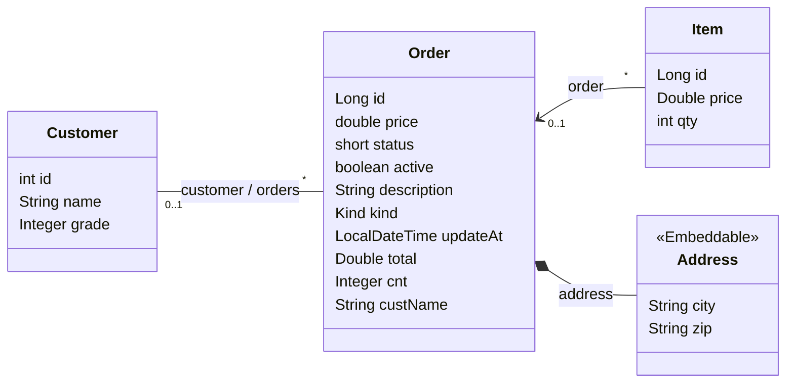

<a id="2-getting-started-java"></a>
# 2. Getting started (Java)

[Java track](README.md) | [Manual home](../README.md) | Previous: [1. Overview](../01-overview.md) | Next: [3. Conditions](03-where.md) | [Kotlin version of this page](../kotlin/02-getting-started.md)

Common pages: [1. Overview](../01-overview.md) · [11. Errors and languages](../11-errors-and-languages.md)

---

<a id="requirements"></a>
## Requirements

| Item | Version | Notes |
|---|---|---|
| Java | 21 or later | Needed to build and run lambdaQL. |
| JPA implementation | Hibernate ORM 6.6 or 7.4 | lambdaQL builds Hibernate HQL. Tested with 6.6.53 (Spring Boot 3.5.16) and 7.4.13 (Spring Boot 4.1.2). Other JPA implementations are not supported. See [13. Spring Boot 3 and 4](../13-spring-boot-versions.md). |
| Jakarta Persistence | 3.1 or 3.2 | Hibernate 6.6 uses 3.1, and 7.4 uses 3.2. |
| Database | H2 2.3, MariaDB 10.11, MySQL 8.4, PostgreSQL 17, Oracle 23.26 (23ai) | Tests were run on these database versions. Other databases are planned. |
| Spring Boot | 3.5 or 4.1 | Optional. Tested with 3.5.16 and 4.1.2. |
| Compiler | javac | Lambda expressions compiled with ECJ (the Eclipse compiler) are not guaranteed. See [9. Java notes](09-java-notes.md#912-compiler-and-build). |

<a id="build-from-source"></a>
## Build from source

```bash
git clone https://github.com/lambdaql/lambdaql.git
cd lambdaql
./gradlew build
```

- The Gradle wrapper version is 9.9.1.
- The build needs two JDKs. If they are not installed, Gradle downloads them automatically.
  - **JDK 21**: used for compiling and for the default tests. It checks the behavior on the lowest Java version that lambdaQL supports.
  - **JDK 25**: runs Gradle (`gradle/gradle-daemon-jvm.properties`) and compiles the code that is used only on Java 24 or later (`src/main/java24`). The same tests run once more on Java 25. You can change the JDK for this code to another version (24 or later), like `-Plql.classfile.jdk=24`.
- If Gradle cannot find a JDK that you already installed, write the JDK path in `org.gradle.java.installations.paths` in `~/.gradle/gradle.properties`.
- In IntelliJ IDEA, set **Settings > Build Tools > Gradle > Gradle JVM** to JDK 25.

The main modules of the build are:

| Module | Artifact | Description |
|---|---|---|
| `query` | `lambdaql` | The query engine. Shared by Spring Boot 3 and 4 |
| `spring-data-jpa` | `lambdaql-spring-data-jpa` | Spring Data JPA integration. Shared by Spring Boot 3 and 4 ([12. Spring Data JPA](12-spring-data-jpa.md)) |
| `spring-boot-starter-boot3`, `spring-boot-starter-boot4` | `lambdaql-spring-boot-starter-boot3`, `-boot4` | A starter for each Spring Boot version ([13. Spring Boot 3 and 4](../13-spring-boot-versions.md)) |

Run the unit tests:

```bash
./gradlew :query:test
```

By default they run on H2. To run them on another database, add `-Dlql.db=mariadb` or `-Dlql.db=oracle`.

<a id="use-the-local-build-in-your-project"></a>
### Use the local build in your project

Publish the jars of the three modules to the local Maven repository.

```bash
./gradlew publishToMavenLocal
```

Then add `lambdaql` to your project.

Gradle (Groovy DSL):

```groovy
repositories {
    mavenLocal()
    mavenCentral()
}

dependencies {
    implementation 'io.github.lambdaql:lambdaql:0.0.2'
}
```

Maven:

```xml
<dependency>
  <groupId>io.github.lambdaql</groupId>
  <artifactId>lambdaql</artifactId>
  <version>0.0.2</version>
</dependency>
```

If you use Spring Boot, add `lambdaql-spring-boot-starter-boot4` (`-boot3`) that matches your Boot version instead. If you use only Spring Data JPA without Spring Boot, add `lambdaql-spring-data-jpa` instead. Both artifacts bring in `lambdaql` too (see [12.2](12-spring-data-jpa.md#122-modules)).

<a id="recommended-compiler-option--parameters"></a>
### Recommended compiler option: `-parameters`

Compile with the `-parameters` option. Then lambdaQL can look at the parameter names of procedure stub methods and find arguments in the wrong order (see [8.4](08-procedures-functions.md#84-warning-argument-order)).

Gradle (Groovy DSL):

```groovy
tasks.withType(JavaCompile).configureEach {
    options.compilerArgs << '-parameters'
}
```

Maven (`maven-compiler-plugin`):

```xml
<configuration>
  <parameters>true</parameters>
</configuration>
```

<a id="example-entities"></a>
## Example entities

The examples of the Java track use these example entities. The full code is in [`Order.java`](https://github.com/lambdaql/lambdaql/blob/main/query/src/test/java/org/lambdaql/query/Order.java), [`Customer.java`](https://github.com/lambdaql/lambdaql/blob/main/query/src/test/java/org/lambdaql/query/Customer.java) and [`Item.java`](https://github.com/lambdaql/lambdaql/blob/main/query/src/test/java/org/lambdaql/query/Item.java).

The diagram below shows the example entities and their associations.



| Entity | Table | Main properties |
|---|---|---|
| `Order` | `orders` | `id` (`Long`, generated), `price` (`double`), `status` (`short`), `active` (`boolean`, getter `isActive()`), `description` (`String`), `kind` (enum `Order.Kind`: `NORMAL`, `RUSH`), `updateAt` (`LocalDateTime`), `customer` (`@ManyToOne` `Customer`), `total` (`Double`), `cnt` (`Integer`), `custName` (`String`), `address` (`@Embedded` `Address`: `city`, `zip`) |
| `Customer` | `customers` | `id` (`int`), `name` (`String`), `grade` (`Integer`), `orders` (`@OneToMany` `Order`) |
| `Item` | `items` | `id` (`Long`, generated), `order` (`@ManyToOne` `Order`), `price` (`Double`), `qty` (`int`) |

`Order` has no collection of `Item`. You find the items of an order through `Item.order` (see [5. Subqueries](05-subquery.md)).

Entity rules:

- lambdaQL reads **getters** (`o.getPrice()`, `o.isActive()`). It maps the getters to JPA properties with the JPA Metamodel. It does not read fields directly.
- No generated code is needed (no Q-classes, no static metamodel).
- Primitive fields (`double price`, `short status`) cannot be NULL, and boxed fields (`Double total`, `Integer cnt`) can be NULL. This affects `==` and NULL handling. See [9. Java notes](09-java-notes.md#92-boxing-and-unboxing).

<a id="create-a-querybuilder"></a>
## Create a QueryBuilder

`QueryBuilder` is the entry point. It needs a JPA `EntityManagerFactory` or `EntityManager`.

<!-- region: ManualJavaStartTest.java#create -->
```java
// one builder for the whole application; each query opens and closes its own EntityManager
QueryBuilder qb = new QueryBuilder(emf);
// or on an EntityManager that you manage: the queries run on it (and in its transaction)
QueryBuilder qbOnEm = new QueryBuilder(em);
```

Do not create a `QueryBuilder` for each query. Create one and reuse it.

<a id="with-spring-boot"></a>
### With Spring Boot

If you use `lambdaql-spring-boot-starter-boot4` (`-boot3`), Spring Boot creates the `QueryBuilder` bean (see [12.8](12-spring-data-jpa.md#128-the-querybuilder-bean)).
To use it without the starter, declare the bean as in the example below.
The configuration class and the repository class in the example are `static` nested classes. In an application, they are usually top-level classes.

<!-- region: ManualJavaStartTest.java#config -->
```java
@Configuration
public static class LambdaQlConfig {

    @Bean
    public QueryBuilder queryBuilder(EntityManagerFactory entityManagerFactory) {
        return new QueryBuilder(SharedEntityManagerCreator.createSharedEntityManager(entityManagerFactory));
    }
}
```

Then inject `QueryBuilder` into your repository.

<!-- region: ManualJavaStartTest.java#repository -->
```java
@Repository
public static class OrderRepository {

    private final QueryBuilder qb;

    public OrderRepository(QueryBuilder qb) {
        this.qb = qb;
    }

    @Transactional(readOnly = true)
    public List<Order> activeOrders() {
        return qb.from(Order.class)
                 .where(o -> o.isActive())
                 .toList();
    }
}
```

- The shared `EntityManager` is bound to the current transaction. Inside `@Transactional`, lambdaQL runs in the same transaction.
- To write lambdaQL queries inside a Spring Data repository, see [12. Spring Data JPA](12-spring-data-jpa.md).

Example code: [`ManualJavaStartTest.java`](https://github.com/lambdaql/lambdaql/blob/main/query/src/test/java/org/lambdaql/query/ManualJavaStartTest.java) (`create`, `config`, `repository`).

<a id="your-first-query"></a>
## Your first query

<!-- region: ManualJavaStartTest.java#first-query -->
```java
SelectQuery<Order> query = qb.from(Order.class)
        .where(o -> o.getStatus() == 1 && o.getPrice() > 100);
assertEquals("select e0 from Order e0 where e0.status = 1 and e0.price > 100.0", query.toHql().hql());
List<Order> orders = query.toList();
```

**SQL by database**

<!-- sql: to-hql -->
```sql
-- H2, MariaDB, Oracle (same)
select …
from orders o1_0
where o1_0.status=1 and o1_0.price>100.0
```

- `qb.from(Order.class)` starts a query on `Order`.
- `where(...)` takes one condition lambda expression.
- `toHql()` returns the HQL and the parameters without running the query. The string in `assertEquals` is the HQL that lambdaQL builds.
- `toList()` runs the query and returns a `List<Order>`.
- `toList()` returns all rows. The other result functions (`first()`, `one()`, `count()`, `exists()`, `toSet()`) are in [Getting the result](#getting-the-result).

Constants written directly in the lambda expression, such as `1` and `100.0`, are written directly into the HQL. This covers numbers, strings, booleans, `null` and enum constants.
`price` is a `double`, so javac compiles `100` into the decimal `100.0`.
Values from outside the lambda expression become bind parameters (see the next section and [3.3](03-where.md#33-basic-form)).

<a id="use-values-from-outside-the-lambda"></a>
### Use values from outside the lambda expression

A lambda expression can use local variables, fields and method parameters. These are called **captured values**.
lambdaQL turns captured values into bind parameters. It reads the new values each time the query runs.

<!-- region: ManualJavaStartTest.java#captured -->
```java
int status = 1;
double minPrice = 100;
SelectQuery<Order> query = qb.from(Order.class)
        .where(o -> o.getStatus() == status && o.getPrice() >= minPrice);
assertEquals("select e0 from Order e0 where e0.status = :p1 and e0.price >= :p2", query.toHql().hql());
List<Order> orders = query.toList();
```

**SQL by database**

<!-- sql: start-captured -->
```sql
-- H2, MariaDB, Oracle (same)
select …
from orders o1_0
where o1_0.status=? and o1_0.price>=?
```

<a id="many-where-calls"></a>
### Many `where` calls

You can call `where` more than once. lambdaQL combines the conditions with `AND`.

<!-- region: ManualJavaStartTest.java#many-where -->
```java
SelectQuery<Order> query = qb.from(Order.class)
        .where(o -> o.isActive())
        .where(o -> o.getStatus() == 1 || o.getStatus() == 2);
assertEquals("select e0 from Order e0 where e0.active = true and (e0.status = 1 or e0.status = 2)",
        query.toHql().hql());
```

**SQL by database**

<!-- sql: start-many-where -->
```sql
-- H2, MariaDB, Oracle (same)
select …
from orders o1_0
where o1_0.active=true and (o1_0.status=1 or o1_0.status=2)
```

This is useful when you add conditions step by step.

<!-- region: ManualJavaStartTest.java#step-by-step -->
```java
Double minPrice = input;                         // for example from a search form; may be null
SelectQuery<Order> query = qb.from(Order.class).where(o -> o.isActive());
if (minPrice != null) {
    query = query.where(o -> o.getPrice() >= minPrice);
}
assertEquals("select e0 from Order e0 where e0.active = true and e0.price >= :p1", query.toHql().hql());
List<Order> orders = query.toList();
```

The type of the builder variable is `SelectQuery<Order>` (you can also use `var`). `where` adds a condition to the same query object and returns that object.

<a id="paths-to-other-entities"></a>
### Associated entities

A path like `o.getCustomer().getName()` points to a column of the joined entity.
In `where`, lambdaQL joins the customer table. If the condition can let an order without a customer into the result, it is a `left join`. If it cannot, it is an inner `join`. The test is whether the condition can be true when there is no customer.
The condition below is true only for orders that have a customer, so it is an inner `join`, and orders without a customer are **not** in the result.

<!-- region: SelectQueryTest.java#inner-join -->
```java
String name = "Kim";
RenderedQuery q = qb.from(Order.class).where(o -> o.getCustomer().getName().equals(name)).toHql();
assertEquals("select e0 from Order e0 join e0.customer j1 where j1.name = :p1", q.hql());
```

**SQL by database**

<!-- sql: inner-join -->
```sql
-- H2, MariaDB, Oracle (same)
select …
from orders o1_0
join customers c1_0 on c1_0.id=o1_0.customer_id
where c1_0.name=?
```

To find orders without a customer, compare the association. `o.getCustomer() == null` becomes `e0.customer is null` (no join).
If you use a null guard (`o.getCustomer() == null || ...`), orders without a customer also match the condition. So it becomes a `left join`, and those orders stay in the result.
See [3.10](03-where.md#310-association-paths).

Example code: [`ManualJavaStartTest.java`](https://github.com/lambdaql/lambdaql/blob/main/query/src/test/java/org/lambdaql/query/ManualJavaStartTest.java) (`first-query`, `captured`, `many-where`, `step-by-step`), [`SelectQueryTest.java`](https://github.com/lambdaql/lambdaql/blob/main/query/src/test/java/org/lambdaql/query/SelectQueryTest.java) (`inner-join`).

<a id="getting-the-result"></a>
## Getting the result

`toList()` is not the only way to run a query. lambdaQL has six result functions.

| Function | Return type | Where you can call it | What it does |
|---|---|---|---|
| `toList()` | `List<T>` | After `where`, and after `orderBy` / `limit` / `offset` | Returns all rows (or one page). |
| `first()` | `Optional<T>` | After `where`, and after `orderBy` / `limit` / `offset` | Returns the first row. It reads only one row. |
| `one()` | `Optional<T>` | Only after `where` | Returns the only row. If two or more rows match, it throws `NonUniqueResultException`. It reads at most 2 rows. |
| `count()` | `long` | Only after `where` | Returns the number of rows that match the condition. |
| `exists()` | `boolean` | Only after `where` | Returns `true` if a row matches. It reads one row and does not load entities. |
| `toSet()` | `SequencedSet<T>` | After `where`, and after `orderBy` / `limit` / `offset` | Returns all rows (or one page) as a Set that keeps the row order. If the Set is smaller than the number of rows, it throws `IllegalStateException`. |

"After `where`" means the query that you get from `qb.from(...)` and `where(...)` (type `SelectQuery`). This manual calls it the **where stage**. You can also call these functions right after `qb.from(...)` without `where`.

The examples below use the [example entities](#example-entities) and give the same result on H2, MariaDB and Oracle.
`price` is a `double`, so the sort has no `nulls` part, and `Order` has the enum `kind`.

<a id="first"></a>
### `first()`

Returns the first row.

<!-- region: ResultQueryTest.java#first -->
```java
import static org.lambdaql.query.By.asc;

Optional<Order> cheapest = qb.from(Order.class)
        .orderBy(o -> asc(o.getPrice()))
        .first();
// without orderBy there is no order by: "first" is any matching row
Optional<Order> firstActive = qb.from(Order.class).where(o -> o.isActive()).first();
Optional<Order> none = qb.from(Order.class).where(o -> o.getStatus() == 9).first();
```

**SQL by database**

<!-- sql: first -->
```sql
-- H2, Oracle
select …
from orders o1_0
order by o1_0.price,o1_0.id
fetch first ? rows only

-- MariaDB
select …
from orders o1_0
order by o1_0.price,o1_0.id
limit ?
```

**SQL by database**

<!-- sql: first#2 -->
```sql
-- H2, Oracle
select …
from orders o1_0
where o1_0.active=true
order by o1_0.id
fetch first ? rows only

-- MariaDB
select …
from orders o1_0
where o1_0.active=true
order by o1_0.id
limit ?
```

`first()` reads one row, so it is a paging query. lambdaQL adds `id` as the last sort key (see [4.8](04-order-paging.md#tie-breaker-automatic-id)), and Hibernate writes the paging for each database: `fetch first ? rows only` on H2 and Oracle, and `limit ?` on MariaDB. The `?` is 1.

<a id="one"></a>
### `one()`

Use `one()` when at most one row matches the condition, for example when you search by a unique key.
If there is no row, the result is `Optional.empty()`. Two or more rows throw `jakarta.persistence.NonUniqueResultException`. If any matching row is fine, use `first()`.

<!-- region: ResultQueryTest.java#one -->
```java
long id = knownId;
Optional<Order> order = qb.from(Order.class).where(o -> o.getId() == id).one();
Optional<Order> missing = qb.from(Order.class).where(o -> o.getId() == -1L).one();
// two or more rows: an exception (use first() if any row is fine)
assertThrows(NonUniqueResultException.class, () -> qb.from(Order.class).where(o -> o.isActive()).one());
```

**SQL by database**

<!-- sql: one -->
```sql
-- H2, Oracle
select …
from orders o1_0
where o1_0.id=?
fetch first ? rows only

-- MariaDB
select …
from orders o1_0
where o1_0.id=?
limit ?
```

`one()` asks the database for at most 2 rows. That is enough to know if there is a second row. So the SQL has `fetch first ? rows only` (H2, Oracle) or `limit ?` (MariaDB), and the `?` is 2. The order does not matter here, so there is no `order by`.

<a id="count-and-a-paged-screen"></a>
### `count()` and a paged screen

`count()` returns the number of rows that match the condition.

<!-- region: ResultQueryTest.java#count -->
```java
SelectQuery<Order> active = qb.from(Order.class).where(o -> o.isActive());
long total = active.count();                                   // every matching row
List<Order> page = active.orderBy(o -> desc(o.getPrice())).limit(2).toList();
```

`active.count()` in the example runs the HQL `select count(e0) from Order e0 where e0.active = true`.

**SQL by database**

<!-- sql: count -->
```sql
-- H2, MariaDB, Oracle (same)
select count(o1_0.id)
from orders o1_0
where o1_0.active=true
```

Hibernate turns `count(e0)` into `select count(o1_0.id)`, so it counts the id column. The count query has no paging.

For a paged screen, keep the query of the where stage in a variable. Call `count()` on that variable to get the total. Then call `orderBy(...).limit(...).toList()` on the same variable to get the page.

**A column.** `count(column)` returns the number of rows where that column is not NULL. After `distinct()`, it returns the number of different values.

<!-- region: CountColumnTest.java#count-column -->
```java
// rows whose description is not NULL
SelectQuery<Order> orders = qb.from(Order.class);
long described = orders.count(o -> o.getDescription());
```

<!-- region: CountColumnTest.java#count-distinct -->
```java
// the number of different customers that have an order
SelectQuery<Order> orders = qb.from(Order.class);
long customers = orders.distinct().count(o -> o.getCustomer().getId());
```

The two examples run the HQL `select count(e0.description) from Order e0` and `select count(distinct e0.customer.id) from Order e0`.
The joins for a column path are the same as in `select`.

If you give the entity itself (`count(o -> o)`), whole rows are counted. The HQL is `count(*)`.

<!-- region: CountColumnTest.java#count-row -->
```java
// o -> o is the whole row: count(*)
long active = qb.from(Order.class).where(o -> o.isActive()).count(o -> o);
```

Example code: [`CountColumnTest.java`](https://github.com/lambdaql/lambdaql/blob/main/query/src/test/java/org/lambdaql/query/CountColumnTest.java) (`count-column`, `count-distinct`, `count-row`).

<a id="exists"></a>
### `exists()`

`exists()` returns `true` if at least one row matches. It runs `select 1` and reads at most one row. It does not load entities.

<!-- region: ResultQueryTest.java#exists -->
```java
boolean anyRush = qb.from(Order.class).where(o -> o.getKind() == Order.Kind.RUSH).exists();
boolean anyStatus9 = qb.from(Order.class).where(o -> o.getStatus() == 9).exists();
```

**SQL by database**

<!-- sql: exists -->
```sql
-- H2, Oracle
select 1
from orders o1_0
where o1_0.kind='RUSH'
fetch first ? rows only

-- MariaDB
select 1
from orders o1_0
where o1_0.kind='RUSH'
limit ?
```

The HQL is `select 1 from Order e0 where e0.kind = org.lambdaql.query.Order$Kind.RUSH`. The SQL selects only the constant `1`, so it reads no column, and the paging (the `?` is 1) stops after the first row.

<a id="toset"></a>
### `toSet()`

`toSet()` runs the query in the same way as `toList()` and returns a `SequencedSet<T>`.
The returned object is a `LinkedHashSet`, so the elements keep the row order. If there is an `orderBy`, they follow the sort order.

<!-- region: ResultQueryTest.java#to-set -->
```java
java.util.SequencedSet<Order> byPrice = qb.from(Order.class)
        .orderBy(o -> desc(o.getPrice()))
        .toSet();
```

The SQL is the same as for `toList()`. lambdaQL does **not** add `distinct`.

- An entity row has a primary key. So the same row does not appear twice when you query only one table.
- lambdaQL joins only to-one associations. Collections become `exists` subqueries. So joins do not duplicate rows.
- So `distinct` cannot change the result and only adds cost. (This is not about a database limit. Oracle 23.26 also allows `distinct` on LOB columns. This is a measured result.)

For value queries (`select`), `distinct()` and `toSet()` use `select distinct` (see [6.7](06-select-group.md#67-distinct-paging-and-results)).

**Size check.** If the Set is smaller than the number of rows, `toSet()` throws `IllegalStateException`. This happens when:

- The `equals` / `hashCode` of the entity treats two different rows as equal
- The `@Id` is not unique (for example, an entity mapped to a view)

Without the check, rows would be lost without any sign. In these cases, use `toList()`.

In the next example, `Tag.equals` compares only the name, and the table has two rows with the same name.

<!-- region: ResultQueryTest.java#to-set-check -->
```java
// Tag.equals compares only the name: two different rows would become one element, so toSet() refuses
assertThrows(IllegalStateException.class, () -> qb.from(Tag.class).toSet());
assertEquals(2, qb.from(Tag.class).toList().size());
```

Example code: [`ResultQueryTest.java`](https://github.com/lambdaql/lambdaql/blob/main/query/src/test/java/org/lambdaql/query/ResultQueryTest.java) (`first`, `one`, `count`, `exists`, `to-set`, `to-set-check`).

<a id="things-to-know"></a>
## Things to know

| Rule | Example |
|---|---|
| Use lambda expressions. Anonymous classes are rejected, and method references can be used only for sort keys. | `where(o -> o.isActive())`, `orderBy(Order::getPrice)` |
| A lambda expression must be one expression (condition, sort, select). | Loops and local variables in a lambda expression are rejected. |
| Do not put code that must run into a lambda expression. lambdaQL does not call condition, sort or select lambda expressions. It analyzes their bytecode opcodes. | Calls with side effects, like `System.out.println(...)`, are rejected. |
| Compile with javac. | ECJ output is not guaranteed. |
| On Java 21 to 23, you need an ASM version that matches classes compiled with a newer JDK. | lambdaQL uses ASM 9.11.1 on Java 21 to 23 (it reads class files up to Java 28). If you compile with a newer JDK, update ASM. On Java 24 or later, lambdaQL reads with the `java.lang.classfile` of the running JDK, so the ASM version does not matter. |

More about Java is in [9. Java notes](09-java-notes.md).

<a id="next"></a>
## Next

- [3. Conditions (`where`)](03-where.md): all operators and the NULL rules.
- [4. Sorting and paging](04-order-paging.md)

---

[Java track](README.md) | Previous: [1. Overview](../01-overview.md) | Next: [3. Conditions](03-where.md) | [Kotlin version of this page](../kotlin/02-getting-started.md)
