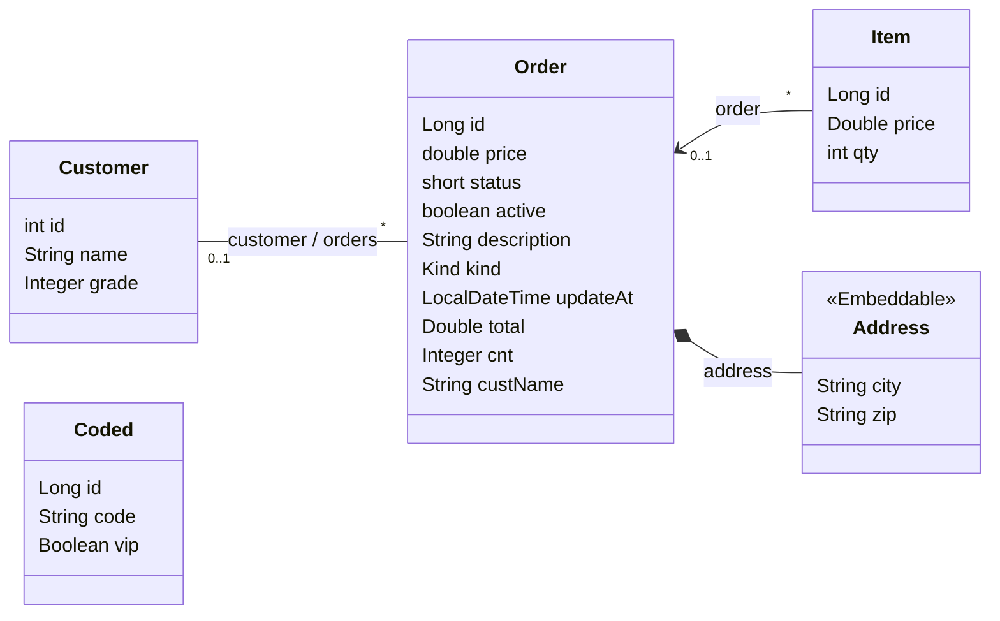

<a id="2-getting-started-kotlin"></a>
# 2. Getting started (Kotlin)

[Kotlin track](README.md) | [Manual home](../README.md) | Previous: [1. Overview](../01-overview.md) | Next: [3. Conditions](03-where.md) | [Java version of this page](../java/02-getting-started.md)

Common pages: [1. Overview](../01-overview.md) · [11. Errors and languages](../11-errors-and-languages.md)

---

<a id="requirements"></a>
## Requirements

| Item | Version | Notes |
|---|---|---|
| Kotlin | 2.x | The design was checked with kotlinc 1.7.22, 2.1.10, 2.2.21, 2.3.0 and 2.3.21. |
| JVM | Java 21 or later | Needed to build and run lambdaQL. |
| `-jvm-target` | 1.8, 11, 17 or 21 | All four compile query lambdas in the same way. |
| JPA provider | Hibernate ORM 6.6 or 7.4 | lambdaQL makes Hibernate HQL. Tested with 6.6.53 (Spring Boot 3.5.16) and 7.4.13 (Spring Boot 4.1.2). Other JPA providers are not supported. See [13. Spring Boot 3 and 4](../13-spring-boot-versions.md). |
| Jakarta Persistence | 3.1 or 3.2 | Hibernate 6.6 uses 3.1, and 7.4 uses 3.2. |
| Database | H2 2.3, MariaDB 10.11, MySQL 8.4, PostgreSQL 17, Oracle 23.26 (23ai) | Tests were run on these database versions. Other databases will be added later. |
| Spring Boot | 3.5 or 4.1 | Optional. Tested with Spring Boot 3.5.16 and 4.1.2. |
| Kotlin runtime | – | lambdaQL does not add `kotlin-stdlib` or `kotlin-reflect` to your dependencies. |

<a id="build-from-source"></a>
## Build from source

```bash
git clone https://github.com/lambdaql/lambdaql.git
cd lambdaql
./gradlew build
```

- The Gradle wrapper version is 9.9.1.
- The build needs two JDKs. If they are not installed, Gradle downloads them automatically.
  - **JDK 21**: used to compile and for the main tests. It checks the behavior on the lowest Java version that lambdaQL supports.
  - **JDK 25**: runs Gradle (`gradle/gradle-daemon-jvm.properties`) and compiles the code used only on Java 24 or later (`src/main/java24`). It runs the same tests once more on Java 25. You can change the JDK for this code to another version (24 or later), for example `-Plql.classfile.jdk=24`.
- If Gradle cannot find a JDK that you already installed, write the JDK path in `org.gradle.java.installations.paths` in `~/.gradle/gradle.properties`.
- In IntelliJ IDEA, set **Settings > Build Tools > Gradle > Gradle JVM** to JDK 25.

The main modules of the build are:

| Module | Artifact | Description |
|---|---|---|
| `query` | `lambdaql` | The query engine. Common to Spring Boot 3 and 4 |
| `spring-data-jpa` | `lambdaql-spring-data-jpa` | Spring Data JPA integration. Common to Spring Boot 3 and 4 ([12. Spring Data JPA](12-spring-data-jpa.md)) |
| `spring-boot-starter-boot3`, `spring-boot-starter-boot4` | `lambdaql-spring-boot-starter-boot3`, `-boot4` | Starters for each Spring Boot version ([13. Spring Boot 3 and 4](../13-spring-boot-versions.md)) |

Run the unit tests:

```bash
./gradlew :query:test
```

The source of the examples in this track is in `query/src/test/kotlin`, and the task above runs it too.

<a id="use-the-local-build-in-your-project"></a>
### Use the local build in your project

Publish the jars of the three modules to the local Maven repository:

```bash
./gradlew publishToMavenLocal
```

Then add `lambdaql` to your project (Gradle Kotlin DSL):

```gradle-kts
repositories {
    mavenLocal()
    mavenCentral()
}

dependencies {
    implementation("io.github.lambdaql:lambdaql:0.0.2")
}
```

Maven:

```xml
<dependency>
  <groupId>io.github.lambdaql</groupId>
  <artifactId>lambdaql</artifactId>
  <version>0.0.2</version>
</dependency>
```

If you use Spring Boot, add `lambdaql-spring-boot-starter-boot4` (`-boot3`) for your Boot version instead. If you use only Spring Data JPA without Spring Boot, add `lambdaql-spring-data-jpa` instead. Both artifacts bring `lambdaql` with them (see [12.2](12-spring-data-jpa.md#122-modules)).

<a id="kotlin-compiler-settings"></a>
## Kotlin compiler settings

| Setting | What to do | Why |
|---|---|---|
| `-Xsam-conversions` | Keep the default (`indy`). Do **not** set `-Xsam-conversions=class`. | With `class`, Kotlin makes a class instead of a serializable lambda. lambdaQL cannot read it. |
| `-java-parameters` | Recommended if you call stored procedures. | Then lambdaQL can compare the parameter names with the database (see [8.4](08-procedures-functions.md#84-warning-argument-order)). |
| JPA plugins | Use `kotlin("plugin.jpa")` and all-open (or `kotlin("plugin.spring")`). | JPA needs a no-argument constructor and open classes. This is the usual setup for Kotlin JPA entities. |

Example (`build.gradle.kts`):

```gradle-kts
plugins {
    kotlin("jvm")
    kotlin("plugin.jpa")
    kotlin("plugin.spring")   // or the all-open plugin
}

kotlin {
    compilerOptions {
        javaParameters = true   // same as -java-parameters
    }
}
```

Match the plugin versions to your Kotlin version.

<a id="example-entities"></a>
## Example entities

The examples in the Kotlin track use the following **example entities**.
The example entities are Java classes ([`query/src/test/java/org/lambdaql/query/`](https://github.com/lambdaql/lambdaql/tree/main/query/src/test/java/org/lambdaql/query)). The Kotlin examples use these classes in the same way that your project uses compiled entities.

The following diagram shows the example entities and their associations.



| Entity | Main properties (Java types) | In Kotlin |
|---|---|---|
| `Order` (table `orders`) | `Long id`, `double price`, `short status`, `boolean active`, `String description`, `Integer cnt`, `String custName`, `LocalDateTime updateAt`, `Kind kind` (enum `NORMAL`, `RUSH`), `Customer customer` (`@ManyToOne`), `Address address` (`@Embedded`) | `it.price`, `it.status`, `it.isActive`, `it.cnt`, `it.customer?.name` |
| `Customer` (table `customers`) | `int id`, `String name`, `Integer grade` | `it.name`, `it.grade` |
| `Item` (table `items`) | `Long id`, `Order order` (`@ManyToOne`), `Double price`, `int qty` | `it.order?.id`, `it.qty` |
| `Coded` (table `coded`) | `Long id`, `String code` (`@Convert`), `Boolean vip` (`YesNoConverter`) | `it.code`, `it.vip` |

Things to know when you use Java entities from Kotlin:

- `price`, `status`, `active` and `qty` are Java primitive types. They can never be NULL, and in Kotlin they are `Double`, `Short`, `Boolean` and `Int`. The getter of `boolean active` is `isActive()`, so the Kotlin property name is `isActive`.
- `status` is a `Short`, so Kotlin does not compile `it.status == 1`. The examples write `it.status.toInt() == 1`. lambdaQL ignores this conversion and writes `e0.status = 1`.
- Reference types (`String`, `Integer`, `Double`, `LocalDateTime`, associations) are platform types in Kotlin. The compiler does not know if they are nullable, so you can compare them without `!!`, and you can also use `?.` and `?:`.
- If you write your own Kotlin entities, a column that can be NULL gets a nullable type such as `Double?`. Then you must add `!!`, as in `it.price!! > 100.0`, for the code to compile. lambdaQL ignores `!!` (see [3.3](03-where.md#33-basic-form)).

Entity rules:

| Rule | Why |
|---|---|
| Use normal public `var` or `val` properties. | lambdaQL reads the getter (`it.price` is the getter `getPrice()`) and maps it to a JPA attribute. |
| Use nullable types (`Double?`, `String?`) for columns that can be NULL. | A Kotlin non-null type does not stop a NULL that comes from the database. Hibernate writes the column value to the field without a check. |
| Do not use `@JvmField`, `internal` properties, `value class` properties or `@get:JvmName` in a query. | lambdaQL cannot map them to a JPA attribute. |
| `Boolean`, `Int`, `Long`, `Double` (not nullable) are JVM primitives. | They cannot hold NULL. lambdaQL knows this and can make simpler SQL. |

<a id="create-a-querybuilder"></a>
## Create a QueryBuilder

`QueryBuilder` is the entry point. It needs a JPA `EntityManagerFactory` or `EntityManager`.

<!-- region: ManualKotlinStartTest.kt#create -->
```kotlin
val qb = QueryBuilder(emf)
```

`emf` is the `EntityManagerFactory` of your application.

Do not make a `QueryBuilder` for each query. Make one and reuse it.

<a id="with-spring-boot"></a>
### With Spring Boot

If you use `lambdaql-spring-boot-starter-boot4` (`-boot3`), Spring Boot makes the `QueryBuilder` bean (see [12.8](12-spring-data-jpa.md#128-the-querybuilder-bean)).
To use it without the starter, declare the bean as in the example below.

<!-- region: ManualKotlinStartTest.kt#spring-config -->
```kotlin
@Configuration(proxyBeanMethods = false)
class LambdaQlConfig {

    @Bean
    fun queryBuilder(entityManagerFactory: EntityManagerFactory) =
        QueryBuilder(SharedEntityManagerCreator.createSharedEntityManager(entityManagerFactory))
}
```

Then inject the `QueryBuilder` into your repository.

<!-- region: ManualKotlinStartTest.kt#spring-repository -->
```kotlin
@Repository
open class OrderRepository(private val qb: QueryBuilder) {

    @Transactional(readOnly = true)
    open fun activeOrders(): List<Order> =
        qb.from(Order::class.java)
            .where { it.isActive }
            .toList()
}
```

- The shared `EntityManager` is bound to the current transaction. Inside `@Transactional`, lambdaQL runs in the same transaction.
- To write lambdaQL queries inside a Spring Data repository, see [12. Spring Data JPA](12-spring-data-jpa.md).

Example code: [`ManualKotlinStartTest.kt`](https://github.com/lambdaql/lambdaql/blob/main/query/src/test/kotlin/org/lambdaql/query/ManualKotlinStartTest.kt) (`create`, `spring-config`, `spring-repository`).

<a id="your-first-query"></a>
## Your first query

<!-- region: ManualKotlinStartTest.kt#first-query -->
```kotlin
val q = qb.from(Order::class.java).where { it.status.toInt() == 1 && it.price > 100.0 }
assertEquals("select e0 from Order e0 where e0.status = 1 and e0.price > 100.0", q.toHql().hql())
val orders: List<Order> = q.toList()
```

**SQL by database**

<!-- sql: to-hql -->
```sql
-- H2, MariaDB, Oracle (same)
select …
from orders o1_0
where o1_0.status=1 and o1_0.price>100.0
```

- `qb.from(Order::class.java)` starts a query on `Order`.
- `where { ... }` takes one condition lambda. Use a trailing lambda and `it`.
- `toHql()` returns the HQL that lambdaQL made, without running the query. The `assertEquals` string in the example is that HQL.
- `toList()` runs the query and returns a `List<Order>`.
- `toList()` returns all rows. The other result functions (`first()`, `one()`, `count()`, `exists()`, `toSet()`) are in [Getting the result](#getting-the-result).

`it.status.toInt()` is there because `status` is a `Short` (see [Example entities](#example-entities)). lambdaQL ignores this conversion.

Constants written directly in the lambda, such as `1` and `100.0`, are written directly into the HQL. This covers numbers, strings, booleans, `null`, enum constants and `const val`.
Values from outside the lambda become bind parameters (see the next section and [3.3](03-where.md#33-basic-form)).

<a id="use-values-from-outside-the-lambda"></a>
### Use values from outside the lambda

A lambda can use local values, properties and function parameters. These are called **captured values**.
lambdaQL turns captured values into bind parameters. It reads the new value each time the query runs.

<!-- region: ManualKotlinStartTest.kt#captured -->
```kotlin
fun expensive(status: Short, minPrice: Double) =
    qb.from(Order::class.java).where { it.status == status && it.price >= minPrice }

val q = expensive(1, 100.0)
assertEquals("select e0 from Order e0 where e0.status = :p1 and e0.price >= :p2", q.toHql().hql())
```

`status` and `minPrice` are function parameters, so they become the bind parameters `:p1` and `:p2`.

**SQL by database**

<!-- sql: start-captured -->
```sql
-- H2, MariaDB, Oracle (same)
select …
from orders o1_0
where o1_0.status=? and o1_0.price>=?
```

<a id="many-where-calls"></a>
### Many `where` calls

You can call `where` more than once. lambdaQL joins the conditions with `AND`.

<!-- region: ManualKotlinStartTest.kt#many-where -->
```kotlin
val q = qb.from(Order::class.java)
    .where { it.isActive }
    .where { it.status.toInt() == 1 || it.status.toInt() == 2 }
assertEquals("select e0 from Order e0 where e0.active = true and (e0.status = 1 or e0.status = 2)", q.toHql().hql())
```

**SQL by database**

<!-- sql: start-many-where -->
```sql
-- H2, MariaDB, Oracle (same)
select …
from orders o1_0
where o1_0.active=true and (o1_0.status=1 or o1_0.status=2)
```

This is useful when you add conditions step by step.

<!-- region: ManualKotlinStartTest.kt#step-where -->
```kotlin
val minPrice: Double? = 100.0
var query = qb.from(Order::class.java).where { it.isActive }
if (minPrice != null) {
    query = query.where { it.price >= minPrice }
}
assertEquals("select e0 from Order e0 where e0.active = true and e0.price >= :p1", query.toHql().hql())
val orders = query.toList()
```

<a id="paths-to-other-entities"></a>
### Associated entities

A path such as `it.customer?.name` names a column of a joined entity.
In `where`, lambdaQL joins the customer table. If an order without a customer can be in the result for the condition, it is a `left join`. If it cannot, it is an inner `join`. The test is whether the condition can be true when there is no customer.
The condition below is true only for orders that have a customer, so it is an inner `join`, and orders without a customer are **not** in the result.

<!-- region: ManualKotlinStartTest.kt#join-path -->
```kotlin
val name = "Kim"
val q = qb.from(Order::class.java).where { it.customer?.name == name }
assertEquals("select e0 from Order e0 join e0.customer j1 where j1.name = :p1", q.toHql().hql())
```

`name` is a non-null `String`, so lambdaQL uses a simple `=` (see [3.6](03-where.md#36-null-rules)).

**SQL by database**

<!-- sql: inner-join -->
```sql
-- H2, MariaDB, Oracle (same)
select …
from orders o1_0
join customers c1_0 on c1_0.id=o1_0.customer_id
where c1_0.name=?
```

Examples of other conditions:

- `it.status == 1 || it.customer?.name == name`: an order without a customer is in the result if its `status` is 1, so it is a `left join`.
- `it.customer?.name == null`: orders without a customer are in the result, so it is a `left join`.
- `it.customer!!.name == name`: only orders that have a customer are in the result, so it is an inner `join`.

To find only orders without a customer, compare the association itself, as in `it.customer == null`. This becomes `e0.customer is null`, with no join.
For the full rules, see [3.10](03-where.md#310-association-paths).

Example code: [`ManualKotlinStartTest.kt`](https://github.com/lambdaql/lambdaql/blob/main/query/src/test/kotlin/org/lambdaql/query/ManualKotlinStartTest.kt) (`first-query`, `captured`, `many-where`, `step-where`, `join-path`).

<a id="getting-the-result"></a>
## Getting the result

`toList()` is not the only way to run a query. lambdaQL has six result functions.

| Function | Return type | Where you can call it | What it does |
|---|---|---|---|
| `toList()` | `List<T>` | After `where`, and after `orderBy` / `limit` / `offset` | Returns all rows (or one page). |
| `first()` | `Optional<T>` | After `where`, and after `orderBy` / `limit` / `offset` | Returns the first row. It reads only one row. |
| `one()` | `Optional<T>` | Only after `where` | Returns the only row. It throws `NonUniqueResultException` if two or more rows match. It reads at most 2 rows. |
| `count()` | `Long` | Only after `where` | Returns the number of rows that match the condition. |
| `exists()` | `Boolean` | Only after `where` | Returns `true` if a row matches. It reads one row and does not load entities. |
| `toSet()` | `SequencedSet<T>` | After `where`, and after `orderBy` / `limit` / `offset` | Returns all rows (or one page) as a Set that keeps the row order. It throws `IllegalStateException` if the Set is smaller than the number of rows. |

"After `where`" means the query you get from `qb.from(...)` and `where { }` (the type `SelectQuery`). In this manual it is called the **where stage**. You can also call these functions right after `qb.from(...)`, with no `where`.

`first()` and `one()` return a Java `Optional`.

<a id="first"></a>
### `first()`

Returns the first row.

<!-- region: ManualKotlinStartTest.kt#first -->
```kotlin
val byPrice = qb.from(Order::class.java).orderBy { o -> asc(o.price) }
val cheapest: Order? = byPrice.first().orElse(null)
// first() reads one row like limit(1); paging adds the id as the last sort key
assertEquals("select e0 from Order e0 order by e0.price asc, e0.id asc", byPrice.limit(1).toHql().hql())

// without orderBy there is no order by: "first" is any matching row
val active = qb.from(Order::class.java).where { it.isActive }
val firstActive: Order? = active.first().orElse(null)
assertEquals("select e0 from Order e0 where e0.active = true", active.limit(1).toHql().hql())
```

`first()` runs the same query as `limit(1)`. So the example shows the HQL of `first()` with the HQL of `limit(1)`.

**SQL by database**

<!-- sql: first#2 -->
```sql
-- H2, Oracle
select …
from orders o1_0
where o1_0.active=true
order by o1_0.id
fetch first ? rows only

-- MariaDB
select …
from orders o1_0
where o1_0.active=true
order by o1_0.id
limit ?
```

`first()` reads one row, so it is a paging query. lambdaQL adds `id` as the last sort key (see [4.8](04-order-paging.md#tie-breaker-automatic-id)), and Hibernate writes the paging for each database: `fetch first ? rows only` on H2 and Oracle, and `limit ?` on MariaDB. `?` is 1.
The `price` of the example entity can never be NULL, so the HQL has no `nulls` part. A sort key that can be NULL gets `nulls first` or `nulls last` (see [4. Sorting and paging](04-order-paging.md)).

<a id="one"></a>
### `one()`

Use `one()` when at most one row matches the condition, for example when you search by a unique key.
No row gives `Optional.empty()`. Two or more rows throw `jakarta.persistence.NonUniqueResultException`. If any matching row is fine, use `first()`.

<!-- region: ManualKotlinStartTest.kt#one -->
```kotlin
val id: Long = knownId
val byId = qb.from(Order::class.java).where { it.id == id }
assertEquals("select e0 from Order e0 where e0.id = :p1", byId.toHql().hql())
val order: Order? = byId.one().orElse(null)

// two or more rows: an exception (use first() if any row is fine)
assertThrows<NonUniqueResultException> { qb.from(Order::class.java).where { it.isActive }.one() }
```

**SQL by database**

<!-- sql: one -->
```sql
-- H2, Oracle
select …
from orders o1_0
where o1_0.id=?
fetch first ? rows only

-- MariaDB
select …
from orders o1_0
where o1_0.id=?
limit ?
```

`one()` asks the database for at most 2 rows. That is enough to know if there is a second row. So the SQL has `fetch first ? rows only` (H2, Oracle) or `limit ?` (MariaDB), and `?` is 2. The order does not matter here, so there is no `order by`.

<a id="count-and-a-paged-screen"></a>
### `count()` and a paged screen

`count()` returns the number of rows that match the condition.

<!-- region: ManualKotlinStartTest.kt#count -->
```kotlin
val active = qb.from(Order::class.java).where { it.isActive }
val total: Long = active.count()                       // every matching row
val page = active.orderBy { o -> desc(o.price) }.limit(2)
assertEquals("select e0 from Order e0 where e0.active = true order by e0.price desc, e0.id asc", page.toHql().hql())
val rows: List<Order> = page.toList()
```

`active.count()` in the example runs the HQL `select count(e0) from Order e0 where e0.active = true`.

**SQL by database**

<!-- sql: count -->
```sql
-- H2, MariaDB, Oracle (same)
select count(o1_0.id)
from orders o1_0
where o1_0.active=true
```

Hibernate turns `count(e0)` into `select count(o1_0.id)`. That is, it counts the id column. A count query has no paging.

For a paged screen, keep the where-stage query in a value. Call `count()` on that value to get the total. Then call `orderBy { }.limit(...).toList()` on the same value to get the page.

**Choosing a column.** `count(column)` returns the number of rows where that column is not NULL. After `distinct()`, it returns the number of different values.

<!-- region: KotlinCountColumnTest.kt#count-column -->
```kotlin
// rows whose description is not NULL
val orders = qb.from(Order::class.java)
val described = orders.count { it.description }
```

<!-- region: KotlinCountColumnTest.kt#count-distinct -->
```kotlin
// the number of different customers that have an order
val orders = qb.from(Order::class.java)
val customers = orders.distinct().count { it.customer?.id }
```

The two examples run the HQL `select count(e0.description) from Order e0` and `select count(distinct e0.customer.id) from Order e0`.
A join for a column path is the same as in `select`.

If you give the entity itself (`count { it }`), it counts whole rows. The HQL is `count(*)`.

<!-- region: KotlinCountColumnTest.kt#count-row -->
```kotlin
// { it } is the whole row: count(*)
val all = qb.from(Order::class.java).count { it }
```

Example code: [`KotlinCountColumnTest.kt`](https://github.com/lambdaql/lambdaql/blob/main/query/src/test/kotlin/org/lambdaql/query/KotlinCountColumnTest.kt) (`count-column`, `count-distinct`, `count-row`).

<a id="exists"></a>
### `exists()`

`exists()` returns `true` if at least one row matches. It runs `select 1` and reads at most one row. It does not load entities.

<!-- region: ManualKotlinStartTest.kt#exists -->
```kotlin
val status3 = qb.from(Order::class.java).where { it.status.toInt() == 3 }
assertEquals("select e0 from Order e0 where e0.status = 3", status3.toHql().hql())
val anyStatus3: Boolean = status3.exists()
val anyStatus9: Boolean = qb.from(Order::class.java).where { it.status.toInt() == 9 }.exists()
```

The HQL that `exists()` runs is `select 1 from Order e0 where e0.status = 3`. The SQL has the form `select 1 from orders o1_0 where … fetch first ? rows only` on H2 and Oracle, and `… limit ?` on MariaDB. `?` is 1.

<a id="toset"></a>
### `toSet()`

`toSet()` runs the query in the same way as `toList()` and returns a `SequencedSet<T>`.
The returned object is a `LinkedHashSet`, so the elements keep the row order. If there is an `orderBy { }`, they follow the sort order.

<!-- region: ManualKotlinStartTest.kt#to-set -->
```kotlin
val sorted = qb.from(Order::class.java).orderBy { o -> desc(o.price) }
assertEquals("select e0 from Order e0 order by e0.price desc", sorted.toHql().hql())
val byPrice: java.util.SequencedSet<Order> = sorted.toSet()
```

The SQL is the same as for `toList()`. lambdaQL does **not** add `distinct`.

- An entity row has a primary key. So the same row does not appear twice, even when you read only one table.
- lambdaQL joins only to-one associations. Collections become `exists` subqueries. So joins do not duplicate rows.
- So `distinct` cannot change the result. It only adds cost. (This has nothing to do with database limits. Oracle 23.26 also allows `distinct` on LOB columns. This is a measured result.)

For value queries (`select`), `distinct()` and `toSet()` use `select distinct` (see [6.7](06-select-group.md#67-distinct-paging-and-results)).

**Size check.** If the Set is smaller than the number of rows, `toSet()` throws `IllegalStateException`. This happens in these cases:

- The entity's `equals` / `hashCode` treats two different rows as equal.
- The `@Id` is not unique (for example, an entity mapped to a view).

Without the check, rows would be lost with no sign. In these cases, use `toList()`.
A Kotlin `data class` compares only the properties of the primary constructor. If the `@Id` is not in the primary constructor, `equals` can be true for two different rows.

The `equals` of the example entity `Tag` compares only the name. If two rows have the same name, `toSet()` throws an exception.

<!-- region: ManualKotlinStartTest.kt#to-set-check -->
```kotlin
// Tag.equals compares only the name: two different rows would become one element, so toSet() refuses
assertThrows<IllegalStateException> { qb.from(Tag::class.java).toSet() }
val tags: List<Tag> = qb.from(Tag::class.java).toList()   // use toList() instead
assertEquals(2, tags.size)
```

Example code: [`ManualKotlinStartTest.kt`](https://github.com/lambdaql/lambdaql/blob/main/query/src/test/kotlin/org/lambdaql/query/ManualKotlinStartTest.kt) (`first`, `one`, `count`, `exists`, `to-set`, `to-set-check`).

<a id="things-to-know"></a>
## Things to know

| Rule | Example |
|---|---|
| Pass a lambda literal. | `where { it.isActive }` |
| Do not store a lambda in a Kotlin function type first. | `val f: (Order) -> Boolean = { it.isActive }; where(f)` is rejected. |
| Do not make a query lambda inside an `inline fun`. | It is rejected. Make the helper non-inline, or pass the lambda from the caller. |
| A lambda must be one expression (condition, sort, select). | Loops and local `val`/`var` in a lambda are rejected. |
| Do not put code that must run in a lambda. lambdaQL does not call the lambda. It reads the bytecode opcodes. | A call with a side effect, such as `println(...)`, is rejected. |
| If you run on Java 21 to 23, you need an ASM version that fits classes compiled with a newer JDK. | lambdaQL uses ASM 9.11.1 on Java 21 to 23 (it reads class files up to Java 28). On Java 24 or later, it reads them with `java.lang.classfile` of the running JDK, so the ASM version does not matter. |

All Kotlin limits are in [9. Kotlin notes](09-kotlin-notes.md#914-kotlin-limits-kc1-to-kc21).

<a id="next"></a>
## Next

- [3. Conditions (`where`)](03-where.md): all operators and null rules.
- [4. Sorting and paging](04-order-paging.md)

---

[Kotlin track](README.md) | Previous: [1. Overview](../01-overview.md) | Next: [3. Conditions](03-where.md) | [Java version of this page](../java/02-getting-started.md)
