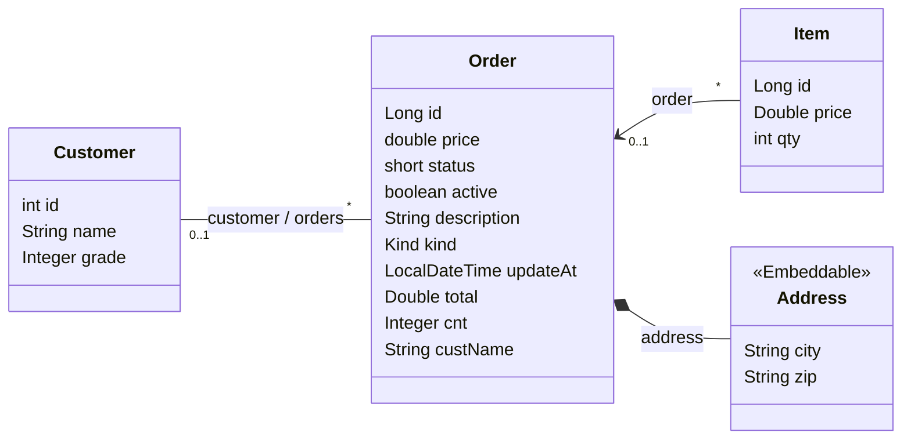

<a id="2-getting-started-java"></a>
# 2. はじめよう（Java）

[Java トラック](README.md) | [マニュアルのホーム](../README.md) | 前: [1. 概要](../01-overview.md) | 次: [3. 条件](03-where.md) | [このページの Kotlin 版](../kotlin/02-getting-started.md)

共通ページ: [1. 概要](../01-overview.md) · [11. エラーと言語](../11-errors-and-languages.md)

---

<a id="requirements"></a>
## 必要な環境

| 項目 | バージョン | 備考 |
|---|---|---|
| Java | 21 以上 | lambdaQL のビルドと実行に必要です。 |
| JPA 実装 | Hibernate ORM 6.6 または 7.4 | lambdaQL は Hibernate の HQL を組み立てます。6.6.53（Spring Boot 3.5.16）と 7.4.13（Spring Boot 4.1.2）でテストしました。他の JPA 実装はサポートしていません。[13. Spring Boot 3 と 4](../13-spring-boot-versions.md) を参照してください。 |
| Jakarta Persistence | 3.1 または 3.2 | Hibernate 6.6 は 3.1、7.4 は 3.2 を使います。 |
| データベース | H2 2.3、MariaDB 10.11、MySQL 8.4、PostgreSQL 17、Oracle 23.26 (23ai) | これらのバージョンのデータベースでテストしました。他のデータベースは今後追加する予定です。 |
| Spring Boot | 3.5 または 4.1 | 任意です。3.5.16 と 4.1.2 でテストしました。 |
| コンパイラー | javac | ECJ（Eclipse のコンパイラー）でコンパイルしたラムダ式は保証しません。[9. Java の注意点](09-java-notes.md#912-compiler-and-build) を参照してください。 |

<a id="build-from-source"></a>
## ソースからビルドする

```bash
git clone https://github.com/lambdaql/lambdaql.git
cd lambdaql
./gradlew build
```

- Gradle ラッパーのバージョンは 9.9.1 です。
- ビルドには JDK が 2 つ必要です。インストールされていなければ、Gradle が自動でダウンロードします。
  - **JDK 21**: コンパイルと基本のテストに使います。lambdaQL がサポートする最も低い Java のバージョンで動作を確認します。
  - **JDK 25**: Gradle を実行し（`gradle/gradle-daemon-jvm.properties`）、Java 24 以上でだけ使うコード（`src/main/java24`）をコンパイルします。同じテストを Java 25 でもう一度実行します。このコードの JDK は、`-Plql.classfile.jdk=24` のように別のバージョン（24 以上）に変えられます。
- インストール済みの JDK を Gradle が見つけられない場合は、`~/.gradle/gradle.properties` の `org.gradle.java.installations.paths` に JDK のパスを書いてください。
- IntelliJ IDEA では、**Settings > Build Tools > Gradle > Gradle JVM** を JDK 25 に設定してください。

ビルドの主なモジュールは次のとおりです。

| モジュール | アーティファクト | 説明 |
|---|---|---|
| `query` | `lambdaql` | クエリエンジン。Spring Boot 3・4 で共通 |
| `spring-data-jpa` | `lambdaql-spring-data-jpa` | Spring Data JPA との連携。Spring Boot 3・4 で共通（[12. Spring Data JPA](12-spring-data-jpa.md)） |
| `spring-boot-starter-boot3`、`spring-boot-starter-boot4` | `lambdaql-spring-boot-starter-boot3`、`-boot4` | Spring Boot のバージョンごとのスターター（[13. Spring Boot 3 と 4](../13-spring-boot-versions.md)） |

ユニットテストを実行します。

```bash
./gradlew :query:test
```

デフォルトでは H2 で実行します。他のデータベースで実行するには、`-Dlql.db=mariadb` か `-Dlql.db=oracle` を付けてください。

<a id="use-the-local-build-in-your-project"></a>
### ローカルビルドを自分のプロジェクトで使う

3 つのモジュールの jar をローカルの Maven リポジトリに公開します。

```bash
./gradlew publishToMavenLocal
```

それから、`lambdaql` を自分のプロジェクトに追加します。

Gradle（Groovy DSL）:

```groovy
repositories {
    mavenLocal()
    mavenCentral()
}

dependencies {
    implementation 'io.github.lambdaql:lambdaql:0.0.2'
}
```

Maven:

```xml
<dependency>
  <groupId>io.github.lambdaql</groupId>
  <artifactId>lambdaql</artifactId>
  <version>0.0.2</version>
</dependency>
```

Spring Boot を使う場合は Boot のバージョンに合った `lambdaql-spring-boot-starter-boot4`（`-boot3`）を、Spring Boot なしで Spring Data JPA だけを使う場合は `lambdaql-spring-data-jpa` を代わりに追加してください。どちらのアーティファクトも `lambdaql` を一緒に持ち込みます（[12.2](12-spring-data-jpa.md#122-modules) を参照）。

<a id="recommended-compiler-option--parameters"></a>
### 推奨するコンパイラーオプション: `-parameters`

`-parameters` オプションを付けてコンパイルしてください。そうすると、lambdaQL はプロシージャのスタブメソッドのパラメーター名を見て、順序が入れ替わった引数を見つけられます（[8.4](08-procedures-functions.md#84-warning-argument-order) を参照）。

Gradle（Groovy DSL）:

```groovy
tasks.withType(JavaCompile).configureEach {
    options.compilerArgs << '-parameters'
}
```

Maven（`maven-compiler-plugin`）:

```xml
<configuration>
  <parameters>true</parameters>
</configuration>
```

<a id="example-entities"></a>
## 例で使うエンティティ

Java トラックの例は、次のエンティティを使います。コード全体は [`Order.java`](https://github.com/lambdaql/lambdaql/blob/main/query/src/test/java/org/lambdaql/query/Order.java)、[`Customer.java`](https://github.com/lambdaql/lambdaql/blob/main/query/src/test/java/org/lambdaql/query/Customer.java)、[`Item.java`](https://github.com/lambdaql/lambdaql/blob/main/query/src/test/java/org/lambdaql/query/Item.java) にあります。

次の図は、例のエンティティとその関連を示します。



| エンティティ | テーブル | 主な属性 |
|---|---|---|
| `Order` | `orders` | `id`（`Long`、自動生成）、`price`（`double`）、`status`（`short`）、`active`（`boolean`、getter は `isActive()`）、`description`（`String`）、`kind`（enum `Order.Kind`: `NORMAL`、`RUSH`）、`updateAt`（`LocalDateTime`）、`customer`（`@ManyToOne` `Customer`）、`total`（`Double`）、`cnt`（`Integer`）、`custName`（`String`）、`address`（`@Embedded` `Address`: `city`、`zip`） |
| `Customer` | `customers` | `id`（`int`）、`name`（`String`）、`grade`（`Integer`）、`orders`（`@OneToMany` `Order`） |
| `Item` | `items` | `id`（`Long`、自動生成）、`order`（`@ManyToOne` `Order`）、`price`（`Double`）、`qty`（`int`） |

`Order` には `Item` のコレクションがありません。注文の明細は `Item.order` で探します（[5. サブクエリ](05-subquery.md) を参照）。

エンティティのルール:

- lambdaQL は **getter**（`o.getPrice()`、`o.isActive()`）を読みます。JPA Metamodel を使って、getter を JPA の属性にマッピングします。フィールドを直接読むことはありません。
- 生成コードは不要です（Q クラスも静的メタモデルも要りません）。
- プリミティブ型のフィールド（`double price`、`short status`）は NULL になれず、ボックス型のフィールド（`Double total`、`Integer cnt`）は NULL になれます。これは `==` と NULL の扱いに影響します。[9. Java の注意点](09-java-notes.md#92-boxing-and-unboxing) を参照してください。

<a id="create-a-querybuilder"></a>
## QueryBuilder を作る

`QueryBuilder` は入口です。JPA の `EntityManagerFactory` または `EntityManager` が必要です。

<!-- region: ManualJavaStartTest.java#create -->
```java
// one builder for the whole application; each query opens and closes its own EntityManager
QueryBuilder qb = new QueryBuilder(emf);
// or on an EntityManager that you manage: the queries run on it (and in its transaction)
QueryBuilder qbOnEm = new QueryBuilder(em);
```

`QueryBuilder` はクエリごとに作らず、1 つだけ作って使い回してください。

<a id="with-spring-boot"></a>
### Spring Boot で

`lambdaql-spring-boot-starter-boot4`（`-boot3`）を使うと、Spring Boot が `QueryBuilder` の Bean を作ります（[12.8](12-spring-data-jpa.md#128-the-querybuilder-bean) を参照）。
スターターなしで使う場合は、次の例のように Bean を宣言してください。
例の設定クラスとリポジトリクラスは `static` のネストしたクラスです。アプリケーションでは、普通はトップレベルのクラスにします。

<!-- region: ManualJavaStartTest.java#config -->
```java
@Configuration
public static class LambdaQlConfig {

    @Bean
    public QueryBuilder queryBuilder(EntityManagerFactory entityManagerFactory) {
        return new QueryBuilder(SharedEntityManagerCreator.createSharedEntityManager(entityManagerFactory));
    }
}
```

あとは、リポジトリに `QueryBuilder` を注入します。

<!-- region: ManualJavaStartTest.java#repository -->
```java
@Repository
public static class OrderRepository {

    private final QueryBuilder qb;

    public OrderRepository(QueryBuilder qb) {
        this.qb = qb;
    }

    @Transactional(readOnly = true)
    public List<Order> activeOrders() {
        return qb.from(Order.class)
                 .where(o -> o.isActive())
                 .toList();
    }
}
```

- 共有 `EntityManager` は現在のトランザクションに結び付いています。`@Transactional` の中では、lambdaQL は同じトランザクションで実行されます。
- Spring Data のリポジトリの中で lambdaQL のクエリを書く方法は、[12. Spring Data JPA](12-spring-data-jpa.md) を参照してください。

コード例: [`ManualJavaStartTest.java`](https://github.com/lambdaql/lambdaql/blob/main/query/src/test/java/org/lambdaql/query/ManualJavaStartTest.java)（`create`、`config`、`repository`）。

<a id="your-first-query"></a>
## 最初のクエリ

<!-- region: ManualJavaStartTest.java#first-query -->
```java
SelectQuery<Order> query = qb.from(Order.class)
        .where(o -> o.getStatus() == 1 && o.getPrice() > 100);
assertEquals("select e0 from Order e0 where e0.status = 1 and e0.price > 100.0", query.toHql().hql());
List<Order> orders = query.toList();
```

**データベースごとの SQL**

<!-- sql: to-hql -->
```sql
-- H2, MariaDB, Oracle (same)
select …
from orders o1_0
where o1_0.status=1 and o1_0.price>100.0
```

- `qb.from(Order.class)` で `Order` に対するクエリを始めます。
- `where(...)` は条件のラムダ式を 1 つ受け取ります。
- `toHql()` はクエリを実行せずに、HQL とパラメーターを返します。`assertEquals` の文字列が、lambdaQL が組み立てる HQL です。
- `toList()` はクエリを実行し、`List<Order>` を返します。
- `toList()` はすべての行を返します。他の結果の関数（`first()`、`one()`、`count()`、`exists()`、`toSet()`）は [結果を受け取る](#getting-the-result) にあります。

ラムダ式に直接書いた `1` や `100.0` のような定数は、HQL に直接書かれます。数値、文字列、boolean、`null`、enum 定数がこれにあたります。
`price` は `double` なので、javac は `100` を小数の `100.0` としてコンパイルします。
ラムダ式の外から来た値はバインドパラメーターになります（次の節と [3.3](03-where.md#33-basic-form) を参照）。

<a id="use-values-from-outside-the-lambda"></a>
### ラムダ式の外の値を使う

ラムダ式は、ローカル変数、フィールド、メソッドのパラメーターを使えます。これを **キャプチャ値** と呼びます。
lambdaQL はキャプチャ値をバインドパラメーターに変えます。クエリを実行するたびに新しい値を読みます。

<!-- region: ManualJavaStartTest.java#captured -->
```java
int status = 1;
double minPrice = 100;
SelectQuery<Order> query = qb.from(Order.class)
        .where(o -> o.getStatus() == status && o.getPrice() >= minPrice);
assertEquals("select e0 from Order e0 where e0.status = :p1 and e0.price >= :p2", query.toHql().hql());
List<Order> orders = query.toList();
```

**データベースごとの SQL**

<!-- sql: start-captured -->
```sql
-- H2, MariaDB, Oracle (same)
select …
from orders o1_0
where o1_0.status=? and o1_0.price>=?
```

<a id="many-where-calls"></a>
### 複数の `where` 呼び出し

`where` は何度でも呼べます。lambdaQL は条件を `AND` で結合します。

<!-- region: ManualJavaStartTest.java#many-where -->
```java
SelectQuery<Order> query = qb.from(Order.class)
        .where(o -> o.isActive())
        .where(o -> o.getStatus() == 1 || o.getStatus() == 2);
assertEquals("select e0 from Order e0 where e0.active = true and (e0.status = 1 or e0.status = 2)",
        query.toHql().hql());
```

**データベースごとの SQL**

<!-- sql: start-many-where -->
```sql
-- H2, MariaDB, Oracle (same)
select …
from orders o1_0
where o1_0.active=true and (o1_0.status=1 or o1_0.status=2)
```

条件を段階的に追加するときに便利です。

<!-- region: ManualJavaStartTest.java#step-by-step -->
```java
Double minPrice = input;                         // for example from a search form; may be null
SelectQuery<Order> query = qb.from(Order.class).where(o -> o.isActive());
if (minPrice != null) {
    query = query.where(o -> o.getPrice() >= minPrice);
}
assertEquals("select e0 from Order e0 where e0.active = true and e0.price >= :p1", query.toHql().hql());
List<Order> orders = query.toList();
```

ビルダーの変数の型は `SelectQuery<Order>` です（`var` も使えます）。`where` は同じクエリオブジェクトに条件を加え、そのオブジェクトを返します。

<a id="paths-to-other-entities"></a>
### 関連エンティティ

`o.getCustomer().getName()` のようなパスは、結合したエンティティの列を指します。
`where` では、lambdaQL は顧客のテーブルを結合します。顧客のない注文も結果に出うる条件なら `left join`、出ない条件なら inner `join` です。基準は、顧客がなくても条件が真になりうるかどうかです。
次の条件は顧客のある注文でだけ真になるので inner `join` になり、顧客のない注文は結果に **出ません**。

<!-- region: SelectQueryTest.java#inner-join -->
```java
String name = "Kim";
RenderedQuery q = qb.from(Order.class).where(o -> o.getCustomer().getName().equals(name)).toHql();
assertEquals("select e0 from Order e0 join e0.customer j1 where j1.name = :p1", q.hql());
```

**データベースごとの SQL**

<!-- sql: inner-join -->
```sql
-- H2, MariaDB, Oracle (same)
select …
from orders o1_0
join customers c1_0 on c1_0.id=o1_0.customer_id
where c1_0.name=?
```

顧客のない注文を探すには、関連を比較してください。`o.getCustomer() == null` は `e0.customer is null` になります（結合なし）。
null ガード（`o.getCustomer() == null || ...`）を書くと、顧客のない注文も条件に合うので `left join` になり、そのような注文も結果に残ります。
[3.10](03-where.md#310-association-paths) を参照してください。

コード例: [`ManualJavaStartTest.java`](https://github.com/lambdaql/lambdaql/blob/main/query/src/test/java/org/lambdaql/query/ManualJavaStartTest.java)（`first-query`、`captured`、`many-where`、`step-by-step`）、[`SelectQueryTest.java`](https://github.com/lambdaql/lambdaql/blob/main/query/src/test/java/org/lambdaql/query/SelectQueryTest.java)（`inner-join`）。

<a id="getting-the-result"></a>
## 結果を受け取る

クエリを実行する方法は `toList()` だけではありません。lambdaQL には結果の関数が 6 つあります。

| 関数 | 戻り値の型 | 呼べる場所 | 何をするか |
|---|---|---|---|
| `toList()` | `List<T>` | `where` の後、および `orderBy` / `limit` / `offset` の後 | すべての行（または 1 ページ分）を返します。 |
| `first()` | `Optional<T>` | `where` の後、および `orderBy` / `limit` / `offset` の後 | 最初の行を返します。読むのは 1 行だけです。 |
| `one()` | `Optional<T>` | `where` の後だけ | ただ 1 つの行を返します。2 行以上が合うと `NonUniqueResultException` を投げます。読むのは最大 2 行です。 |
| `count()` | `long` | `where` の後だけ | 条件に合う行の数を返します。 |
| `exists()` | `boolean` | `where` の後だけ | 合う行があれば `true` を返します。読むのは 1 行だけで、エンティティは読み込みません。 |
| `toSet()` | `SequencedSet<T>` | `where` の後、および `orderBy` / `limit` / `offset` の後 | すべての行（または 1 ページ分）を、行の順序を保つ Set として返します。Set のサイズが行数より小さいと `IllegalStateException` を投げます。 |

「`where` の後」とは、`qb.from(...)` と `where(...)` で得られるクエリ（型は `SelectQuery`）のことです。このマニュアルではこれを **where 段階** と呼びます。`where` なしで、`qb.from(...)` のすぐ後にこれらの関数を呼ぶこともできます。

次の例は [例で使うエンティティ](#example-entities) を使い、H2、MariaDB、Oracle で同じ結果になります。
`price` は `double` なのでソートに `nulls` の部分がなく、`Order` には enum の `kind` があります。

<a id="first"></a>
### `first()`

最初の 1 行を返します。

<!-- region: ResultQueryTest.java#first -->
```java
import static org.lambdaql.query.By.asc;

Optional<Order> cheapest = qb.from(Order.class)
        .orderBy(o -> asc(o.getPrice()))
        .first();
// without orderBy there is no order by: "first" is any matching row
Optional<Order> firstActive = qb.from(Order.class).where(o -> o.isActive()).first();
Optional<Order> none = qb.from(Order.class).where(o -> o.getStatus() == 9).first();
```

**データベースごとの SQL**

<!-- sql: first -->
```sql
-- H2, Oracle
select …
from orders o1_0
order by o1_0.price,o1_0.id
fetch first ? rows only

-- MariaDB
select …
from orders o1_0
order by o1_0.price,o1_0.id
limit ?
```

**データベースごとの SQL**

<!-- sql: first#2 -->
```sql
-- H2, Oracle
select …
from orders o1_0
where o1_0.active=true
order by o1_0.id
fetch first ? rows only

-- MariaDB
select …
from orders o1_0
where o1_0.active=true
order by o1_0.id
limit ?
```

`first()` は 1 行を読むので、ページングのクエリです。lambdaQL は `id` を最後のソートキーとして追加し（[4.8](04-order-paging.md#tie-breaker-automatic-id) を参照）、Hibernate はデータベースごとにページングを書きます。H2 と Oracle は `fetch first ? rows only`、MariaDB は `limit ?` です。`?` は 1 です。

<a id="one"></a>
### `one()`

条件に合う行が多くても 1 つのときに `one()` を使ってください。たとえばユニークキーで探すときです。
行がなければ `Optional.empty()` です。2 行以上は `jakarta.persistence.NonUniqueResultException` を投げます。合う行ならどれでもよいときは `first()` を使ってください。

<!-- region: ResultQueryTest.java#one -->
```java
long id = knownId;
Optional<Order> order = qb.from(Order.class).where(o -> o.getId() == id).one();
Optional<Order> missing = qb.from(Order.class).where(o -> o.getId() == -1L).one();
// two or more rows: an exception (use first() if any row is fine)
assertThrows(NonUniqueResultException.class, () -> qb.from(Order.class).where(o -> o.isActive()).one());
```

**データベースごとの SQL**

<!-- sql: one -->
```sql
-- H2, Oracle
select …
from orders o1_0
where o1_0.id=?
fetch first ? rows only

-- MariaDB
select …
from orders o1_0
where o1_0.id=?
limit ?
```

`one()` はデータベースに最大 2 行を要求します。2 番目の行があるかどうかを知るには、それで足ります。そのため SQL に `fetch first ? rows only`（H2、Oracle）または `limit ?`（MariaDB）があり、`?` は 2 です。ここでは順序が重要でないので、`order by` はありません。

<a id="count-and-a-paged-screen"></a>
### `count()` とページ付きの画面

`count()` は条件に合う行の数を返します。

<!-- region: ResultQueryTest.java#count -->
```java
SelectQuery<Order> active = qb.from(Order.class).where(o -> o.isActive());
long total = active.count();                                   // every matching row
List<Order> page = active.orderBy(o -> desc(o.getPrice())).limit(2).toList();
```

例の `active.count()` は HQL `select count(e0) from Order e0 where e0.active = true` を実行します。

**データベースごとの SQL**

<!-- sql: count -->
```sql
-- H2, MariaDB, Oracle (same)
select count(o1_0.id)
from orders o1_0
where o1_0.active=true
```

Hibernate は `count(e0)` を `select count(o1_0.id)` に変えます。つまり id の列を数えます。count のクエリにはページングがありません。

ページ付きの画面では、where 段階のクエリを変数に入れておいてください。その変数で `count()` を呼んで総数を得ます。次に、同じ変数で `orderBy(...).limit(...).toList()` を呼んでページを得ます。

**カラムの指定。** `count(カラム)` は、そのカラムが NULL でない行の数を返します。`distinct()` の後では、異なる値の数を返します。

<!-- region: CountColumnTest.java#count-column -->
```java
// rows whose description is not NULL
SelectQuery<Order> orders = qb.from(Order.class);
long described = orders.count(o -> o.getDescription());
```

<!-- region: CountColumnTest.java#count-distinct -->
```java
// the number of different customers that have an order
SelectQuery<Order> orders = qb.from(Order.class);
long customers = orders.distinct().count(o -> o.getCustomer().getId());
```

2 つの例は、HQL `select count(e0.description) from Order e0` と `select count(distinct e0.customer.id) from Order e0` を実行します。
カラムのパスの結合は `select` と同じです。

エンティティ自体（`count(o -> o)`）を指定すると、行全体を数えます。HQL は `count(*)` です。

<!-- region: CountColumnTest.java#count-row -->
```java
// o -> o is the whole row: count(*)
long active = qb.from(Order.class).where(o -> o.isActive()).count(o -> o);
```

コード例: [`CountColumnTest.java`](https://github.com/lambdaql/lambdaql/blob/main/query/src/test/java/org/lambdaql/query/CountColumnTest.java)（`count-column`、`count-distinct`、`count-row`）。

<a id="exists"></a>
### `exists()`

`exists()` は合う行が 1 つでもあれば `true` を返します。`select 1` を実行し、読むのは最大 1 行です。エンティティは読み込みません。

<!-- region: ResultQueryTest.java#exists -->
```java
boolean anyRush = qb.from(Order.class).where(o -> o.getKind() == Order.Kind.RUSH).exists();
boolean anyStatus9 = qb.from(Order.class).where(o -> o.getStatus() == 9).exists();
```

**データベースごとの SQL**

<!-- sql: exists -->
```sql
-- H2, Oracle
select 1
from orders o1_0
where o1_0.kind='RUSH'
fetch first ? rows only

-- MariaDB
select 1
from orders o1_0
where o1_0.kind='RUSH'
limit ?
```

HQL は `select 1 from Order e0 where e0.kind = org.lambdaql.query.Order$Kind.RUSH` です。SQL は定数 `1` だけを選択するので列を読まず、ページング（`?` は 1）によって最初の行の後で止まります。

<a id="toset"></a>
### `toSet()`

`toSet()` は `toList()` と同じようにクエリを実行し、`SequencedSet<T>` を返します。
返すオブジェクトは `LinkedHashSet` なので、要素は行の順序を保ちます。`orderBy` があれば、ソートの順序に従います。

<!-- region: ResultQueryTest.java#to-set -->
```java
java.util.SequencedSet<Order> byPrice = qb.from(Order.class)
        .orderBy(o -> desc(o.getPrice()))
        .toSet();
```

SQL は `toList()` と同じです。lambdaQL は `distinct` を **追加しません**。

- エンティティの行には主キーがあります。そのため、1 つのテーブルだけを読んでも同じ行が 2 回出ることはありません。
- lambdaQL が結合するのは to-one の関連だけです。コレクションは `exists` サブクエリになります。そのため、結合で行が重複することはありません。
- したがって `distinct` は結果を変えず、コストを増やすだけです。（データベースの制約とは関係ありません。Oracle 23.26 は LOB の列の `distinct` も受け付けます。実測の結果です。）

値の選択（`select`）では、`distinct()` と `toSet()` が `select distinct` を使います（[6.7](06-select-group.md#67-distinct-paging-and-results) を参照）。

**サイズのチェック。** Set のサイズが行数より小さいと、`toSet()` は `IllegalStateException` を投げます。次の場合がこれにあたります。

- エンティティの `equals` / `hashCode` が、異なる 2 つの行を等しいと判断する場合
- `@Id` が一意でない場合（たとえばビューにマッピングしたエンティティ）

チェックがなければ、行が何の兆候もなく失われます。このような場合は `toList()` を使ってください。

次の例の `Tag.equals` は名前だけを比べ、テーブルには同じ名前の行が 2 つあります。

<!-- region: ResultQueryTest.java#to-set-check -->
```java
// Tag.equals compares only the name: two different rows would become one element, so toSet() refuses
assertThrows(IllegalStateException.class, () -> qb.from(Tag.class).toSet());
assertEquals(2, qb.from(Tag.class).toList().size());
```

コード例: [`ResultQueryTest.java`](https://github.com/lambdaql/lambdaql/blob/main/query/src/test/java/org/lambdaql/query/ResultQueryTest.java)（`first`、`one`、`count`、`exists`、`to-set`、`to-set-check`）。

<a id="things-to-know"></a>
## 知っておくこと

| ルール | 例 |
|---|---|
| ラムダ式を使ってください。匿名クラスは拒否され、メソッド参照はソートキーにだけ使えます。 | `where(o -> o.isActive())`、`orderBy(Order::getPrice)` |
| ラムダ式は 1 つの式でなければなりません（条件、ソート、選択）。 | ラムダ式の中のループやローカル変数は拒否されます。 |
| 必ず実行されなければならないコードをラムダ式に入れないでください。lambdaQL は条件、ソート、選択のラムダ式を呼び出さず、バイトコードの opcode を解析します。 | `System.out.println(...)` のような副作用のある呼び出しは拒否されます。 |
| javac でコンパイルしてください。 | ECJ の出力は保証しません。 |
| Java 21〜23 で実行する場合は、新しい JDK でコンパイルしたクラスに対応する ASM のバージョンが必要です。 | lambdaQL は Java 21〜23 では ASM 9.11.1 を使います（Java 28 までのクラスファイルを読めます）。もっと新しい JDK でコンパイルする場合は、ASM を更新してください。Java 24 以上では、実行中の JDK の `java.lang.classfile` で読むので、ASM のバージョンとは関係ありません。 |

Java についての詳しい内容は [9. Java の注意点](09-java-notes.md) にあります。

<a id="next"></a>
## 次へ

- [3. 条件（`where`）](03-where.md): すべての演算子と NULL のルール。
- [4. ソートとページング](04-order-paging.md)

---

[Java トラック](README.md) | 前: [1. 概要](../01-overview.md) | 次: [3. 条件](03-where.md) | [このページの Kotlin 版](../kotlin/02-getting-started.md)
