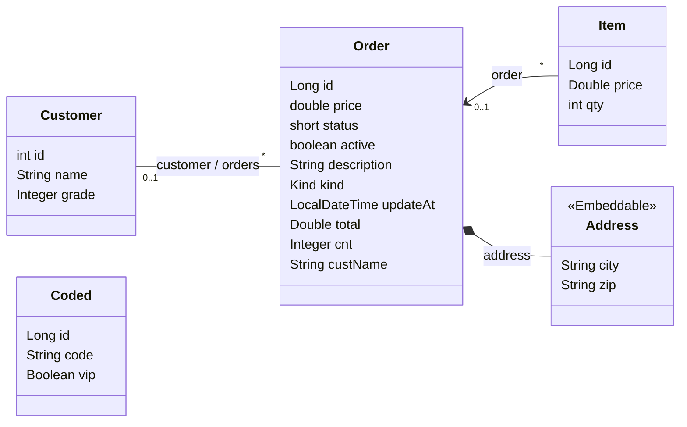

<a id="2-getting-started-kotlin"></a>
# 2. はじめよう（Kotlin）

[Kotlin トラック](README.md) | [マニュアルのホーム](../README.md) | 前: [1. 概要](../01-overview.md) | 次: [3. 条件](03-where.md) | [このページの Java 版](../java/02-getting-started.md)

共通ページ: [1. 概要](../01-overview.md) · [11. エラーと言語](../11-errors-and-languages.md)

---

<a id="requirements"></a>
## 必要な環境

| 項目 | バージョン | 備考 |
|---|---|---|
| Kotlin | 2.x | 設計は kotlinc 1.7.22、2.1.10、2.2.21、2.3.0、2.3.21 で確認しました。 |
| JVM | Java 21 以上 | lambdaQL のビルドと実行に必要です。 |
| `-jvm-target` | 1.8、11、17、21 | 4 つとも、クエリのラムダ式を同じ方法でコンパイルします。 |
| JPA 実装 | Hibernate ORM 6.6 または 7.4 | lambdaQL は Hibernate の HQL を作ります。6.6.53（Spring Boot 3.5.16）と 7.4.13（Spring Boot 4.1.2）でテストしました。他の JPA 実装はサポートしていません。[13. Spring Boot 3 と 4](../13-spring-boot-versions.md) を参照してください。 |
| Jakarta Persistence | 3.1 または 3.2 | Hibernate 6.6 は 3.1、7.4 は 3.2 を使います。 |
| データベース | H2 2.3、MariaDB 10.11、MySQL 8.4、PostgreSQL 17、Oracle 23.26 (23ai) | これらのバージョンのデータベースでテストしました。他のデータベースは今後追加する予定です。 |
| Spring Boot | 3.5 または 4.1 | 任意です。Spring Boot 3.5.16 と 4.1.2 でテストしました。 |
| Kotlin ランタイム | – | lambdaQL は `kotlin-stdlib` や `kotlin-reflect` を依存関係に追加しません。 |

<a id="build-from-source"></a>
## ソースからビルドする

```bash
git clone https://github.com/lambdaql/lambdaql.git
cd lambdaql
./gradlew build
```

- Gradle ラッパーのバージョンは 9.9.1 です。
- ビルドには JDK が 2 つ必要です。インストールされていなければ、Gradle が自動でダウンロードします。
  - **JDK 21**: コンパイルと基本のテストに使います。lambdaQL がサポートするいちばん低い Java のバージョンで動作を確認します。
  - **JDK 25**: Gradle を実行し（`gradle/gradle-daemon-jvm.properties`）、Java 24 以上でだけ使うコード（`src/main/java24`）をコンパイルします。同じテストを Java 25 でもう一度実行します。このコードの JDK は、`-Plql.classfile.jdk=24` のように別のバージョン（24 以上）に変えられます。
- インストール済みの JDK を Gradle が見つけられない場合は、`~/.gradle/gradle.properties` の `org.gradle.java.installations.paths` に JDK のパスを書いてください。
- IntelliJ IDEA では、**Settings > Build Tools > Gradle > Gradle JVM** を JDK 25 に設定してください。

ビルドの主なモジュールは次のとおりです。

| モジュール | アーティファクト | 説明 |
|---|---|---|
| `query` | `lambdaql` | クエリエンジン。Spring Boot 3・4 共通 |
| `spring-data-jpa` | `lambdaql-spring-data-jpa` | Spring Data JPA との連携。Spring Boot 3・4 共通（[12. Spring Data JPA](12-spring-data-jpa.md)） |
| `spring-boot-starter-boot3`、`spring-boot-starter-boot4` | `lambdaql-spring-boot-starter-boot3`、`-boot4` | Spring Boot のバージョンごとのスターター（[13. Spring Boot 3 と 4](../13-spring-boot-versions.md)） |

ユニットテストを実行します。

```bash
./gradlew :query:test
```

このトラックの例の元のコードは `query/src/test/kotlin` にあり、上のタスクで一緒に実行されます。

<a id="use-the-local-build-in-your-project"></a>
### ローカルビルドを自分のプロジェクトで使う

3 つのモジュールの jar をローカルの Maven リポジトリに公開します。

```bash
./gradlew publishToMavenLocal
```

それから、`lambdaql` を自分のプロジェクトに追加します（Gradle Kotlin DSL）。

```gradle-kts
repositories {
    mavenLocal()
    mavenCentral()
}

dependencies {
    implementation("io.github.lambdaql:lambdaql:0.0.2")
}
```

Maven:

```xml
<dependency>
  <groupId>io.github.lambdaql</groupId>
  <artifactId>lambdaql</artifactId>
  <version>0.0.2</version>
</dependency>
```

Spring Boot を使う場合は Boot のバージョンに合った `lambdaql-spring-boot-starter-boot4`（`-boot3`）を、Spring Boot なしで Spring Data JPA だけを使う場合は `lambdaql-spring-data-jpa` を、代わりに追加してください。どちらのアーティファクトも `lambdaql` を一緒に持ち込みます（[12.2](12-spring-data-jpa.md#122-modules) を参照）。

<a id="kotlin-compiler-settings"></a>
## Kotlin コンパイラーの設定

| 設定 | すること | 理由 |
|---|---|---|
| `-Xsam-conversions` | デフォルト（`indy`）のままにします。`-Xsam-conversions=class` は設定 **しないで** ください。 | `class` にすると、Kotlin はシリアライズ可能なラムダ式ではなくクラスを作ります。lambdaQL はそれを読めません。 |
| `-java-parameters` | ストアドプロシージャを呼ぶなら推奨です。 | lambdaQL がパラメーター名をデータベースと比べられるようになります（[8.4](08-procedures-functions.md#84-warning-argument-order) を参照）。 |
| JPA プラグイン | `kotlin("plugin.jpa")` と all-open（または `kotlin("plugin.spring")`）を使います。 | JPA には引数なしのコンストラクターと open なクラスが必要です。Kotlin の JPA エンティティでは一般的な設定です。 |

例（`build.gradle.kts`）:

```gradle-kts
plugins {
    kotlin("jvm")
    kotlin("plugin.jpa")
    kotlin("plugin.spring")   // または all-open プラグイン
}

kotlin {
    compilerOptions {
        javaParameters = true   // -java-parameters と同じ
    }
}
```

プラグインのバージョンは、使っている Kotlin のバージョンに合わせてください。

<a id="example-entities"></a>
## 例で使うエンティティ

Kotlin トラックの例は、次の **例のエンティティ** を使います。
例のエンティティは Java クラスです（[`query/src/test/java/org/lambdaql/query/`](https://github.com/lambdaql/lambdaql/tree/main/query/src/test/java/org/lambdaql/query)）。Kotlin の例は、ユーザーのプロジェクトがコンパイル済みのエンティティを使うのと同じ方法で、これらのクラスを使います。

次の図は、例のエンティティと関連を示します。



| エンティティ | 主なプロパティ（Java の型） | Kotlin では |
|---|---|---|
| `Order`（テーブル `orders`） | `Long id`、`double price`、`short status`、`boolean active`、`String description`、`Integer cnt`、`String custName`、`LocalDateTime updateAt`、`Kind kind`（enum `NORMAL`、`RUSH`）、`Customer customer`（`@ManyToOne`）、`Address address`（`@Embedded`） | `it.price`、`it.status`、`it.isActive`、`it.cnt`、`it.customer?.name` |
| `Customer`（テーブル `customers`） | `int id`、`String name`、`Integer grade` | `it.name`、`it.grade` |
| `Item`（テーブル `items`） | `Long id`、`Order order`（`@ManyToOne`）、`Double price`、`int qty` | `it.order?.id`、`it.qty` |
| `Coded`（テーブル `coded`） | `Long id`、`String code`（`@Convert`）、`Boolean vip`（`YesNoConverter`） | `it.code`、`it.vip` |

Java のエンティティを Kotlin で使うときに知っておくことです。

- `price`、`status`、`active`、`qty` は Java のプリミティブ型です。NULL になれず、Kotlin では `Double`、`Short`、`Boolean`、`Int` です。`boolean active` の getter は `isActive()` なので、Kotlin のプロパティ名は `isActive` です。
- `status` は `Short` なので、Kotlin は `it.status == 1` をコンパイルしません。例では `it.status.toInt() == 1` と書きます。lambdaQL はこの変換を無視して `e0.status = 1` と書きます。
- 参照型（`String`、`Integer`、`Double`、`LocalDateTime`、関連）は、Kotlin ではプラットフォーム型です。コンパイラーは nullable かどうかを知らないので、`!!` なしで比較でき、`?.` と `?:` も使えます。
- Kotlin のエンティティを自分で作ると、NULL になりうるカラムは `Double?` のような nullable 型になります。この場合は `it.price!! > 100.0` のように `!!` を付けないとコンパイルできません。lambdaQL は `!!` を無視します（[3.3](03-where.md#33-basic-form) を参照）。

エンティティのルール:

| ルール | 理由 |
|---|---|
| 普通の public な `var` か `val` のプロパティを使います。 | lambdaQL は getter を読み（`it.price` は getter の `getPrice()`）、JPA の属性にマッピングします。 |
| NULL になりうるカラムには nullable な型（`Double?`、`String?`）を使います。 | Kotlin の non-null 型でも、データベースからの NULL は防げません。Hibernate はチェックなしでカラムの値をフィールドに書き込みます。 |
| クエリでは `@JvmField`、`internal` プロパティ、`value class` のプロパティ、`@get:JvmName` を使わないでください。 | lambdaQL はこれらを JPA の属性にマッピングできません。 |
| `Boolean`、`Int`、`Long`、`Double`（nullable でないもの）は JVM のプリミティブ型です。 | NULL を入れられません。lambdaQL はこれを知っていて、より単純な SQL を作れます。 |

<a id="create-a-querybuilder"></a>
## QueryBuilder を作る

`QueryBuilder` が入り口です。JPA の `EntityManagerFactory` か `EntityManager` が必要です。

<!-- region: ManualKotlinStartTest.kt#create -->
```kotlin
val qb = QueryBuilder(emf)
```

`emf` はアプリケーションの `EntityManagerFactory` です。

`QueryBuilder` はクエリごとに作らず、1 つ作って再利用してください。

<a id="with-spring-boot"></a>
### Spring Boot で

`lambdaql-spring-boot-starter-boot4`（`-boot3`）を使うと、Spring Boot が `QueryBuilder` の Bean を作ります（[12.8](12-spring-data-jpa.md#128-the-querybuilder-bean) を参照）。
スターターなしで使う場合は、下の例のように Bean を宣言してください。

<!-- region: ManualKotlinStartTest.kt#spring-config -->
```kotlin
@Configuration(proxyBeanMethods = false)
class LambdaQlConfig {

    @Bean
    fun queryBuilder(entityManagerFactory: EntityManagerFactory) =
        QueryBuilder(SharedEntityManagerCreator.createSharedEntityManager(entityManagerFactory))
}
```

それから、リポジトリに `QueryBuilder` を注入します。

<!-- region: ManualKotlinStartTest.kt#spring-repository -->
```kotlin
@Repository
open class OrderRepository(private val qb: QueryBuilder) {

    @Transactional(readOnly = true)
    open fun activeOrders(): List<Order> =
        qb.from(Order::class.java)
            .where { it.isActive }
            .toList()
}
```

- 共有 `EntityManager` は現在のトランザクションに結び付いています。`@Transactional` の中では、lambdaQL は同じトランザクションで実行されます。
- Spring Data のリポジトリの中で lambdaQL のクエリを書く方法は、[12. Spring Data JPA](12-spring-data-jpa.md) を参照してください。

コード例: [`ManualKotlinStartTest.kt`](https://github.com/lambdaql/lambdaql/blob/main/query/src/test/kotlin/org/lambdaql/query/ManualKotlinStartTest.kt)（`create`、`spring-config`、`spring-repository`）。

<a id="your-first-query"></a>
## 最初のクエリ

<!-- region: ManualKotlinStartTest.kt#first-query -->
```kotlin
val q = qb.from(Order::class.java).where { it.status.toInt() == 1 && it.price > 100.0 }
assertEquals("select e0 from Order e0 where e0.status = 1 and e0.price > 100.0", q.toHql().hql())
val orders: List<Order> = q.toList()
```

**データベースごとの SQL**

<!-- sql: to-hql -->
```sql
-- H2, MariaDB, Oracle (same)
select …
from orders o1_0
where o1_0.status=1 and o1_0.price>100.0
```

- `qb.from(Order::class.java)` で `Order` に対するクエリを始めます。
- `where { ... }` は条件のラムダ式を 1 つ受け取ります。末尾ラムダ式と `it` を使います。
- `toHql()` はクエリを実行せず、lambdaQL が作った HQL を返します。例の `assertEquals` の文字列がその HQL です。
- `toList()` はクエリを実行し、`List<Order>` を返します。
- `toList()` はすべての行を返します。他の結果関数（`first()`、`one()`、`count()`、`exists()`、`toSet()`）は [結果を受け取る](#getting-the-result) にあります。

`it.status.toInt()` と書いたのは、`status` が `Short` だからです（[例で使うエンティティ](#example-entities) を参照）。lambdaQL はこの変換を無視します。

ラムダ式に直接書いた `1` や `100.0` のような定数は、HQL に直接書かれます。数値、文字列、boolean、`null`、enum 定数、`const val` がこれにあたります。
ラムダ式の外から来た値はバインドパラメーターになります（次の節と [3.3](03-where.md#33-basic-form) を参照）。

<a id="use-values-from-outside-the-lambda"></a>
### ラムダ式の外の値を使う

ラムダ式は、ローカルの値、プロパティ、関数のパラメーターを使えます。これを **キャプチャした値** と呼びます。
lambdaQL はキャプチャした値をバインドパラメーターに変えます。クエリを実行するたびに新しい値を読みます。

<!-- region: ManualKotlinStartTest.kt#captured -->
```kotlin
fun expensive(status: Short, minPrice: Double) =
    qb.from(Order::class.java).where { it.status == status && it.price >= minPrice }

val q = expensive(1, 100.0)
assertEquals("select e0 from Order e0 where e0.status = :p1 and e0.price >= :p2", q.toHql().hql())
```

`status` と `minPrice` は関数のパラメーターなので、バインドパラメーター `:p1`、`:p2` になります。

**データベースごとの SQL**

<!-- sql: start-captured -->
```sql
-- H2, MariaDB, Oracle (same)
select …
from orders o1_0
where o1_0.status=? and o1_0.price>=?
```

<a id="many-where-calls"></a>
### 複数の `where` 呼び出し

`where` は何回でも呼べます。lambdaQL は条件を `AND` でつなぎます。

<!-- region: ManualKotlinStartTest.kt#many-where -->
```kotlin
val q = qb.from(Order::class.java)
    .where { it.isActive }
    .where { it.status.toInt() == 1 || it.status.toInt() == 2 }
assertEquals("select e0 from Order e0 where e0.active = true and (e0.status = 1 or e0.status = 2)", q.toHql().hql())
```

**データベースごとの SQL**

<!-- sql: start-many-where -->
```sql
-- H2, MariaDB, Oracle (same)
select …
from orders o1_0
where o1_0.active=true and (o1_0.status=1 or o1_0.status=2)
```

条件を段階的に追加するときに便利です。

<!-- region: ManualKotlinStartTest.kt#step-where -->
```kotlin
val minPrice: Double? = 100.0
var query = qb.from(Order::class.java).where { it.isActive }
if (minPrice != null) {
    query = query.where { it.price >= minPrice }
}
assertEquals("select e0 from Order e0 where e0.active = true and e0.price >= :p1", query.toHql().hql())
val orders = query.toList()
```

<a id="paths-to-other-entities"></a>
### 関連エンティティ

`it.customer?.name` のようなパスは、結合したエンティティのカラムを指します。
`where` では、lambdaQL は顧客のテーブルを結合します。顧客のない注文も結果に出うる条件なら `left join`、出えない条件なら内部結合の `join` です。顧客がなくても条件が真になりうるかどうかが、その基準です。
下の条件は顧客のある注文でだけ真になるので内部結合の `join` になり、顧客のない注文は結果に **入りません**。

<!-- region: ManualKotlinStartTest.kt#join-path -->
```kotlin
val name = "Kim"
val q = qb.from(Order::class.java).where { it.customer?.name == name }
assertEquals("select e0 from Order e0 join e0.customer j1 where j1.name = :p1", q.toHql().hql())
```

`name` は non-null の `String` なので、lambdaQL は単純な `=` を使います（[3.6](03-where.md#36-null-rules) を参照）。

**データベースごとの SQL**

<!-- sql: inner-join -->
```sql
-- H2, MariaDB, Oracle (same)
select …
from orders o1_0
join customers c1_0 on c1_0.id=o1_0.customer_id
where c1_0.name=?
```

他の条件の例です。

- `it.status == 1 || it.customer?.name == name`: 顧客がなくても `status` が 1 なら結果に出るので、`left join` です。
- `it.customer?.name == null`: 顧客のない注文も結果に出るので、`left join` です。
- `it.customer!!.name == name`: 顧客のある注文だけが結果に出るので、内部結合の `join` です。

顧客のない注文だけを探すには、`it.customer == null` のように関連そのものを比較してください。結合なしの `e0.customer is null` になります。
詳しいルールは [3.10](03-where.md#310-association-paths) を参照してください。

コード例: [`ManualKotlinStartTest.kt`](https://github.com/lambdaql/lambdaql/blob/main/query/src/test/kotlin/org/lambdaql/query/ManualKotlinStartTest.kt)（`first-query`、`captured`、`many-where`、`step-where`、`join-path`）。

<a id="getting-the-result"></a>
## 結果を受け取る

クエリを実行する方法は `toList()` だけではありません。lambdaQL には結果関数が 6 つあります。

| 関数 | 戻り値の型 | 呼べる場所 | 何をするか |
|---|---|---|---|
| `toList()` | `List<T>` | `where` の後、および `orderBy` / `limit` / `offset` の後 | すべての行（または 1 ページ分）を返します。 |
| `first()` | `Optional<T>` | `where` の後、および `orderBy` / `limit` / `offset` の後 | 最初の行を返します。読むのは 1 行だけです。 |
| `one()` | `Optional<T>` | `where` の後だけ | ただ 1 つの行を返します。2 行以上が合うと `NonUniqueResultException` を投げます。読むのは最大 2 行です。 |
| `count()` | `Long` | `where` の後だけ | 条件に合う行の数を返します。 |
| `exists()` | `Boolean` | `where` の後だけ | 合う行があれば `true` を返します。読むのは 1 行で、エンティティは読み込みません。 |
| `toSet()` | `SequencedSet<T>` | `where` の後、および `orderBy` / `limit` / `offset` の後 | すべての行（または 1 ページ分）を、行の順序を保つ Set として返します。Set のサイズが行数より小さいと `IllegalStateException` を投げます。 |

「`where` の後」とは、`qb.from(...)` と `where { }` で得られるクエリ（型は `SelectQuery`）のことです。このマニュアルではこれを **where 段階** と呼びます。`where` なしで、`qb.from(...)` のすぐ後でもこれらの関数を呼べます。

`first()` と `one()` は Java の `Optional` を返します。

<a id="first"></a>
### `first()`

最初の行を 1 つ返します。

<!-- region: ManualKotlinStartTest.kt#first -->
```kotlin
val byPrice = qb.from(Order::class.java).orderBy { o -> asc(o.price) }
val cheapest: Order? = byPrice.first().orElse(null)
// first() reads one row like limit(1); paging adds the id as the last sort key
assertEquals("select e0 from Order e0 order by e0.price asc, e0.id asc", byPrice.limit(1).toHql().hql())

// without orderBy there is no order by: "first" is any matching row
val active = qb.from(Order::class.java).where { it.isActive }
val firstActive: Order? = active.first().orElse(null)
assertEquals("select e0 from Order e0 where e0.active = true", active.limit(1).toHql().hql())
```

`first()` は `limit(1)` と同じクエリを実行します。そのため、例では `limit(1)` の HQL で `first()` の HQL を示します。

**データベースごとの SQL**

<!-- sql: first#2 -->
```sql
-- H2, Oracle
select …
from orders o1_0
where o1_0.active=true
order by o1_0.id
fetch first ? rows only

-- MariaDB
select …
from orders o1_0
where o1_0.active=true
order by o1_0.id
limit ?
```

`first()` は 1 行を読むので、ページングしたクエリになります。lambdaQL は最後のソートキーとして `id` を追加し（[4.8](04-order-paging.md#tie-breaker-automatic-id) を参照）、Hibernate はデータベースごとにページングを書きます。H2 と Oracle では `fetch first ? rows only`、MariaDB では `limit ?` です。`?` は 1 です。
例のエンティティの `price` は NULL になれないので、HQL に `nulls` の部分はありません。NULL になりうるソートキーには `nulls first` か `nulls last` が付きます（[4. ソートとページング](04-order-paging.md) を参照）。

<a id="one"></a>
### `one()`

条件に合う行が多くても 1 つのときに `one()` を使います。たとえばユニークキーで探すときです。
行がなければ `Optional.empty()` です。2 行以上あると `jakarta.persistence.NonUniqueResultException` を投げます。合う行ならどれでもよいときは `first()` を使ってください。

<!-- region: ManualKotlinStartTest.kt#one -->
```kotlin
val id: Long = knownId
val byId = qb.from(Order::class.java).where { it.id == id }
assertEquals("select e0 from Order e0 where e0.id = :p1", byId.toHql().hql())
val order: Order? = byId.one().orElse(null)

// two or more rows: an exception (use first() if any row is fine)
assertThrows<NonUniqueResultException> { qb.from(Order::class.java).where { it.isActive }.one() }
```

**データベースごとの SQL**

<!-- sql: one -->
```sql
-- H2, Oracle
select …
from orders o1_0
where o1_0.id=?
fetch first ? rows only

-- MariaDB
select …
from orders o1_0
where o1_0.id=?
limit ?
```

`one()` はデータベースに最大 2 行を求めます。2 行目があるかどうかを知るにはそれで十分です。そのため SQL には `fetch first ? rows only`（H2、Oracle）または `limit ?`（MariaDB）が付き、`?` は 2 です。ここでは順序は関係ないので、`order by` はありません。

<a id="count-and-a-paged-screen"></a>
### `count()` とページ付きの画面

`count()` は条件に合う行の数を返します。

<!-- region: ManualKotlinStartTest.kt#count -->
```kotlin
val active = qb.from(Order::class.java).where { it.isActive }
val total: Long = active.count()                       // every matching row
val page = active.orderBy { o -> desc(o.price) }.limit(2)
assertEquals("select e0 from Order e0 where e0.active = true order by e0.price desc, e0.id asc", page.toHql().hql())
val rows: List<Order> = page.toList()
```

例の `active.count()` は HQL `select count(e0) from Order e0 where e0.active = true` を実行します。

**データベースごとの SQL**

<!-- sql: count -->
```sql
-- H2, MariaDB, Oracle (same)
select count(o1_0.id)
from orders o1_0
where o1_0.active=true
```

Hibernate は `count(e0)` を `select count(o1_0.id)` に変えます。つまり id の列を数えます。count クエリにはページングはありません。

ページ付きの画面では、where 段階のクエリを値に入れておきます。その値で `count()` を呼んで全体の件数を得ます。次に、同じ値で `orderBy { }.limit(...).toList()` を呼んでページを得ます。

**カラムの指定。** `count(カラム)` は、そのカラムが NULL でない行の数を返します。`distinct()` の後では、異なる値の数を返します。

<!-- region: KotlinCountColumnTest.kt#count-column -->
```kotlin
// rows whose description is not NULL
val orders = qb.from(Order::class.java)
val described = orders.count { it.description }
```

<!-- region: KotlinCountColumnTest.kt#count-distinct -->
```kotlin
// the number of different customers that have an order
val orders = qb.from(Order::class.java)
val customers = orders.distinct().count { it.customer?.id }
```

2 つの例は、HQL `select count(e0.description) from Order e0` と `select count(distinct e0.customer.id) from Order e0` を実行します。
カラムのパスの結合は `select` と同じです。

エンティティそのもの（`count { it }`）を指定すると、行全体を数えます。HQL は `count(*)` です。

<!-- region: KotlinCountColumnTest.kt#count-row -->
```kotlin
// { it } is the whole row: count(*)
val all = qb.from(Order::class.java).count { it }
```

コード例: [`KotlinCountColumnTest.kt`](https://github.com/lambdaql/lambdaql/blob/main/query/src/test/kotlin/org/lambdaql/query/KotlinCountColumnTest.kt)（`count-column`、`count-distinct`、`count-row`）。

<a id="exists"></a>
### `exists()`

`exists()` は、合う行が 1 つでもあれば `true` を返します。`select 1` を実行し、読むのは最大 1 行です。エンティティは読み込みません。

<!-- region: ManualKotlinStartTest.kt#exists -->
```kotlin
val status3 = qb.from(Order::class.java).where { it.status.toInt() == 3 }
assertEquals("select e0 from Order e0 where e0.status = 3", status3.toHql().hql())
val anyStatus3: Boolean = status3.exists()
val anyStatus9: Boolean = qb.from(Order::class.java).where { it.status.toInt() == 9 }.exists()
```

`exists()` が実行する HQL は `select 1 from Order e0 where e0.status = 3` です。SQL は H2 と Oracle では `select 1 from orders o1_0 where … fetch first ? rows only`、MariaDB では `… limit ?` の形で、`?` は 1 です。

<a id="toset"></a>
### `toSet()`

`toSet()` は `toList()` と同じ方法でクエリを実行し、`SequencedSet<T>` を返します。
返すオブジェクトは `LinkedHashSet` なので、要素は行の順序を保ちます。`orderBy { }` があれば、ソートの順序に従います。

<!-- region: ManualKotlinStartTest.kt#to-set -->
```kotlin
val sorted = qb.from(Order::class.java).orderBy { o -> desc(o.price) }
assertEquals("select e0 from Order e0 order by e0.price desc", sorted.toHql().hql())
val byPrice: java.util.SequencedSet<Order> = sorted.toSet()
```

SQL は `toList()` と同じです。lambdaQL は `distinct` を **付けません**。

- エンティティの行には主キーがあります。そのため、1 つのテーブルだけを照会しても同じ行が 2 回出ることはありません。
- lambdaQL が結合するのは to-one の関連だけです。コレクションは `exists` サブクエリになります。そのため、結合で行が重複することはありません。
- したがって `distinct` は結果を変えず、コストを増やすだけです。（データベースの制約とは関係ありません。Oracle 23.26 は LOB の列の `distinct` も受け付けます。実測の結果です。）

値の照会（`select`）では、`distinct()` と `toSet()` が `select distinct` を使います（[6.7](06-select-group.md#67-distinct-paging-and-results) を参照）。

**サイズのチェック。** Set のサイズが行数より小さいと、`toSet()` は `IllegalStateException` を投げます。次の場合がこれにあたります。

- エンティティの `equals` / `hashCode` が、違う 2 つの行を等しいと判断する場合
- `@Id` が一意でない場合（たとえばビューにマッピングしたエンティティ）

チェックがないと、行が何の兆候もなく失われます。このような場合は `toList()` を使ってください。
Kotlin の `data class` は、プライマリコンストラクターのプロパティだけを比べます。`@Id` がプライマリコンストラクターにないと、違う 2 つの行の `equals` の結果が true になることがあります。

例のエンティティ `Tag` の `equals` は名前だけを比べます。名前が同じ 2 つの行があると、`toSet()` は例外を投げます。

<!-- region: ManualKotlinStartTest.kt#to-set-check -->
```kotlin
// Tag.equals compares only the name: two different rows would become one element, so toSet() refuses
assertThrows<IllegalStateException> { qb.from(Tag::class.java).toSet() }
val tags: List<Tag> = qb.from(Tag::class.java).toList()   // use toList() instead
assertEquals(2, tags.size)
```

コード例: [`ManualKotlinStartTest.kt`](https://github.com/lambdaql/lambdaql/blob/main/query/src/test/kotlin/org/lambdaql/query/ManualKotlinStartTest.kt)（`first`、`one`、`count`、`exists`、`to-set`、`to-set-check`）。

<a id="things-to-know"></a>
## 知っておくこと

| ルール | 例 |
|---|---|
| ラムダ式のリテラルを渡してください。 | `where { it.isActive }` |
| ラムダ式を先に Kotlin の関数型に保存しないでください。 | `val f: (Order) -> Boolean = { it.isActive }; where(f)` は拒否されます。 |
| クエリのラムダ式を `inline fun` の中で作らないでください。 | 拒否されます。ヘルパーを inline でなくするか、呼び出し側からラムダ式を渡してください。 |
| ラムダ式は 1 つの式でなければなりません（条件、ソート、照会）。 | ラムダ式の中のループやローカルの `val`/`var` は拒否されます。 |
| 必ず実行されなければならないコードをラムダ式に入れないでください。lambdaQL はラムダ式を呼び出さず、バイトコードの opcode を解析します。 | `println(...)` のような副作用のある呼び出しは拒否されます。 |
| Java 21〜23 で実行する場合は、新しい JDK でコンパイルしたクラスに対応する ASM のバージョンが必要です。 | lambdaQL は Java 21〜23 では ASM 9.11.1 を使います（Java 28 までのクラスファイルを読めます）。Java 24 以上では、実行中の JDK の `java.lang.classfile` で読むので、ASM のバージョンとは関係ありません。 |

Kotlin の制限はすべて [9. Kotlin の注意点](09-kotlin-notes.md#914-kotlin-limits-kc1-to-kc21) にあります。

<a id="next"></a>
## 次へ

- [3. 条件（`where`）](03-where.md): すべての演算子と null のルール。
- [4. ソートとページング](04-order-paging.md)

---

[Kotlin トラック](README.md) | 前: [1. 概要](../01-overview.md) | 次: [3. 条件](03-where.md) | [このページの Java 版](../java/02-getting-started.md)
