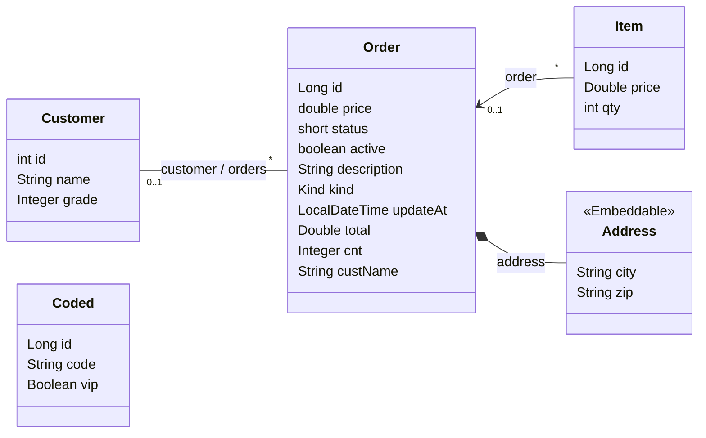

<a id="2-getting-started-kotlin"></a>
# 2. 시작하기 (Kotlin)

[Kotlin 트랙](README.md) | [매뉴얼 홈](../README.md) | 이전: [1. 개요](../01-overview.md) | 다음: [3. 조건](03-where.md) | [이 페이지의 Java 버전](../java/02-getting-started.md)

공통 페이지: [1. 개요](../01-overview.md) · [11. 오류와 언어](../11-errors-and-languages.md)

---

<a id="requirements"></a>
## 요구 사항

| 항목 | 버전 | 참고 |
|---|---|---|
| Kotlin | 2.x | 설계는 kotlinc 1.7.22, 2.1.10, 2.2.21, 2.3.0, 2.3.21로 확인했습니다. |
| JVM | Java 21 이상 | lambdaQL을 빌드하고 실행하는 데 필요합니다. |
| `-jvm-target` | 1.8, 11, 17 또는 21 | 네 가지 모두 쿼리 람다 표현식을 같은 방식으로 컴파일합니다. |
| JPA 구현체 | Hibernate ORM 6.6 또는 7.4 | lambdaQL은 Hibernate HQL을 만듭니다. 6.6.53(Spring Boot 3.5.16)과 7.4.13(Spring Boot 4.1.2)으로 테스트했습니다. 다른 JPA 구현체는 지원하지 않습니다. [13. Spring Boot 3과 4](../13-spring-boot-versions.md)를 참고하십시오. |
| Jakarta Persistence | 3.1 또는 3.2 | Hibernate 6.6은 3.1, 7.4는 3.2를 씁니다. |
| 데이터베이스 | H2 2.3, MariaDB 10.11, MySQL 8.4, PostgreSQL 17, Oracle 23.26 (23ai) | 해당 버전의 DB에서 테스트를 진행하였습니다. 다른 데이터베이스는 추가로 진행될 예정입니다. |
| Spring Boot | 3.5 또는 4.1 | 선택 사항입니다. Spring Boot 3.5.16과 4.1.2로 테스트했습니다. |
| Kotlin 런타임 | – | lambdaQL은 의존성에 `kotlin-stdlib`나 `kotlin-reflect`를 추가하지 않습니다. |

<a id="build-from-source"></a>
## 소스에서 빌드

```bash
git clone https://github.com/codebit0/lambdaql.git
cd lambdaql
./gradlew build
```

- Gradle 래퍼 버전은 9.9.1입니다.
- 빌드에는 JDK 두 개가 필요합니다. 설치되어 있지 않으면 Gradle이 자동으로 내려받습니다.
  - **JDK 21**: 컴파일과 기본 테스트에 씁니다. lambdaQL이 지원하는 가장 낮은 Java 버전에서 동작을 확인합니다.
  - **JDK 25**: Gradle을 실행하고(`gradle/gradle-daemon-jvm.properties`), Java 24 이상에서만 쓰는 코드(`src/main/java24`)를 컴파일합니다. 같은 테스트를 Java 25에서 한 번 더 실행합니다. 이 코드의 JDK는 `-Plql.classfile.jdk=24`처럼 다른 버전(24 이상)으로 바꿀 수 있습니다.
- 이미 설치한 JDK를 Gradle이 찾지 못하면 `~/.gradle/gradle.properties`의 `org.gradle.java.installations.paths`에 JDK 경로를 적으십시오.
- IntelliJ IDEA에서는 **Settings > Build Tools > Gradle > Gradle JVM**을 JDK 25로 설정하십시오.

빌드의 주요 모듈은 다음과 같습니다.

| 모듈 | 아티팩트 | 설명 |
|---|---|---|
| `query` | `lambdaql` | 쿼리 엔진. Spring Boot 3·4 공통 |
| `spring-data-jpa` | `lambdaql-spring-data-jpa` | Spring Data JPA 연동. Spring Boot 3·4 공통([12. Spring Data JPA](12-spring-data-jpa.md)) |
| `spring-boot-starter-boot3`, `spring-boot-starter-boot4` | `lambdaql-spring-boot-starter-boot3`, `-boot4` | Spring Boot 버전별 스타터([13. Spring Boot 3과 4](../13-spring-boot-versions.md)) |

단위 테스트를 실행합니다.

```bash
./gradlew :query:test
```

이 트랙의 예제 원본은 `query/src/test/kotlin`에 있으며, 위 작업으로 함께 실행됩니다.

<a id="use-the-local-build-in-your-project"></a>
### 로컬 빌드를 프로젝트에서 사용하기

세 모듈의 jar를 로컬 Maven 저장소에 배포합니다.

```bash
./gradlew publishToMavenLocal
```

그다음 `lambdaql`을 프로젝트에 추가합니다(Gradle Kotlin DSL).

```gradle-kts
repositories {
    mavenLocal()
    mavenCentral()
}

dependencies {
    implementation("io.github.lambdaql:lambdaql:0.0.1")
}
```

Maven:

```xml
<dependency>
  <groupId>io.github.lambdaql</groupId>
  <artifactId>lambdaql</artifactId>
  <version>0.0.1</version>
</dependency>
```

Spring Boot를 사용하면 Boot 버전에 맞는 `lambdaql-spring-boot-starter-boot4`(`-boot3`)를, Spring Boot 없이 Spring Data JPA만 사용하면 `lambdaql-spring-data-jpa`를 대신 추가하십시오. 두 아티팩트는 `lambdaql`을 함께 가져옵니다([12.2](12-spring-data-jpa.md#122-modules) 참고).

<a id="kotlin-compiler-settings"></a>
## Kotlin 컴파일러 설정

| 설정 | 할 일 | 이유 |
|---|---|---|
| `-Xsam-conversions` | 기본값(`indy`)을 유지하십시오. `-Xsam-conversions=class`를 설정하지 **마십시오**. | `class`로 설정하면 Kotlin은 직렬화 가능한 람다 표현식 대신 클래스를 만듭니다. lambdaQL은 이를 읽을 수 없습니다(제한 KC1). |
| `-java-parameters` | 저장 프로시저를 호출한다면 권장합니다. | 그러면 lambdaQL이 파라미터 이름을 데이터베이스와 비교할 수 있습니다([8.4](08-procedures-functions.md#84-warning-argument-order) 참고). |
| JPA 플러그인 | `kotlin("plugin.jpa")`와 all-open(또는 `kotlin("plugin.spring")`)을 사용하십시오. | JPA에는 인자 없는 생성자와 open 클래스가 필요합니다. Kotlin JPA 엔티티에서는 일반적인 설정입니다. |

예(`build.gradle.kts`):

```gradle-kts
plugins {
    kotlin("jvm")
    kotlin("plugin.jpa")
    kotlin("plugin.spring")   // 또는 all-open 플러그인
}

kotlin {
    compilerOptions {
        javaParameters = true   // -java-parameters와 같음
    }
}
```

플러그인 버전은 사용하는 Kotlin 버전에 맞추십시오.

<a id="example-entities"></a>
## 예제 엔티티

Kotlin 트랙의 예제는 다음 **예제 엔티티**를 사용합니다.
예제 엔티티는 Java 클래스입니다([`query/src/test/java/org/lambdaql/query/`](https://github.com/codebit0/lambdaql/tree/main/query/src/test/java/org/lambdaql/query)). Kotlin 예제는 사용자 프로젝트가 컴파일된 엔티티를 쓰는 것과 같은 방식으로 이 클래스를 사용합니다.

다음 다이어그램은 예제 엔티티와 연관을 보여 줍니다.



| 엔티티 | 주요 속성(Java 타입) | Kotlin에서 |
|---|---|---|
| `Order`(테이블 `orders`) | `Long id`, `double price`, `short status`, `boolean active`, `String description`, `Integer cnt`, `String custName`, `LocalDateTime updateAt`, `Kind kind`(enum `NORMAL`, `RUSH`), `Customer customer`(`@ManyToOne`), `Address address`(`@Embedded`) | `it.price`, `it.status`, `it.isActive`, `it.cnt`, `it.customer?.name` |
| `Customer`(테이블 `customers`) | `int id`, `String name`, `Integer grade` | `it.name`, `it.grade` |
| `Item`(테이블 `items`) | `Long id`, `Order order`(`@ManyToOne`), `Double price`, `int qty` | `it.order?.id`, `it.qty` |
| `Coded`(테이블 `coded`) | `Long id`, `String code`(`@Convert`), `Boolean vip`(`YesNoConverter`) | `it.code`, `it.vip` |

Java 엔티티를 Kotlin에서 쓸 때 알아 둘 점입니다.

- `price`, `status`, `active`, `qty`는 Java 기본형입니다. NULL이 될 수 없고, Kotlin에서는 `Double`, `Short`, `Boolean`, `Int`입니다. `boolean active`의 getter는 `isActive()`이므로 Kotlin 속성 이름은 `isActive`입니다.
- `status`는 `Short`이므로 Kotlin은 `it.status == 1`을 컴파일하지 않습니다. 예제는 `it.status.toInt() == 1`로 씁니다. lambdaQL은 이 변환을 무시하고 `e0.status = 1`로 씁니다.
- 참조 타입(`String`, `Integer`, `Double`, `LocalDateTime`, 연관)은 Kotlin에서 플랫폼 타입입니다. 컴파일러가 nullable 여부를 모르므로 `!!` 없이 비교할 수 있고, `?.`와 `?:`도 쓸 수 있습니다.
- 직접 Kotlin 엔티티를 만들면 NULL일 수 있는 컬럼은 `Double?`처럼 nullable 타입이 됩니다. 이때는 `it.price!! > 100.0`처럼 `!!`를 붙여야 컴파일됩니다. lambdaQL은 `!!`를 무시합니다([3.3](03-where.md#33-basic-form) 참고).

엔티티 규칙:

| 규칙 | 이유 |
|---|---|
| 일반적인 public `var`나 `val` 속성을 사용하십시오. | lambdaQL은 getter를 읽고(`it.price`는 getter `getPrice()`) JPA 속성에 매핑합니다. |
| NULL일 수 있는 컬럼에는 nullable 타입(`Double?`, `String?`)을 사용하십시오. | Kotlin의 non-null 타입은 데이터베이스에서 오는 NULL을 막지 못합니다. Hibernate는 검사 없이 컬럼 값을 필드에 씁니다. |
| 쿼리에서 `@JvmField`, `internal` 속성, `value class` 속성, `@get:JvmName`을 사용하지 마십시오. | lambdaQL은 이들을 JPA 속성에 매핑할 수 없습니다(제한 KC15, KC16). |
| `Boolean`, `Int`, `Long`, `Double`(nullable 아님)은 JVM 기본형입니다. | NULL을 담을 수 없습니다. lambdaQL은 이를 알고 더 단순한 SQL을 만들 수 있습니다. |

<a id="create-a-querybuilder"></a>
## QueryBuilder 만들기

`QueryBuilder`는 진입점입니다. JPA `EntityManagerFactory` 또는 `EntityManager`가 필요합니다.

<!-- region: ManualKotlinStartTest.kt#create -->
```kotlin
val qb = QueryBuilder(emf)
```

`emf`는 애플리케이션의 `EntityManagerFactory`입니다.

`QueryBuilder`를 쿼리마다 만들지 않고 하나만 만들어 재사용하십시오.

<a id="with-spring-boot"></a>
### Spring Boot에서

`lambdaql-spring-boot-starter-boot4`(`-boot3`)를 사용하면 Spring Boot가 `QueryBuilder` 빈을 만듭니다([12.8](12-spring-data-jpa.md#128-the-querybuilder-bean) 참고).
스타터 없이 사용하려면 아래 예시처럼 빈을 선언하십시오.

<!-- region: ManualKotlinStartTest.kt#spring-config -->
```kotlin
@Configuration(proxyBeanMethods = false)
class LambdaQlConfig {

    @Bean
    fun queryBuilder(entityManagerFactory: EntityManagerFactory) =
        QueryBuilder(SharedEntityManagerCreator.createSharedEntityManager(entityManagerFactory))
}
```

그다음 리포지토리에 `QueryBuilder`를 주입합니다.

<!-- region: ManualKotlinStartTest.kt#spring-repository -->
```kotlin
@Repository
open class OrderRepository(private val qb: QueryBuilder) {

    @Transactional(readOnly = true)
    open fun activeOrders(): List<Order> =
        qb.from(Order::class.java)
            .where { it.isActive }
            .toList()
}
```

- 공유 `EntityManager`는 현재 트랜잭션에 연결됩니다. `@Transactional` 안에서 lambdaQL은 같은 트랜잭션으로 실행됩니다.
- Spring Data 리포지토리 안에서 lambdaQL 쿼리를 작성하려면 [12. Spring Data JPA](12-spring-data-jpa.md)를 참고하십시오.

예제 코드: [`ManualKotlinStartTest.kt`](https://github.com/codebit0/lambdaql/blob/main/query/src/test/kotlin/org/lambdaql/query/ManualKotlinStartTest.kt)(`create`, `spring-config`, `spring-repository`).

<a id="your-first-query"></a>
## 첫 쿼리

<!-- region: ManualKotlinStartTest.kt#first-query -->
```kotlin
val q = qb.from(Order::class.java).where { it.status.toInt() == 1 && it.price > 100.0 }
assertEquals("select e0 from Order e0 where e0.status = 1 and e0.price > 100.0", q.toHql().hql())
val orders: List<Order> = q.toList()
```

**데이터베이스별 SQL**

<!-- sql: to-hql -->
```sql
-- H2, MariaDB, Oracle (same)
select …
from orders o1_0
where o1_0.status=1 and o1_0.price>100.0
```

- `qb.from(Order::class.java)`는 `Order`에 대한 쿼리를 시작합니다.
- `where { ... }`는 조건 람다 표현식 하나를 받습니다. 후행 람다 표현식과 `it`을 사용하십시오.
- `toHql()`은 쿼리를 실행하지 않고 lambdaQL이 만든 HQL을 반환합니다. 예제의 `assertEquals` 문자열이 그 HQL입니다.
- `toList()`는 쿼리를 실행하고 `List<Order>`를 반환합니다.
- `toList()`는 모든 행을 반환합니다. 다른 결과 함수(`first()`, `one()`, `count()`, `exists()`, `toSet()`)는 [결과 가져오기](#getting-the-result)에 있습니다.

`it.status.toInt()`는 `status`가 `Short`라서 쓴 것입니다([예제 엔티티](#example-entities) 참고). lambdaQL은 이 변환을 무시합니다.

람다 표현식에 직접 쓴 `1`과 `100.0` 같은 상수는 HQL에 직접 기록합니다. 숫자, 문자열, boolean, `null`, enum 상수, `const val`이 이에 해당합니다.
람다 표현식 밖에서 온 값은 바인드 파라미터가 됩니다(다음 절과 [3.3](03-where.md#33-basic-form) 참고).

<a id="use-values-from-outside-the-lambda"></a>
### 람다 표현식 밖의 값 사용하기

람다 표현식은 지역 값, 속성, 함수 파라미터를 사용할 수 있습니다. 이를 **캡처 값**이라고 합니다.
lambdaQL은 캡처 값을 바인드 파라미터로 바꿉니다. 쿼리가 실행될 때마다 새 값을 읽습니다.

<!-- region: ManualKotlinStartTest.kt#captured -->
```kotlin
fun expensive(status: Short, minPrice: Double) =
    qb.from(Order::class.java).where { it.status == status && it.price >= minPrice }

val q = expensive(1, 100.0)
assertEquals("select e0 from Order e0 where e0.status = :p1 and e0.price >= :p2", q.toHql().hql())
```

`status`와 `minPrice`는 함수 파라미터이므로 바인드 파라미터 `:p1`, `:p2`가 됩니다.

**데이터베이스별 SQL**

<!-- sql: start-captured -->
```sql
-- H2, MariaDB, Oracle (same)
select …
from orders o1_0
where o1_0.status=? and o1_0.price>=?
```

<a id="many-where-calls"></a>
### 여러 번의 `where` 호출

`where`는 여러 번 호출할 수 있습니다. lambdaQL은 조건들을 `AND`로 결합합니다.

<!-- region: ManualKotlinStartTest.kt#many-where -->
```kotlin
val q = qb.from(Order::class.java)
    .where { it.isActive }
    .where { it.status.toInt() == 1 || it.status.toInt() == 2 }
assertEquals("select e0 from Order e0 where e0.active = true and (e0.status = 1 or e0.status = 2)", q.toHql().hql())
```

**데이터베이스별 SQL**

<!-- sql: start-many-where -->
```sql
-- H2, MariaDB, Oracle (same)
select …
from orders o1_0
where o1_0.active=true and (o1_0.status=1 or o1_0.status=2)
```

조건을 단계별로 추가할 때 유용합니다.

<!-- region: ManualKotlinStartTest.kt#step-where -->
```kotlin
val minPrice: Double? = 100.0
var query = qb.from(Order::class.java).where { it.isActive }
if (minPrice != null) {
    query = query.where { it.price >= minPrice }
}
assertEquals("select e0 from Order e0 where e0.active = true and e0.price >= :p1", query.toHql().hql())
val orders = query.toList()
```

<a id="paths-to-other-entities"></a>
### 연관 엔티티

`it.customer?.name` 같은 경로는 조인한 엔티티의 컬럼을 가리킵니다.
`where`에서 lambdaQL은 고객 테이블을 조인합니다. 고객이 없는 주문도 결과에 나올 수 있는 조건이면 `left join`, 나올 수 없는 조건이면 inner `join`입니다. 고객이 없어도 조건이 참이 될 수 있는지가 그 기준입니다.
아래 조건은 고객이 있는 주문에서만 참이므로 inner `join`이고, 고객이 없는 주문은 결과에 **없습니다**.

<!-- region: ManualKotlinStartTest.kt#join-path -->
```kotlin
val name = "Kim"
val q = qb.from(Order::class.java).where { it.customer?.name == name }
assertEquals("select e0 from Order e0 join e0.customer j1 where j1.name = :p1", q.toHql().hql())
```

`name`은 non-null `String`이므로 lambdaQL은 단순한 `=`를 씁니다([3.6](03-where.md#36-null-rules) 참고).

**데이터베이스별 SQL**

<!-- sql: inner-join -->
```sql
-- H2, MariaDB, Oracle (same)
select …
from orders o1_0
join customers c1_0 on c1_0.id=o1_0.customer_id
where c1_0.name=?
```

다른 조건의 예입니다.

- `it.status == 1 || it.customer?.name == name`: 고객이 없어도 `status`가 1이면 결과에 나오므로 `left join`입니다.
- `it.customer?.name == null`: 고객이 없는 주문도 결과에 나오므로 `left join`입니다.
- `it.customer!!.name == name`: 고객이 있는 주문만 결과에 나오므로 inner `join`입니다.

고객이 없는 주문만 찾으려면 `it.customer == null`처럼 연관 자체를 비교하십시오. 조인 없이 `e0.customer is null`이 됩니다.
자세한 규칙은 [3.10](03-where.md#310-association-paths)을 참고하십시오.

예제 코드: [`ManualKotlinStartTest.kt`](https://github.com/codebit0/lambdaql/blob/main/query/src/test/kotlin/org/lambdaql/query/ManualKotlinStartTest.kt)(`first-query`, `captured`, `many-where`, `step-where`, `join-path`).

<a id="getting-the-result"></a>
## 결과 가져오기

쿼리를 실행하는 방법은 `toList()`만이 아닙니다. lambdaQL에는 결과 함수가 여섯 개 있습니다.

| 함수 | 반환 타입 | 호출할 수 있는 곳 | 하는 일 |
|---|---|---|---|
| `toList()` | `List<T>` | `where` 뒤, 그리고 `orderBy` / `limit` / `offset` 뒤 | 모든 행(또는 한 페이지)을 반환합니다. |
| `first()` | `Optional<T>` | `where` 뒤, 그리고 `orderBy` / `limit` / `offset` 뒤 | 첫 행을 반환합니다. 한 행만 읽습니다. |
| `one()` | `Optional<T>` | `where` 뒤에서만 | 유일한 행을 반환합니다. 2개 이상의 행이 맞으면 `NonUniqueResultException`을 던집니다. 최대 2행을 읽습니다. |
| `count()` | `Long` | `where` 뒤에서만 | 조건에 맞는 행의 수를 반환합니다. |
| `exists()` | `Boolean` | `where` 뒤에서만 | 맞는 행이 있으면 `true`를 반환합니다. 한 행을 읽고, 엔티티는 로드하지 않습니다. |
| `toSet()` | `SequencedSet<T>` | `where` 뒤, 그리고 `orderBy` / `limit` / `offset` 뒤 | 모든 행(또는 한 페이지)을 행 순서를 유지하는 Set으로 반환합니다. Set의 크기가 행 수보다 작으면 `IllegalStateException`을 던집니다. |

"`where` 뒤"는 `qb.from(...)`과 `where { }`로 얻은 쿼리(타입 `SelectQuery`)를 말합니다. 이 매뉴얼에서는 이를 **where 단계**라고 부릅니다. `where` 없이 `qb.from(...)` 바로 뒤에서도 이 함수들을 호출할 수 있습니다.

`first()`와 `one()`은 Java `Optional`을 반환합니다.

<a id="first"></a>
### `first()`

첫 행 하나를 반환합니다.

<!-- region: ManualKotlinStartTest.kt#first -->
```kotlin
val byPrice = qb.from(Order::class.java).orderBy { o -> asc(o.price) }
val cheapest: Order? = byPrice.first().orElse(null)
// first() reads one row like limit(1); paging adds the id as the last sort key
assertEquals("select e0 from Order e0 order by e0.price asc, e0.id asc", byPrice.limit(1).toHql().hql())

// without orderBy, "first" is the row with the smallest id
val active = qb.from(Order::class.java).where { it.isActive }
val firstActive: Order? = active.first().orElse(null)
assertEquals("select e0 from Order e0 where e0.active = true order by e0.id asc", active.limit(1).toHql().hql())
```

`first()`는 `limit(1)`과 같은 쿼리를 실행합니다. 그래서 예제는 `limit(1)`의 HQL로 `first()`의 HQL을 보여 줍니다.

**데이터베이스별 SQL**

<!-- sql: first#2 -->
```sql
-- H2, Oracle
select …
from orders o1_0
where o1_0.active=true
order by o1_0.id
fetch first ? rows only

-- MariaDB
select …
from orders o1_0
where o1_0.active=true
order by o1_0.id
limit ?
```

`first()`는 한 행을 읽으므로 페이징 쿼리입니다. lambdaQL은 `id`를 마지막 정렬 키로 추가하고([4.8](04-order-paging.md#tie-breaker-automatic-id) 참고), Hibernate는 데이터베이스마다 페이징을 씁니다: H2와 Oracle은 `fetch first ? rows only`, MariaDB는 `limit ?`입니다. `?`는 1입니다.
예제 엔티티의 `price`는 NULL이 될 수 없으므로 HQL에 `nulls` 부분이 없습니다. NULL이 될 수 있는 정렬 키에는 `nulls first`나 `nulls last`가 붙습니다([4. 정렬과 페이징](04-order-paging.md) 참고).

<a id="one"></a>
### `one()`

조건에 맞는 행이 최대 하나일 때 `one()`을 쓰십시오. 예를 들어 유일 키로 찾을 때입니다.
행이 없으면 `Optional.empty()`입니다. 2개 이상의 행은 `jakarta.persistence.NonUniqueResultException`을 던집니다. 맞는 행 아무거나 괜찮다면 `first()`를 쓰십시오.

<!-- region: ManualKotlinStartTest.kt#one -->
```kotlin
val id: Long = knownId
val byId = qb.from(Order::class.java).where { it.id == id }
assertEquals("select e0 from Order e0 where e0.id = :p1", byId.toHql().hql())
val order: Order? = byId.one().orElse(null)

// two or more rows: an exception (use first() if any row is fine)
assertThrows<NonUniqueResultException> { qb.from(Order::class.java).where { it.isActive }.one() }
```

**데이터베이스별 SQL**

<!-- sql: one -->
```sql
-- H2, Oracle
select …
from orders o1_0
where o1_0.id=?
fetch first ? rows only

-- MariaDB
select …
from orders o1_0
where o1_0.id=?
limit ?
```

`one()`은 데이터베이스에 최대 2행을 요청합니다. 두 번째 행이 있는지 알기에는 그것으로 충분합니다. 그래서 SQL에 `fetch first ? rows only`(H2, Oracle) 또는 `limit ?`(MariaDB)가 있고, `?`는 2입니다. 여기서는 순서가 중요하지 않으므로 `order by`가 없습니다.

<a id="count-and-a-paged-screen"></a>
### `count()`와 페이징 화면

`count()`는 조건에 맞는 행의 수를 반환합니다.

<!-- region: ManualKotlinStartTest.kt#count -->
```kotlin
val active = qb.from(Order::class.java).where { it.isActive }
val total: Long = active.count()                       // every matching row
val page = active.orderBy { o -> desc(o.price) }.limit(2)
assertEquals("select e0 from Order e0 where e0.active = true order by e0.price desc, e0.id asc", page.toHql().hql())
val rows: List<Order> = page.toList()
```

예제의 `active.count()`는 HQL `select count(e0) from Order e0 where e0.active = true`를 실행합니다.

**데이터베이스별 SQL**

<!-- sql: count -->
```sql
-- H2, MariaDB, Oracle (same)
select count(o1_0.id)
from orders o1_0
where o1_0.active=true
```

Hibernate는 `count(e0)`를 `select count(o1_0.id)`로 바꿉니다. 즉 id 열을 셉니다. count 쿼리에는 페이징이 없습니다.

페이징 화면에서는 where 단계의 쿼리를 값에 담아 두십시오. 그 값에서 `count()`를 호출해 전체 수를 얻습니다. 그다음 같은 값에서 `orderBy { }.limit(...).toList()`를 호출해 페이지를 얻습니다.

**컬럼 지정.** `count(컬럼)`은 그 컬럼이 NULL이 아닌 행의 수를 반환합니다. `distinct()` 뒤에서는 서로 다른 값의 수를 반환합니다.

<!-- region: KotlinCountColumnTest.kt#count-column -->
```kotlin
// rows whose description is not NULL
val orders = qb.from(Order::class.java)
val described = orders.count { it.description }
```

<!-- region: KotlinCountColumnTest.kt#count-distinct -->
```kotlin
// the number of different customers that have an order
val orders = qb.from(Order::class.java)
val customers = orders.distinct().count { it.customer?.id }
```

두 예제는 HQL `select count(e0.description) from Order e0`와 `select count(distinct e0.customer.id) from Order e0`를 실행합니다.
컬럼 경로의 조인은 `select`와 같습니다.

엔티티 자체(`count { it }`)를 지정하면 행 전체를 셉니다. HQL은 `count(*)`입니다.

<!-- region: KotlinCountColumnTest.kt#count-row -->
```kotlin
// { it } is the whole row: count(*)
val all = qb.from(Order::class.java).count { it }
```

예제 코드: [`KotlinCountColumnTest.kt`](https://github.com/codebit0/lambdaql/blob/main/query/src/test/kotlin/org/lambdaql/query/KotlinCountColumnTest.kt)(`count-column`, `count-distinct`, `count-row`).

<a id="exists"></a>
### `exists()`

`exists()`는 맞는 행이 하나라도 있으면 `true`를 반환합니다. `select 1`을 실행하고 최대 한 행만 읽습니다. 엔티티는 로드하지 않습니다.

<!-- region: ManualKotlinStartTest.kt#exists -->
```kotlin
val status3 = qb.from(Order::class.java).where { it.status.toInt() == 3 }
assertEquals("select e0 from Order e0 where e0.status = 3", status3.toHql().hql())
val anyStatus3: Boolean = status3.exists()
val anyStatus9: Boolean = qb.from(Order::class.java).where { it.status.toInt() == 9 }.exists()
```

`exists()`가 실행하는 HQL은 `select 1 from Order e0 where e0.status = 3`입니다. SQL은 H2와 Oracle에서 `select 1 from orders o1_0 where … fetch first ? rows only`, MariaDB에서 `… limit ?`의 모양이고, `?`는 1입니다.

<a id="toset"></a>
### `toSet()`

`toSet()`은 `toList()`와 같은 방식으로 쿼리를 실행하고 `SequencedSet<T>`를 반환합니다.
반환 객체는 `LinkedHashSet`이므로 요소가 행 순서를 유지합니다. `orderBy { }`가 있으면 정렬 순서를 따릅니다.

<!-- region: ManualKotlinStartTest.kt#to-set -->
```kotlin
val sorted = qb.from(Order::class.java).orderBy { o -> desc(o.price) }
assertEquals("select e0 from Order e0 order by e0.price desc", sorted.toHql().hql())
val byPrice: java.util.SequencedSet<Order> = sorted.toSet()
```

SQL은 `toList()`와 같습니다. lambdaQL은 `distinct`를 **추가하지 않습니다**.

- 엔티티 행에는 기본 키가 있습니다. 따라서 테이블 하나만 조회해도 같은 행이 두 번 나오지 않습니다.
- lambdaQL은 to-one 연관만 조인합니다. 컬렉션은 `exists` 서브쿼리로 바뀝니다. 따라서 조인으로 행이 중복되지 않습니다.
- 그러므로 `distinct`는 결과를 바꾸지 못하고 비용만 늘립니다. (데이터베이스 제약과는 무관합니다. Oracle 23.26은 LOB 열의 `distinct`도 허용합니다. 실측 결과입니다.)

값 조회(`select`)에서는 `distinct()`와 `toSet()`이 `select distinct`를 사용합니다([6.7](06-select-group.md#67-distinct-paging-and-results) 참고).

**크기 검사.** Set의 크기가 행 수보다 작으면 `toSet()`은 `IllegalStateException`을 던집니다. 다음 경우가 해당합니다.

- 엔티티의 `equals` / `hashCode`가 서로 다른 두 행을 같다고 판단하는 경우
- `@Id`가 유일하지 않은 경우(예: 뷰에 매핑한 엔티티)

검사가 없으면 행이 아무 표시 없이 유실됩니다. 이런 경우에는 `toList()`를 사용하십시오.
Kotlin `data class`는 주 생성자의 속성만 비교합니다. `@Id`가 주 생성자에 없으면 서로 다른 두 행의 `equals` 결과가 true일 수 있습니다.

예제 엔티티 `Tag`의 `equals`는 이름만 비교합니다. 이름이 같은 두 행이 있으면 `toSet()`은 예외를 던집니다.

<!-- region: ManualKotlinStartTest.kt#to-set-check -->
```kotlin
// Tag.equals compares only the name: two different rows would become one element, so toSet() refuses
assertThrows<IllegalStateException> { qb.from(Tag::class.java).toSet() }
val tags: List<Tag> = qb.from(Tag::class.java).toList()   // use toList() instead
assertEquals(2, tags.size)
```

예제 코드: [`ManualKotlinStartTest.kt`](https://github.com/codebit0/lambdaql/blob/main/query/src/test/kotlin/org/lambdaql/query/ManualKotlinStartTest.kt)(`first`, `one`, `count`, `exists`, `to-set`, `to-set-check`).

<a id="things-to-know"></a>
## 알아 둘 점

| 규칙 | 예 |
|---|---|
| 람다 표현식 리터럴을 전달하십시오. | `where { it.isActive }` |
| 람다 표현식을 먼저 Kotlin 함수 타입에 저장하지 마십시오. | `val f: (Order) -> Boolean = { it.isActive }; where(f)`는 거부됩니다(KC4). |
| 쿼리 람다 표현식을 `inline fun` 안에서 만들지 마십시오. | 거부됩니다(KC2). 헬퍼를 non-inline으로 만들거나, 호출하는 쪽에서 람다 표현식을 전달하십시오. |
| 람다 표현식은 식 하나여야 합니다(조건, 정렬, 조회). | 람다 표현식 안의 반복문과 지역 `val`/`var`는 거부됩니다. |
| 반드시 실행되어야 하는 코드를 람다 표현식에 넣지 마십시오. lambdaQL은 람다 표현식을 호출하지 않고 바이트 opcode를 분석합니다. | `println(...)`처럼 부수 효과가 있는 호출은 거부됩니다. |
| Java 21~23에서 실행하면 새 JDK로 컴파일한 클래스에 맞는 ASM 버전이 필요합니다. | lambdaQL은 Java 21~23에서 ASM 9.11.1을 사용합니다(Java 28까지의 클래스 파일을 읽음). Java 24 이상에서는 실행 중인 JDK의 `java.lang.classfile`로 읽으므로 ASM 버전과 관계가 없습니다. |

Kotlin의 모든 제한은 [9. Kotlin 노트](09-kotlin-notes.md#914-kotlin-limits-kc1-to-kc21)에 있습니다.

<a id="next"></a>
## 다음

- [3. 조건(`where`)](03-where.md): 모든 연산자와 null 규칙.
- [4. 정렬과 페이징](04-order-paging.md)

---

[Kotlin 트랙](README.md) | 이전: [1. 개요](../01-overview.md) | 다음: [3. 조건](03-where.md) | [이 페이지의 Java 버전](../java/02-getting-started.md)
