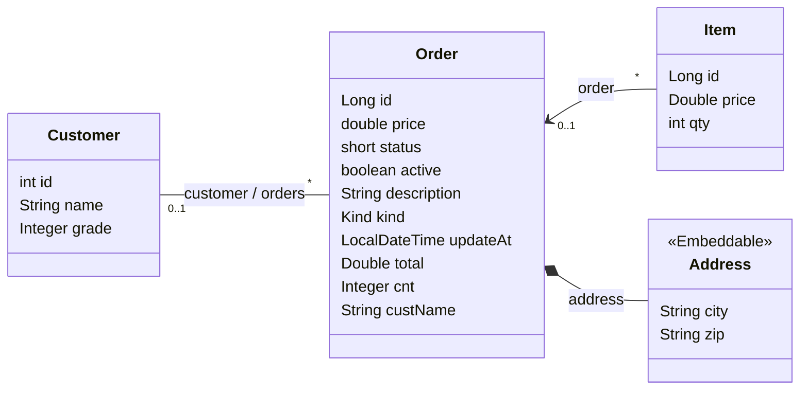

<a id="2-getting-started-java"></a>
# 2. 入门（Java）

[Java 路线](README.md) | [手册首页](../README.md) | 上一章：[1. 概述](../01-overview.md) | 下一章：[3. 条件](03-where.md) | [本页的 Kotlin 版本](../kotlin/02-getting-started.md)

公共页面：[1. 概述](../01-overview.md) · [11. 错误与语言](../11-errors-and-languages.md)

---

<a id="requirements"></a>
## 环境要求

| 项目 | 版本 | 说明 |
|---|---|---|
| Java | 21 及以上 | 构建和运行 lambdaQL 都需要。 |
| JPA 实现 | Hibernate ORM 6.6 或 7.4 | lambdaQL 生成 Hibernate HQL。已用 6.6.53（Spring Boot 3.5.16）和 7.4.13（Spring Boot 4.1.2）测试。不支持其他 JPA 实现。请参阅 [13. Spring Boot 3 与 4](../13-spring-boot-versions.md)。 |
| Jakarta Persistence | 3.1 或 3.2 | Hibernate 6.6 使用 3.1，7.4 使用 3.2。 |
| 数据库 | H2 2.3、MariaDB 10.11、MySQL 8.4、PostgreSQL 17、Oracle 23.26 (23ai) | 已在这些版本的数据库上测试。其他数据库的测试将陆续进行。 |
| Spring Boot | 3.5 或 4.1 | 可选。已用 3.5.16 和 4.1.2 测试。 |
| 编译器 | javac | 不保证支持由 ECJ（Eclipse 编译器）编译的 Lambda 表达式。请参阅 [9. Java 说明](09-java-notes.md#912-compiler-and-build)。 |

<a id="build-from-source"></a>
## 从源码构建

```bash
git clone https://github.com/lambdaql/lambdaql.git
cd lambdaql
./gradlew build
```

- Gradle wrapper 版本为 9.9.1。
- 构建需要两个 JDK。如果未安装，Gradle 会自动下载。
  - **JDK 21**：用于编译和默认测试。在 lambdaQL 支持的最低 Java 版本上验证行为。
  - **JDK 25**：运行 Gradle（`gradle/gradle-daemon-jvm.properties`），并编译只在 Java 24 及以上使用的代码（`src/main/java24`）。同一套测试在 Java 25 上再运行一次。这部分代码的 JDK 可以像 `-Plql.classfile.jdk=24` 这样换成其他版本（24 及以上）。
- 如果 Gradle 找不到已安装的 JDK，请在 `~/.gradle/gradle.properties` 的 `org.gradle.java.installations.paths` 中写入 JDK 路径。
- 在 IntelliJ IDEA 中，把 **Settings > Build Tools > Gradle > Gradle JVM** 设置为 JDK 25。

构建的主要模块如下。

| 模块 | 构件 | 说明 |
|---|---|---|
| `query` | `lambdaql` | 查询引擎。Spring Boot 3·4 通用 |
| `spring-data-jpa` | `lambdaql-spring-data-jpa` | Spring Data JPA 集成。Spring Boot 3·4 通用（[12. Spring Data JPA](12-spring-data-jpa.md)） |
| `spring-boot-starter-boot3`、`spring-boot-starter-boot4` | `lambdaql-spring-boot-starter-boot3`、`-boot4` | 按 Spring Boot 版本区分的 starter（[13. Spring Boot 3 与 4](../13-spring-boot-versions.md)） |

运行单元测试。

```bash
./gradlew :query:test
```

默认在 H2 上运行。要在其他数据库上运行，请加上 `-Dlql.db=mariadb` 或 `-Dlql.db=oracle`。

<a id="use-the-local-build-in-your-project"></a>
### 在项目中使用本地构建

把三个模块的 jar 发布到本地 Maven 仓库。

```bash
./gradlew publishToMavenLocal
```

然后把 `lambdaql` 添加到项目中。

Gradle（Groovy DSL）：

```groovy
repositories {
    mavenLocal()
    mavenCentral()
}

dependencies {
    implementation 'io.github.lambdaql:lambdaql:0.0.2'
}
```

Maven：

```xml
<dependency>
  <groupId>io.github.lambdaql</groupId>
  <artifactId>lambdaql</artifactId>
  <version>0.0.2</version>
</dependency>
```

使用 Spring Boot 时，请改为添加与 Boot 版本对应的 `lambdaql-spring-boot-starter-boot4`（`-boot3`）；不使用 Spring Boot 而只使用 Spring Data JPA 时，请改为添加 `lambdaql-spring-data-jpa`。这两个构件会一并带入 `lambdaql`（参阅 [12.2](12-spring-data-jpa.md#122-modules)）。

<a id="recommended-compiler-option--parameters"></a>
### 推荐的编译器选项：`-parameters`

请使用 `-parameters` 选项编译。这样 lambdaQL 就能根据存储过程桩方法的参数名发现顺序颠倒的参数（参阅 [8.4](08-procedures-functions.md#84-warning-argument-order)）。

Gradle（Groovy DSL）：

```groovy
tasks.withType(JavaCompile).configureEach {
    options.compilerArgs << '-parameters'
}
```

Maven（`maven-compiler-plugin`）：

```xml
<configuration>
  <parameters>true</parameters>
</configuration>
```

<a id="example-entities"></a>
## 示例实体

Java 路线的示例使用以下示例实体。完整代码见 [`Order.java`](https://github.com/lambdaql/lambdaql/blob/main/query/src/test/java/org/lambdaql/query/Order.java)、[`Customer.java`](https://github.com/lambdaql/lambdaql/blob/main/query/src/test/java/org/lambdaql/query/Customer.java)、[`Item.java`](https://github.com/lambdaql/lambdaql/blob/main/query/src/test/java/org/lambdaql/query/Item.java)。

下图展示示例实体及其关联。



| 实体 | 表 | 主要属性 |
|---|---|---|
| `Order` | `orders` | `id`（`Long`，自动生成）、`price`（`double`）、`status`（`short`）、`active`（`boolean`，getter `isActive()`）、`description`（`String`）、`kind`（enum `Order.Kind`：`NORMAL`、`RUSH`）、`updateAt`（`LocalDateTime`）、`customer`（`@ManyToOne` `Customer`）、`total`（`Double`）、`cnt`（`Integer`）、`custName`（`String`）、`address`（`@Embedded` `Address`：`city`、`zip`） |
| `Customer` | `customers` | `id`（`int`）、`name`（`String`）、`grade`（`Integer`）、`orders`（`@OneToMany` `Order`） |
| `Item` | `items` | `id`（`Long`，自动生成）、`order`（`@ManyToOne` `Order`）、`price`（`Double`）、`qty`（`int`） |

`Order` 没有 `Item` 集合。订单的明细通过 `Item.order` 查找（参阅 [5. 子查询](05-subquery.md)）。

实体规则：

- lambdaQL 读取 **getter**（`o.getPrice()`、`o.isActive()`）。它通过 JPA Metamodel 把 getter 映射到 JPA 属性。不直接读取字段。
- 不需要生成代码（没有 Q 类，也没有静态元模型）。
- 基本类型字段（`double price`、`short status`）不能为 NULL，装箱类型字段（`Double total`、`Integer cnt`）可以为 NULL。这会影响 `==` 和 NULL 处理。请参阅 [9. Java 说明](09-java-notes.md#92-boxing-and-unboxing)。

<a id="create-a-querybuilder"></a>
## 创建 QueryBuilder

`QueryBuilder` 是入口。它需要 JPA `EntityManagerFactory` 或 `EntityManager`。

<!-- region: ManualJavaStartTest.java#create -->
```java
// one builder for the whole application; each query opens and closes its own EntityManager
QueryBuilder qb = new QueryBuilder(emf);
// or on an EntityManager that you manage: the queries run on it (and in its transaction)
QueryBuilder qbOnEm = new QueryBuilder(em);
```

不要为每个查询创建 `QueryBuilder`，请只创建一个并重复使用。

<a id="with-spring-boot"></a>
### 在 Spring Boot 中

使用 `lambdaql-spring-boot-starter-boot4`（`-boot3`）时，Spring Boot 会创建 `QueryBuilder` bean（参阅 [12.8](12-spring-data-jpa.md#128-the-querybuilder-bean)）。
不使用 starter 时，请像下面的示例那样声明 bean。
示例中的配置类和仓库类是 `static` 嵌套类。在应用中通常作为顶层类。

<!-- region: ManualJavaStartTest.java#config -->
```java
@Configuration
public static class LambdaQlConfig {

    @Bean
    public QueryBuilder queryBuilder(EntityManagerFactory entityManagerFactory) {
        return new QueryBuilder(SharedEntityManagerCreator.createSharedEntityManager(entityManagerFactory));
    }
}
```

然后把 `QueryBuilder` 注入仓库。

<!-- region: ManualJavaStartTest.java#repository -->
```java
@Repository
public static class OrderRepository {

    private final QueryBuilder qb;

    public OrderRepository(QueryBuilder qb) {
        this.qb = qb;
    }

    @Transactional(readOnly = true)
    public List<Order> activeOrders() {
        return qb.from(Order.class)
                 .where(o -> o.isActive())
                 .toList();
    }
}
```

- 共享的 `EntityManager` 绑定到当前事务。在 `@Transactional` 内部，lambdaQL 在同一个事务中执行。
- 要在 Spring Data 仓库中编写 lambdaQL 查询，请参阅 [12. Spring Data JPA](12-spring-data-jpa.md)。

示例代码：[`ManualJavaStartTest.java`](https://github.com/lambdaql/lambdaql/blob/main/query/src/test/java/org/lambdaql/query/ManualJavaStartTest.java)（`create`、`config`、`repository`）。

<a id="your-first-query"></a>
## 第一个查询

<!-- region: ManualJavaStartTest.java#first-query -->
```java
SelectQuery<Order> query = qb.from(Order.class)
        .where(o -> o.getStatus() == 1 && o.getPrice() > 100);
assertEquals("select e0 from Order e0 where e0.status = 1 and e0.price > 100.0", query.toHql().hql());
List<Order> orders = query.toList();
```

**各数据库的 SQL**

<!-- sql: to-hql -->
```sql
-- H2, MariaDB, Oracle (same)
select …
from orders o1_0
where o1_0.status=1 and o1_0.price>100.0
```

- `qb.from(Order.class)` 开始一个针对 `Order` 的查询。
- `where(...)` 接收一个条件 Lambda 表达式。
- `toHql()` 不执行查询，而是返回 HQL 和参数。`assertEquals` 中的字符串就是 lambdaQL 生成的 HQL。
- `toList()` 执行查询并返回 `List<Order>`。
- `toList()` 返回所有行。其他结果函数（`first()`、`one()`、`count()`、`exists()`、`toSet()`）见[获取结果](#getting-the-result)。

直接写在 Lambda 表达式中的 `1`、`100.0` 这类常量会直接写入 HQL。数字、字符串、boolean、`null`、enum 常量都属于此类。
`price` 是 `double`，因此 javac 把 `100` 编译为小数 `100.0`。
来自 Lambda 表达式外部的值成为绑定参数（参阅下一节和 [3.3](03-where.md#33-basic-form)）。

<a id="use-values-from-outside-the-lambda"></a>
### 使用 Lambda 表达式外部的值

Lambda 表达式可以使用局部变量、字段和方法参数。这些称为**捕获值**。
lambdaQL 把捕获值转换为绑定参数。每次执行查询时都会读取新的值。

<!-- region: ManualJavaStartTest.java#captured -->
```java
int status = 1;
double minPrice = 100;
SelectQuery<Order> query = qb.from(Order.class)
        .where(o -> o.getStatus() == status && o.getPrice() >= minPrice);
assertEquals("select e0 from Order e0 where e0.status = :p1 and e0.price >= :p2", query.toHql().hql());
List<Order> orders = query.toList();
```

**各数据库的 SQL**

<!-- sql: start-captured -->
```sql
-- H2, MariaDB, Oracle (same)
select …
from orders o1_0
where o1_0.status=? and o1_0.price>=?
```

<a id="many-where-calls"></a>
### 多次调用 `where`

`where` 可以多次调用。lambdaQL 用 `AND` 连接这些条件。

<!-- region: ManualJavaStartTest.java#many-where -->
```java
SelectQuery<Order> query = qb.from(Order.class)
        .where(o -> o.isActive())
        .where(o -> o.getStatus() == 1 || o.getStatus() == 2);
assertEquals("select e0 from Order e0 where e0.active = true and (e0.status = 1 or e0.status = 2)",
        query.toHql().hql());
```

**各数据库的 SQL**

<!-- sql: start-many-where -->
```sql
-- H2, MariaDB, Oracle (same)
select …
from orders o1_0
where o1_0.active=true and (o1_0.status=1 or o1_0.status=2)
```

逐步添加条件时很有用。

<!-- region: ManualJavaStartTest.java#step-by-step -->
```java
Double minPrice = input;                         // for example from a search form; may be null
SelectQuery<Order> query = qb.from(Order.class).where(o -> o.isActive());
if (minPrice != null) {
    query = query.where(o -> o.getPrice() >= minPrice);
}
assertEquals("select e0 from Order e0 where e0.active = true and e0.price >= :p1", query.toHql().hql());
List<Order> orders = query.toList();
```

构建器变量的类型是 `SelectQuery<Order>`（也可以使用 `var`）。`where` 向同一个查询对象添加条件并返回该对象。

<a id="paths-to-other-entities"></a>
### 关联实体

`o.getCustomer().getName()` 这样的路径指代所连接实体的列。
在 `where` 中，lambdaQL 会连接客户表。如果条件允许没有客户的订单出现在结果中，则使用 `left join`；不允许时使用 inner `join`。判断标准是没有客户时条件能否为真。
下面的条件只对有客户的订单为真，因此是 inner `join`，没有客户的订单**不在**结果中。

<!-- region: SelectQueryTest.java#inner-join -->
```java
String name = "Kim";
RenderedQuery q = qb.from(Order.class).where(o -> o.getCustomer().getName().equals(name)).toHql();
assertEquals("select e0 from Order e0 join e0.customer j1 where j1.name = :p1", q.hql());
```

**各数据库的 SQL**

<!-- sql: inner-join -->
```sql
-- H2, MariaDB, Oracle (same)
select …
from orders o1_0
join customers c1_0 on c1_0.id=o1_0.customer_id
where c1_0.name=?
```

要查找没有客户的订单，请比较关联本身。`o.getCustomer() == null` 生成 `e0.customer is null`（没有连接）。
使用 null 守卫（`o.getCustomer() == null || ...`）时，没有客户的订单也满足条件，因此成为 `left join`，这些订单也会保留在结果中。
请参阅 [3.10](03-where.md#310-association-paths)。

示例代码：[`ManualJavaStartTest.java`](https://github.com/lambdaql/lambdaql/blob/main/query/src/test/java/org/lambdaql/query/ManualJavaStartTest.java)（`first-query`、`captured`、`many-where`、`step-by-step`）、[`SelectQueryTest.java`](https://github.com/lambdaql/lambdaql/blob/main/query/src/test/java/org/lambdaql/query/SelectQueryTest.java)（`inner-join`）。

<a id="getting-the-result"></a>
## 获取结果

执行查询的方法不只有 `toList()`。lambdaQL 有六个结果函数。

| 函数 | 返回类型 | 可调用的位置 | 作用 |
|---|---|---|---|
| `toList()` | `List<T>` | `where` 之后，以及 `orderBy` / `limit` / `offset` 之后 | 返回所有行（或一页）。 |
| `first()` | `Optional<T>` | `where` 之后，以及 `orderBy` / `limit` / `offset` 之后 | 返回第一行。只读取一行。 |
| `one()` | `Optional<T>` | 只能在 `where` 之后 | 返回唯一的一行。有 2 行或更多行匹配时抛出 `NonUniqueResultException`。最多读取 2 行。 |
| `count()` | `long` | 只能在 `where` 之后 | 返回满足条件的行数。 |
| `exists()` | `boolean` | 只能在 `where` 之后 | 有匹配行时返回 `true`。读取一行，不加载实体。 |
| `toSet()` | `SequencedSet<T>` | `where` 之后，以及 `orderBy` / `limit` / `offset` 之后 | 以保持行顺序的 Set 返回所有行（或一页）。Set 的大小小于行数时抛出 `IllegalStateException`。 |

"`where` 之后"指通过 `qb.from(...)` 和 `where(...)` 得到的查询（类型 `SelectQuery`）。本手册称之为 **where 阶段**。也可以不写 `where`，直接在 `qb.from(...)` 之后调用这些函数。

下面的示例使用[示例实体](#example-entities)，在 H2、MariaDB、Oracle 上得到相同的结果。
`price` 是 `double`，因此排序中没有 `nulls` 部分；`Order` 有 enum `kind`。

<a id="first"></a>
### `first()`

返回第一行。

<!-- region: ResultQueryTest.java#first -->
```java
import static org.lambdaql.query.By.asc;

Optional<Order> cheapest = qb.from(Order.class)
        .orderBy(o -> asc(o.getPrice()))
        .first();
// without orderBy there is no order by: "first" is any matching row
Optional<Order> firstActive = qb.from(Order.class).where(o -> o.isActive()).first();
Optional<Order> none = qb.from(Order.class).where(o -> o.getStatus() == 9).first();
```

**各数据库的 SQL**

<!-- sql: first -->
```sql
-- H2, Oracle
select …
from orders o1_0
order by o1_0.price,o1_0.id
fetch first ? rows only

-- MariaDB
select …
from orders o1_0
order by o1_0.price,o1_0.id
limit ?
```

**各数据库的 SQL**

<!-- sql: first#2 -->
```sql
-- H2, Oracle
select …
from orders o1_0
where o1_0.active=true
order by o1_0.id
fetch first ? rows only

-- MariaDB
select …
from orders o1_0
where o1_0.active=true
order by o1_0.id
limit ?
```

`first()` 只读取一行，因此是分页查询。lambdaQL 把 `id` 添加为最后一个排序键（参阅 [4.8](04-order-paging.md#tie-breaker-automatic-id)），Hibernate 按数据库写出分页：H2 和 Oracle 是 `fetch first ? rows only`，MariaDB 是 `limit ?`。`?` 是 1。

<a id="one"></a>
### `one()`

满足条件的行最多一行时使用 `one()`，例如按唯一键查找时。
没有行时得到 `Optional.empty()`。2 行或更多行时抛出 `jakarta.persistence.NonUniqueResultException`。如果任意一条匹配行都可以，请使用 `first()`。

<!-- region: ResultQueryTest.java#one -->
```java
long id = knownId;
Optional<Order> order = qb.from(Order.class).where(o -> o.getId() == id).one();
Optional<Order> missing = qb.from(Order.class).where(o -> o.getId() == -1L).one();
// two or more rows: an exception (use first() if any row is fine)
assertThrows(NonUniqueResultException.class, () -> qb.from(Order.class).where(o -> o.isActive()).one());
```

**各数据库的 SQL**

<!-- sql: one -->
```sql
-- H2, Oracle
select …
from orders o1_0
where o1_0.id=?
fetch first ? rows only

-- MariaDB
select …
from orders o1_0
where o1_0.id=?
limit ?
```

`one()` 最多向数据库请求 2 行。这足以判断是否存在第二行。因此 SQL 中有 `fetch first ? rows only`（H2、Oracle）或 `limit ?`（MariaDB），`?` 是 2。这里顺序无关紧要，所以没有 `order by`。

<a id="count-and-a-paged-screen"></a>
### `count()` 与分页画面

`count()` 返回满足条件的行数。

<!-- region: ResultQueryTest.java#count -->
```java
SelectQuery<Order> active = qb.from(Order.class).where(o -> o.isActive());
long total = active.count();                                   // every matching row
List<Order> page = active.orderBy(o -> desc(o.getPrice())).limit(2).toList();
```

示例中的 `active.count()` 执行 HQL `select count(e0) from Order e0 where e0.active = true`。

**各数据库的 SQL**

<!-- sql: count -->
```sql
-- H2, MariaDB, Oracle (same)
select count(o1_0.id)
from orders o1_0
where o1_0.active=true
```

Hibernate 把 `count(e0)` 变成 `select count(o1_0.id)`，即统计 id 列。计数查询没有分页。

在分页画面中，请把 where 阶段的查询保存在变量中。在该变量上调用 `count()` 得到总数。然后在同一个变量上调用 `orderBy(...).limit(...).toList()` 得到一页。

**指定列。** `count(列)` 返回该列不为 NULL 的行数。在 `distinct()` 之后返回不同值的个数。

<!-- region: CountColumnTest.java#count-column -->
```java
// rows whose description is not NULL
SelectQuery<Order> orders = qb.from(Order.class);
long described = orders.count(o -> o.getDescription());
```

<!-- region: CountColumnTest.java#count-distinct -->
```java
// the number of different customers that have an order
SelectQuery<Order> orders = qb.from(Order.class);
long customers = orders.distinct().count(o -> o.getCustomer().getId());
```

这两个示例执行 HQL `select count(e0.description) from Order e0` 和 `select count(distinct e0.customer.id) from Order e0`。
列路径的连接与 `select` 相同。

指定实体本身（`count(o -> o)`）时统计整行。HQL 为 `count(*)`。

<!-- region: CountColumnTest.java#count-row -->
```java
// o -> o is the whole row: count(*)
long active = qb.from(Order.class).where(o -> o.isActive()).count(o -> o);
```

示例代码：[`CountColumnTest.java`](https://github.com/lambdaql/lambdaql/blob/main/query/src/test/java/org/lambdaql/query/CountColumnTest.java)（`count-column`、`count-distinct`、`count-row`）。

<a id="exists"></a>
### `exists()`

只要有一行匹配，`exists()` 就返回 `true`。它执行 `select 1`，最多只读取一行。不加载实体。

<!-- region: ResultQueryTest.java#exists -->
```java
boolean anyRush = qb.from(Order.class).where(o -> o.getKind() == Order.Kind.RUSH).exists();
boolean anyStatus9 = qb.from(Order.class).where(o -> o.getStatus() == 9).exists();
```

**各数据库的 SQL**

<!-- sql: exists -->
```sql
-- H2, Oracle
select 1
from orders o1_0
where o1_0.kind='RUSH'
fetch first ? rows only

-- MariaDB
select 1
from orders o1_0
where o1_0.kind='RUSH'
limit ?
```

HQL 是 `select 1 from Order e0 where e0.kind = org.lambdaql.query.Order$Kind.RUSH`。SQL 只选择常量 `1`，因此不读取列，分页（`?` 是 1）在第一行之后停止。

<a id="toset"></a>
### `toSet()`

`toSet()` 以与 `toList()` 相同的方式执行查询，并返回 `SequencedSet<T>`。
返回对象是 `LinkedHashSet`，因此元素保持行的顺序。有 `orderBy` 时按排序顺序。

<!-- region: ResultQueryTest.java#to-set -->
```java
java.util.SequencedSet<Order> byPrice = qb.from(Order.class)
        .orderBy(o -> desc(o.getPrice()))
        .toSet();
```

SQL 与 `toList()` 相同。lambdaQL **不添加** `distinct`。

- 实体行有主键。因此即使只查询一张表，同一行也不会出现两次。
- lambdaQL 只连接 to-one 关联。集合会变成 `exists` 子查询。因此连接不会造成行重复。
- 所以 `distinct` 不会改变结果，只会增加开销。（这与数据库的限制无关。Oracle 23.26 也允许 LOB 列上的 `distinct`。这是实测结果。）

在值查询（`select`）中，`distinct()` 和 `toSet()` 使用 `select distinct`（参阅 [6.7](06-select-group.md#67-distinct-paging-and-results)）。

**大小检查。** Set 的大小小于行数时，`toSet()` 抛出 `IllegalStateException`。以下情况属于此类。

- 实体的 `equals` / `hashCode` 把两个不同的行判断为相等
- `@Id` 不唯一（例如映射到视图的实体）

如果没有这项检查，行会在没有任何提示的情况下丢失。这些情况请使用 `toList()`。

下面示例中的 `Tag.equals` 只比较名称，而表中有两行名称相同。

<!-- region: ResultQueryTest.java#to-set-check -->
```java
// Tag.equals compares only the name: two different rows would become one element, so toSet() refuses
assertThrows(IllegalStateException.class, () -> qb.from(Tag.class).toSet());
assertEquals(2, qb.from(Tag.class).toList().size());
```

示例代码：[`ResultQueryTest.java`](https://github.com/lambdaql/lambdaql/blob/main/query/src/test/java/org/lambdaql/query/ResultQueryTest.java)（`first`、`one`、`count`、`exists`、`to-set`、`to-set-check`）。

<a id="things-to-know"></a>
## 注意事项

| 规则 | 示例 |
|---|---|
| 请使用 Lambda 表达式。匿名类会被拒绝，方法引用只能用于排序键。 | `where(o -> o.isActive())`、`orderBy(Order::getPrice)` |
| Lambda 表达式必须是一个表达式（条件、排序、查询）。 | Lambda 表达式内的循环和局部变量会被拒绝。 |
| 不要把必须执行的代码放进 Lambda 表达式。lambdaQL 不调用条件、排序、查询 Lambda 表达式，而是分析其字节 opcode。 | `System.out.println(...)` 这类有副作用的调用会被拒绝。 |
| 请使用 javac 编译。 | 不保证支持 ECJ 的输出。 |
| 在 Java 21~23 上运行时，需要与新 JDK 编译的类相匹配的 ASM 版本。 | lambdaQL 在 Java 21~23 上使用 ASM 9.11.1（可读取最高到 Java 28 的 class 文件）。如果用更新的 JDK 编译，请升级 ASM。在 Java 24 及以上版本上，使用运行中 JDK 的 `java.lang.classfile` 读取，因此与 ASM 版本无关。 |

更多 Java 细节见 [9. Java 说明](09-java-notes.md)。

<a id="next"></a>
## 下一步

- [3. 条件（`where`）](03-where.md)：所有运算符和 NULL 规则。
- [4. 排序与分页](04-order-paging.md)

---

[Java 路线](README.md) | 上一章：[1. 概述](../01-overview.md) | 下一章：[3. 条件](03-where.md) | [本页的 Kotlin 版本](../kotlin/02-getting-started.md)
