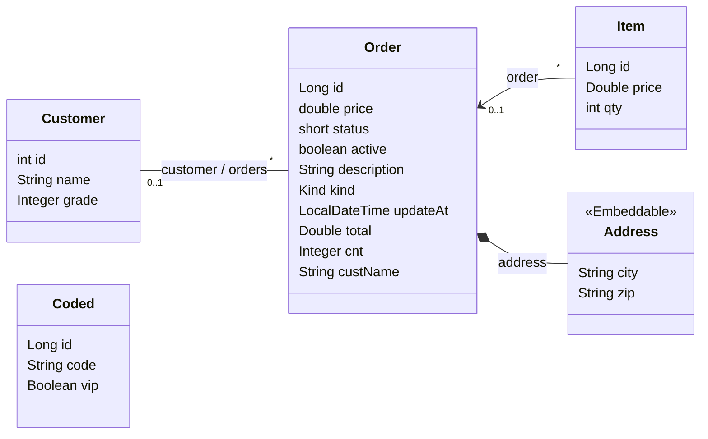

<a id="2-getting-started-kotlin"></a>
# 2. 入门（Kotlin）

[Kotlin 路线](README.md) | [手册首页](../README.md) | 上一章：[1. 概述](../01-overview.md) | 下一章：[3. 条件](03-where.md) | [本页的 Java 版本](../java/02-getting-started.md)

公共页面：[1. 概述](../01-overview.md) · [11. 错误与语言](../11-errors-and-languages.md)

---

<a id="requirements"></a>
## 环境要求

| 项目 | 版本 | 说明 |
|---|---|---|
| Kotlin | 2.x | 设计已用 kotlinc 1.7.22、2.1.10、2.2.21、2.3.0、2.3.21 确认。 |
| JVM | Java 21 及以上 | 构建和运行 lambdaQL 时需要。 |
| `-jvm-target` | 1.8、11、17 或 21 | 四者都以相同方式编译查询 Lambda 表达式。 |
| JPA 实现 | Hibernate ORM 6.6 或 7.4 | lambdaQL 生成 Hibernate HQL。已用 6.6.53（Spring Boot 3.5.16）和 7.4.13（Spring Boot 4.1.2）测试。不支持其他 JPA 实现。请参阅 [13. Spring Boot 3 与 4](../13-spring-boot-versions.md)。 |
| Jakarta Persistence | 3.1 或 3.2 | Hibernate 6.6 使用 3.1，7.4 使用 3.2。 |
| 数据库 | H2 2.3、MariaDB 10.11、MySQL 8.4、PostgreSQL 17、Oracle 23.26 (23ai) | 已在这些版本的数据库上进行测试。其他数据库将陆续追加。 |
| Spring Boot | 3.5 或 4.1 | 可选。已用 Spring Boot 3.5.16 和 4.1.2 测试。 |
| Kotlin 运行时 | – | lambdaQL 不会在依赖中添加 `kotlin-stdlib` 或 `kotlin-reflect`。 |

<a id="build-from-source"></a>
## 从源码构建

```bash
git clone https://github.com/lambdaql/lambdaql.git
cd lambdaql
./gradlew build
```

- Gradle wrapper 版本为 9.9.1。
- 构建需要两个 JDK。如果未安装，Gradle 会自动下载。
  - **JDK 21**：用于编译和默认测试。在 lambdaQL 支持的最低 Java 版本上确认行为。
  - **JDK 25**：用于运行 Gradle（`gradle/gradle-daemon-jvm.properties`），并编译只在 Java 24 及以上使用的代码（`src/main/java24`）。同样的测试会在 Java 25 上再运行一次。这部分代码使用的 JDK 可以像 `-Plql.classfile.jdk=24` 这样换成其他版本（24 及以上）。
- 如果 Gradle 找不到已安装的 JDK，请把 JDK 路径写入 `~/.gradle/gradle.properties` 的 `org.gradle.java.installations.paths`。
- 在 IntelliJ IDEA 中，请把 **Settings > Build Tools > Gradle > Gradle JVM** 设为 JDK 25。

构建的主要模块如下。

| 模块 | 构件 | 说明 |
|---|---|---|
| `query` | `lambdaql` | 查询引擎。Spring Boot 3、4 通用 |
| `spring-data-jpa` | `lambdaql-spring-data-jpa` | Spring Data JPA 集成。Spring Boot 3、4 通用（[12. Spring Data JPA](12-spring-data-jpa.md)） |
| `spring-boot-starter-boot3`、`spring-boot-starter-boot4` | `lambdaql-spring-boot-starter-boot3`、`-boot4` | 按 Spring Boot 版本区分的 starter（[13. Spring Boot 3 与 4](../13-spring-boot-versions.md)） |

运行单元测试：

```bash
./gradlew :query:test
```

本路线示例的源代码位于 `query/src/test/kotlin`，会随上面的任务一起运行。

<a id="use-the-local-build-in-your-project"></a>
### 在项目中使用本地构建

把三个模块的 jar 发布到本地 Maven 仓库：

```bash
./gradlew publishToMavenLocal
```

然后把 `lambdaql` 添加到项目中（Gradle Kotlin DSL）：

```gradle-kts
repositories {
    mavenLocal()
    mavenCentral()
}

dependencies {
    implementation("io.github.lambdaql:lambdaql:0.0.2")
}
```

Maven：

```xml
<dependency>
  <groupId>io.github.lambdaql</groupId>
  <artifactId>lambdaql</artifactId>
  <version>0.0.2</version>
</dependency>
```

使用 Spring Boot 时，请改为添加与 Boot 版本对应的 `lambdaql-spring-boot-starter-boot4`（`-boot3`）；不使用 Spring Boot 而只使用 Spring Data JPA 时，请改为添加 `lambdaql-spring-data-jpa`。这两个构件都会一并引入 `lambdaql`（见 [12.2](12-spring-data-jpa.md#122-modules)）。

<a id="kotlin-compiler-settings"></a>
## Kotlin 编译器设置

| 设置 | 做法 | 原因 |
|---|---|---|
| `-Xsam-conversions` | 保持默认值（`indy`）。**不要**设置 `-Xsam-conversions=class`。 | 设为 `class` 时，Kotlin 会生成类，而不是可序列化的 Lambda 表达式。lambdaQL 无法读取它。 |
| `-java-parameters` | 如果调用存储过程，建议开启。 | 这样 lambdaQL 可以把参数名与数据库进行比对（见 [8.4](08-procedures-functions.md#84-warning-argument-order)）。 |
| JPA 插件 | 使用 `kotlin("plugin.jpa")` 和 all-open（或 `kotlin("plugin.spring")`）。 | JPA 需要无参构造函数和 open 类。这是 Kotlin JPA 实体的常规设置。 |

示例（`build.gradle.kts`）：

```gradle-kts
plugins {
    kotlin("jvm")
    kotlin("plugin.jpa")
    kotlin("plugin.spring")   // 或 all-open 插件
}

kotlin {
    compilerOptions {
        javaParameters = true   // 等同于 -java-parameters
    }
}
```

插件版本请与所用的 Kotlin 版本保持一致。

<a id="example-entities"></a>
## 示例实体

Kotlin 路线的示例使用以下**示例实体**。
示例实体是 Java 类（[`query/src/test/java/org/lambdaql/query/`](https://github.com/lambdaql/lambdaql/tree/main/query/src/test/java/org/lambdaql/query)）。Kotlin 示例使用这些类的方式，与用户项目使用已编译实体的方式相同。

下图展示示例实体及其关联。



| 实体 | 主要属性（Java 类型） | 在 Kotlin 中 |
|---|---|---|
| `Order`（表 `orders`） | `Long id`、`double price`、`short status`、`boolean active`、`String description`、`Integer cnt`、`String custName`、`LocalDateTime updateAt`、`Kind kind`（enum `NORMAL`、`RUSH`）、`Customer customer`（`@ManyToOne`）、`Address address`（`@Embedded`） | `it.price`、`it.status`、`it.isActive`、`it.cnt`、`it.customer?.name` |
| `Customer`（表 `customers`） | `int id`、`String name`、`Integer grade` | `it.name`、`it.grade` |
| `Item`（表 `items`） | `Long id`、`Order order`（`@ManyToOne`）、`Double price`、`int qty` | `it.order?.id`、`it.qty` |
| `Coded`（表 `coded`） | `Long id`、`String code`（`@Convert`）、`Boolean vip`（`YesNoConverter`） | `it.code`、`it.vip` |

在 Kotlin 中使用 Java 实体时需要注意：

- `price`、`status`、`active`、`qty` 是 Java 基本类型。它们不可能为 NULL，在 Kotlin 中分别是 `Double`、`Short`、`Boolean`、`Int`。`boolean active` 的 getter 是 `isActive()`，因此 Kotlin 属性名是 `isActive`。
- `status` 是 `Short`，因此 Kotlin 不会编译 `it.status == 1`。示例写成 `it.status.toInt() == 1`。lambdaQL 忽略这个转换，写成 `e0.status = 1`。
- 引用类型（`String`、`Integer`、`Double`、`LocalDateTime`、关联）在 Kotlin 中是平台类型。编译器不知道它们是否可空，因此可以不加 `!!` 直接比较，也可以使用 `?.` 和 `?:`。
- 如果自己编写 Kotlin 实体，可能为 NULL 的列会是 `Double?` 这样的可空类型。这时要写成 `it.price!! > 100.0`，加上 `!!` 才能编译。lambdaQL 忽略 `!!`（见 [3.3](03-where.md#33-basic-form)）。

实体规则：

| 规则 | 原因 |
|---|---|
| 使用普通的 public `var` 或 `val` 属性。 | lambdaQL 读取 getter（`it.price` 是 getter `getPrice()`），并把它映射到 JPA 属性。 |
| 可能为 NULL 的列使用可空类型（`Double?`、`String?`）。 | Kotlin 的非空类型无法阻止来自数据库的 NULL。Hibernate 不做检查就把列值写入字段。 |
| 不要在查询中使用 `@JvmField`、`internal` 属性、`value class` 属性和 `@get:JvmName`。 | lambdaQL 无法把它们映射到 JPA 属性。 |
| `Boolean`、`Int`、`Long`、`Double`（非可空）是 JVM 基本类型。 | 它们不能保存 NULL。lambdaQL 知道这一点，可以生成更简单的 SQL。 |

<a id="create-a-querybuilder"></a>
## 创建 QueryBuilder

`QueryBuilder` 是入口。它需要 JPA 的 `EntityManagerFactory` 或 `EntityManager`。

<!-- region: ManualKotlinStartTest.kt#create -->
```kotlin
val qb = QueryBuilder(emf)
```

`emf` 是应用程序的 `EntityManagerFactory`。

不要每次查询都创建 `QueryBuilder`，请只创建一个并重复使用。

<a id="with-spring-boot"></a>
### 使用 Spring Boot

使用 `lambdaql-spring-boot-starter-boot4`（`-boot3`）时，Spring Boot 会创建 `QueryBuilder` bean（见 [12.8](12-spring-data-jpa.md#128-the-querybuilder-bean)）。
不使用 starter 时，请像下面这样声明 bean。

<!-- region: ManualKotlinStartTest.kt#spring-config -->
```kotlin
@Configuration(proxyBeanMethods = false)
class LambdaQlConfig {

    @Bean
    fun queryBuilder(entityManagerFactory: EntityManagerFactory) =
        QueryBuilder(SharedEntityManagerCreator.createSharedEntityManager(entityManagerFactory))
}
```

然后把 `QueryBuilder` 注入仓库：

<!-- region: ManualKotlinStartTest.kt#spring-repository -->
```kotlin
@Repository
open class OrderRepository(private val qb: QueryBuilder) {

    @Transactional(readOnly = true)
    open fun activeOrders(): List<Order> =
        qb.from(Order::class.java)
            .where { it.isActive }
            .toList()
}
```

- 共享的 `EntityManager` 与当前事务绑定。在 `@Transactional` 中，lambdaQL 在同一个事务中执行。
- 如果要在 Spring Data 仓库中编写 lambdaQL 查询，请参阅 [12. Spring Data JPA](12-spring-data-jpa.md)。

示例代码：[`ManualKotlinStartTest.kt`](https://github.com/lambdaql/lambdaql/blob/main/query/src/test/kotlin/org/lambdaql/query/ManualKotlinStartTest.kt)（`create`、`spring-config`、`spring-repository`）。

<a id="your-first-query"></a>
## 第一个查询

<!-- region: ManualKotlinStartTest.kt#first-query -->
```kotlin
val q = qb.from(Order::class.java).where { it.status.toInt() == 1 && it.price > 100.0 }
assertEquals("select e0 from Order e0 where e0.status = 1 and e0.price > 100.0", q.toHql().hql())
val orders: List<Order> = q.toList()
```

**各数据库的 SQL**

<!-- sql: to-hql -->
```sql
-- H2, MariaDB, Oracle (same)
select …
from orders o1_0
where o1_0.status=1 and o1_0.price>100.0
```

- `qb.from(Order::class.java)` 开始一个针对 `Order` 的查询。
- `where { ... }` 接收一个条件 Lambda 表达式。请使用尾随 Lambda 表达式和 `it`。
- `toHql()` 不执行查询，而是返回 lambdaQL 生成的 HQL。示例中 `assertEquals` 的字符串就是该 HQL。
- `toList()` 执行查询并返回 `List<Order>`。
- `toList()` 返回所有行。其他结果函数（`first()`、`one()`、`count()`、`exists()`、`toSet()`）见[获取结果](#getting-the-result)。

写成 `it.status.toInt()` 是因为 `status` 是 `Short`（见[示例实体](#example-entities)）。lambdaQL 忽略这个转换。

直接写在 Lambda 表达式中的 `1`、`100.0` 这样的常量会直接写入 HQL。数字、字符串、boolean、`null`、enum 常量、`const val` 都属于这一类。
来自 Lambda 表达式外部的值会成为绑定参数（见下一节和 [3.3](03-where.md#33-basic-form)）。

<a id="use-values-from-outside-the-lambda"></a>
### 使用 Lambda 表达式外部的值

Lambda 表达式可以使用局部值、属性和函数参数。这些称为**捕获的值**。
lambdaQL 把捕获的值转换为绑定参数。每次执行查询时都会读取新值。

<!-- region: ManualKotlinStartTest.kt#captured -->
```kotlin
fun expensive(status: Short, minPrice: Double) =
    qb.from(Order::class.java).where { it.status == status && it.price >= minPrice }

val q = expensive(1, 100.0)
assertEquals("select e0 from Order e0 where e0.status = :p1 and e0.price >= :p2", q.toHql().hql())
```

`status` 和 `minPrice` 是函数参数，因此成为绑定参数 `:p1`、`:p2`。

**各数据库的 SQL**

<!-- sql: start-captured -->
```sql
-- H2, MariaDB, Oracle (same)
select …
from orders o1_0
where o1_0.status=? and o1_0.price>=?
```

<a id="many-where-calls"></a>
### 多次调用 `where`

`where` 可以调用多次。lambdaQL 用 `AND` 组合这些条件。

<!-- region: ManualKotlinStartTest.kt#many-where -->
```kotlin
val q = qb.from(Order::class.java)
    .where { it.isActive }
    .where { it.status.toInt() == 1 || it.status.toInt() == 2 }
assertEquals("select e0 from Order e0 where e0.active = true and (e0.status = 1 or e0.status = 2)", q.toHql().hql())
```

**各数据库的 SQL**

<!-- sql: start-many-where -->
```sql
-- H2, MariaDB, Oracle (same)
select …
from orders o1_0
where o1_0.active=true and (o1_0.status=1 or o1_0.status=2)
```

这在逐步添加条件时很有用。

<!-- region: ManualKotlinStartTest.kt#step-where -->
```kotlin
val minPrice: Double? = 100.0
var query = qb.from(Order::class.java).where { it.isActive }
if (minPrice != null) {
    query = query.where { it.price >= minPrice }
}
assertEquals("select e0 from Order e0 where e0.active = true and e0.price >= :p1", query.toHql().hql())
val orders = query.toList()
```

<a id="paths-to-other-entities"></a>
### 关联实体

`it.customer?.name` 这样的路径指关联实体的列。
在 `where` 中，lambdaQL 会连接客户表。如果条件允许没有客户的订单出现在结果中，就是 `left join`；如果不允许，就是内连接 `join`。判断标准是：没有客户时条件是否可能为真。
下面的条件只在有客户的订单上为真，因此是内连接 `join`，没有客户的订单**不会**出现在结果中。

<!-- region: ManualKotlinStartTest.kt#join-path -->
```kotlin
val name = "Kim"
val q = qb.from(Order::class.java).where { it.customer?.name == name }
assertEquals("select e0 from Order e0 join e0.customer j1 where j1.name = :p1", q.toHql().hql())
```

`name` 是非空的 `String`，因此 lambdaQL 使用简单的 `=`（见 [3.6](03-where.md#36-null-rules)）。

**各数据库的 SQL**

<!-- sql: inner-join -->
```sql
-- H2, MariaDB, Oracle (same)
select …
from orders o1_0
join customers c1_0 on c1_0.id=o1_0.customer_id
where c1_0.name=?
```

其他条件的例子：

- `it.status == 1 || it.customer?.name == name`：没有客户时，只要 `status` 为 1 也会出现在结果中，因此是 `left join`。
- `it.customer?.name == null`：没有客户的订单也会出现在结果中，因此是 `left join`。
- `it.customer!!.name == name`：只有有客户的订单才会出现在结果中，因此是内连接 `join`。

如果只想查找没有客户的订单，请像 `it.customer == null` 这样比较关联本身。这样会成为不带连接的 `e0.customer is null`。
详细规则请参阅 [3.10](03-where.md#310-association-paths)。

示例代码：[`ManualKotlinStartTest.kt`](https://github.com/lambdaql/lambdaql/blob/main/query/src/test/kotlin/org/lambdaql/query/ManualKotlinStartTest.kt)（`first-query`、`captured`、`many-where`、`step-where`、`join-path`）。

<a id="getting-the-result"></a>
## 获取结果

`toList()` 并不是执行查询的唯一方式。lambdaQL 有六个结果函数。

| 函数 | 返回类型 | 可调用的位置 | 作用 |
|---|---|---|---|
| `toList()` | `List<T>` | `where` 之后，以及 `orderBy` / `limit` / `offset` 之后 | 返回所有行（或一页）。 |
| `first()` | `Optional<T>` | `where` 之后，以及 `orderBy` / `limit` / `offset` 之后 | 返回第一行。只读取一行。 |
| `one()` | `Optional<T>` | 仅 `where` 之后 | 返回唯一的一行。匹配两行及以上时抛出 `NonUniqueResultException`。最多读取 2 行。 |
| `count()` | `Long` | 仅 `where` 之后 | 返回匹配条件的行数。 |
| `exists()` | `Boolean` | 仅 `where` 之后 | 有匹配的行时返回 `true`。读取一行，不加载实体。 |
| `toSet()` | `SequencedSet<T>` | `where` 之后，以及 `orderBy` / `limit` / `offset` 之后 | 以保持行顺序的 Set 返回所有行（或一页）。Set 的大小小于行数时抛出 `IllegalStateException`。 |

"`where` 之后"指通过 `qb.from(...)` 和 `where { }` 得到的查询（类型为 `SelectQuery`）。本手册把它称为 **where 阶段**。也可以不写 `where`，直接在 `qb.from(...)` 之后调用这些函数。

`first()` 和 `one()` 返回 Java `Optional`。

<a id="first"></a>
### `first()`

返回第一行。

<!-- region: ManualKotlinStartTest.kt#first -->
```kotlin
val byPrice = qb.from(Order::class.java).orderBy { o -> asc(o.price) }
val cheapest: Order? = byPrice.first().orElse(null)
// first() reads one row like limit(1); paging adds the id as the last sort key
assertEquals("select e0 from Order e0 order by e0.price asc, e0.id asc", byPrice.limit(1).toHql().hql())

// without orderBy there is no order by: "first" is any matching row
val active = qb.from(Order::class.java).where { it.isActive }
val firstActive: Order? = active.first().orElse(null)
assertEquals("select e0 from Order e0 where e0.active = true", active.limit(1).toHql().hql())
```

`first()` 执行与 `limit(1)` 相同的查询。因此示例用 `limit(1)` 的 HQL 来展示 `first()` 的 HQL。

**各数据库的 SQL**

<!-- sql: first#2 -->
```sql
-- H2, Oracle
select …
from orders o1_0
where o1_0.active=true
order by o1_0.id
fetch first ? rows only

-- MariaDB
select …
from orders o1_0
where o1_0.active=true
order by o1_0.id
limit ?
```

`first()` 只读取一行，因此是分页查询。lambdaQL 会把 `id` 添加为最后一个排序键（见 [4.8](04-order-paging.md#tie-breaker-automatic-id)），Hibernate 按数据库写出分页：H2 和 Oracle 上是 `fetch first ? rows only`，MariaDB 上是 `limit ?`。`?` 是 1。
示例实体的 `price` 不可能为 NULL，因此 HQL 中没有 `nulls` 部分。可能为 NULL 的排序键会带上 `nulls first` 或 `nulls last`（见 [4. 排序与分页](04-order-paging.md)）。

<a id="one"></a>
### `one()`

当匹配条件的行最多只有一行时使用 `one()`，例如按唯一键查找时。
没有行时返回 `Optional.empty()`。两行及以上会抛出 `jakarta.persistence.NonUniqueResultException`。如果任意一行匹配的行都可以，请使用 `first()`。

<!-- region: ManualKotlinStartTest.kt#one -->
```kotlin
val id: Long = knownId
val byId = qb.from(Order::class.java).where { it.id == id }
assertEquals("select e0 from Order e0 where e0.id = :p1", byId.toHql().hql())
val order: Order? = byId.one().orElse(null)

// two or more rows: an exception (use first() if any row is fine)
assertThrows<NonUniqueResultException> { qb.from(Order::class.java).where { it.isActive }.one() }
```

**各数据库的 SQL**

<!-- sql: one -->
```sql
-- H2, Oracle
select …
from orders o1_0
where o1_0.id=?
fetch first ? rows only

-- MariaDB
select …
from orders o1_0
where o1_0.id=?
limit ?
```

`one()` 最多向数据库请求 2 行。这足以知道是否存在第二行。因此 SQL 中有 `fetch first ? rows only`（H2、Oracle）或 `limit ?`（MariaDB），`?` 是 2。这里顺序并不重要，所以没有 `order by`。

<a id="count-and-a-paged-screen"></a>
### `count()` 与分页画面

`count()` 返回匹配条件的行数。

<!-- region: ManualKotlinStartTest.kt#count -->
```kotlin
val active = qb.from(Order::class.java).where { it.isActive }
val total: Long = active.count()                       // every matching row
val page = active.orderBy { o -> desc(o.price) }.limit(2)
assertEquals("select e0 from Order e0 where e0.active = true order by e0.price desc, e0.id asc", page.toHql().hql())
val rows: List<Order> = page.toList()
```

示例中的 `active.count()` 执行 HQL `select count(e0) from Order e0 where e0.active = true`。

**各数据库的 SQL**

<!-- sql: count -->
```sql
-- H2, MariaDB, Oracle (same)
select count(o1_0.id)
from orders o1_0
where o1_0.active=true
```

Hibernate 把 `count(e0)` 转换为 `select count(o1_0.id)`，也就是统计 id 列。count 查询没有分页。

对于分页画面，请把 where 阶段的查询保存在一个值中。在这个值上调用 `count()` 得到总数。然后在同一个值上调用 `orderBy { }.limit(...).toList()` 得到这一页。

**指定列。** `count(列)` 返回该列不为 NULL 的行数。在 `distinct()` 之后，返回不同值的个数。

<!-- region: KotlinCountColumnTest.kt#count-column -->
```kotlin
// rows whose description is not NULL
val orders = qb.from(Order::class.java)
val described = orders.count { it.description }
```

<!-- region: KotlinCountColumnTest.kt#count-distinct -->
```kotlin
// the number of different customers that have an order
val orders = qb.from(Order::class.java)
val customers = orders.distinct().count { it.customer?.id }
```

两个示例分别执行 HQL `select count(e0.description) from Order e0` 和 `select count(distinct e0.customer.id) from Order e0`。
列路径的连接与 `select` 相同。

指定实体本身（`count { it }`）时，统计整行。HQL 是 `count(*)`。

<!-- region: KotlinCountColumnTest.kt#count-row -->
```kotlin
// { it } is the whole row: count(*)
val all = qb.from(Order::class.java).count { it }
```

示例代码：[`KotlinCountColumnTest.kt`](https://github.com/lambdaql/lambdaql/blob/main/query/src/test/kotlin/org/lambdaql/query/KotlinCountColumnTest.kt)（`count-column`、`count-distinct`、`count-row`）。

<a id="exists"></a>
### `exists()`

只要有一行匹配，`exists()` 就返回 `true`。它执行 `select 1`，最多只读取一行，不加载实体。

<!-- region: ManualKotlinStartTest.kt#exists -->
```kotlin
val status3 = qb.from(Order::class.java).where { it.status.toInt() == 3 }
assertEquals("select e0 from Order e0 where e0.status = 3", status3.toHql().hql())
val anyStatus3: Boolean = status3.exists()
val anyStatus9: Boolean = qb.from(Order::class.java).where { it.status.toInt() == 9 }.exists()
```

`exists()` 执行的 HQL 是 `select 1 from Order e0 where e0.status = 3`。SQL 的形式在 H2 和 Oracle 上是 `select 1 from orders o1_0 where … fetch first ? rows only`，在 MariaDB 上是 `… limit ?`，`?` 是 1。

<a id="toset"></a>
### `toSet()`

`toSet()` 以与 `toList()` 相同的方式执行查询，并返回 `SequencedSet<T>`。
返回的对象是 `LinkedHashSet`，因此元素保持行的顺序。有 `orderBy { }` 时按排序顺序排列。

<!-- region: ManualKotlinStartTest.kt#to-set -->
```kotlin
val sorted = qb.from(Order::class.java).orderBy { o -> desc(o.price) }
assertEquals("select e0 from Order e0 order by e0.price desc", sorted.toHql().hql())
val byPrice: java.util.SequencedSet<Order> = sorted.toSet()
```

SQL 与 `toList()` 相同。lambdaQL **不会添加** `distinct`。

- 实体行有主键。因此即使只查询一张表，同一行也不会出现两次。
- lambdaQL 只连接 to-one 关联。集合会变成 `exists` 子查询。因此连接不会使行重复。
- 所以 `distinct` 不会改变结果，只会增加开销。（这与数据库的限制无关。Oracle 23.26 也允许对 LOB 列使用 `distinct`。这是实测结果。）

在值查询（`select`）中，`distinct()` 和 `toSet()` 使用 `select distinct`（见 [6.7](06-select-group.md#67-distinct-paging-and-results)）。

**大小检查。** Set 的大小小于行数时，`toSet()` 抛出 `IllegalStateException`。以下情况属于这一类：

- 实体的 `equals` / `hashCode` 把两个不同的行判断为相等
- `@Id` 不唯一（例如映射到视图的实体）

如果没有检查，行会在没有任何提示的情况下丢失。这些情况下请使用 `toList()`。
Kotlin `data class` 只比较主构造函数中的属性。如果 `@Id` 不在主构造函数中，两个不同行的 `equals` 结果可能为 true。

示例实体 `Tag` 的 `equals` 只比较名称。存在两个同名的行时，`toSet()` 会抛出异常。

<!-- region: ManualKotlinStartTest.kt#to-set-check -->
```kotlin
// Tag.equals compares only the name: two different rows would become one element, so toSet() refuses
assertThrows<IllegalStateException> { qb.from(Tag::class.java).toSet() }
val tags: List<Tag> = qb.from(Tag::class.java).toList()   // use toList() instead
assertEquals(2, tags.size)
```

示例代码：[`ManualKotlinStartTest.kt`](https://github.com/lambdaql/lambdaql/blob/main/query/src/test/kotlin/org/lambdaql/query/ManualKotlinStartTest.kt)（`first`、`one`、`count`、`exists`、`to-set`、`to-set-check`）。

<a id="things-to-know"></a>
## 需要知道的事

| 规则 | 示例 |
|---|---|
| 请传入 Lambda 表达式字面量。 | `where { it.isActive }` |
| 不要先把 Lambda 表达式保存到 Kotlin 函数类型中。 | `val f: (Order) -> Boolean = { it.isActive }; where(f)` 会被拒绝。 |
| 不要在 `inline fun` 中创建查询 Lambda 表达式。 | 会被拒绝。请把辅助函数改为非 inline，或由调用方传入 Lambda 表达式。 |
| Lambda 表达式必须是单个表达式（条件、排序、查询列）。 | Lambda 表达式中的循环和局部 `val`/`var` 会被拒绝。 |
| 不要把必须执行的代码放进 Lambda 表达式。lambdaQL 不调用 Lambda 表达式，而是分析字节码 opcode。 | `println(...)` 这样有副作用的调用会被拒绝。 |
| 在 Java 21~23 上运行时，需要与新 JDK 编译的类相匹配的 ASM 版本。 | lambdaQL 在 Java 21~23 上使用 ASM 9.11.1（可读取至 Java 28 的类文件）。在 Java 24 及以上，使用正在运行的 JDK 的 `java.lang.classfile` 读取，因此与 ASM 版本无关。 |

Kotlin 的所有限制见 [9. Kotlin 说明](09-kotlin-notes.md#914-kotlin-limits-kc1-to-kc21)。

<a id="next"></a>
## 下一步

- [3. 条件（`where`）](03-where.md)：所有运算符和 null 规则。
- [4. 排序与分页](04-order-paging.md)

---

[Kotlin 路线](README.md) | 上一章：[1. 概述](../01-overview.md) | 下一章：[3. 条件](03-where.md) | [本页的 Java 版本](../java/02-getting-started.md)
